# 본인 시황판단 로그 — 2026년 10월

> **이 파일 = 2026년 10월분** (월별 분할 — 9월분은 [`본인시황_2026.md`](본인시황_2026.md)). **요인값 변천사는 [`요인값변천사_2026.md`](요인값변천사_2026.md)**, 장전 예측·장후 채점은 [`예측대조_2026.md`](예측대조_2026.md).
> **목적**: 시황 판단을 사후 검증하기 위한 기록. 복기가 *매매 판단*을 검증하는 장치라면, 이 문서는 *시황 판단*을 검증하는 장치다.
> **출처 태그**: `[본인시황 MMDD]` (운영규칙 §4 등재) · 같은 날 국장마감후는 `A`를 붙인다
> 최신 항목이 위로 오게 누적한다. 각 항목의 `검증 대상 명제`는 다음 시황에서 채점한다.

---

## 2026-10-30 (금) — 미장마감후
#시황/미장마감후 #단계/S1 #요인/AI불안 #요인/국채금리 #요인/유가 #일정/무라타 #일정/BOJ

> [!warning] 🟡 단계 **S1 — 대장테마 대장주만 · 보수**(1029A 판정 유지) · 하락장(역배열) — **AI 불안이 이틀째 번졌고(알파벳 −13% → 中 기술주 −4% → 샌디스크 셀온), 미국 물가가 높게 나왔는데도 장기금리가 급락했다**
> 야간선물 **912.45(−22.55, −2.41%)** — HTS [5401] 최근월물 F 202612 · 주간 종가 935.00 · 코스피 환산 약 **5,794** = **10/29 저가 5,818 아래 · 5일선 5,722 위**
> **비중 삼전·하닉 500만 / 그 외 250만 · 당일 청산 · 오버나잇 안 함(금요일)** · 보유 없음

**⚖ 판정 한 줄** : **돈이 AI에서 국채로 도망친 날 — 국장은 5,790대 갭하락 출발 · 발판은 5일선 5,722(클로징 "5일선만 지키면 상승 관성"). 대형 반도체는 숫자보다 환원 메시지(하닉 > 삼전) · 테마는 MLCC(가격 인상 · 무라타 실적)가 가장 신선 · 로봇은 美 232조 역풍. S1 유지 · 쉬는 것도 정답**

**🎯 핵심 요인 3**

| 요인 | 지난밤 값 | 성격 · 의미 | 신호 |
|:---|:---|:---|:---:|
| **국채금리** | 미 10년 **4.938(−11.3bp)** · 2년 4.646(−8.9bp) · 30년 5.318 | **도피형 하락** — 美 9월 PCE 3.6% · 3Q 성장률 3.4%로 **12월 인상 전망이 강해졌는데도** 내렸다 = AI에서 국채로 / 국내는 국고채 11월 5조 추가 축소(우호) | 🟡 |
| **AI 불안감** | **알파벳 −13%**(잉여현금흐름 −90.7억 달러) · 나스닥 −1.38% · 필라 −1.42% · **中 기술주 −4%대** · 샌디스크 호실적에도 시간외 −4% · SOXX 시간외 −3.85% · 나스닥100 선물 −2.35% | 투자비 부담 → 조달(MS 9년 만의 회사채 250억 달러↑) → 불안 — **이틀째 · 미국 → 중국 → 메모리로 번짐** | 🔴 |
| **유가** | WTI **102.86(+0.84%)** · 브렌트 111.69 | 100 위 유지 — 美 – 이란 평화협상 재개 기대로 장중 101달러선까지 밀렸다가 회복 · 물가 · 금리 인상 압력 | 🔴 |

> 🔁 **AI ↔ 국채 순환**(사용자 10/30 가설) — 지금 위치 = **AI 불안 → 국채로 도피(금리↓)** · 다음에 볼 것 : 금리가 안정되면 AI 조달 · 반등이 오나(10/23 → 10/27~28 표본 1회)

**✅ checklist 3** : WTI 102.86(+0.86) 🔴 · 미 10년 4.938(−11.3bp) 🟡(도피형) · 일본 30년 3.896(+2.1bp) 🟡 · 달러/원 1,339.19(−2.50)

### 🧭 장전 시황 7 + 1 (10/30 장전 · §0-5 3-17)

| # | 항목 | 값 | 판정 | 신호 |
|:---:|:---|:---|:---|:---:|
| ① | **지수** | 10/29 **5,937.66(−1.24%)** · 고가 6,100 = **20일선 6,102 거부** · 장중 5,817(−3.24%)에서 **3일선 저가 매수**로 회복 · 5 · 10일선 위(3일째) · 역배열 · 거래대금 코스피 24.91조 · 코스닥 5.82조 / 코스닥 753.23(−2.34%) **10일선 저항에 이틀 밀림** / 오늘 시초 환산 **약 5,794(−2.4%)** | **20일선 거부 다음 날 갭하락 — 발판은 5일선 5,722(시초 대비 −1.2%) · 10일선 5,687** · 코스닥이 더 약하다 | 🔴 |
| ② | 상승 / 하락 종목 수 | 10/29 하락 **69% · 80%** | 전체 약세 이어진 채 출발 | 🔴 |
| ③ | **장세 유형** | 10/29 이브닝 **대장테마 없음** · 광통신 광전자 1일차 · 반도체 칸 없음 / 오늘 재료 : **MLCC 가격 인상(TODAY ISSUE · AI용 품귀 · 무라타 실적)** · 삼성SDI 흑자전환(영업익 4,078억 · ESS 60GWh) · 원전 체코 장관 방한 협의 · **로봇 美 232조 안보위협 판단(악재)** / 애프터 : 대원제약 +24.94%(P-CAB 3상) · 일동제약 +9.79% · 나무가 +4.00% · 광전자 +2.86% | 대장테마 없이 출발 — **새 재료는 MLCC가 가장 신선** · 이차전지 · 제약 개별 · 로봇은 역풍 | 🟡 |
| ④ | **수급 주체** | 10/29 HTS 요약표 : 외인 현물 −3,128억 · 기관 −6,075억 · 비차익 −3,816억 ↔ 연합 : 외인 **+655억**(사흘 연속 매수 우위) · 기관 −4,447억 / 클로징 : 외인 **삼전 매도 · 하닉 4,500억 매수** / 오늘 08:45 ⏳ | 외인은 반도체 안에서 **삼전 → 하닉으로 갈아탔다** · ⚠️ 외인 합계는 출처마다 달라 확정치 확인 필요 | 🟡 |
| ⑤ | 유동성 방향 | 예탁금 90.10조(+1.42조 · 10/27) · 신용 −4,306억 / 정부 **국고채 11월 5조 추가 축소**(반도체 초과세수 · 두 달 10조) | 돈은 들어오고 빚은 줄었다 · 국내 채권 공급도 줄어 금리 우호 | 🟢 |
| ⑥ | **미장 시황** | S&P −0.30% · 나스닥 −1.38% · **필라 11,518.2(−1.42%)** · VIX 17.18 / **알파벳 −13% · 캐터필러 −9%** · 中 기술주 −4%대 · 닛케이 +1.1%(어드밴테스트 전망 상향) / 장 후 : **SOXX −3.85% · SOXL −11.38%** · QQQ −1.31% · 나스닥100 선물 **−2.35%** · S&P 선물 −0.70% / 샌디스크 매출 110.3억 · EPS 49.51 달러(예상 107억 · 46.41) **상회에도 −4%** / **美 9월 PCE 3.6% · 3Q 성장률 3.4%** · 금 −1% / 아마존 · 인텔 ⏳ | **AI · 메모리 "호실적에도 판다" 이틀째** — 삼전(10/29) → 샌디스크 · 미국이 중국 · 메모리까지 끌어내림 | 🔴 |
| ⑦ | **큰 일정** | 아래 📅 — 오늘 **무라타 실적 · BOJ 금융정책회의** · 엑슨모빌 · 셰브런 / 국내 실적 : 기아 · 현대모비스 · 현대글로비스 · LG씨엔에스 · 현대제철 · 현대건설 · 금요일 · 11/3 미국 중간선거(D-4) | 무라타 = MLCC 재료의 시험대 · 금요일 · 주말 리스크 | 🟡 |
| + | **하락의 성격(예상)** | 해외발 갭(美 기술주 정규장 + 장 후 반도체) · **미 10년 −11.3bp(물가 상회에도)** · 국장 고유 악재 아님 · VIX 17(공포 크지 않음) | **AI 불안을 따라 빠지는 갭(도피형)** — 판단 매도가 아니면 장중 되돌림 여지 · 확인은 08:45 외인 · 비차익 | 🟡 |

**📅 이벤트 팔로우업**(일정 파일 `updated_at` 2026-10-29 · 읽은 시각 10/30 05:15)

| 이벤트 | D-day | 지금 | 할 일(저자) | 반응 채점 |
|:---|:---|:---:|:---|:---|
| **아마존 · 인텔 · 샌디스크**(10/29 미국 장 후) | 10/29 | 결과 | 샌디스크 상회 → 시간외 −4% · 아마존 · 인텔 ⏳(장전뉴스 07:40) | **오늘 국장 — 메모리 · 반도체** |
| 알파벳(10/28 장 후) | 10/28 | 결과 | 정규장 **−13%**(FCF 적자) | AI 불안감 🔴 |
| 삼성전자 3Q 컨콜 | 10/29 | D+1 | 환원 구체안 **1월 말 이사회로 연기** · "최대 75조 추가 환원 · 소각"(서울경제 — 확정 아님) | 1029A 명제 3(삼전 > 코스피) |
| **무라타 실적**(일정 파일 · 중) | **10/30** | **오늘** | MLCC 가격 인상 TODAY ISSUE — **이벤트 당일 · 발표 시각 매수 금지** `[A-IMI-진입-05]` | 10/31 |
| **BOJ 금융정책회의** | **10/30** | **오늘** | 일본 금리 · 엔 → 외인 · 일본 30년 | 📮 파일에 없음 |
| 국내 실적(기아 · 현대모비스 등) | 10/30 | 오늘 | 로봇 232조와 겹침(현대모비스) | — |
| 미국 중간선거(일정 파일 · 상) | 11/03 | D-4 | 한국 11/4 08:00경 개표 · 전력기기 · ESS | 11/04 |
| 마벨 – 루멘텀 인수 발표 가능성 | 11월 1주 | 대기 | 광통신(광전자 · 우리로) | 📮 파일에 없음 |
| 엔비디아 AI 데이 서울(일정 파일 · 중) | 11/09~10 | D-10 | 삼성 · SK 총출동 · 매디슨 황 방한 | — |

### 🧭 대응 (10/30 금 — S1)

| 영역 | 대응 | 근거 |
|:---|:---|:---|
| **기본** | **쉬는 것도 정답** + 오늘은 **갭하락 출발** · AI 불안 이틀째 | `[G-IMI-멘탈-10]` · S1 |
| 지수 | 시초 약 **5,794** — 위 **10/29 저가 5,818 → 종가 5,937** / 아래 **5일선 5,722 · 10일선 5,687** · 갭하락 순서 = 거래대금 자리 → 전일 종가 회복 여부 | `차_차트` §4.6 |
| 대형 반도체 | **환원 메시지 차이 — 하닉(분기 자사주 즉시 · 외인 4,500억 매수) > 삼전(1월로 연기)** · AI 불안 이틀째라 시가 · 전일 저가 지지 확인 뒤만 | `[A-주간-판단-04]` |
| 소부장 | 티에프이 10/30 제안서 — **갭하락 시나리오**로 장 직전 칸 채움 · 3일차 RC-31 절반 | 1029A · RC-31 |
| 테마 | **MLCC 관찰 1순위**(가격 인상 · 무라타 실적 당일 — 발표 전후 변동) · 이차전지(삼성SDI) · 제약(대원제약 애프터 +25% 선반영) / **로봇은 232조 역풍 → 안 함** / 광통신은 전날 1위 다음 날 약화 교훈 — 광전자는 1029A 대응대로 지지 확인 뒤만 | 원장 교훈 · RC-25 |
| 장중 | 08:45 외인 · 비차익 → **5일선 지지 + 비차익 매수 전환이면 갭 메우기 시도** / 5일선 이탈이면 오전 쉼 | [[장중시황_체크리스트]] |
| 오버나잇 | 안 함 · 금요일 | 하락장 · RC-03 |

### 📮 일정 관리 방 전달용
> - **BOJ 금융정책회의 10/30** — 파일에 없음
> - **마벨 – 루멘텀 인수 계약 발표 가능성 11월 1주** — 날짜 미정(period_label "11월 1주") · 다이제스트 일정 칸

> [!missing] 못 판정한 것
> - **아마존 · 인텔 실적과 시간외 반응**(검색 · 다이제스트에 없음 — 장전뉴스 07:40 뒤 확인) · 샌디스크 수치는 라이브 블로그 1곳
> - **10/29 외인 현물 합계 출처 불일치**(HTS 요약표 −3,128억 vs 연합 +655억) · 오늘 HTS 시장 요약표 · 08:45 수급

> [!info]- 출처 · 형
> - 사용자 제공 : 해외 · 금리 · ETF 표(10/30 05:15 무렵) · HTS [5401] 야간선물 최근월물
> - 시그널리포트 : **다이제스트 14304** · **클로징 14301**(10/29) · 이브닝 14297(10/29)
> - 웹 : [24/7 Wall St. 샌디스크 라이브](https://247wallst.com/investing/2026/10/29/live-will-sandisks-q1-earnings-disappoint-tonight-after-a-6-intraday-plunge/) · 일정 파일 `지표API/data/calendar/macro_calendar.json`(읽기만)
> - 이력 : 05:17 작성 → 05:27 다이제스트 · 클로징 보강 → **05:44 사용자 지시로 한 장으로 합침**(판정 한 줄 · 핵심 요인 3을 표 위로 · 요인 = 국채금리 · AI 불안감 · 유가)
> - 태그 : `[본인시황 1030]`

---

## 2026-10-29 (목) — 국장마감후
#시황/국장마감후 #단계/S1 #요인/AI #요인/유가 #일정/삼성전자실적 #테마/광통신

> [!warning] 🟡 단계 **S1 — 대장테마 대장주만 · 보수**(10/30 적용) · 하락장(역배열) — **삼성전자가 110조 환원을 내놓고도 −4.13%(자사주 소각 없음) — 지수는 20일선 6,101에서 정확히 막히고 장중 −3.24%까지 밀렸다가 −1.24%**
> KOSPI **5,937.66(−1.24%)** · 시가 6,017.22(+0.08%) → **고가 6,100.11(20일선 6,101.67과 같은 자리)** → 저가 5,817.92(−3.24%) → 아래꼬리 회복 · **음봉** · 5 · 10일선 위(3일째) · 20일선 아래(−2.7%) · 거래대금 코스피 **24.91조**(30조의 83% · 전일 117%) · 코스닥 **5.82조**(7조의 83%)
> **하락비율 69% · 80%** · 외인 현물 **−3,128억**(매도 전환) · 지수선물 +210억 · 기관 **−6,075억**(금융투자 −3,906) · 개인 **+6,746억** · **비차익 −3,816억** · 차익 +667억 → **외인 · 기관이 이틀 산 것을 되판 날** · VKOSPI 51.42(−0.8%)
> 악재 셋 : **삼전 컨콜(소각 없음)** · **체코 원전 시공 협상 결렬**(대우건설 −18.57% · 두산에너빌리티 −7.65%) · 한화솔루션 실적 쇼크(−11.61%) / 밤사이 : FOMC 동결(3.75~4%) · **MS +3.4% · 알파벳 시간외 −10%**(광고 둔화 · 클라우드는 +103%)
> **비중 삼전·하닉 500만 / 그 외 250만 · 당일 청산** · ==10/30 = 아마존 · 인텔 · 샌디스크(오늘 밤 미국 장 후) 반응 · 나스닥100 선물 −1.15%(17:30)==

### 🚦 단계 판정
| S0 조건 | 오늘 | 결과 |
|:---|:---|:---:|
| ① 상승장 아님 | 20일선 6,102 · 60일선 6,523 아래 · 역배열 | ✅ |
| ② 외인 현물 · 지수선물 동시 매도 | 현물 −3,128억 · **선물 +210억 매수** — 동시 매도 아님 | ❌ |
| ③ 코스닥 하락비율 60%↑ | **80%** | ✅ |
| **판정** | **S0 조건 2/3** — 외인 선물 소액 매수(+210억)가 막았다 → **S1** | **S1** |
- **1028A S1 판정 결과** : 다음 날(오늘) −1.24% · −2.34% → **△**(보완안 ① · ②도 S1 — 현물 −1조 미만 · 지수 −3% 미만)
- **바닥 신호 2/4** : §6.3 외인 선물 +210억 · 콜 −6억 · 풋 +10억 ❌ / §6.4 판정 그대로(2/3) / **§2.2 저점 유지 ✅**(5,818 > 10/28 저가 5,746) / **5일선 위 ✅**(3일째)
- 📝 S0 조건 2/3인데 **외인 선물 +210억(아주 작은 매수)**이 S0을 막았다 — 10/12 · 10/13 · 10/14와 같은 모양(RC-45 조건 ② 보완 논의)

### 🧭 장전 시황 7 + 1 (10/30 장전용)

| # | 항목 | 값 | 판정 | 신호 |
|:---:|:---|:---|:---|:---:|
| ① | **지수** | 5,937.66(−1.24%) · **역배열**(5 5,722 > 10 5,687 · 20 6,102 < 60 6,523 < 120 7,128) · **고가 6,100 = 20일선** · 5 · 10일선 위 · 거래대금 코스피 **24.91조**(83%) · 코스닥 **5.82조**(83%) | **20일선 "작은 관문"에서 첫 거부** *(월독프 — 하락추세 20일선 못 뚫으면 나락)* · 다만 아래꼬리로 5,818 → 5,938 회복 · 5일선 발판은 유지 | 🟡 |
| ② | **상승 / 하락 종목 수** | 코스피 270 / 596(**하락 69%**) · 코스닥 335 / 1,325(**80%**) | **전체 약세** — 이틀 골고루 오른 뒤 되돌림 | 🔴 |
| ③ | **장세 유형** | 이브닝 : **삼성 / 반디플**(삼전 −4.13% · 한화비전 실적 +22.14% · 서울반도체 · 서울바이오시스 상) · BIO · 우주 · 개별(신규상장 티앤이코리아 +40.52% · **광통신 광전자 +18.15%** · 품절주 양지사) / **반도체 칸 없음** | **대형 호재 무반응 + 개별 실적 · 신규주 장** — 뚜렷한 대장테마 없음 | 🔴 |
| ④ | **수급 주체** | 외인 현물 **−3,128억** · 선물 +210억 · 콜 −6억 · 풋 +10억 · 달러선물 −12,259억 / 기관 **−6,075억**(금융투자 −3,906 · 투신 −1,474 · 연기금 −1,256) / 개인 **+6,746억** / **차익 +667억 · 비차익 −3,816억** / 코스닥 외인 −1,604억 · 기관 −781억 | **외인 바스켓(비차익) · 기관 동반 매도 → 개인이 받음** — 이틀 산 물량의 일부 차익 | 🔴 |
| ⑤ | **유동성 방향** | 예탁금 **90.10조(+1.42조 · 10/27)** · 신용 29.64조(−4,306억) · 미수 9,438억(−298억) | **돈은 다시 들어왔고 빚은 줄었다**(10/27 값 — 반등 첫날분) | 🟢 |
| ⑥ | **미장 시황** | 10/28 S&P +0.28% · 나스닥 +0.27% · **필라 +1.75%** · 미 10년 4.992(−5.9bp) / 장 후 **알파벳 −10% · MS +3.4%** → **나스닥100 선물 −1.15% · SOXL 시간외 −8.1%**(17:30) / 오늘 밤 아마존 · 인텔 · 샌디스크 | **AI 수익성 의심 재점화 위험** — 클라우드는 둘 다 좋았지만 알파벳 광고 둔화 | 🔴 |
| ⑦ | **큰 일정** | 아래 📅 | **아마존 · 인텔 · 샌디스크 = 오늘 밤** | 🔴 |
| + | **하락의 성격** | 삼전 컨콜(소각 없음) · 체코 원전 결렬 · 한화솔루션 실적 쇼크 = **판단 매도**(이벤트 실망) / 비차익 −3,816억 · 금융투자 −3,906억 = 외인 바스켓 · 프로그램 / 아래꼬리(−3.24% → −1.24%) · 개인 +6,746억이 받음 / VKOSPI 하락 | **실망 매물 + 이틀 급등(+9.9%) 차익** — 공포성 투매는 아니다 *(시_시황 §6.1)* | 🟡 |

- **판정 한 줄** : **삼전이 110조 환원에도 소각이 없어 빠지며 대형 호재 무반응이 다시 나왔고, 지수는 20일선에서 정확히 막혔다 — 이틀 사던 외인 · 기관이 되팔았다. 5일선 발판은 지켰지만 하락비율 80% · 대장테마 없음 · 밤사이 AI(알파벳) 부담 → S1, 쉬는 것도 정답**

**🎯 핵심 요인 3**
| 요인 | 오늘 | 신호 |
|:---|:---|:---:|
| 국채금리 | **FOMC 동결(3.75~4%)** · 미 10년 4.992(−5.9bp) · 2년 4.677 · 국고 3년 3.76%(−3bp) | 🟢 |
| AI 수익성 의심 | MS 애저 +48%(+3.4%) vs **알파벳 광고 둔화 −10%**(클라우드 +103%) · 나스닥100 선물 −1.15% · 국장 삼전 −4.13% | 🔴 |
| 국제유가 | WTI 102.78(+2.88% · 10/28) → 101.51(장중) · 브렌트 110.59 — 100 위로 복귀 | 🔴 |

**📅 이벤트 팔로우업**
| 이벤트 | D-day | 지금 | 할 일(저자) | 반응 채점 |
|:---|:---|:---:|:---|:---|
| **삼성전자 3Q 컨콜** | 10/29 | **당일 → 채점** | 반도체 이익 106조 · OPM 72% · HBM 내년 완판 · **110조 환원(소각 없음)** → **−4.13%(5.69조)** | ✅ **대형 호재 무반응 재확인** `[A-주간-판단-04]` · 셀온 *(IMI 0826)* |
| SK하이닉스 3Q | 10/28 | D+1 | 이브닝에 없음(등락 미확인) | 10/29 ⏳ |
| **FOMC** | 10/28(미국) | 결과 | **동결 3.75~4%** · 워시 "내년 FOMC 7번" | 금리 🟢 |
| **MS · 알파벳** | 10/28 장 후 | 결과 | MS +3.4% · **알파벳 −10%** | **10/30 국장** |
| **아마존 · 인텔 · 샌디스크** | 10/29 미국 장 후 | **오늘 밤** | 샌디스크 = 메모리 · 아마존 = AWS(AI 수익성) | **10/30 국장** |
| 무라타(MLCC) | 10/30 | 내일 | | 10/31 |
| 미국 중간선거 | 11/03 | D-4 | 이란 공습설 — 유가 | 11/04 |

### 🧵 주도 테마 (Signal Evening 14297 · 대장 = RC-25 통합 기준 — 이브닝 괄호 값은 KRX만이라 하한값)
| 순위 | 테마(줄기) | 강약(상한가) | 생애주기 | 일차 | 대형주 수급 · 대장 · 2등 | 재료 한 줄 · 등급 |
|:---:|:---|:---:|:---:|:---|:---|:---|
| **1** | **광통신(마벨 – 루멘텀)** | 0 | ③ 대장 교체 | 10/28 0일차 → **1일차** | **광전자 +18.15%(1,456억)** — 500억↑ · 15%↑ / 2등 없음(RF머트리얼즈 +9.05% · 빛샘전자 +2.56% — 15% 미달) · 10/28 대장 빛과전자 미등장 | 마벨의 루멘텀 인수 막바지(블룸버그 — **아직 합의 전**) → 데이터센터 광학 · 국내는 **간접 연관** → **B+** |
| 2 | 신규상장 | 0 | — | 상장 첫날 | **티앤이코리아 +40.52%(5,391억)** | 블룸에너지 SOFC 공급망 · 내년 영업익 +130% 전망 → 신규주(E8) |
| 3 | 개별 실적 | 0 | — | — | 한화비전 +22.14%(1,104억 · 영업익 +183%) · 메쥬 +12.21% · 쎄트렉아이 | 실적 = 지속성 없음 *(IMI강의 2강)* |
| 4 | 우주 | 0 | ③ | 10/23~ | **대장 없음**(컨텍 +8.79% · 712억 / AP위성 +4.53% — 15% 미달) · 에이치브이엠 189억 계약 | 컨텍 56억 지상국 우협 — 규모 작음 → **B** |
| 5 | BIO / 의료AI | 0 | — | — | 로킷헬스케어 +21.79%(321억 — **통합 확인 필요**) · 한미약품(비만약 처방) · 루닛 +4.10%(648억) | 개별 재료 묶음 → **B** |
| — | 반디플 · LED / 정치 / 로봇 | **4**(서울반도체 46억 · 서울바이오시스 12억 · 상지건설 107억 · 씨티알모빌리티 86억) | — | — | **전부 150억 미만 상한가(KRX 기준) → 잡주 · 통합 확인 필요** / 정치 진양 3형제(오세훈) · 액스비스 +11.67%(728억) | 희토류 없는 LED · 자산 · 아틀라스 2일차 |
| ✕ | **하락** | | | | 대형 : **삼성전자 −4.13%(5.69조)** · 대우건설 −18.57% · 두산에너빌리티 −7.65% · 한화솔루션 −11.61% | 소각 없음 · 체코 원전 결렬 · 실적 쇼크 |

- **테마 서열 한 줄** : **뚜렷한 대장테마 없음** — 상한가 4개는 모두 거래대금 150억 미만(잡주) · 500억↑ · 15%↑ 대장이 있는 테마는 **광통신(광전자)**뿐 / 양지사 +17.52%(537억)는 **품절주 헤지**(삼전 급락 날) — 테마 아님
- **이탈** : **반도체(10/28 1위 → 칸 없음)** — "하락장 전날 1위 테마 다음 날 약화" 6회째 · 보안 · 로봇 삼성 줄기
- **B칸 상태** : 빛과전자 · 지니언스 = **이브닝 미등장**(일봉 확인 필요) · 멜콘 = 미등장 · 루닛 +4.10%(648억 — 관찰 유지) · 컨텍 +8.79%(제외 유지 — 재료 B)

### 🧭 대응 (10/30 금 — S1)
| 영역 | 대응 | 근거 |
|:---|:---|:---|
| **기본** | **쉬는 것도 정답** — 대장테마 없음 · 하락비율 80% · 밤사이 AI(알파벳 · 아마존) 부담 | `[G-IMI-멘탈-10]` · S1 |
| 하려면 | **광통신 대장 광전자만** — 1일차 · 가장 강한 지지구간 지지 확인 뒤 · 재료 B+(인수 "막바지" — 합의 전) · 250만 · 당일 청산 | RC-25 · 03 |
| 대형주 수급 | 삼전 컨콜 실망 다음 날 — 반등이 나와도 **시가 · 오늘 저가 5,818 지지 확인 뒤만** | `[A-주간-판단-04]` |
| 지수 | 위 **20일선 6,102 · 6,000 라운드** / 아래 **오늘 저가 5,818 · 5일선 5,722 · 10일선 5,687** | `차_차트` §2.4 |
| 밤사이 | 아마존 · 샌디스크가 나쁘면 갭하락 → 5일선 시험 / 좋으면 20일선 재도전 | |
| 오버나잇 | 안 함 · 금요일 | 하락장 · RC-03 |

### ✅ 1028A 검증 명제
| # | 명제 | 결과 | 채점 |
|:---:|:---|:---|:---:|
| 1 | 10/29 코스피 종가 6,000 위 | **5,937.66** | ❌ |
| 2 | 외인 현물 순매수 3일째 | **−3,128억** | ❌ |
| 3 | 장중 20일선 6,148 터치 | 고가 6,100.11 — 오늘 20일선은 **6,101.67로 내려와 거의 닿았다**(1.5포인트) · 기준 6,148엔 못 미침 | ❌(△) |
| 4 | 삼성전자 < 코스피(컨콜 당일 무반응) | **−4.13% < −1.24%** | ✅ |
- **원장 10/29 없음** — 1029 미장마감후(아침 시황)가 작성되지 않아 장전 예측 블록이 없다

### 📋 볼 것 (10/30 금)
> [!todo]
> - [ ] **아마존 · 인텔 · 샌디스크** → 나스닥 · 필라 · 야간선물 (알파벳 −10%가 번지는지)
> - [ ] **5일선 5,722 지지 / 20일선 6,102 재도전** — 거부 다음 날
> - [ ] 외인 현물 · 비차익 방향(이틀 매수 → 하루 매도)
> - [ ] 광통신 광전자 1일차 · 대장 이어지나 / 반도체 소부장(엑시콘 · 티에프이 · 한양디지텍) 반응

> [!question] 검증 명제
> | # | 명제 | 기준 | 채점 |
> |:---:|:---|:---|:---:|
> | 1 | 10/30 코스피 종가 **5일선 위** | 종가 ≥ 5일선 | ⬜ |
> | 2 | 코스닥 하락비율 **50% 미만**(되돌림 하루로 끝) — 확신도 하 | 이브닝 표 | ⬜ |
> | 3 | **삼성전자 > 코스피**(실망 다음 날 반등) — 확신도 하 | 등락률 | ⬜ |
> | 4 | 광통신 1일차 이브닝 1~3위 — 확신도 하 | 이브닝 | ⬜ |

> [!missing] 못 판정한 것
> - **SK하이닉스 · 반도체 소부장 등락**(이브닝에 없음) · 상한가 4종목 **통합 거래대금 · 시총** · 빛과전자 · 지니언스 · 멜콘 일봉
> - 1029 미장마감후 · 원장 10/29 미작성

> [!info]- 출처 · 형
> - 사용자 제공 : HTS 코스피 일봉 캡처(10/29) · 시장 요약표(17:28~17:40 · 프로그램 차익 · 비차익 · 선물 · 옵션 · 증시주변 10/27) · 해외 · 금리 · ETF 표
> - 시그널리포트 : **이브닝 14297** · 장전뉴스 14286(MS · 알파벳) · 다이제스트 14284(FOMC 동결)
> - 태그 : `[본인시황 1029A]`

---

## 2026-10-28 (수) — 국장마감후
#시황/국장마감후 #단계/S1 #요인/AI #수급/외인기관동반 #일정/FOMC #일정/하닉실적 #테마/반도체 #테마/보안 #테마/광통신 #테마/로봇

> [!warning] 🟡 단계 **S1 — 대장테마 대장주만 · 보수**(10/29 적용) · 하락장(역배열) — **외인 · 기관이 이틀째 같이 사서 6,000을 되찾았다 · 다만 20일선 아래 · 역배열 · 밤에 FOMC · MS · 알파벳**
> KOSPI **6,012.44(+6.63%)** · 시가 5,763.85(+2.23% — **10/27 고가 5,737 위 갭**) → 저가 5,745.51(갭 안 메움) → 고가 6,032.28(+6.99%) → **고가 근처 장대양봉** · 5 · 10일선 위(2일째) · **20일선 6,148 아래(−2.2%)** · 224일선 6,215 · 60일선 6,518 · 거래대금 코스피 **19.84조**(HTS 전일 대비 121% · 30조의 66%) · 코스닥 **6.67조**(7조의 95%)
> **하락비율 33% · 32% = 골고루** · 외인 현물 **+11,581억**(2일째) · 기관 **+11,893억**(금융투자 +8,962) · 개인 **−23,334억** · **비차익 +7,817억** · 차익 +332억 → ==**지수 상승 수급장 2일째** — 코스피100 +7.54% · 코스피200 +7.41% vs 코스닥 +3.69% = 대형주가 끈 장==
> ⚠️ 외인 **지수선물 −3,683억 매도** · 콜 −24억 · 풋 +28억 · **VKOSPI 51.85(+1.0%) — +6.6% 날에도 공포 지수가 올랐다** · 원/달러 1,339.7(+12.7원 — 원화 약세)
> **비중 삼전·하닉 500만 / 그 외 250만 · 당일 청산** · ==10/29 = FOMC 결과(03시 무렵) · MS · 알파벳(05시~) 뒤 · 삼성전자 3Q 컨콜 · 삼성SDI 3Q 당일==

### 🚦 단계 판정
| S0 조건 | 오늘 | 결과 |
|:---|:---|:---:|
| ① 상승장 아님 | 20일선 6,148 · 60일선 6,518 아래 · 역배열 | ✅ |
| ② 외인 현물 · 지수선물 동시 매도 | 현물 **+11,581억 매수** · 선물 −3,683억 매도 — 동시 매도 아님 | ❌ |
| ③ 코스닥 하락비율 60%↑ | **32%** | ❌ |
| **판정** | S0 조건 1/3 · 60일선 아래라 S2(박스)도 아님 → **S1** | **S1** |
- **1027A S1 판정 결과** : 다음 날(오늘) **+6.63% · +3.69%** → **S1 ✅**(보완안 ①도 S1 — 같은 결과)
- **바닥 신호 2/4** : §6.3 외인 선물 **매도** · 콜 매도 · 풋 매수 ❌(반등 뒤 헤지) / §6.4 판정 그대로(2/3) / **§2.2 저점 유지 ✅**(5,745 > 5,612) / **5일선 위 ✅**(2일째)
- **지수 상승 수급장 2일째**(§0-5 3-16) : 외인 · 기관 2.3조 매수 + 개인 2.3조 매도 · 대형 지수(코스피100 +7.5%)가 코스닥(+3.7%)의 두 배 → *"테마주는 죽고 대형 시총주가 가는 장"* `[A-월독프-판단-02]` 쪽 — 다만 코스닥도 68% 상승이라 테마가 완전히 죽은 날은 아니다
- 📝 **관찰** : S2는 "60일선 위"부터 — 지금 60일선까지 **+8.4%**. 급반등 2일(+3.09% · +6.63%)에도 규칙상 S1이다(RC-45 보완 논의와 함께 볼 것)

### 🧭 장전 시황 7 + 1 (10/29 장전용)

| # | 항목 | 값 | 판정 | 신호 |
|:---:|:---|:---|:---|:---:|
| ① | **지수** | 6,012.44(+6.63%) · **역배열**(5 5,641 < 10 5,648 < 20 6,148 < 60 6,518 < 120 7,134) · 5 · 10일선 위 · **20일선 아래 −2.2%** · 224일선 6,215(−3.3%) · 거래대금 코스피 **19.84조**(30조의 66%) · 코스닥 **6.67조**(7조의 95%) | **하락장 속 반등 2단계 — 6,000 라운드 회복 · 다음 관문 20일선 6,148 → 224일선 6,215** · 갭(5,737~5,745)을 안 메우고 고가 근처 마감 = 강한 양봉 | 🟢 |
| ② | **상승 / 하락 종목 수** | 코스피 상승 582 / 하락 289(**하락 33%**) · 코스닥 1,141 / 527(**32%**) | **골고루 2일째** | 🟢 |
| ③ | **장세 유형** | 코스피100 **+7.54%** · 코스피200 +7.41% · KTOP30 +6.49% vs 코스닥 +3.69% · 코스닥150 +4.25% / 이브닝 : **반도체 1위**(대형 실적 · 주주환원 + 소부장) · 로봇 · 통신장비(광) · 보안(상 2) | **대형주가 끌고 테마도 동반** — 돈은 대형 반도체, 상한가는 보안 · 광통신 | 🟢 |
| ④ | **수급 주체** | 외인 현물 **+11,581억** · 지수선물 **−3,683억** · 콜 −24억 · 풋 +28억 · 달러선물 +19,266억 / 기관 **+11,893억**(금융투자 +8,962 · 투신 +1,895 · 연기금 +832) / 개인 **−23,334억** / **프로그램 차익 +332억 · 비차익 +7,817억** / 코스닥 외인 −1,854억 · 기관 +2,251억 | **외인 바스켓(비차익) + 기관 이틀째** — 단 외인은 **현물 사고 선물 팔았다(헤지)** · 코스닥에선 외인 매도 | 🟢 |
| ⑤ | **유동성 방향** | 예탁금 **88.68조(−1.18조 · 10/26)** · 신용 30.07조(−844억) · 미수 9,737억(+394억) | **10/26 값 — 반등 전이라 다시 감소** · 이틀 늦은 값이라 10/27 · 28 반등분은 아직 안 보인다 | 🟡 |
| ⑥ | **미장 시황** | 오늘 밤 **FOMC 결정 · MS · 알파벳 실적** · 미니 나스닥 +0.42% · 미니 S&P +0.06%(17:32) · 아시아 니케이 +1.08% · 상해 +0.91% | ⏳ 내일 새벽 | ⬜ |
| ⑦ | **큰 일정** | 아래 📅 | **FOMC · MS · 알파벳 = 오늘 밤** · **삼성전자 3Q 컨콜 · 삼성SDI = 내일** | 🔴 |
| + | **반등의 성격** | 외인 · 기관 동반 + 비차익 매수 · 대형주 주도 · 갭 유지 / **VKOSPI 51.85 상승 · 외인 선물 매도 · 원화 약세** | **돈은 들어왔지만 겁은 아직 남았다** — 공포 지수가 같이 오른 반등 | 🟡 |

- **판정 한 줄** : **외인 · 기관이 이틀째 2조 넘게 사서 대형주 중심으로 6,000을 되찾았다 — 그러나 역배열 하락장 · 20일선 아래 · 공포 지수 상승 · 밤에 FOMC와 빅테크 실적이라 S1 그대로, 대장 하나만 짧게**

**🎯 핵심 요인 3**
| 요인 | 오늘 | 신호 |
|:---|:---|:---:|
| 국채금리 | 국고 3년 **3.79%(+4bp)** · 미 10년 4.994(10/27) — **FOMC 결과 대기** | 🟡 |
| AI 수익성 의심 | 필라 +3.60%(10/27) 뒤 국장 대형주 주도 반등 · **오늘 밤 MS · 알파벳이 시험** | 🟡 |
| 국제유가 | WTI **99.90(−1.83%) — 100 아래로** | 🟡 |

**📅 이벤트 팔로우업**
| 이벤트 | D-day | 지금 | 할 일(저자) | 반응 채점 |
|:---|:---|:---:|:---|:---|
| **SK하이닉스 3Q + 주주환원** | 10/28 | **D+1** | **영업익 83.3조(서프라이즈) · 2029년분까지 D램 · HBM 완판 · 100조 주주환원**(배당 14조 + 자사주 20조 중 10조 소각) → 오늘 **+10.89%(5.6조)** | **10/29** : 부합이면 셀온? `[IMI 0826]` · 무반응 = 투심 부재 `[A-주간-판단-04]` |
| 삼성전기 3Q | 10/28 | D+1 | 영업익 6,910억(+165% · 역대 최대) · 데이터센터 MLCC 장기계약 50여 곳 → **+8.74%(1.16조)** | 10/29 |
| **FOMC 결정** | 10/28(미국) · 한국 10/29 03시 무렵 | **오늘 밤** | 금리 · 달러 — 원화 약세 중 | **10/29 국장** |
| **MS · 알파벳 실적** | 10/28 미국 장 후 | **오늘 밤** | AI 설비투자 = **핵심 요인 ② 시험** | **10/29 국장** |
| **삼성전자 3Q 컨콜 · 삼성SDI 3Q** | 10/29 | **내일 당일** | **이벤트 당일 발표 시각 매수 금지** `[A-IMI-진입-05]` · 삼성 대형 호재 무반응 이력 | 10/30 |
| 아마존 · 인텔 · 샌디스크(미국 장 후) | 10/29 | D-1 | 샌디스크 = 메모리 | 10/30 국장 |
| 무라타(MLCC) | 10/30 | D-2 | | 10/31 |
| 미국 중간선거 | 11/03 | D-5 | 이란 공습설 — 유가 | 11/04 |

### 🧵 주도 테마 (Signal Evening 14279)
| 순위 | 테마(줄기) | 강약(상한가) | 생애주기 | 일차 | 대장(판정 근거) · 2등 | 재료 한 줄 · 등급 |
|:---:|:---|:---:|:---:|:---|:---|:---|
| **1** | **반도체 — 대형(실적 · 주주환원)** | 0 — **대형 수급 테마** | ② | 10/27 복귀 → 2일째 | **SK하이닉스 +10.89%(5.61조)** — 재료 주체 · 거래대금 1위(같은 체급) / 2등 삼성전자 +9.01%(4.01조) · SK스퀘어 +11.23%(8,939억) · 삼성물산 · 삼성생명 · SK(지주) | 영업익 83.3조 서프라이즈 · **2029년분까지 D램 · HBM 사실상 완판** · **100조 주주환원(매 분기 자사주)** — 신선 ◎ · 연관 ◎ · 지속 ◎(완판 = 3년 가시성) · 확장 ◎(삼전 · 지주 · 소부장) → **S · 지속** |
| 1-2 | 반도체 — 소부장 · 테스트 · 기판 · MLCC | 0 | ③ 3~5등 탐색 | 2일째(엑시콘 · 티에프이 이틀 연속) | **멜콘 +21.35%(4,169억) = RC-25 대장**(500억↑ · 15%↑ 중 상승률 최고) · **신규주(9월 상장)** / **2등 엑시콘 +15.52%(522억)** · 디아이 +14.55%(777억 — 15% 미달) / 해성디에스 +19.82%(이브닝 215억 — **통합 확인 필요** · 500억↑면 2등) *(🔄 10/29 RC-25 통합 기준 반영)* / MLCC 삼성전기 +8.74%(1.16조 · 실적) · 아모텍 +16.45% | 하닉발 소부장 훈풍 · 멜콘 마이크론 평가 완료(**발주 · 규모 미확인 — "예정"**) · 샘씨엔에스 · ISC · 워트 실적 → **A · 지속**(개별 재료가 섞임) |
| **2** | **보안 — 금융권 해킹** | **2**(지니언스 · 에스피소프트) | ② | 10/27 0일차(샌즈랩) → **1일차** | **지니언스 상(375억)** — 상한가 + 거래대금 / 2등 **안랩 +19.63%(1,295억** · 3Q 영업익 +39%) · 엑스게이트 +12.71%(950억) · 에스피소프트 상(66억) | 빗썸 · 미래에셋운용 · 대신증권까지 — **주요 금융업권 전체로 해킹 확산** · EDR 추가 도입 수혜 — 신선 ○(사고가 매일 새로) · 연관 ◎ · 지속 ○(보안은 반복 부각) · 확장 ○ → **A** |
| **3** | **통신장비 — 광통신** | **1**(빛과전자) | ① 대장 첫 상한가 | **0일차** | **빛과전자 상(1,515억)** — 유일 상한가 / 2등 빛샘전자 +19.10%(928억) · 대한광통신 +9.34%(1,778억 — 거래대금 1위) · RFHIC +9.81%(실적 +38% 상회) | 美 H사 25G 파장 가변 트랜시버 **초도 양산 PO**(규모 비공개) · 대한광통신 북미 AI 데이터센터 인증 — 신선 ○ · 연관 ◎ · 지속 ○(2027 본격) · 확장 △ → **A−** |
| 4 | 로봇 — **삼성 줄기 복귀** · 아틀라스 2일차 | 1(피앤에스로보틱스 — **거래대금 38억 · 잡주 확인 필요**) | ③ 줄기 교대 | 10/23 0일차 추정 → 3일차 | **원익홀딩스 +17.89%(1,814억)** — 상승률 · 거래대금 실질 1위 / 2등 레인보우로보틱스 +15.08%(607억) · 로보티즈 +9.76%(1,198억) / 아틀라스 : 씨티알모빌리티 +13.07%(60억) · 나무가 +7.14%(상 → +7%) · 현대모비스 +5.86% | 이재용 RX 방문(10/27 — **이미 나온 재료**) · CES 2027 공개 **검토** · 매디슨 황 방한(11/9~10) — 신선 △ · 연관 ○ · 지속 ○(일정 남음) · 확장 ○ → **B+** / 아틀라스 1만 대(PO "조만간") 2일차 약화 |

- **개별** : KINX 상 · 가비아(공개매수 — 매매 대상 아님) · HD현대마린엔진 +14.49%(영업익 컨센 +47%) · 에이치브이엠 +9.47%(232억 계약 · 매출 35%) · 리브스메드 +17.65%(수술로봇) · 명신산업(테슬라 로보택시 상표)
- **이탈** : 의료AI · 우주 · 이차전지 · 신규상장 칸(멜콘은 반도체 칸으로 옮김)
- **테마 서열 한 줄** : **돈** = 반도체 대형(하닉 5.6조 · 삼전 4.0조) ≫ 나머지 / **상한가** = 보안 2 > 광통신 1 > 로봇 1(잡주) > 반도체 0 → **대장테마 = 반도체**(재료 S + 가장 큰 돈) · **상한가로 본 강한 테마 = 보안 · 광통신**
- ⚠️ **"관련주 상한가 = 강한 테마"(차읽남)는 대형 테마에 맞지 않는다** — 사용자 10/27 *"대형주는 거래대금이 터져도 상승률이 낮은 경우도 있거든"*과 같은 이유 → 대형 테마는 거래대금 · 같은 체급 상승률로 본다

### 🗂 B. 억봉 대장 대기열
| 종목 | 테마 | 0일차(억봉 · 상한가) | 재료 | 억봉 | 15일선 · 직전 저점 | 상태 |
|:---|:---|:---|:---:|:---|:---|:---|
| **빛과전자** | 광통신 | **10/28 상(1,515억)** | A− | 500억 + 15% ✅ | 일봉 확인 필요 | **대기** — 1일차 갭 순서 · 지지 확인 뒤 |
| **지니언스** | 보안 | **10/28 상(375억)** | A | 150억 + 15% ✅ | 확인 필요 | **대기** — 보안 1일차 대장 |
| 멜콘 | 반도체 소부장(신규주) | 10/27 상 · 10/28 +21.35%(4,169억) | A− | ✅ | 확인 필요 | 대기 — **신규주 3배 탄력 → 비중 축소** `[C-선정-08]` |
| 루닛 | 의료AI | 10/26 상(1,218억) | A | ✅ | 10/28 일봉 확인 필요 | 관찰 — 테마 이틀째 이탈 |
| 컨텍 | 우주 | 10/23 상 | **B** | — | — | **제외**(재료 B — 10/27 복기) |

### 🧭 대응 (10/29 목 — S1)
| 영역 | 대응 | 근거 |
|:---|:---|:---|
| **대장테마** | **반도체** — 재료 S(완판 · 100조 환원) + 돈 최대 | 02 ✅ 10 · RC-45 |
| **대장주** | **멜콘**(반도체 소부장 · +21.35% · 4,169억) — **신규주 → 비중 축소**(상승 · 하락 3배 탄력) · 가장 강한 지지구간 지지 확인 뒤만 · 당일 청산 · 자리는 분봉 확인 필요 *(🔄 10/29 RC-25 통합 기준 반영 — 사용자 "반영해")* | RC-25 · `[C-선정-08]` · S1 |
| **대형주 수급** | **SK하이닉스**(시총 5조↑ — 대장 비교에서 뺌) — 실적 다음 날 · **삼성전자 컨콜 당일** → 시가 · 오늘 종가 · 갭 자리 지지 확인 뒤만 · 비중 500만 · 당일 청산 | RC-25 0 · `[A-IMI-진입-05]` · `차_차트` §4.6 |
| 소부장 2등 | S1이라 2등 이하는 안 함 — 엑시콘 · 해성디에스(통합 확인 필요)는 관찰만 | S1 |
| **B칸** | **빛과전자 · 지니언스** — 1일차, **가장 강한 지지구간에서 지지 확인 뒤만** | 03 B칸 · §0-5 2-1 S1 |
| 밤사이 이벤트 | FOMC · MS · 알파벳이 나쁘면 갭하락 → 갭하락 순서(거래대금 자리 → 오늘 종가 → 오늘 갭 5,737~5,745) | `차_차트` §4.6 |
| 오버나잇 | 안 함 | 하락장 |

### ✅ 1028 미장마감후 확인 · 1027A 검증 명제
| 항목 | 결과 | 채점 |
|:---|:---|:---:|
| 명제 1 — 종가 5일선 위 유지 | **6,012 > 5일선 5,641** | ✅ |
| 명제 2 — 외인 현물 순매수 2일째 | **+11,581억** | ✅ |
| 명제 3 — 하닉 < 코스피(실적 당일 셀온) | **하닉 +10.89% > 코스피 +6.63%** — 완판 · 100조 환원 | ❌ |
| 명제 4 — 로봇 아틀라스 2일차 이브닝 1~3위 | 로봇 칸은 2번째 섹션 · **첫 줄은 삼성 줄기** · 아틀라스는 둘째 줄(나무가 +7%) | △ |
| 미장마감후 "종가 < 시가(차익)" 예측 | **6,012 > 5,764 — 장대양봉** | ❌ |

> [!example] 📊 원장 10/28 → [[예측대조_2026#2026-10-28 (수)]]
> - **A : 6개 ✅4 · ❌2**(A2 종가 < 시가 · A5 하닉 셀온)
> - **B : 반도체 ✅ · 로봇 △ · 이차전지 ❌** · **C : ✅1 · △2 · ❌6** — "약(선반영 · 소진)" 예측이 거의 다 틀렸다

### 📋 볼 것 (10/29 목)
> [!todo]
> - [ ] **FOMC 결과 · MS · 알파벳** — 금리 · AI 설비투자 → 야간선물 · 필라
> - [ ] **20일선 6,148 · 224일선 6,215 시험** / 아래 6,000 · 오늘 갭 5,737~5,745
> - [ ] 외인 현물 3일째인가 · **선물 매도 이어지나** · VKOSPI 내려오나
> - [ ] **삼성전자 3Q 컨콜 당일 반응**(대형 호재 무반응 이력) · 하닉 실적 다음 날
> - [ ] 대형주만 가는 장인가(코스피100 vs 코스닥) — 테마 쪽 대장 자리

> [!question] 검증 명제
> | # | 명제 | 기준 | 채점 |
> |:---:|:---|:---|:---:|
> | 1 | 10/29 코스피 종가 **6,000 위** | 종가 ≥ 6,000 | ⬜ |
> | 2 | 외인 코스피 현물 **순매수 3일째** — 확신도 하 | > 0 | ⬜ |
> | 3 | 코스피 장중 **20일선 6,148 터치** — 확신도 하 | 고가 ≥ 6,148 | ⬜ |
> | 4 | **삼성전자 < 코스피**(컨콜 당일 무반응) — 확신도 하 | 등락률 | ⬜ |

> [!missing] 못 판정한 것
> - 피앤에스로보틱스 · 에스피소프트 시총(상한가지만 거래대금 38억 · 66억 — 1,000억 컷) · B칸 종목 일봉(15일선 · 직전 저점)
> - 증시주변은 10/26 값(이틀 늦음 — 반등분 미반영)

> [!info]- 출처 · 형
> - 사용자 제공 : HTS 코스피 일봉 캡처(10/28 · 이평선 5~224) · 시장 요약표(17:32~17:36 · 종목 수 · 투자자 · 프로그램 차익 · 비차익 · 해외 · 환율 · 증시주변 10/26)
> - 시그널리포트 : **이브닝 14279** · 다이제스트 14274
> - 태그 : `[본인시황 1028A]` · 원장 → [[예측대조_2026#2026-10-28 (수)]]

---

## 2026-10-28 (수) — 미장마감후
*(동기화 충돌 복구 06:22 — 이 블록은 10/28 05:29 DESKTOP-PQ0PPL4가 **1027A(다른 PC 10/27 저녁 작성)를 보기 전에** 쓴 것이다. ①②④⑤ "미수령" 칸의 실제 값은 바로 아래 1027A에 있다)*

#시황/미장마감후 #단계/S1 #요인/AI #일정/하닉실적 #일정/FOMC

> [!warning] 🟡 단계 **S1 — 대장테마 대장주만 · 보수**(10/27 규칙 판정 유지 — 1027A 미작성) · 하락장 — **10/27 +3.09% 반등에 미국 반도체 +3.6%가 이어졌다. 오늘은 하닉 실적 · 주주환원 당일, 밤엔 FOMC · MS · 알파벳**
> 야간선물 **899.60(+17.15, +1.94%)** — HTS [5401] · 주간 종가 882.45 · 코스피 환산 약 **5,748** = 10/27 종가 5,638 위 · **20일선(약 6,2xx) 아래**
> **비중 삼전·하닉 500만 / 그 외 250만 · 당일 청산 · 오버나잇 금지(실적 당일 · FOMC 전)** · 보유 없음

### 🧭 장전 시황 7 + 1 (10/28 장전 · §0-5 3-17)

| # | 항목 | 값 | 판정 | 신호 |
|:---:|:---|:---|:---|:---:|
| ① | **지수** | 10/27 **5,638.34(+3.09%)** · 시가 약 5,659(+3.46% 갭) → 박스 상단에서 막혀 일부 반납(시가 > 종가) · **10일선 돌파**(클로징) · 5일선 위 / **역배열 유지**(20 · 60 · 120일선 아래) · 거래대금 **미수령** | **하락장 속 반등 1일차** — 단기 박스 상단 시험 | 🟡 |
| ② | **상승 / 하락 종목 수** | **미수령**(HTS 시장 요약표) | — | ⬜ |
| ③ | **장세 유형** | 이브닝 1위 **< 반도체 >** — 삼전 +4.23%(2.97조) · 하닉 +5.18%(3.84조) · 소부장 티에프이 +23.90% · 엑시콘 +21.98% · 네오셈 +13.29%(825억) · 기판 심텍 +9.23%(1,215억) · 대덕전자 +6.68%(1,324억) · 코리아써키트 +13.40% / **< 로봇 >** 나무가 · 캠시스 상(아틀라스 공급망) · 액스비스 상 / 신규상장(멜콘 상) / 보안 개별(샌즈랩 +23.87%) | **대형주 + 테마가 같이 오른 날** — 반도체(대형 + 소부장 + 기판)가 1위로 돌아옴 · 로봇은 **대장 교체**(로보티즈 → 아틀라스 공급망 나무가 · 캠시스) | 🟢 |
| ④ | **수급 주체** | **외국인 · 기관 동반 매수**(클로징) · 금액 · 프로그램 **미수령** / 8:45 ⏳ | 동반 매수 = 저자 "최고 매수 신호" 쪽 — 금액 확인 필요 | 🟡 |
| ⑤ | **유동성 방향** | **미수령** — 직전 값 예탁금 88.68조(감소 중) · 신용 30.36조(감소 멈춤) | 돈은 빠지는 중(직전 판정 유지) | 🔴 |
| ⑥ | **미장 시황** | S&P **+0.60%** · 나스닥 **+1.18%** · 다우 보합 / **필라 11,482.5(+3.60%)** · SOXX +3.91% · **SOXL +11.69%** · VIX 17.51(−4.8%) · 야간선물 **+1.94%** / 재료 : **앤트로픽 흑자 전환 공개**(2Q 영업이익 9.7억 달러 · 컴퓨팅 1달러당 매출 2.1달러) · **브로드컴–앤트로픽 630억 달러 계약** · 반도체 바스켓 60개 중 57개 상승 · 메타 최대 950억 달러 증자(엔비디아 30억 참여 = 순환 금융 논란) · 스페이스X GPU 400억 달러 리스 | **AI 수익성 의심이 이틀째 물러남** — 다만 "투자 부담 · 순환 금융" 의심은 남음 → 오늘 밤 MS · 알파벳이 시험 | 🟢 |
| ⑦ | **큰 일정** | 아래 📅 | **오늘 = 하닉 3Q + 주주환원(D-day)** · 오늘 밤 **FOMC 결정 · MS · 알파벳** | 🔴 |
| + | 하락의 성격 | 해당 없음(반등) — **반등의 성격** : 외인 · 기관 동반 매수 + 주주환원 기대("삼전닉스 210조+α" 단독) | **지수 상승 수급장 언급**(§0-5 3-16) — 대형 수급주가 끄는 장이면 테마는 접힐 수 있다 `[A-월독프-판단-02]` | 🟡 |

**🎯 핵심 요인 3**
| 요인 | 지난밤 | 신호 |
|:---|:---|:---:|
| 국채금리 | 미 10년 **4.994**(+1.2bp · 5% 바로 아래) · 2년 4.739(+2.8bp) — FOMC 전날 | 🟡 |
| AI 수익성 의심 | 앤트로픽 흑자 전환 · 브로드컴 630억 계약 → 필라 이틀 +6.5% / 순환 금융(엔비디아 → 메타 증자) 논란 | 🟢 |
| 국제유가 | WTI **100.10** · 브렌트 109.68 — 100 근처 · 미-이란 | 🔴 |

**📅 이벤트 팔로우업**(일정 파일 `updated_at` 2026-10-26 · 읽은 시각 10/28 05:29)
| 이벤트 | D-day | 지금 | 할 일(저자) | 반응 채점 |
|:---|:---|:---:|:---|:---|
| **SK하이닉스 3Q + 주주환원 계획** | 10/28 | **당일** | **이벤트 당일 · 발표 시각 매수 금지 · 미리 익절** `[A-IMI-진입-05]` · 컨센(영업이익 약 80조 · 이익률 80%)을 **압도적으로** 넘어야 산다 `[A-IMI-진입-04]` · 10/27 애프터 +2.46%(삼전닉스 210조+α 단독) = 기대 선반영 | 10/29 : 부합이면 셀온 · 무반응이면 투심 부재 `[A-주간-판단-04]` |
| 삼성전기 3Q | 10/28 | 당일 | MLCC · 기판 — 애프터 +2.08% | 10/29 |
| **FOMC 결정**(미국 10/28 · 한국 10/29 03시 무렵) | 10/28 | **오늘 밤** | **기사로 날짜 확인**(일정 파일엔 없음) · 금리 · 유가 | 10/29 국장 |
| **MS · 알파벳 실적**(미국 장 후) | 10/28 | 오늘 밤 | AI 설비투자 · 클라우드 — 한국 10/29 05시 이후 | 10/29 국장 |
| 삼성전자 3Q 컨콜 · 삼성SDI 3Q | 10/29 | D-1 | 삼성 대형 호재 무반응 이력 | 10/30 |
| 아마존 · 인텔 · 샌디스크(미국 장 후) | 10/29 | D-1 | 샌디스크 = 메모리 | 10/30 국장 |
| 무라타(MLCC) | 10/30 | D-2 | | 10/31 |
| 이재용 RX(로봇) 방문 | **10/27 완료** | D+1 | 로봇 재료 소진 여부 — 오늘 로봇 대장 반응 | **10/28 채점** |
| 미국 중간선거 | 11/03 | D-6 | 이란 공습설 | 11/04 |

- **판정 한 줄** : **미국 반도체가 이틀 연속 오르고 국장도 외인 · 기관이 같이 산 반등 1일차 — 하지만 역배열 하락장이고 오늘은 하닉 실적 당일 · 밤엔 FOMC. 반도체 대형주는 실적 발표 시각 매수 금지, 소부장 · 기판 대장만 짧게**(S1)

### 🔎 10/27 후보 결과 (사용자 업로드 `일봉분봉/*__확인_2026-10-27.xls` · 05:31 확인)
| 종목 | 10/27(정규장) | 우리 선과 비교 |
|:---|:---|:---|
| **로보티즈** | 시가 246,500(= 전일 정규 종가) · **저가 244,000(09:00)** → **고가 254,000(09:12)** · 종가 251,000 · 일봉 보합(1,128억) | 1단계 선대로 움직였다 — 지지 240,000~243,500 바로 위(244,000)에서 받치고 **박스 상단 252,500~256,500에서 막힘**(고가 254,000 · NXT 255,000) / 09:00 저점 → 09:12 고점 = 약 +4.1% 구간 |
| 루닛(의료AI) | 시가 14,490 → 고가 15,800(10:09) → 종가 14,650 · +0.41%(2,132억) | 상한가 다음 날 **2일차 약화** — "하락장 전날 1위 테마 다음 날 약화" 5회째와 같은 모양 |
| 컨텍(우주) | 2연상 뒤 −2.75% · 장중 고가 11,660(12:00) → 저가 9,790(14:42) | **3연상 실패** |

### 🧭 대응 (10/28 국장 — S1)

| 영역 | 대응 | 근거 |
|:---|:---|:---|
| **대장테마** | **반도체**(10/27 이브닝 1위 · 오늘 실적 · 中 빅테크 D램 장기계약 요청 TODAY ISSUE) | 이브닝 1위 |
| 대장주 | **하닉 = 실적 당일이라 진입 금지**(저자) → 실행 대상은 **소부장 · 기판 대장** : 거래대금 기준 **대덕전자(1,324억) · 심텍(1,215억)** / 상승률 기준 **티에프이(+23.90%)** — RC-25(상승률) vs 저자(거래대금) ⚠️ 상충 → 저자 우선 = **거래대금 대장** | `[A-IMI-진입-05]` · `[C-IMI-선정-06]` |
| 진입 조건(S1) | 대장 **시가 지지 → 전일 종가 → 거래대금 많은 자리** · 가장 강한 지지구간에서 지지 확인 뒤만 | `차_차트` §4.6 |
| 로봇 | **대장 교체** — 10/27 이브닝 로봇 칸 : 나무가 · 캠시스 상(아틀라스 공급망) · 액스비스 상 / **로보티즈 미등장** → 로보티즈 계획은 보류 · 애프터 씨티알모빌리티 +22%(아틀라스 1만 대 부품 발주) | 하락장 대장 하루 만에 교체(10/26 인계 C) |
| 지수 | 시초 약 **5,748** — 위 **10/27 고가 · 박스 상단 → 20일선** / 아래 **10/27 종가 5,638 · 시가 5,659 · 5일선** | |
| 장중 | 오후엔 **하닉 실적 발표 시각** 전후 변동 · 밤 FOMC → **장 마감 전 정리** | [[장중시황_체크리스트]] ⑤ |

### ✅ 10/27 원장 부분 채점 (HTS 자료 미수령 — 나머지는 1027A에서)
- A1 시초 +2.5%(5,550~5,660) → 실제 약 5,659(+3.46%) **✅(범위 끝)** · A2 종가 < 시가 → 5,638 < 약 5,659 **✅** · A3 종가 5일선 위 **✅** · A4 외국인 순매도 → 동반 매수(클로징) **❌** · A6 하닉 > 코스피 → +5.18% > +3.09% **✅** · A5 · A7 **⏳**
- B1 로봇 → 이브닝 3위 칸(대장 교체) **△** · B2 반도체 → **1위 ✅** · B3 의료AI → 미등장 **❌**(하락장 전날 1위 테마 약화 — 5회째)

### 📮 일정 관리 방 전달용
> - **FOMC 결정 10/28(미국) · 한국 10/29 03시 무렵** — 파일에 없음(기사 확인 : "tomorrow's Federal Reserve policy announcement", 10/27 미국 장)
> - 이재용 RX 방문 = **10/27 완료**(날짜 미정 → 지난 일정으로)

> [!missing] 못 판정한 것
> - **10/27 HTS 시장 요약표**(종목 수 · 투자자 금액 · 프로그램 · 증시주변 · 거래대금) — 1027A 국장마감후 미작성
> - 장전뉴스 10/28(07:40 이후) · 로보티즈 10/27 등락률

---

## 2026-10-27 (화) — 국장마감후
#시황/국장마감후 #단계/S1 #요인/AI #수급/외인기관동반 #테마/반도체 #테마/로봇

> [!warning] 🟡 단계 **S1 — 대장테마 대장주만 · 보수**(10/28 적용) · 하락장(역배열) — **외인 · 기관이 같이 사서 5일선 위로 올라섰다 · 다만 갭상승 음봉 · 10일선 아래**
> KOSPI **5,638.34(+3.09%)** · 시가 5,658.65(+3.46%) → 고가 5,737.61(+4.90%) → 종가 = **갭상승 음봉**(시가 아래 마감) · **5일선 5,585 위 종가(첫 발판)** · 10일선 5,648 바로 아래 · 거래대금 **15.29조**(전일 118%)
> **하락비율 32% · 33% = 골고루 반등** · 외인 현물 **+8,324억(매수 전환)** · 기관 +4,553억 · 개인 −1.44조 · **비차익 +8,051억** → ==**지수 상승 수급장**(외인 · 기관 주도) — 월독프 "테마주가 죽는 장" 경계 · 단 오늘은 테마도 같이 갔다==
> 돈이 간 곳 : **반도체**(하닉 +5.18% · 삼전 +4.23% · 테스트 소켓 · 기판 — SoCAMM) · **신규상장**(멜콘 상 · 엠에스바이오 2,968억) · **로봇 — 아틀라스 줄기**(나무가 · 캠시스 · 액스비스 상) · 보안(샌즈랩 +23.87%) / **의료AI 이탈**
> **비중 삼전·하닉 500만 / 그 외 250만 · 당일 청산** · ==10/28 = 하닉 3Q + 주주환원 발표 당일 · 미국 장 후 알파벳 · MS==

### 🚦 단계 판정
| S0 조건 | 오늘 | 결과 |
|:---|:---|:---:|
| ① 상승장 아님 | 60일선 6,512 아래(−13.4%) · 역배열 | ✅ |
| ② 외인 현물 · 지수선물 동시 매도 | 현물 **+8,324억** · 선물 **+1,489억** — 둘 다 매수 | ❌ |
| ③ 코스닥 하락비율 60%↑ | **33%** | ❌ |
| **판정** | S0 조건 1/3 · 60일선 아래라 S2(박스)도 아님 → **S1** | **S1** |
- **1026A S1 판정 결과** : 다음 날(오늘) **+3.09% · +2.29%** → **S1 ✅**(보완안 ①도 S1이라 같은 결과)
- **바닥 신호 3/4** : §6.3 외인 **현물 매수 전환** · 선물 매수 · **콜 +141억 매수** ✅ / 풋 +133억(매수 쪽 — 매도 전환은 아님) / §6.4 2/3 / **§2.2 저점 유지 ✅**(5,612 > 5,455) / **5일선 회복 ✅**(첫 종가)
- **지수 상승 수급장 언급**(§0-5 3-16) : 외인 · 기관 매수 + 개인 매도 = *"테마주는 죽고 대형 시총주가 가는 장"* `[A-월독프-판단-02]` / *"외국인 + 기관 동시 매수 구간 = 최고 매수 신호"* *(IMI 0626)* — **오늘은 하락비율 32%로 골고루라 테마도 살았다** → 내일도 외인 · 기관 주도면 테마보다 대형 · 소부장 쪽 무게

### 🧭 장전 시황 7 + 1 (10/28 장전용)

| # | 항목 | 값 | 판정 | 신호 |
|:---:|:---|:---|:---|:---:|
| ① | **지수** | 5,638.34(+3.09%) · **역배열**(60 · 120일 > 20일) · **5일선 5,585 위 종가(+0.94%)** · 10일선 5,648 아래(−0.17%) · 거래대금 **15.29조**(30조의 51% · 전일 118%) | **하락장 속 반등 1단계 — "발판"(5일선)을 처음 디뎠다** · 다음 관문 10일선 → 20일선 6,192 · **갭상승 음봉**(시가 5,658 아래 마감 · 고가 5,737에서 −1.7% 밀림) | 🟡 |
| ② | **상승 / 하락 종목 수** | 코스피 상승 595 / 하락 275(**하락 32%**) · 코스닥 1,089 / 544(**33%**) | **골고루**(지수+ · 상승 다수) — 10/26 89%에서 반전 | 🟢 |
| ③ | **장세 유형** | 이브닝 : **반도체 1위**(대형 + 테스트 소켓 · 기판 — 상한가는 없음, +17~24% 다수) · 신규상장(멜콘 상) · **로봇 — 아틀라스 줄기 상한가 3**(나무가 · 캠시스 · 액스비스) · 보안 | **대형주 + 테마 동반 장** — 강한 테마 = 로봇(아틀라스 · 상한가 3) · 반도체는 대형 수급 | 🟢 |
| ④ | **수급 주체** | 외인 현물 **+8,324억** · 지수선물 +1,489억 · 콜 +141억 / 기관 **+4,553억**(금융투자 +2,096 · 투신 +1,828 · 연기금 −1,265) / 개인 **−14,369억** / **프로그램 차익 −1,059억 · 비차익 +8,051억** | **외인 바스켓(비차익) 매수 + 기관 = 지수 상승 수급장** — 10/26(비차익 −8,093억)과 정반대 · 개인은 팔았다 | 🟢 |
| ⑤ | **유동성 방향** | 예탁금 **89.86조(+1.18조 — 10/23 · 열흘 만의 첫 증가)** · 신용 30.15조(−2,111억) · 미수 9,343억(−1,131억) · 거래대금 증가 | **돈이 들어오기 시작(1일) · 빚 정리 계속** — 이틀 늦은 값이라 10/27 반등분은 아직 안 보인다 | 🟡 |
| ⑥ | **미장 시황** | 오늘 밤 미국 장 — **알파벳 · MS 실적(10/28 장 후)** 하루 전 · 미 선물(17:16) −0.06% · −0.19% | ⏳ 내일 새벽 | ⬜ |
| ⑦ | **큰 일정** | 아래 📅 | **하닉 3Q + 주주환원 = 내일(D-day)** | 🟡 |
| + | **바닥 신호** | 위 🚦 | **3/4** — 공포 끝(현물 매수 전환 · 콜 매수) · 저점 유지 · 5일선 회복 | 🟢 |

- **판정 한 줄** : **외인 · 기관이 같이 사고 종목도 골고루 올라 5일선을 처음 넘었다 — 바닥 신호 3/4. 그러나 역배열 하락장 · 갭상승 음봉 · 10일선 아래 · 하닉 실적 당일이라 S1 그대로, 대장 하나만 짧게**

**📅 이벤트 팔로우업**
| 이벤트 | D-day | 지금 | 할 일(저자) | 반응 채점 |
|:---|:---|:---:|:---|:---|
| **SK하이닉스 3Q + 주주환원**(최대 60조) | **10/28** | **당일** | **이벤트 앞 전량 익절 · 오버나잇 금지** `[F-IMI-청산-01]` · 오늘 +5.18%로 기대 선반영 | **10/29** : 컨센 부합 = 셀온? `[IMI 0826]` · 무반응 = 투심 부재 `[A-주간-판단-04]` |
| 삼성전기 3Q | 10/28 | 당일 | MLCC · 기판(오늘 기판주 강세) | 10/29 |
| **알파벳 · MS 실적**(미국 장 후) | 10/28 | D-1 | AI 설비투자 — **핵심 요인 ② AI 수익성의 진짜 시험** | 10/29 국장 |
| 삼성전자 3Q 컨콜 · 삼성SDI 3Q | 10/29 | D-2 | 삼성 대형 호재 무반응 이력 | 10/30 |
| 아마존 · 인텔 · 샌디스크(미국 장 후) | 10/29 | D-2 | 샌디스크 = 메모리 | 10/30 국장 |
| 무라타(MLCC) | 10/30 | D-3 | | 10/31 |
| 이재용 RX(로봇) 방문 | 이번 주 | — | 로봇 재료 | 방문 다음 날 |
| 미국 중간선거 | 11/03 | D-7 | 이란 공습설 "중간선거 뒤" — 유가 | |
| FOMC | 날짜 미확인 | — | 📮 | |

### 🧵 주도 테마 (Signal Evening 14268)
| 순위 | 테마(줄기) | 대장 · 2등(재료) | 비고 |
|:---:|:---|:---|:---|
| 1 | **반도체** | 대형 **SK하이닉스 +5.18%**(3.84조) · 삼성전자 +4.23%(2.97조) / **테스트 소켓 · 후공정 : 티에프이 +23.90% · 엑시콘 +21.98%** · 마이크로컨텍솔 · 한양디지텍 · 오킨스전자 / **기판 : 코리아써키트 +13.40% · 심텍 +9.23%(1,215억)** · 대덕전자(1,324억) · 티엘비 / 태성(SoCAMM 장비) | 앤트로픽 · 미국 반도체 +2.8% · **SoCAMM**(저전력 D램 모듈) — 10/25에 고른 기판 대장 코리아써키트 ✅ |
| 2 | **신규상장** | **멜콘 상**(앤트로픽 투심) · 글로벌테크놀로지 +26.76% · **엠에스바이오 +8.91%(2,968억)** · 엘리스(3,753억) · 브릴스 | 이틀 연속 신규주 칸 — E8 *"하락장 · 강한 테마 없으면 신규주 쏠림"* |
| 3 | **로봇 — 현대차 아틀라스 줄기** | **나무가 상 · 캠시스 상 · 액스비스 상** · 엠씨넥스 +22.22% · 우림피티에스 +16.99% · 아이엘 · 비에이치 · 현대모비스 +1.99% | **"아틀라스 내년 1만 대 · 팀코리아"** — 로보티즈(10/26 대장)는 **미등장 → 대장 교체** · 같은 로봇이라도 **삼성 줄기 → 현대차 줄기**로 이동 |
| — | 보안 | 샌즈랩 +23.87% · 안랩 +15.59% | KB국민은행 유출 2,210명 |
| — | 개별 | 보원케미칼(로지텍 필름) · 에코앤드림(172억 전구체) | |
| ✕ | 이탈 | **의료AI(루닛 · 뷰노 — 1일차)** · 우주 컨텍 | 전날 0일차 테마 다음 날 이탈 |

### ✅ 1027 미장마감후 확인 · 원장
| 항목 | 결과 | 채점 |
|:---|:---|:---:|
| 5일선 세 번째 시험 | **종가 5,638 > 5일선 5,585 — 처음 통과** | ✅ |
| 외인 현물이 돌아섰나 | **+8,324억 매수 전환** | ✅ |
| 상승 종목 수가 따라오나 | 하락 32% — 골고루 | ✅ |
| 대장테마 로봇 → 로보티즈 | 로봇 칸 3위 · **로보티즈 미등장 → 아틀라스 줄기로 대장 교체** | △ |

> [!example] 📊 원장 10/27 → [[예측대조_2026#2026-10-27 (화)]]
> - **A : 6/7** — 중 2/2 · 하 4/5(외인 순매도 ❌)
> - **B : 1위 로봇 ✅(3위 칸 · 대장 교체) · 2위 반도체 ✅(1위 칸) · 3위 의료AI ❌(이탈)**
> - **C : △3 · ❌1 · ❓8** — 보안(약 → 강) ❌ · 반도체 · 아틀라스 · 하닉 △

### 📋 볼 것 (10/28 수)
> [!todo]
> - [ ] **하닉 3Q + 주주환원 발표 반응** — 장중 셀온인가 · 대형 호재 무반응인가
> - [ ] 오늘 밤 미국(필라 · 앤트로픽 이어지나) · 알파벳 · MS는 10/29 새벽
> - [ ] **10일선 5,648 돌파 / 5일선 5,585 지지** — 갭상승 음봉 다음 날
> - [ ] 외인 현물 매수 2일째인가 · 비차익 방향
> - [ ] 로봇 아틀라스 줄기 2일차(나무가 · 액스비스) · 반도체 소부장(티에프이 · 엑시콘)

> [!question] 검증 명제
> | # | 명제 | 기준 | 채점 |
> |:---:|:---|:---|:---:|
> | 1 | 10/28 코스피 종가 **5일선 위 유지** | 종가 ≥ 5일선 | ⬜ |
> | 2 | 외인 코스피 현물 **순매수 2일째** — 확신도 하 | > 0 | ⬜ |
> | 3 | **SK하이닉스 < 코스피**(실적 당일 셀온) — 확신도 하 | 등락률 | ⬜ |
> | 4 | 로봇(아틀라스 줄기) 2일차 이브닝 1~3위 | 이브닝 | ⬜ |

> [!missing] 못 판정한 것
> - 로보티즈 10/27 등락(S1 대장 결과) · 클로징 10/27 원본 없음
> - 증시주변은 10/23 값(오늘 반등분 미반영)

> [!info]- 출처 · 형
> - 사용자 제공 : HTS 코스피 일봉 · 시장 요약표(17:16~17:21 · 프로그램 차익 · 비차익 포함 · 증시주변 10/23)
> - 시그널리포트 : **이브닝 14268** · 다이제스트 14258 · 클로징 14256(10/26)
> - 태그 : `[본인시황 1027A]` · 원장 → [[예측대조_2026#2026-10-27 (화)]]

---

## 2026-10-27 (화) — 미장마감후
#시황/미장마감후 #단계/S1 #요인/AI #요인/유가 #일정/하닉실적

> [!warning] 🟡 단계 **S1 — 대장테마 대장주만 · 보수**(1026A) · 하락장 — **앤트로픽 상장 신고로 미국 반도체 +2.8% · 야간선물 +2.54% = 반등 시도일, 그러나 하닉 실적 D-1**
> 야간선물 **871.55(+21.55, +2.54%)** — HTS [5401] · 주간 종가 850.00 · 코스피 환산 약 **5,608** = **5일선(약 5,568) 위 출발** · 세 번째 5일선 시험
> **비중 삼전·하닉 500만 / 그 외 250만 · 당일 청산 · 오버나잇 금지(하닉 실적 D-1)** · 보유 없음 · 대장테마 **로봇 → 로보티즈** / 의료AI 1일차(루닛)

### 🧭 장전 시황 7 + 1 (10/27 장전 · §0-5 3-17)

| # | 항목 | 값 | 판정 | 신호 |
|:---:|:---|:---|:---|:---:|
| ① | **지수** | 5,469.47(−1.46%) · **역배열**(60일 6,518 · 120일 7,147 > 20일 6,264) · 5일선 약 5,568 · 거래대금 12.01조(30조의 40%) *(1026A)* | **하락장** — 오늘은 5일선 위에서 시작할 듯(야간선물 환산 5,608) | 🔴 |
| ② | **상승 / 하락 종목 수** | 코스피 하락 89% · 코스닥 78% *(1026A)* | **전체 약세** — 오늘 반등이면 상승 종목 수가 따라오는지가 첫 확인 | 🔴 |
| ③ | **장세 유형** | 로봇(로보티즈 · 한국피아이엠) · **의료AI 0일차(루닛 · 뷰노 상)** · 신규상장 / 반도체 칸 없음 *(1026A)* | **개별 · 신규주 장세** | 🟡 |
| ④ | **수급 주체** | 외인 현물 −7,562억 · 지수선물 +7,409억 · 금융투자 +6,015억 · **비차익 −8,093억** *(1026A)* / 8:45 ⏳ | **외인 바스켓 매도를 금융투자가 받음** — 오늘 8:45 외인 선물 · 비차익 방향 | 🔴 |
| ⑤ | **유동성 방향** | 예탁금 88.68조(10/12 대비 −11.8조) · 신용 30.36조(감소 멈춤) *(1026A)* | **돈은 빠지는 중** | 🔴 |
| ⑥ | **미장 시황** | S&P **+0.69%** · 나스닥 **+0.83%** · 다우 +0.28% · **러셀2000(IWM) +0.45%** / **필라 11,083.5(+2.82%)** · SOXX +2.94% · **SOXL +8.31%** · EWY +0.97% · VIX 18.39(−5.45%) / **강세 ETF** : 반도체 SOXX +2.94% · **방산 ITA +2.44%** · 산업재 XLI +1.42% · **우주 UFO +1.40%** · 리튬 LIT +0.97% · 우라늄 URA +0.73% · 바이오 XBI +0.62% / **약세** : 해운 BDRY −2.30% · 양자(RGTX) −1.53% · 금속 XME −0.37% · 헬스 XLV 0% / 야간선물 **+2.54%** | **AI 수익성 의심이 한 발 물러난 날** — **앤트로픽 SEC 상장 신고(티커 ANT · 상반기 매출 162.9억 달러, +1,304%)**로 AI 트레이드 재점화 · 엔비디아 +2.4% · 마이크론 +3% · 브로드컴 +2.3% · AMD +2.8%(기사) / 4개 선물 모두 + · 러셀도 + = 고른 반등 | 🟢 |
| ⑦ | **큰 일정** | 아래 📅 | **하닉 3Q + 주주환원 계획 D-1** · 알파벳 · MS D-1(장 후) | 🟡 |
| + | 하락의 성격 | 오늘은 반등 시도일 — 1026A 판정(판단 매도 · 공포 끝 절반 · 급반등 2/3) 유지 | 반등이 **외인 현물**로 오면 "지수 상승 수급장" 언급(§0-5 3-16) | ⬜ |

**🎯 핵심 요인 3**(사용자 지정 10/25)
| 요인 | 지난밤 | 신호 |
|:---|:---|:---:|
| **국채금리** | 미 10년 **4.986**(보합 · 5% 아래 유지) · 2년 4.716(+3.4bp) · 30년 5.299 · 일본 10년 2.805 · 30년 3.821 | 🟢 |
| **AI 수익성 의심** | **앤트로픽 S-1 공개 — 상반기 매출 +1,304%** → 필라 +2.82% / 다만 이번 주 **알파벳 · MS(10/28 장 후) · 아마존 · 인텔(10/29 장 후)** 실적이 진짜 시험 · 메타 때처럼 "잘 벌어도 현금 태운다"고 파는 장(클로징 10/26) | 🟡 |
| **국제유가** | WTI **101.48** · 브렌트 **110.34** · 두바이 111.68 — 100 위 · 이란 공습설(중간선거 뒤) | 🔴 |

**📅 이벤트 팔로우업**(일정 파일 `updated_at` 2026-10-26 · 읽은 시각 10/27 05:23)
| 이벤트 | D-day | 지금 | 할 일(저자) | 반응 채점(D+1) |
|:---|:---|:---:|:---|:---|
| **SK하이닉스 3Q 실적 + 주주환원 계획**(이사회 결의 뒤 당일 공개) | 10/28 | **D-1** | **오늘 현금 확대 · 오버나잇 금지** `[F-IMI-리스크-20]` · 10/26 "특별배당 정해진 것 없다" → 장 후반 상승분 반납 · 영업이익률 80% 컨센 | 10/29 : 컨센 부합이면 셀온 *(IMI 0826)* · 무반응이면 투심 부재 `[A-주간-판단-04]` |
| 삼성전기 3Q | 10/28 | D-1 | MLCC · 기판 | 10/29 |
| **알파벳 · MS 실적**(미국 장 후) | 10/28 | D-1 | AI 설비투자 · 클라우드 — 한국 10/29 05시 이후 | 10/29 국장 |
| 삼성전자 3Q 컨콜 · 삼성SDI 3Q | 10/29 | D-2 | 삼성은 대형 호재 무반응 이력 | 10/30 |
| 아마존 · 인텔 · 샌디스크(미국 장 후) | 10/29 | D-2 | 샌디스크 = 메모리 | 10/30 국장 |
| 무라타(MLCC) | 10/30 | D-3 | 삼성전기 · MLCC 소형주 | 10/31 |
| **이재용 회장 RX(로봇) 방문** | 10월 4주(날짜 미정) | 이번 주 | **로봇 대장테마 재료** | 방문 다음 날 |
| 미국 중간선거 | 11/03 | D-7 | 이란 공습설이 "중간선거 뒤" — 유가 | 11/04 |
| **FOMC** | **날짜 미확인** | — | 일정 파일 · 다이제스트에 없음 → 📮 | — |

- **판정 한 줄** : **미국은 앤트로픽 덕에 AI 의심이 한 발 물러나 반도체가 +2.8%, 야간선물도 +2.5% — 5일선 위에서 시작하는 반등 시도일이지만, 역배열 하락장 · 돈 빠짐 · 하닉 실적 D-1이라 짧게. 대장테마 로봇 대장주만**(S1)

### 🧭 대응 (10/27 국장 — S1)

| 영역 | 대응 | 근거 |
|:---|:---|:---|
| **대장테마 · 대장주** | **로봇 → 로보티즈**(10/26 +9.56% · 1,224억) — 재료 갱신 : **삼성 휴머노이드 열 손가락(TODAY ISSUE)** · **현대차 아틀라스 공급망 확정**(애프터 캠시스 +21.73% · 나무가 +18.10% · 엠씨넥스) · **이재용 RX 방문 이번 주** · 테슬라 옵티머스 생산 개시 · 미국 BOTZ +0.36% | 1026A 🧵 1위 · RC-25 |
| 진입 조건(S1) | 대장 **시가 지지 → 전일 종가 → 거래대금 많은 자리** · 가장 강한 지지구간에서 지지 확인 뒤만 | `차_차트` §4.6 · RC-45 |
| 그 밖 | 의료AI 1일차(루닛 · 뷰노 — 하락장 전날 1위 테마 약화 경계 RC 후보) · 반도체(하닉 D-1 — 실적 앞 기대 반등은 오버나잇 금지) · 방산(ITA +2.44%) · 우주(UFO · 나라스페이스 애프터 +5.64%) → **관찰만** | S1 = 대장테마 하나 |
| 지수 | 시초 약 **5,608** — 위 **10/26 시가 5,499 → 6,000 · 20일선 6,264** / 아래 **5일선 약 5,568 · 10/26 저가 5,455 · 10/23 저가 5,306** | 1026A 사다리 |
| 장중 | [[장중시황_체크리스트]] ② 개장 직후 — **누가 사나(외인 현물이 돌아섰나) · 시가 위인가** · ③ 상승 종목 수가 따라오나 | 저자 `[A-주간-판단-01]` · `[A-IMI-선정-07]` |

### 📮 일정 관리 방 전달용
> - **10월 FOMC 날짜** — 파일에 없음(1026A에서도 미확인)
> - **하닉 주주환원 계획 = 10/28 실적과 같은 날 공개**(이사회 결의) — 파일의 "10월 중 · 날짜 없음" 항목을 10/28로

> [!missing] 못 판정한 것
> - 8:45 선물 · 투자자별 · NXT 프리장(장 직전 사용자 확인) / 마이크론 · 엔비디아 등락률은 기사 값
> - 장전뉴스 10/27(07:40 이후)

---

## 2026-10-26 (월) — 국장마감후
#시황/국장마감후 #단계/S1 #요인/금리 #요인/AI #요인/유가 #테마/로봇 #테마/의료AI

> [!danger] 🔴 단계 **S1 — 대장테마 대장주만 · 보수**(10/27 적용) · 하락장 · **음봉** — **5일선 첫 관문에서 막히고 코스닥이 새 저점 · 종목 열에 아홉이 빠졌다**
> 단계 근거 : 위치 하락장 ✅ · 외국인 현물 **−7,562억** + 지수선물 **+7,409억** ❌ · 코스닥 하락비율 **78%** ✅ → **S0 조건 2/3 = S1**(보완안 ① · ② 모두 S1 — 현물이 조 단위 아님 · 지수 −3% 미만) · **코스피 하락비율 89%**(101 / 792)
> KOSPI **5,469.47(−1.46%)** · 시가 5,499.05(−0.92%) → **고가 5,565.67(5일선 5,568에서 멈춤)** → 저가 5,455.11 → 종가 = **저가권 음봉** · 거래대금 **12.01조(전일 69%)** — 거래가 말랐다
> **저점은 지켰다** : 오늘 저가 5,455 > 10/23 저가 5,306 / **코스닥 727.21(−3.26%) — 10/23(751.69)보다 아래 = 코스닥이 더 약하다**
> 핵심 요인 3 : ① 금리 🟢 **미 10년 4.984**(보합) ② AI 수익성 ⬜ **미국 장 없음**(이번 주 빅테크 · 하닉 실적 대기) ③ 유가 🟡 **WTI 100.96(−2.24%) · 브렌트 109.75(−1.75%)** — 오늘은 내렸다
> 돈이 간 곳 : **로봇**(로보티즈 +9.56% · 1,224억 · 도요타 휴머노이드) · **의료AI**(루닛 · 뷰노 상) · **신규상장**(빅웨이브로보틱스 상 · 엠에스바이오) · **우주 컨텍 2연상** / **반도체 칸이 없었다**
> **비중 삼전·하닉 500만 / 그 외 250만 · 당일 청산 · 오버나잇 금지**(하락장)

### 🚦 단계 판정 (`_시황판단방법.md` §0-5 2-1 · RC-45)

| 항목 | 오늘 | S0 조건 | 결과 |
|:---|:---|:---|:---:|
| ① 위치 | 5,469.47 < 5일선 5,568 < 224일선 6,198(−11.8%) · 60일선 6,518(−16.1%) | 상승장 아님 | ✅ |
| ② 외국인 현물 · 지수선물 | 현물 **−7,562억** · 지수선물 **+7,409억** | 동시 순매도 | ❌ |
| ③ 코스닥 하락비율 | **78%**(370 / 1,309) · 코스피 **89%**(101 / 792) | 60% 이상 | ✅ |
| **판정** | S0 조건 2/3 — 보완안 ①(현물 −1조 이하)도 미충족 · ②(지수 −3%↑)도 미충족 | | **S1** |

- **바닥 신호 1/4** : §6.3 외국인 지수선물 매수 ✅ · 콜 −56억 ❌ · 풋 −34억(매도 쪽 · 소액) = 절반 / §6.4 급반등 3조건 2/3(낙폭 ✅ · 반대매매 대부분 소화 ✅ — 단 10/22 신용 +923억 · 기계적 매도 없음) / §2.2 첫 눌림 저점 유지 ✅ / 5일선 회복 ❌
- ⚠️ **하락비율 89%인데 S0이 아니다** — 외국인 선물 매수 하나가 막는 모양이 10/12 · 10/13 · 10/15와 같다(RC-45 ② 보완 미결)

### 🧭 장전 시황 7 + 1 (10/27 장전용 · §0-5 3-17 첫 적용)
*(10/26 사용자 "오늘 것도 적용할 수 있겠네. 해보자" — ①~⑤는 오늘 마감 자료로 판정, ⑥ 미장은 내일 새벽 미장마감후 시황에서 채운다)*

| # | 항목 | 값 | 판정 | 신호 |
|:---:|:---|:---|:---|:---:|
| ① | **지수** | 5,469.47(−1.46%) · **역배열**(60일 6,518 · 120일 7,147 > 20일 6,264) · 5일선 5,568 아래 · 거래대금 **12.01조**(30조의 40% · 전일 69%) | **하락장 — 역배열 속 "발판"(5일선)도 못 디딤** · 5일선 저항 2번째 | 🔴 |
| ② | **상승 / 하락 종목 수** | 코스피 하락 **89%**(101 / 792) · 코스닥 **78%**(370 / 1,309) | **전체 약세**(지수− · 하락 압도) | 🔴 |
| ③ | **장세 유형** | 이브닝 : 로봇(상한가 없음) · **의료AI(루닛 · 뷰노 상)** · **신규상장(빅웨이브로보틱스 상)** · 컨텍 2연상 / **반도체 · 대형주 칸 없음** | **개별 · 신규주 장세** — 강한 테마는 의료AI(관련주 상한가 2) · 로봇은 약한 테마(상한가 없음) | 🟡 |
| ④ | **수급 주체** | 외인 현물 **−7,562억** · 지수선물 +7,409억 / 기관 **+5,921억**(금융투자 +6,015억) · 개인 +1,198억 / **프로그램 차익 +2,629억 · 비차익 −8,093억** | **외인 바스켓(비차익) 매도를 금융투자가 받은 날** — 차익 매수는 외인 선물 매수와 짝(베이시스) · 개인 매수 작음 → 테마 장 힘도 약하다 | 🔴 |
| ⑤ | **유동성 방향** | 예탁금 **88.68조**(10/22 · −9,502억 · 10/12 대비 **−11.8조**) · 신용 30.36조(**+923억** — 감소 멈춤) · 미수 1.05조(−391억) · 거래대금 감소 | **돈은 빠지는 중 · 빚 정리는 멈춤** | 🔴 |
| ⑥ | **미장 시황** | 오늘 밤 미국 장 — 빅테크 실적 주간 · 유가(WTI 100.96 · 이란 공습설) · 핵심 요인 3 | ⏳ 내일 새벽 | ⬜ |
| ⑦ | **큰 일정** | 아래 📅 | **하닉 3Q D-2** — 반도체 방향의 분기점 | 🟡 |
| + | **하락의 성격**(오늘 −1.46%) | 아래 표 | **판단 매도(비차익) · 기계적 청산 아님** | 🔴 |

**하락의 성격 (시_시황 §6 — 데이터 대응표)**
| 항목 | 판정 | 데이터 |
|:---|:---|:---|
| 6.1 기계적 vs 판단 | **판단 매도** | 외인 현물 −7,562억 + **비차익 −8,093억**(바스켓) · 만기 없음 · 신용 오히려 +923억 → 반대매매 아님 |
| 6.2 악재의 실체 | **뚜렷한 새 악재 없음** | 미국 장 없음 · 유가는 내림 — 원인 기사 미확인(클로징 10/26 없음) 📰 |
| 6.3 공포의 끝 | **절반** | 외인 지수선물 +7,409억 ✅ · 콜 −56억 ❌ · 풋 −34억(매도 쪽 · 소액) |
| 6.4 급반등 3조건 | **2/3** | ① 낙폭 ✅(10/02 약 7,000 → −22%) ② 반대매매 소화 ✅(신용 34.3 → 30.4조) — 단 10/22 소폭 재증가 ③ 기계적 매도 ❌(오늘은 판단 매도) |
| 6.5 헤드라인 vs 구조 | **구조** | AI 이익 의심 · 외인 비중 축소 — 📰 |
| 6.6 받아주는 손 | **금융투자 +6,015억** | 개인은 +1,198억뿐 |

**📅 이벤트 팔로우업**
| 이벤트 | D-day | 지금 | 할 일(저자) | 반응 채점(D+1) |
|:---|:---|:---:|:---|:---|
| **SK하이닉스 3Q 실적** | 10/28 | **D-2** | 요인값 최신화(영업이익률 80% 컨센 · 추가 주주환원 60조↑) · 방향 기준 세우기 · **10/27~28 현금 확대 · 오버나잇 금지** `[F-IMI-리스크-20]` | 10/29 : 컨센 부합이면 셀온 *(IMI 0826)* · 무반응이면 투심 부재 `[A-주간-판단-04]` |
| 삼성전자 3Q 컨콜 · 삼성SDI 3Q | 10/29 | D-3 | 삼성은 **대형 호재 무반응 이력**(10/08 잠정 → 사흘 하락) | 10/30 |
| SK하이닉스 추가 주주환원 | 10월 중 | — | 발표 다음 날 반응 = 투심 확인 | 발표 다음 날 |
| 무라타 실적(MLCC) | 10/30 | D-4 | 삼성전기 · MLCC 소형주 연결 | 10/31 |
| ESMO 2026 | ~10/27 | 진행 중 | BIO(의료AI · 항암) 재료 | — |
| 중국 5중전회 | ~10/29 | 진행 중 | 중국 소비 · 정책 | — |
| **미 빅테크 실적 · FOMC** | **날짜 미확인** | — | 일정 파일 · 다이제스트에 없음 → 📮 일정 관리 방 전달 | — |

- **판정 한 줄** : **역배열 하락장 · 전체 약세 · 외인 바스켓 매도 · 돈이 빠지는 중 — 하닉 실적(D-2) 앞이라 오버나잇 금지, 대장테마 대장주만 짧게**(S1)

- **1026 S1 판정(10/23 자료) 결과** : 다음 날(오늘) 코스피 −1.46% · 코스닥 −3.26% → **지수 ❌** / 대장테마 후보 반도체(하닉)는 **이브닝 칸 없음** · 대안 BIO 지투지바이오도 미등장 — 대신 **의료AI(루닛 상)** · 로봇 · 신규상장이 나왔다 → **테마 △**
- **당일 캔들 = 음봉**(시가 5,499 → 종가 5,469) · 코스닥도 크게 밀림 → 10/25 제안한 "음봉일 규칙" 대상인 날

### 🎛 한눈에

| 지표 | 값 | 변화 | 신호 | 한 줄 |
|:---|---:|:---|:---:|:---|
| **KOSPI** | 5,469.47 | −80.83 (−1.46%) | 🔴 | 시가 5,499.05 · 고가 5,565.67 · 저가 5,455.11 · LC 5.79% · HC −41.72% |
| **KOSDAQ** | 727.21 | −24.48 (**−3.26%**) | 🔴 | 10/23 751.69 아래 — 코스닥 새 저점 |
| 코스피 거래대금 | **12.01조** | 전일 69% · 30조의 40% | 🔴 | 바닥권 거래 실종 |
| KOSPI200 · KTOP30 · 코스닥150 | 851.51 · 15,307.72 · 1,210.01 | −1.31% · −1.35% · **−3.79%** | 🔴 | 코스닥 대형이 가장 약했다 |
| 하락비율 | 코스피 **89%**(101 / 792) · 코스닥 **78%**(370 / 1,309) | | 🔴 | **지수 −1.46%인데 종목 열에 아홉이 빠졌다** |
| 코스닥 거래대금 | 4.43조 | 7조의 63% | 🔴 | |
| **외국인** 현물 · 지수선물 | **−7,562억** · **+7,409억** | | 🟡 | 현물 매도 축소(−1.10 → −0.76조) · 선물 매수 · 코스닥 +331억 · 달러선물 −3,104억 |
| 개인 · 기관(금융투자) | +1,198억 · **+5,921억**(+6,015억) | | 🟡 | 기관이 받았다 · 투신 −1,258억 |
| **프로그램** 차익 · 비차익 | +2,629억 · **−8,093억** | | 🔴 | 비차익 매도 = 외인 바스켓(판단 매도) |
| VKOSPI | **52.46** | +0.79% | 🔴 | 50대 유지 |
| 증시주변(10/22) | 예탁금 **88.68조(−9,502억)** · 신용 30.36조(**+923억**) · 미수 1.05조 | | 🔴 | 예탁금은 계속 빠지고 신용은 다시 소폭 증가 |
| 니케이 · 상해 · 항셍 | 62,190 · 3,698 · 23,212 | −0.80% · +0.19% · +0.51% | 🟡 | |
| 미 10년 · 2년 · 30년 | 4.984 · 4.692 · 5.312 | −0.2bp · +1.0bp · −0.3bp | 🟢 | 5% 아래 유지 |
| 일본 10년 · 30년 | 2.805 · 3.824 | +0.1bp · +0.8bp | 🟢 | |
| **WTI · 브렌트** | **100.96 · 109.75** | **−2.24% · −1.75%** | 🟡 | 이란 공습설은 다이제스트 TODAY ISSUE — 오늘은 내렸다 |
| 금 · 원/달러 | 4,029.07 · 1,324.03 | +0.53% · +0.43 | 🟡 | |
| 미 선물(17:25) | S&P 7,672.25 · 나스닥100 29,096.00 | +0.16% · −0.07% | 🟡 | 미국 장 없음(월요일 아시아 시간) |

### 📐 코스피 사다리 (10/26 종가 기준 · HTS 일봉)

| 선 | 값 | 종가 대비 | 거리 | 역할 |
|:---|---:|---:|:---|:---|
| 120일 · 100일 | 7,147.5 · 7,075.6 | +30.7 · +29.4% | `▲▲▲▲▲▲▲▲` | |
| 45일 · 60일 | 6,568.2 · 6,518.3 | +20.1 · +19.2% | `▲▲▲▲▲▲▲` | |
| 20일 | 6,264.3 | +14.53% | `▲▲▲▲▲▲` | |
| **224일** | **6,197.8** | **+13.32%** | `▲▲▲▲▲` | |
| 10일 | 5,687.6 | +3.99% | `▲▲` | 박스 상단 5,768 근처 |
| **5일** | **5,568.4** | **+1.81%** | `▲` | **오늘 고가 5,565.67에서 막힘 = 첫 관문 저항 2번째**(10/23 고가 마감 5,550도 5일선 아래) |
| *오늘 시가* | *5,499.1* | *+0.54%* | `▲` | 강도선 — 종가는 아래 |
| **종가** | **5,469.47** | — | `◆` | |
| 오늘 저가 | 5,455.1 | −0.26% | `▼` | |
| **10/23 저가** | **5,306.0** | −2.99% | `▼▼` | **깨지면 저점 유지 무효** |

### 📗 저자 시황 판정 (요약)

> **한 줄 정의** [A-IMI-선정-07] : **거래가 말라붙은 하락장 — 코스피는 5일선에 막혀 밀렸고 코스닥은 새 저점, 돈은 로봇 · 의료AI · 신규상장 같은 개별 재료로만 갔다**

| 판정 | 근거 |
|:---|:---|
| ① 이평선 위치 | **하락장 · 완전 역배열** — 5일선(5,568) 위로 못 올라섰다 → "역전의 발판" 미충족 [차_차트 §2.4] |
| ② 거래대금 + 고저점 | **12.01조(40%)** — 반등도 하락도 거래가 없다 / 저점은 5,306 위 유지 |
| 장세 유형 | **개별 · 신규주 장세** — 저자 E8 *"하락장에서 강한 테마 없으면 신규주로 자금 쏠림"* → 오늘 신규상장 칸이 따로 생겼다(빅웨이브로보틱스 상 · 엠에스바이오 1,677억 · 브릴스 · 해치텍 · 레몬헬스케어) |
| 하락 성격 | **판단 매도 · 무관심** — 비차익 −8,093억(외인 바스켓) · 거래대금 40% · 미국 장 없음 · 유가는 내림 → 큰 악재 없이 밀린 날(원인 기사 미확인) — 상세는 🧭 |
| 급락 중 반등 [§2.2] | 10/23 반등 뒤 **첫 눌림이 5,306을 안 깼다** ✅ — 다만 고점도 못 높였다(5일선 저항) |

### 🧵 주도 테마 (Signal Evening 14252 · 일차 = §0-4 6)

| 순위 | 테마(줄기) | 일차(10/26 → 10/27) | 대장 · 2등(재료) | 거래대금 |
|:---:|:---|:---:|:---|:---|
| 1 | **로봇** | 10/20부터 이어짐 → 계속 | **로보티즈 +9.56%**(1,224억 · 생산 확대 · 내년 실적) · **한국피아이엠 +17.06%** · 폴라리스AI +8.22%(유비테크 국내 공급 · 핫스왑 배터리) · SKAI +16.35%(피지컬 AI 데이터) · 삼현 · 알트 · 원익홀딩스 / 재료 : **日 도요타 휴머노이드 가세** — **10/23 대장 앤로보틱스는 미등장 → 교체** | 로보티즈 1,224억 |
| 2 | **의료AI** | **새 0일차** | **루닛 상**(593억 · AI 병리 · 바이오마커 사업가치 5,000억) · **뷰노 상** · 뉴로핏 +15.96% · 씨어스 +17.51%(UAE 부정맥 검진) · 쓰리빌리언 · 프로티나 | 루닛 593억 |
| 3 | **신규상장** | — | **빅웨이브로보틱스 상**(1,375억) · **엠에스바이오 +11.25%(1,677억)** · 브릴스 +20.65% · 해치텍 +14.57%(휴머노이드 손가락 인코더) · 레몬헬스케어 | 엠에스바이오 1,677억 |
| — | 우주 | 계속 | **컨텍 2연상**(596억 · 우주청 태국 사절단) · AP위성 +9.87%(535억) — **10/25에 2등으로 고른 컨텍이 대장으로 올라섬** · 에스엠벡셀 미등장 | |
| — | 개별 | | 유니테크노 +20.65%(삼성SDI · LG엔솔 ESS 공급망) · 보안(샌즈랩 · 파수AI · 엑스게이트 — 라자루스 PHP) | |
| ✕ | 이탈 | | **반도체 칸 없음**(하닉 · 소부장) · BIO 지투지바이오 · 전력(비나텍) | |

- **10/25 대장 · 2등 선별 첫 확인** : 로봇 앤로보틱스 ❌(교체 → 로보티즈) · 우주 에스엠벡셀 ❌ / 컨텍 ✅(대장으로) · 반도체 · BIO · 전력 대장 미등장 → **하락장에서는 대장이 하루 만에 바뀐다**(1014A 교훈과 같은 방향)

### ✅ 1026 미장마감후 확인
| 항목 | 결과 | 채점 |
|:---|:---|:---:|
| 5일선 5,628 첫 관문 | 오늘 5일선 5,568 — **고가 5,565.67에서 막힘** | ❌ |
| 10/23 저가 5,306 지지(다음 눌림) | 저가 5,455 | ✅ |
| 대장테마 반도체(하닉) | 이브닝 칸 없음 | ❌ |
| 유가 100 위 → 금리 되돌림 | WTI 100.96(−2.24%) · 10년 4.984 보합 | 해당 없음 |

### 📋 볼 것 (10/27 화)
> [!todo]
> - [ ] **오늘 밤 미국** — 빅테크 실적 주간 시작 · 필라 · 유가(이란 공습설)
> - [ ] **5일선(약 5,55x) 돌파 여부** — 세 번째 시험 / 아래는 **5,306**
> - [ ] **10/28 하닉 3Q 하루 전** — 반도체가 실적 기대로 돌아오는가
> - [ ] 로봇(로보티즈 · 한국피아이엠) · 의료AI(루닛 2일차) · 컨텍 3연상 여부

> [!missing] 못 판정한 것
> - 하락 원인 기사(클로징 10/26 원본 없음) · 원장 10/26 장전 예측 블록 없음(채점 없음)

> [!info]- 출처 · 형
> - 사용자 제공 : HTS 코스피 일봉(10/26) · 시장 표(17:35 기준 — 필라 · 미국 지수는 10/23 값) · **HTS 시장 요약표(17:27~17:31 — 등락 종목 · 투자자 · 증시주변 10/22 기준)**
> - 시그널리포트 원본 : **이브닝 14252** · 다이제스트 14243(10/26)
> - 태그 : `[본인시황 1026A]` · 요인값 → [[요인값변천사_2026#2026-10-26 (국장마감후)]]

---

## 2026-10-26 (월) — 미장마감후 (10/25 작성 · 10/23 국장마감후 합본)
#시황/미장마감후 #단계/S1 #요인/금리 #요인/AI #요인/유가 #섹터

> [!danger] 🔴 단계 **S1 — 대장테마 대장주만 · 보수**(규칙) · 하락장 — **금리는 풀렸는데 AI 이익 의심 · 유가 100달러가 시장을 누른다**
> **⭐ 핵심 요인 3개(사용자 지정 10/25) : ① 국채금리 🟢 완화 · ② AI 수익성 의심 🔴 진행 · ③ 국제유가 🔴 상승**
> 10/23 국장 : KOSPI **5,550.30(+0.30%)** · 시가 5,403.17(−2.36%) → **저가 5,305.98(−4.12%) → 고가 = 종가** · 하닉 **−4% → +4.42%**(솔리다임 IPO 철회) / **그러나 코스피 하락비율 81% · 코스닥 −1.62%** = 하닉 혼자 끈 날
> 미국 10/23(금) : S&P −0.52% · **다우 −1.23%** · 나스닥 −0.21% · **필라 +0.44%** · **WTI 103.44(+3.99%) · 브렌트 116.93** · 미 10년 **4.988** · VIX 19.45(+2.2%)
> 야간선물 **861.70(−0.19%)** → 코스피 환산 약 **5,540** · 10/26 단계 근거 : 하락장 ✅ · 외국인 현물 −1.10조 + 지수선물 **+4,514억** ❌ · 코스닥 하락비율 **68%** ✅ → **S0 조건 2/3 = S1**(보완안 ①이면 S0 — 사용자 확인 대기)
> **비중 삼전·하닉 500만 / 그 외 250만 · 당일 청산 · 오버나잇 금지** · ==이번 주 : 10/28 하닉 3Q · 10/29 삼성 컨콜 · 삼성SDI · 하닉 추가 주주환원(10월 중) · 미 빅테크 실적(날짜 확인 필요)==

### 🎯 핵심 요인 3개 (사용자 지정 · 2026-10-25)

| # | 요인 | 지금 값 | 흐름(10/09 → 10/16 → 10/23) | 국장 영향 | 신호 |
|:---:|:---|:---|:---|:---|:---:|
| ① | **국채금리** | 미 10년 **4.988**(+3.5bp) · 2년 4.682(+4.7bp) · 30년 5.315 / **일본 10년 2.799(−8.3bp) · 30년 3.839(−6.0bp)** | 미 10년 5.244 → 5.090 → **4.988 = 5% 아래로 내려왔다** · 일본 30년 4.07 → 3.84 | **우호로 바뀌었다** — 2주 동안 미 10년은 26bp 내렸는데 코스피는 −16%(10/08 6,626 → 5,550) → **지금 시장을 누르는 건 금리가 아니다** | 🟢 |
| ② | **AI 수익성 의심** | 필라 **10,779.5**(+0.44%) · SOXX +0.53% · SOXL +1.77% | 필라 12,572 → (10/15 AI 신용 · 코어위브) → **10/22 −6.72%(메타 잉여현금흐름 적자 · 투자 자금조달 부담)** → 10,779 = **10/09 대비 −14.3%** | 10/22 코스피 −3.52% · 10/23 갭 −2.36% / **국내 반전 재료 : 하닉 솔리다임 IPO 철회(주주가치 희석 우려 해소 · 메리츠 "주주환원 강화 신호")** · 10/28 하닉 실적 · 추가 주주환원 | 🔴 |
| ③ | **국제유가** | **WTI 103.44(+3.99%)** · 브렌트 **116.93** · 두바이 111.68 · 천연가스 −6.08% | WTI 91.7(10/09) → 94.9(10/13) → **103.4 — 100달러 재돌파** | **미 · 이스라엘 이란 "사흘 집중 공습" 검토**(다이제스트) · 트럼프 중간선거 뒤 이란 공격 계획 보도 · 후티-사우디(클로징) → 물가 · 금리 재상승 위험 · 다우 −1.23% | 🔴 |

- **판정** : 셋 중 **금리만 풀렸다.** 10/09엔 "분모(금리)가 아니라 분자(AI 이익)"라고 봤는데 2주 뒤에도 같다 — **금리는 5% 아래로 내려왔는데 반도체 이익 의심과 유가가 커졌다.** 이번 주는 ②(하닉 실적 · 주주환원 · 빅테크 실적)가 방향을 정하고, ③은 금리를 다시 밀어 올릴 위험으로 본다
- 참고 : 금 4,010(−1.24%) — 지정학 긴장에도 금이 빠졌다 · VIX 19.45 — 미국도 공포가 올라오는 중(10/13 15.2)

### 📉 10/14 이후 흐름 (기록 공백 채움 — 이브닝 지수 줄 기준)

| 날짜 | KOSPI | 등락 | 코스닥 | 이브닝 1위 칸 | 한 줄 |
|:---|---:|---:|---:|:---|:---|
| 10/14 | 6,008.81 | −0.44% | −1.57% | 이차전지 · ESS | 224일선 첫 시험 실패 |
| 10/15 | 5,554.22 | **−7.57%** | **−7.65%** | (테마 칸 없음) | **서킷** · 7일 연속 하락 · AI 신용(코어위브) |
| 10/16 | 5,668.05 | +2.05% | **+4.46%** | 반도체 / 호남 | 반등 1일 — 엑시콘 +22% · 서산 +22% |
| 10/19 | 5,768.01 | +1.76% | +1.78% | **이차전지 / ESS** | 삼성SDI +11.7% · 삼기에너지솔루션즈 +25.6% |
| 10/20 | 5,552.74 | **−3.73%** | −3.33% | 반도체 | 다시 하락 — 코리아써키트 +12% · 로봇 |
| 10/21 | 5,735.66 | **+3.29%** | +1.38% | **반도체** | 삼전 +5.67% · 하닉 +5.81% · 수출 반도체 +222% · 오후 차익 |
| 10/22 | 약 5,533.77 | 약 −3.52% | 약 −3.62% | (이브닝 원본 없음) | 미 메타 실적 → 필라 −6.72% |
| **10/23** | **5,550.30** | **+0.30%** | **−1.62%** | 반도체(하닉) | **저가 −4.12% → 고가 마감** · 솔리다임 IPO 철회 |

- **박스 5,533~5,768** 안에서 하루 오르고 하루 빠지는 장 — 10/23 장중 **5,306으로 박스 하단을 깼다가** 종가로 되돌렸다(클로징 *"장중 직전 저점이 한 번 깨졌고, 아직은 사자보다 팔자가 셉니다"*)

### 🎛 한눈에 (10/23 국장 + 10/23 미국)

| 지표 | 값 | 변화 | 신호 | 한 줄 |
|:---|---:|:---|:---:|:---|
| **KOSPI** | 5,550.30 | +16.53 (+0.30%) | 🟡 | 시가 5,403.17 · **저가 5,305.98(−4.12%)** · **고가 = 종가** · LC 7.35% · HC −40.86% |
| KOSPI100 · KOSPI200 · KTOP30 | 6,700.27 · 862.77 · 15,517.78 | +0.69% · +0.55% · **−0.52%** | 🟡 | 하닉 한 종목이 지수를 끌었다 |
| **KOSDAQ** · 코스닥150 | 751.69 · 1,257.72 | **−1.62% · −2.15%** | 🔴 | 외국인 · 기관 동반 매도 |
| 하락비율 | 코스피 **81%**(173 / 719) · 코스닥 **68%**(521 / 1,128) | | 🔴 | **지수 +인데 다섯에 넷이 빠졌다** = 소수 쏠림 |
| 거래대금 | 코스피 **17.37조** · 코스닥 5.81조 | 30조의 58% | 🔴 | |
| **외국인** 현물 · 지수선물 | **−11,028억** · **+4,514억** | | 🔴 | 콜 −447억(매도) · 풋 −268억(매도) |
| 개인 · 기관 · 기타법인 | +2,639억 · **+7,696억**(금융투자 +5,139) · +659억 | | 🟡 | 기관이 버팀목(클로징) |
| SK하이닉스 | **+4.42%**(4.42조) | −4% → +4% | 🟢 | 솔리다임 IPO 철회 · 10/28 실적 |
| VKOSPI | **52.05** | **+4.92%** | 🔴 | 오른 날에도 공포는 커졌다 |
| 원/달러 · 국고 3년 | 1,323.71 · 3.80 | −1.50 · −0.03 | 🟢 | 원화 강세 쪽 |
| S&P · 다우 · 나스닥 | 7,623.68 · 52,215.16 · 25,955.34 | −0.52% · **−1.23%** · −0.21% | 🔴 | 유가 급등일 |
| 필라 · SOXL | 10,779.5 · 83.56 | **+0.44% · +1.77%** | 🟢 | 반도체는 이틀째 버팀 |
| QQQ · TQQQ | 704.40 · 66.29 | −0.01% · −0.20% | 🟡 | |
| 미 선물(05:59) | S&P 7,672.50 · 나스닥100 29,175.00 | −0.42% · +0.11% | 🟡 | |
| 니케이 · 상해 · 항셍 · 심천 | 62,693 · 3,690 · 23,093 · 2,213 | −0.34% · +0.89% · +0.69% · **+2.44%** | 🟡 | 중화권 반등 |
| **야간선물** | **861.70** | **−1.60 (−0.19%)** | 🟡 | 거래량 22,346 · 코스피 환산 약 **5,540** |
| 증시주변(10/21) | 예탁금 **89.63조** · 신용 **30.27조** · 미수 1.09조 | | 🟡 | 아래 ③ |

### 📗 저자 시황 판정 (`투자데이터 종합/3차 활용/1_거차재시/시_시황.md`)

> **한 줄 정의** [A-IMI-선정-07] : **금리는 내려왔는데 AI 이익 의심과 유가 100달러에 눌린 하락장 — 지수는 5,300~5,770 박스에서 하닉 같은 대형 반도체가 끌 때만 오르고, 종목 다섯에 넷은 빠진다. 돈은 BIO · 로봇 · 실적 개별주에만 남았다**

**① 지수 — 세 프레임**
| 프레임 | 판정 | 근거 |
|:---|:---|:---|
| ① 이평선 위치 | **하락장 — 224일선 −10.3%** | 5,550 < 5일 5,628 < 10일 5,779 < 224일 6,191 < 20일 6,342 < 60일 6,540 = **완전 역배열** |
| ② 거래대금 + 20일선 + 고저점 | **하락장** | 17.37조(58%) · 20일선 −12.5% / 저점 : 10/15 서킷 → **10/23 장중 5,306 신저가** |
| ③ 유동성 방향 | **빠지는 중 — 빚은 정리되는 중** | 예탁금 100.44조(10/12) → **89.63조(10/21) −10.8조** / 신용 34.29조 → **30.27조 −4.0조** · 미수 1.43조(10/19) → 1.09조 |
- **5일선(5,628)이 첫 관문** — "역전의 발판 : 5일선 위로 올라섰다는 건 최소 5일간 물린 물량을 소화했다는 뜻" [차_차트 §2.4 · 월독프 5주차]. 10/23 고가(=종가) 5,550은 5일선 1.4% 아래

**② 장세 유형**
| 분류 | 오늘 | 근거 |
|:---|:---|:---|
| 시황 4메커니즘 [A-IMI-선정-07] | **① 지수 + · 소수 쏠림** | 코스피 +0.30%인데 하락 81% — 하닉 한 종목 |
| 차읽남 4대 장세 | **개별주(실적 · 재료) 장세** | 삼성E&A 어닝 서프 · 삼성바이오 최대 실적 · 퓨쳐켐 임상 · 신규상장 디티에스 |
| 월독프 6유형 | **지수 하락장 — 신규주 쏠림** | E8 *"하락장에서 강한 테마 없으면 신규주로 자금 쏠림"* — **디티에스 상장일 따블 · 거래대금 7,039억** |

**③ 하락의 성격 · 바닥 신호**
| 질문 | 판정 | 근거 |
|:---|:---|:---|
| 6.1 기계적 vs 판단 | **판단 매도(AI 이익) + 반대매매는 상당 부분 소화** | 신용 −4.0조 · 미수 정점 대비 −3,400억 |
| 6.2 악재의 실체 | **있다** | 메타 잉여현금흐름 · 투자 자금조달 부담 = 숫자로 나온 악재 / 유가 = 이란 공습 검토 |
| 6.3 공포의 끝 | **일부** | 외국인 지수선물 +4,514억 · **풋 매도 −268억 ✅** / 콜 매도 −447억 ❌ · VKOSPI 52 |
| 6.4 급반등 3조건 | **2~3/3에 근접** | ① 역사적 낙폭 ✅(10/02 약 7,000 → 10/23 저가 5,306 = **−24%** · 서킷) ② **반대매매 상당 부분 소화 ✅**(신용 −11.7%) ③ 기계적 매도 △(10/15 서킷 · 사이드카) |
| 6.6 받아주는 손 | **기관**(10/23 +7,696억) | 외국인은 현물 매도 계속 |
| §2.2 급락 중 반등 | **10/23 장대 아랫꼬리 · 고가 마감 = 되돌림 1회** | **다음 눌림이 5,306을 안 깨면** 반등 확인 [상천유니온 240718] |

### 🔥 강한 섹터 (10/15~10/23 이브닝 등장 횟수 · 대장)

| 순위 | 섹터 | 등장 | 대장 · 최근 | 성격 | 핵심 요인 연결 |
|:---:|:---|:---:|:---|:---|:---|
| 1 | **반도체(대형 + 소부장)** | **4/6일 1위 칸**(10/16 · 10/20 · 10/21 · 10/23) | 대형 : **SK하이닉스 +4.42%**(10/23 · 솔리다임 철회) · 10/21 삼전 +5.67% · 하닉 +5.81% / 소부장 : 엑시콘 +22.4%(10/16) · 코리아써키트 +12.4%(10/20) · 한양디지텍 · 코미코(10/21) · **에이팩트 +8%(10/23 · 테스트 증설)** · 파인엠텍 +10.3%(아이폰 듀오 · 폴더블) | **지수를 끄는 축** — 오르는 날은 반도체가 끌고, 빠지는 날도 반도체가 끈다 | ② AI 이익 의심의 정면 — **10/28 하닉 실적 · 주주환원이 방향** |
| 2 | **BIO** | **5/6일**(10/16 · 10/19 · 10/20 · 10/21 · 10/23) | **지투지바이오**(10/21 +13.8% · 10/23 +20.6% — 빅파마 본계약 기대) · 퓨쳐켐 상(10/23 · 전립선암 2a상) · **삼성바이오로직스 +7.71%**(최대 실적 · 목표가 200만) · 올릭스 · TS트릴리온 | **가장 꾸준함** — 반도체 · 금리와 무관한 재료(임상 · 실적) · **ESMO ~10/27** | ①②③ 모두와 약하게 연결 = **하락장 피난처** |
| 3 | **로봇 · AI 서비스** | 3/6일(10/20 · 10/21 · 10/23) | **앤로보틱스**(10/21 +20.1% · 10/23 +18.9% — 삼성 휴머노이드 배터리 교체) · HT로보틱스(10/15~10/21 거의 매일 · 3,077억) · 디케이티 +10.9%(로봇 BMS) · 플리토 상(10/20) · 빅웨이브로보틱스 | 대장 **앤로보틱스로 모임** | 삼성 휴머노이드 줄기 |
| 4 | **데이터센터 전력 · ESS · 이차전지** | 3/6일(10/16 · 10/19 · 10/21) + 10/14 | 10/19 **삼성SDI +11.7%** · 삼기에너지솔루션즈 +25.6% · 에스엠벡셀 상 / 10/21 혜인 상 · 서한 상 · 대한광통신 · LS ELECTRIC / **비나텍**(10/20 +11.8% · 10/23 +9.9% — 슈퍼커패시터 1,194억 계약) | **반등일에만 강함**(10/19 · 10/21) | ③ 유가 ↑ = ESS · 전력 대체 수요 / 블룸 실적 서프에도 시간외 −5% |
| 5 | 이벤트 · 정치(하루짜리) | 10/23 | **진양산업 · 진양화학 상 · 진양폴리**(오세훈 항소심 무죄) · 천일고속 / **스페코 상**(김정은 사망설 — 방산) · 빅텍 / **컨텍 상 · AP위성**(우주 광통신 실증) / 모니터랩(PHP 해킹) | 재료 하루 | ③ 유가 · 지정학 → 방산 |
| — | 실적 개별 | 10/23 | **삼성E&A +7.94%**(7,552억 · 영업익 컨센 2배 · 자사주 7,800억) · 카카오게임즈 · **디티에스 신규상장 따블(7,039억)** | 실적 시즌 | |

- **한 줄** : **반도체는 "지수 방향", BIO는 "꾸준한 피난처", 로봇은 "대장 하나로 모이는 중", 전력 · ESS는 "반등일 전용"** — S1(대장테마 대장주만)로 보면 대장테마 후보는 **반도체(하닉 · 실적 주간)** 또는 **BIO(지투지바이오)**

### 🧵 테마 일차 (10/26 기준 · `_매매제안방법.md` §0-4 6)
| 테마(줄기) | 0일차 | 10/26 | 대장 이력 |
|:---|:---|:---:|:---|
| 반도체 대형(하닉 재료) | 10/21(수출 · 노무라) — 10/22 원본 없음 | 2~3일차(10/22 확인 불가) | 10/21 하닉 +5.81% → 10/23 **하닉 +4.42%**(솔리다임 철회) |
| BIO(지투지 · 임상) | 10/20 재등장(10/16 · 10/19도 등장 — 끊긴 날 없음) | 계속(5일차↑) | 10/21 지투지바이오 +13.8% → 10/23 **지투지바이오 +20.6%** · 퓨쳐켐 상 |
| 로봇(앤로보틱스) | 10/20(AI/로봇 칸) | 3~4일차(10/22 확인 불가) | 10/20 플리토 상 → 10/21 **앤로보틱스 +20.1%** → 10/23 **앤로보틱스 +18.9%** |
- 10/22 이브닝 원본이 없어 일차 1칸이 불확실하다

### 📐 코스피 사다리 (10/23 종가 기준 · HTS 일봉)

| 선 | 값 | 종가 대비 | 거리 | 역할 |
|:---|---:|---:|:---|:---|
| 120일 · 100일 | 7,157.1 · 7,102.7 | +28.9 · +28.0% | `▲▲▲▲▲▲▲▲` | |
| 45일 · 60일 | 6,599.3 · 6,539.8 | +18.9 · +17.8% | `▲▲▲▲▲▲▲` | |
| 20일 | 6,341.7 | +14.26% | `▲▲▲▲▲▲` | |
| **224일** | **6,190.5** | **+11.54%** | `▲▲▲▲▲` | 10/13 이탈 |
| 10일 | 5,779.1 | +4.12% | `▲▲` | ┐ 박스 상단 5,768(10/19) |
| **5일** | **5,628.1** | **+1.40%** | `▲` | ┘ **첫 관문 — 역전의 발판** |
| **종가 = 고가** | **5,550.30** | — | `◆` | 박스 하단 5,533~5,553(10/20 · 10/22) |
| 시가 | 5,403.2 | −2.65% | `▼` | 10/23 강도선 |
| **저가** | **5,306.0** | **−4.40%** | `▼▼` | **신저가 — 다음 눌림에서 지켜야 할 자리** |

### 🧭 대응 (10/26 국장 — 단계 S1)

| 영역 | 대응 | 근거 |
|:---|:---|:---|
| **단계** | **S1 — 대장테마의 대장주만 · 보수**(규칙) · 보완안 ①이면 **S0** | RC-45 · 아래 ❓ |
| **비중** | 삼전·하닉 **500만** / 그 외 **250만** · 당일 청산 · **오버나잇 금지 · 칼 손절** | 하락장 [F-상천-리스크-01] |
| **대장테마 · 대장주** | **반도체 → SK하이닉스**(10/23 반전 · 10/28 실적 · 추가 주주환원) — 단 **대형 호재 무반응 기간**(삼성 10/08 기준 약 보름 → 10/23 무렵 끝) · 대안 **BIO → 지투지바이오**(꾸준 · ESMO) | 🔥 1 · 2위 |
| 진입 조건(S1) | **예상 흐름대로 + 가장 강한 지지구간에서 지지 확인 뒤만** — 하닉은 **10/23 시가(반전 출발점) · 전일 종가** 지지 확인 / 하락장 전날 1위 다음 날 약화 3회(1014A) → **장 초반 대장 시가 지지 확인 전 진입 금지** | `차_차트` §4.6 · 1014A |
| 지수 | 위 **5일선 5,628 → 박스 상단 5,768 · 10일선 5,779** / 아래 **박스 하단 5,533 → 10/23 저가 5,306** | 📐 |
| 핵심 요인 | ① 금리 : 10년 5% 아래 유지 · ② AI : 하닉 실적(10/28) · 빅테크 실적 · ③ 유가 : **WTI 100 위 + 이란 공습 보도 → 오르면 금리도 되돌아온다** | 🎯 |
| E21 | 해당 없음(야간선물 −0.19%) | |

### ✅ 1016 미장마감후 이후 확인 (기록 공백)
- **1015A 단계 S1 → 10/16 +2.05% · 코스닥 +4.46%** = S1 유리 / 보완안이었다면 S0으로 반등을 놓쳤다(`시황단계_백테스트.md`)
- 10/16~10/23 국장마감후 시황 · 원장 채점은 **쓰지 않았다**(사용자 자료 없음) — 이번 항목의 📉 흐름 표로 대신한다

### 📮 일정 관리 방 전달용 (일정 파일 `updated_at` 2026-10-19 · 읽은 시각 10/25)
> 1. **미 빅테크 실적(MS · 알파벳 · 아마존 · 애플) · FOMC** — 파일에 없음 · 날짜 확인 필요(검색으로 2026년 날짜 확인 못 함)
> 2. 하닉 3Q **10/28**(파일) · 삼성전자 · 삼성SDI 10/29 · 무라타 10/30 · ESMO ~10/27 · 하닉 추가 주주환원 10월 중

### ❓ 사용자 확인 (지난 시황부터 대기)
> [!question] 남아 있는 3건
> 1. **RC-45 조건 ② 보완**(10/13부터) — 지금까지 S1 판정 5건 : 10/12 ❌ · 10/13 △ · 10/14 ❌(서킷 못 잡음 — 보완안도 못 잡음) · **10/15 ✅(+2.05% — 보완안이면 S0으로 반등 놓침)** · 10/23 ⏳ → **보완안 ①도 10/12 ✅ · 10/13 △ · 10/15 ❌**로 한 번씩 맞고 틀렸다 = 아직 어느 쪽도 낫다고 보기 어렵다
> 2. **하락장 전날 1위 테마 다음 날 약화 RC 후보**(1014A)
> 3. **같은 재료 재등장 일차 규칙**(1014A)

> [!missing] 못 판정한 것
> - **미국 10/23 마감 이유**(다우 −1.23% · 유가 +4%) — 검색으로 당일 기사 못 찾음 · 러셀2000 미확인
> - 10/22 국장 세부(이브닝 원본 없음 — 지수는 10/23 대비로 역산) · 10/16~10/23 외국인 · 하락비율 일별
> - 미 빅테크 실적 · FOMC 날짜 / 원장 10/26 장전 예측은 다이제스트 10/26 받은 뒤

> [!info]- 출처 · 형
> - 사용자 제공 : 미국 표(10/23 마감) · HTS 코스피 일봉(10/23) · 시장 요약표 · 증시주변 10/21 기준
> - 시그널리포트 원본 : 이브닝 14160(10/15) · 14170(10/16) · 수동 PDF(10/19 · 10/20) · 14210(10/21) · **14233(10/23)** · 클로징 14213(10/21) · **14235(10/23)** · 다이제스트 14227(10/23)
> - 웹 : 메타 잉여현금흐름(2분기 기사 — 3분기 수치는 클로징 기준)
> - 태그 : `[본인시황 1026]`(10/23 국장 합본) · 요인값 → [[요인값변천사_2026#2026-10-26 (미장마감후 · 10/23 국장 합본)]]

---

## 2026-10-16 (금) — 미장마감후
#시황/미장마감후 #단계/S1 #요인/CPI #요인/AI신용 #요인/반등

> [!danger] 🔴 단계 **S1(규칙)** · 하락장 — **서킷 다음 날, 야간선물 +3.95% · 그러나 대장테마가 없다** · 금요일
> 미국 10/15 : S&P 7,744.81(**+0.34%**) · 나스닥 26,713.03(+0.08%) · **필라 11,581.2(−0.88%)** · SOXL −2.89% · VIX 16.48(−2.3%) / 전날 10/14 S&P −1.1% · 나스닥 −1.9%(CPI)
> **PPI 9월 +1.3%(예상 0.5%) · 근원 +0.7% · 소매판매 +0.8%(예상 0.3%) = 뜨거운 지표인데 금리는 급락** — **미 10년 5.090(−9.9bp) · 30년 5.430 · 2년 4.755** = **AI 신용 공포로 안전자산 이동** · 헬스케어 +2.6% · 다우 강세
> 야간선물 **895.30(+34.00, +3.95%)** — HTS [5401] · 거래량 41,381 · 주간 종가 861.30 · 코스피 환산 약 **5,774** = 10/15 고가 5,751 위 · **6,000 · 5일선 6,122 · 224일선 6,147 아래**
> **비중 삼전·하닉 500만 / 그 외 250만 · 당일 청산 · 오버나잇 금지 · 금요일** · 보유 없음 · ⚠️ **보완안 ①②면 S0 — 그리고 S1이어도 대장테마가 없다 = 실질 관망**

### 🎛 한눈에

| 지표 | 값 | 변화 | 신호 | 한 줄 |
|:---|---:|:---|:---:|:---|
| S&P 500 · 나스닥 | 7,744.81 · 26,713.03 | +0.34% · +0.08% | 🟡 | 장 초반 PPI 충격 → 금리 급락으로 만회 |
| **필라 반도체** | **11,581.2** | **−103.2 (−0.88%)** | 🔴 | AI 매도 계속 · 10/07 13,066 대비 −11.4% |
| SOXX · SOXL | 514.71 · 107.35 | −0.91% · −2.89% | 🔴 | |
| QQQ · TQQQ | 728.00 · 73.82 | −0.13% · −0.40% | 🟡 | |
| 러셀2000 · SKHY · 코어위브 | **미확인** | — | ⬜ | 10/14 러셀 약 −2%(CPI) |
| **미 10년** ✔체크 | **5.090** | **−0.099** | 🟢 | 안전자산 이동 · 장중 5.06 |
| 미 2년 · 20년 · 30년 | 4.755 · 5.480 · 5.430 | −0.047 · −0.094 · −0.094 | 🟢 | 장기 쪽이 더 내림 |
| **일본 30년** ✔체크 · 일본 10년 | **3.969** · 2.898 | **−0.081** · −0.099 | 🟢 | 일본도 채권으로 |
| **WTI** ✔체크 · 브렌트 · 두바이 | **97.71** · 105.89 · 108.80 | −0.27% · −0.03% · −0.63% | 🔴 | WTI 100 앞 · CPI 에너지 +5.2%의 원인 |
| 금 | 4,194.42 | +0.58% | 🟡 | |
| 원/달러 | 1,341.47 | +3.30 | 🟡 | |
| VIX | 16.48 | −2.31% | 🟢 | 미국 공포는 여전히 낮다 — VKOSPI 55와 정반대 |
| 미 선물(05:00) | S&P 7,790.75 · 나스닥100 30,136.75 | +0.26% · −0.15% | 🟡 | |
| **야간선물** | **895.30**(HTS [5401]) | **+34.00 (+3.95%)** | 🟢 | 코스피 환산 약 **5,774** |

> [!info]- 신호등 기준
> 🟢 국장에 우호 · 🟡 중립·경계 · 🔴 역풍. 판정은 **국장 대형주에 미치는 영향** 기준 · ✔체크 = 사용자 매일 확인 항목(`checklist.json`) · 표의 "코스피200 선물(F) 878.05 −7.01%"는 주간 종가 기준 값이라 쓰지 않았다

### 🧮 이익 · 할인율 장부 (시험)

| 칸 | 지난밤 | 방향 |
|:---|:---|:---:|
| **분자 — 이익** | AI 신용 : 코어위브 채권 15% · 가트너 "AI 자산 3.5조 달러 손상" → **AI 인프라 투자의 돈줄 의심** / 필라 −0.88% 계속 | ⬇ |
| **분모 — 단기 할인율** | CPI 3.7% · PPI +1.3% → 연준 인상 우려 / 그런데 2년 **4.755(−4.7bp)** — 시장은 성장 둔화 · 신용 위험을 더 본다 | ↔ |
| **분모 — 장기 할인율** | **10년 5.090(−9.9bp) · 일본 30년 −8.1bp** — 안전자산 이동 | ⬆(주식엔 우호) |
| **분모 — 위험 프리미엄** | 미국 VIX 16 / **한국 VKOSPI 55** — 위험은 한국 · 일본 반도체에 집중 | ⬇(한국) |
| **수급**(국장) | 외국인 7일 현물 매도(10/15 −4.67조) · **지수선물 4일째 매수** · 미수 1.24조 급증 → 반대매매 | ↔ |

- 판정 : **금리는 내렸는데(분모 개선) 반도체는 또 빠졌다(분자 의심)** — 10/09와 같은 "이익 쪽 의심"이 이번엔 **AI 기업의 빚**으로 번졌다. 국장은 7일 −20%로 가격이 먼저 극단에 왔고, 야간선물 +3.95%는 **기계적 투매(서킷 · 반대매매)의 되돌림**이다. 클로징이 경계한 대로 **데드캣이냐 아니냐는 오늘 시가 지지와 외국인 현물로만 가린다**

### 🔗 오늘의 인과

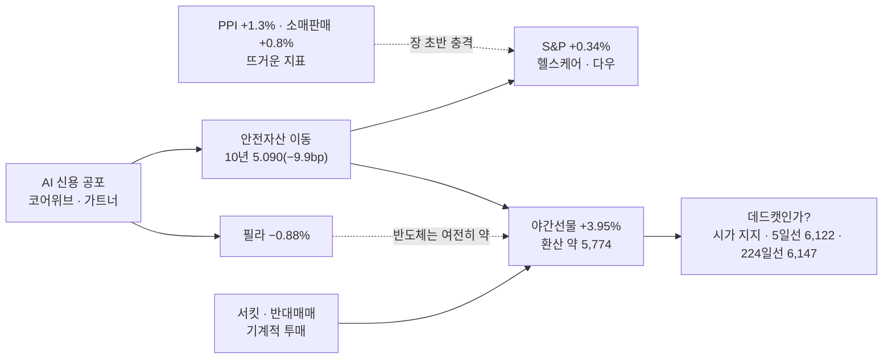

### 📗 저자 시황 판정 (`시_시황.md`)

> **한 줄 정의** [A-IMI-선정-07] : **서킷 다음 날 야간선물이 4% 되돌린 하락장 — 기계적 투매의 반등은 오지만, 외국인 현물이 돌아서기 전엔 데드캣이고, 돈이 모인 대장테마는 아직 없다**

| 항목 | 판정 | 근거 |
|:---|:---|:---|
| 프레임 ① | **하락장**(224일선 −9.6%) | 시초 약 5,774이어도 224일선 · 5일선까지 +6% |
| 장세 | **테마 공백 · 지수 하락장** | 10/15 이브닝 테마 칸 없음 — 반등일엔 **낙폭 큰 대형주 · 기계적 투매 종목이 먼저 튄다**(지수 국면 [소와곰] "바닥에서 오를 땐 바닥권 종목") |
| 하락 성격 | **기계적 투매 되돌림 + 판단 매도 지속** | 서킷 · 미수 반대매매 = 빠른 복귀 가능 / CPI · AI 신용 = 소화 시간 필요 |
| 6.4 급반등 3조건 | **2.5/3** | 역사적 임계 ✅ · 반대매매 진행 △ · 기계적 ✅ |
| §2.2 급락 중 반등 | **2~3회 확인** [D-IMI-진입-18 · 25] | **되돌린 뒤 첫 눌림이 직전 저점을 안 깨야** — 오늘 첫 반등만으로 판단하지 않는다 |
| §8.1 금요일 · 일정 | **금요일 = 주말 불확실성 → 비중 미리 줄임** [F-IMI-리스크-15] | 미국 옵션 만기 · 9월 산업생산 · **워시 연준 의장 연설** |
| §11 악재 강도 | 최상 → 운용 비중 20%대 [F-IMI-리스크-23] | |
| 헤지 테마 [§7] | 품절주 연쇄(양지사 상 → **신라섬유 · 코데즈컴바인**) · 방어주(KT&G) | **반등일엔 헤지가 밀린다** — 지수가 다시 원웨이로 빠질 때만 |
| 미국 4개 선물 | 다우 · S&P 오름 · 나스닥100 약보합 · 러셀2000 미확인 | 대형 가치 · 헬스케어만 |
| 지수 상승 수급장(§0-5 3-16) | **확인 필요** — 반등이 외국인 현물 매수로 오는가, 개인 · 금투 차익뿐인가 | 8:45 선물 · 0780 · 9시 외국인 현물 |

### 🧭 대응 (10/16 국장 — 단계 S1 · 금요일)

| 영역 | 대응 | 근거 |
|:---|:---|:---|
| **단계** | **S1(규칙)** — 보완안 ① · ②면 **S0** / **대장테마 없음 → 실질 관망** | 1015A 🚦 · RC-45 |
| **비중** | 삼전·하닉 **500만** / 그 외 **250만** · 당일 청산 · **오버나잇 금지(금요일)** · 칼 손절 | [F-상천-리스크-01] · [F-IMI-리스크-15] |
| 대장테마 후보(장중 확인) | 10/15 이브닝 강세 중 **2일차** : 라온시큐어(보안 · 2,581억) · 듀켐바이오(치매 진단 상) · 에스엠벡셀(우주 배터리 3일째) — **테마로 퍼지는지(관련주 상한가) 장 초반 조회순위로만 판단** | S1 = 대장테마 대장주만 · 테마가 확인돼야 대상 |
| 지수 | 시초 약 **5,774** — 위 **6,000 · 5일선 6,122 · 224일선 6,147**(저항 덩이) / 아래 **10/15 종가 5,554 · 저가 5,451 · 7월 저점 약 5,260** | 1015A 사다리 |
| 반도체 대형주 | **S1 범위 밖** · 반등해도 **외국인 현물 매수 전환 전엔 데드캣** · 하닉 올해 초 박스 상단 지지 여부(클로징) | 진입 판단은 사용자 |
| E21 · 수급장 | E21 해당 없음(야간선물 +) · **반등이 외국인 현물로 오면 "지수 상승 수급장" 언급**(§0-5 3-16) | |
| 장전 순서 | NXT 프리장 08:10~ → **08:45 선물 · 0780 — 외국인 선물 5일째 · 현물 방향** → 08:50~55 예상체결 → 09:00 NXT 갭 유지 · **시가 지지 여부** | §0-5 3-15 |

### 📮 일정 관리 방 전달용 (일정 파일 `updated_at` 2026-10-12 · 읽은 시각 10/16 05:26)

> 이 방은 읽기만 한다 — 1013 · 1014 전달분 반영 전. 오늘 추가 :
> 1. **10/16(금) 미 옵션 만기 · 9월 산업생산 · 워시 연준 의장 연설** · 애플 아이폰 듀오 사전예약
> 2. **10/29 삼성SDI 3Q 실적 · 설명회** · **10/30 무라타 실적** · 10/28 FOMC(기사 — CME 동결 78%)
> 3. 하닉 3Q 실적일 **10/28**(다이제스트) 확정 여부

> [!missing] 못 판정한 것
> - 러셀2000 · SKHY · 코어위브 10/15 종가 · 미국 마감 이유(장중 기사)
> - 장전뉴스 10/16(07:40 이후)

---

## 2026-10-15 (목) — 국장마감후
#시황/국장마감후 #단계/S1 #요인/CPI #요인/AI신용 #요인/외국인 #서킷브레이커
*(10/16 05:26 DESKTOP-PQ0PPL4 작성 — 10/15 저녁 시황이 비어 있어 사용자 HTS 자료(10/16 새벽 제공)로 씀 · 10/15 미장마감후 시황 · 원장 장전 예측은 없음)*

> [!danger] 🔴 단계 **S1(규칙 · 10/16 적용)** · 하락장 — **서킷브레이커 · 7일 연속 하락 · 이브닝에 테마 칸이 사라졌다**
> 단계 근거 : 위치 하락장(224일선 6,147 −9.6%) ✅ · 코스닥 하락비율 **88%** ✅ · 외국인 현물 **−4.67조** + 지수선물 **+1.21조 매수** ❌ → S0 조건 2/3 = **S1** / **보완안 ①(현물 조 단위) · ②(지수 −3%↑ + 하락비율 70%↑) 어느 쪽이든 S0** — 사용자 확인 대기
> KOSPI **5,554.22(−7.57%)** · 시가 5,673.01(**−5.59%**) · 고가 5,751.45 · **저가 5,450.81(−9.29%)** · **12:38 서킷브레이커 1단계(−8%, 20분 정지 · 7/29 이후 78일 만)** · 거래대금 **28.64조**(30조의 95% · 전일의 134%)
> 코스닥 **760.82(−7.65%)**(서킷) · 하락비율 코스피 **86%**(113 / 789) · 코스닥 **88%**(171 / 1,531) · **VKOSPI 55.38(+23.3%)**
> 원인 : **미 9월 CPI 3.7%(예상 3.6%) · 근원 2.6%(예상 2.5%)** → 10/14 미국 나스닥 −1.9% / **코어위브 회사채 15% · 주가 −15% = AI 부채(네오클라우드) 공포** · 가트너 "2030년 AI 자산 3.5조 달러 손상" / 中 CXMT / 니케이도 **−4.90%**
> 7거래일 −20% 안팎 · **6/19 고점 9,385.59 대비 −41%** · 224일선 갭 이탈 · 60주선 · 7월 급락 저점권까지(클로징)

### 🎛 한눈에

| 지표 | 값 | 변화 | 신호 | 한 줄 |
|:---|---:|:---|:---:|:---|
| **KOSPI** | **5,554.22** | **−454.59 (−7.57%)** | 🔴 | 시가 −5.59% → 장중 −9.29% → 서킷 → 종가 −7.57% |
| KOSPI200 · KOSPI100 · KTOP30 | 860.70 · 6,678.26 · 15,516.74 | −8.13% · −8.19% · −7.53% | 🔴 | 대형주가 더 빠졌다 |
| **KOSDAQ** · 코스닥150 | 760.82 · 1,282.89 | **−7.65%** · −8.60% | 🔴 | 10/13 · 10/14와 달리 **코스닥도 같이 무너졌다** |
| 코스피 거래대금 | **28.64조** | 전일의 134% · 30조의 95% | 🔴 | **투매에 거래가 실렸다** |
| 코스닥 거래대금 | 7.03조 | 7조 기준 100% | 🟡 | |
| **외국인 현물(코스피)** | **−46,668억** | −1.30조 → **−4.67조** | 🔴 | **7일째 · 다시 확대**(코스닥은 +2,970억) |
| **외국인 지수선물** | **+12,101억** | 4일째 매수 | 🟢 | 현물 팔고 선물 사는 모양 4일째 |
| 기관 · 금융투자 | **+23,030억** · **+27,617억** | | 🟡 | **차익 순매수 +1.06조**(베이시스 · 서킷 차익) — 판단 매수 아님 |
| 개인 · 기타법인 | +16,857억 · +6,658억 | | 🟡 | |
| 프로그램 | 차익 **+10,596억** · 비차익 **−3,717억** | | 🟡 | |
| 옵션(외국인) | 콜 −21억 · **풋 +86억** | | 🔴 | 풋 매수 = 공포 쪽(공포 끝 신호 아님) |
| **VKOSPI** | **55.38** | **+10.47 (+23.3%)** | 🔴 | 연중 최고권 |
| 원/달러 · 국고 3년 | 1,342.00 · 3.86 | — · −0.01 | 🟡 | 원화는 버팀 |
| 아시아 | 니케이 **−4.90%** · 상해 −1.59% · 항셍 −1.03% | | 🔴 | **한국 · 일본 반도체 동반 투매** |
| 삼전 · 하닉 · 삼성전기 | — | **−9.48% · −11.06% · −15.36%** | 🔴 | 이브닝 개별주 칸(괄호 = 거래대금 억 : 65,675 · 70,584 · 13,732) |

### 🔗 오늘의 인과

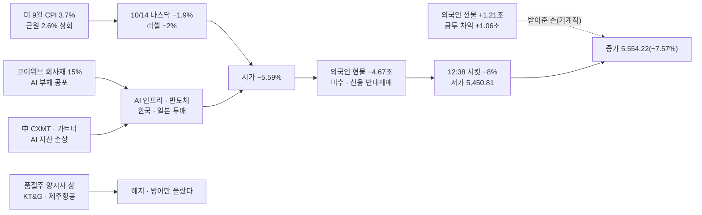

### 🚦 단계 판정 (`_시황판단방법.md` §0-5 2-1 · RC-45)

| 항목 | 오늘 | S0 조건 | 결과 |
|:---|:---|:---|:---:|
| ① 위치(프레임 ①) | 5,554.22 < 224일선 6,147.5(−9.6%) · 60일선 6,654.1(−16.5%) | 상승장 아님 | ✅ |
| ② 외국인 현물 · 지수선물 | 현물 **−46,668억** · 지수선물 **+12,101억**(4일째 매수) | 동시 순매도 | ❌ |
| ③ 코스닥 하락비율 | **88%**(1,531 / 1,734) · 코스피 86% | 60% 이상 | ✅ |
| **판정** | S0 조건 2/3 — **규칙상 S1** / 보완안 ① · ② 모두 **S0** | | **S1**(규칙) |

- **1014A S1 판정 검증** : 다음 날(오늘) 코스피 **−7.57%** · 코스닥 −7.65% → **지수 ❌** / 대장테마 이차전지 2일차 → **이브닝 테마 칸 자체가 없음 — HT로보틱스(ESS 엔드플레이트) 개별만** → **테마 ❌**
- **⚠️ S1 판정 사흘 실전(10/12 · 10/13 · 10/14 판정) : 지수 ❌ · △ · ❌** — 셋 다 외국인 지수선물 매수가 S0을 막았다. 보완안 결정이 급하다(아래 ❓)
- **바닥 신호 2/4** : §6.3 외국인 지수선물 4일째 ✅ · 풋 매수 ❌ = 절반 / §6.4 급반등 3조건 **2.5/3**(아래 📗) / §2.2 저점 높임 ❌(5,944 → 5,451) / 5일선 6,121.7 회복 ❌ / **서킷 = 저자 "패닉셀 후 서킷, 한 번 더 빠지는 그 자리가 진짜 기회"[주간 0720] 조건에 다가감** → 0.5 가산
- **E21** : 오늘은 장중 대응 대상이었다(미장 −1.9% · 시가 −5.59%) — 기록만

### 📗 저자 시황 판정 (`시_시황.md`)

> **한 줄 정의** [A-IMI-선정-07] : **미국 CPI와 AI 부채 공포가 한국 · 일본 반도체를 덮친 서킷 날 — 외국인은 현물 4.67조를 던지고 선물만 샀고, 테마는 사라지고 품절주 · 방어주만 올랐다**

| 항목 | 판정 | 근거 |
|:---|:---|:---|
| 프레임 ①②③ | **하락장 · 하락장 · 돈 빠짐 시작** | 224일선 −9.6% · 거래대금 28.64조(투매) · **예탁금 100.10조(−3,406억) · 미수금 1.24조(+1,781억 — 급증) · 신용 34.25조**(10/13 기준) |
| 장세(차읽남 · 월독프) | **테마주 장세 붕괴 · 지수 하락장** | 이브닝 "시장 주도 종목"에 **테마 섹션 없이 개별주 칸만** — 상한가 듀켐바이오(치매 진단 · 릴리) · 양지사(품절주) |
| 6.1 기계적 vs 판단 | **둘 다** | 판단 : CPI · AI 부채 · CXMT / **기계적 : 서킷 · 미수 · 신용 반대매매 · 레버리지 ETF** → 기계적 부분은 "물량 소화 뒤 빠른 복귀" |
| 6.2 악재 실체 | **실체 있음**(CPI 상회 · 코어위브 채권 15%) | 다만 "이 정도로 빠질 일인가"(클로징 10/13) — PER은 이미 사상 최저 |
| 6.3 공포의 끝 | **절반** | 외국인 지수선물 +1.21조(4일째) ✅ / 풋 매수 · 현물 확대 ❌ |
| 6.4 급반등 3조건 | **2.5/3** | ① 역사적 임계(7일 −20% · 고점 −41% · 서킷) ✅ ② 반대매매 소화 — 미수 급증분 진행 중 △ ③ 기계적 매도(서킷 · 반대매매) ✅ |
| 6.6 받아주는 손 | **개인 · 금투(차익) · 국민연금 "찔끔"** | 판단 매수 주체 없음 — 클로징 "장 마감 전 반등 매수세조차 없었다" |
| §7 헤지 | **품절주 연쇄 진행** — 10/13 신라섬유 → 10/15 **양지사 상** | 저자 [소와곰] "양지사 → 신라섬유 → 코데즈컴바인" 순 / 방어주 KT&G · 환율 수혜 제주항공 |
| §11 매크로 악재 강도 | **최상** — 운용 비중 20%대 [F-IMI-리스크-23] | 금리(CPI) · AI 신용 · 반도체 · 외국인 |

### 🧵 시장 주도 종목 (Signal Evening 14160 — 테마 칸 없음)

| 구분 | 종목 · 등락률(거래대금 억) | 재료 |
|:---|:---|:---|
| 대형주 투매 | 삼성전자 −9.48%(65,675) · SK하이닉스 −11.06%(70,584) · 삼성전기 −15.36%(13,732) | 서킷 · AI 부채 · CXMT |
| 상한가 | **듀켐바이오 +30.00%(252)** · **양지사 +29.89%(274)** | 치매 진단제(릴리 신약 기대) · 품절주 헤지 |
| 강세 | 멜콘 +42.03%(5,549 · 신규상장) · 에스엠벡셀 +18.91%(1,260 · 우주 배터리 2일째) · **라온시큐어 +14.01%(2,581 · AI 보안)** · 토마토시스템 +10.55% · 레메디 · 유한양행 +5.09%(렉라자 3억 달러) · HT로보틱스 +4.08%(ESS) · KT&G +3.96%(방어) · 제주항공 +3.96%(환율) | 개별 |
| 급락 | 진코스텍 −37.36%(이전상장 첫날) | |

- **대장테마 없음** — S1(대장테마 대장주만)이면 **오늘 할 수 있는 매매가 없었다** = 사실상 S0
- **하락장에서 전날 1위 테마 다음 날 약화 — 4회째**(10/08 감염병 · 10/12 ESS · 10/14 호남 · **10/15 이차전지**)

### ✅ 1014A 명제 채점

| # | 명제 | 결과 | 채점 |
|:---:|:---|:---|:---:|
| 1 | 장중 저가 5,944 위(저점 높임 유지) | **5,450.81** | ❌ |
| 2 | 외국인 현물 순매도 1조 미만 | **−4.67조** | ❌ |
| 3 | 이차전지 · ESS 2일차 이브닝 1~3위 | 테마 칸 없음 · HT로보틱스 개별만 | ❌ |
| 4 | 코스피 거래대금 20조 이상 | **28.64조** | ✅ |

### 📐 코스피 사다리 (10/15 종가 기준 · HTS 일봉 캡처)

| 선 | 값 | 종가 대비 | 거리 | 역할 |
|:---|---:|---:|:---|:---|
| 100일 · 120일 | 7,228.8 · 7,193.4 | +30.2 · +29.5% | `▲▲▲▲▲▲▲▲` | |
| 45일 · 20일 | 6,720.8 · 6,683.7 | +21.0 · +20.3% | `▲▲▲▲▲▲▲` | |
| 60일 · 10일 | 6,654.1 · 6,516.7 | +19.8 · +17.3% | `▲▲▲▲▲▲` | |
| **224일** | **6,147.5** | **+10.68%** | `▲▲▲▲` | ┐ 저항 덩이(클로징 "240선 · 5일선 저항") |
| **5일** | **6,121.7** | **+10.22%** | `▲▲▲▲` | ┘ |
| *10/14 저가 · 라운드 6,000* | *5,944.7 · 6,000* | *+7.0 · +8.0%* | `▲▲▲` | |
| *오늘 고가 · 시가* | *5,751.5 · 5,673.0* | *+3.55 · +2.14%* | `▲▲` | **오늘 강도선(시가)** |
| **종가** | **5,554.22** | — | `◆` | |
| 라운드 5,500 | 5,500 | −0.98% | `▼` | |
| **오늘 저가** | **5,450.8** | **−1.86%** | `▼▼` | 서킷 저점 |
| 7월 말 장중 저점 | 약 5,260 | −5.3% | `▼▼▼` | 클로징 10/13 — **HTS 확인 필요** |
| 라운드 5,000 | 5,000 | −10.0% | `▼▼▼▼▼` | |

### 📋 볼 것

> [!todo] 오늘 밤 (미국 10/15)
> - [ ] PPI · 소매판매 · 10년 금리 · 필라 · 코어위브 · 야간선물 되돌림
> [!todo] 10/16(금) 국장
> - [ ] **반등이면 데드캣인가** — 시가 지지 · 3일선 · 5일선 · 224일선 저항 강도(클로징)
> - [ ] **외국인 현물 매도 축소 + 선물 5일째 + 콜 매수** — 공포 끝 신호
> - [ ] **미수 급증분 반대매매** 장 초반 / **하닉 올해 초 박스 상단 지지**(클로징)
> - [ ] 품절주 연쇄(신라섬유 · 코데즈컴바인) · 라온시큐어(보안 2일째) · 듀켐바이오(치매 진단) 2일차

### ❓ 검증 대상 명제 (다음 시황에서 채점)

| # | 명제 | 기준 | 채점 |
|:---:|:---|:---|:---:|
| 1 | 10/16 코스피 **종가 > 시가**(반등 지속 — 데드캣 아님) — 확신도 하 | 일봉 양봉 | ⬜ |
| 2 | 외국인 코스피 현물 **순매도 1조 미만** — 확신도 하 | > −1조 | ⬜ |
| 3 | **VKOSPI 50 아래** | 종가 | ⬜ |
| 4 | 코스피 장중 저가 **5,450.81 위** | 장중 저가 | ⬜ |

> [!question] 사용자 확인 — 쌓인 결정 2건
> 1. **RC-45 조건 ② 보완안**(1013A) — S1 판정 3일 실전 지수 ❌ △ ❌. 10/15 판정은 보완안 ① · ② 모두 **S0**
> 2. **RC 후보 "하락장에서 전날 1위 테마는 다음 날 약화"**(1014A) — 오늘로 **4회째**

> [!missing] 못 판정한 것
> - 10/15 미장마감후 시황 · 원장 장전 예측 없음(아침 시황 미작성)
> - 7월 저점 정확한 값(HTS 일봉) · 반대매매 금액 · 업종별 등락
> - 삼전 · 하닉 · 삼성전기 종가는 이브닝 등락률만

---

## 2026-10-14 (수) — 국장마감후
#시황/국장마감후 #단계/S1 #요인/외국인 #요인/224일선 #테마/이차전지

> [!danger] 🔴 단계 **S1 — 대장테마 대장주만 · 보수**(10/15 적용) · 하락장 — **224일선을 장중에 넘었다가 못 지켰다 · 저점은 높였다**
> 단계 근거 : 위치 **하락장 · 224일선 아래** ✅ · 외국인 현물 −1.30조 + 지수선물 **+8,445억** ❌ · 코스닥 하락비율 **52%** ❌ → **S0 조건 1/3 = S1**(1013A 보완안 ① · ②를 써도 S1) · 바닥 신호 **1.5/4**
> KOSPI **6,008.81(−0.44%)** · 시가 6,062.08(+0.44%) → **고가 6,190.65(+2.57% · 224일선 6,141 위)** → 저가 5,944.65(−1.50%) → 종가 6,008 = **224일선 위에서 밀린 음봉** · 거래대금 **19.93조**(전일 70%)
> **저가 5,944.65 > 10/13 저가 5,911.11 = 저점을 높였다** · VKOSPI **44.91(−7.46%)** · 외국인 현물 **−1.30조**(6일째 조 단위 · 규모 1/4) · 지수선물 **+8,445억(3일째)** · 기관 +9,860억
> 코스닥 **823.88(−1.57%)** · 코스닥150 −2.01% — **오늘은 코스닥이 더 약했다** / 신용 **34.29조(10/12 +4,774억)** · 미수 **1.06조** — 급락일에 빚이 더 늘었다
> 돈이 간 곳 : **이차전지 · ESS**(삼성SDI +5.54% · 이수스페셜티 +10.13%) · **전력 · 에너지**(한선엔지니어링 +26.93%) · **알래스카 LNG 강관**(화성밸브 +18%) · 서울고터(천일고속 상) / **대장테마 호남은 유신 +10.90%만 — 서산 미등장**
> **비중 삼전·하닉 500만 / 그 외 250만 · 당일 청산 · 오버나잇 금지** · ==오늘 밤 미 9월 CPI · 베이지북 → 10/15 시초에 반영==

### 🚦 단계 판정 (`_시황판단방법.md` §0-5 2-1 · RC-45)

| 항목 | 오늘 | S0 조건 | 결과 |
|:---|:---|:---|:---:|
| ① 위치 | 6,008.81 < 224일선 6,141.2(−2.2%) · 60일선 6,682.9(−10.1%) | 상승장 아님 | ✅ |
| ② 외국인 현물 · 지수선물 | 현물 **−12,989억** · 지수선물 **+8,445억**(3일째) | 동시 순매도 | ❌ |
| ③ 코스닥 하락비율 | **52%**(856 / 1,643) · 코스피 42%(371 / 874) | 60% 이상 | ❌ |
| **판정** | S0 조건 1/3 — **보완안 ①(현물 조 단위면 ② 충족)을 써도 ③ 미달 → S1** | | **S1** |

- **1013A S1 판정 검증** : 다음 날(오늘) 코스피 **−0.44%** · 코스닥 −1.57% → **지수 △** / 대장테마 호남 2일차는 **유신 +10.90%(3위 칸)만 · 서산 미등장** → **테마 △(약화)** — S0이었다면 놓친 것은 이차전지 · 전력 · LNG(대장테마 아님)
- **바닥 신호 1.5/4** : §6.3 외국인 지수선물 3일째 ✅ · 현물 매도 −5.22 → −1.30조 축소 · 콜 −4억 ❌ · 풋 +40억(매수 쪽) = **절반** / §6.4 급반등 3조건 **2/3**(아래) / **§2.2 저점 높임 ✅**(5,944.65 > 5,911.11) / 5일선(6,371.6) 회복 ❌
- **E21** : 해당 없음 · **지수 상승 수급장** : 해당 없음(하락일 · 개인 매도 · 기관 매수)

### 🎛 한눈에

| 지표 | 값 | 변화 | 신호 | 한 줄 |
|:---|---:|:---|:---:|:---|
| **KOSPI** | 6,008.81 | −26.54 (−0.44%) | 🟡 | 시가 6,062.08 → **고가 6,190.65(224일선 위)** → 저가 5,944.65 → 종가 · LC 19.15% · HC −35.98% |
| KOSPI200 · KTOP30 | 936.82 · 16,780.55 | −0.56% · **+0.13%** | 🟡 | 초대형주는 보합 |
| **KOSDAQ** · 코스닥150 | 823.88 · 1,403.60 | **−1.57% · −2.01%** | 🔴 | 어제와 반대로 코스닥이 더 약했다 |
| 하락비율 | 코스피 **42%**(503 / 371) · 코스닥 **52%**(787 / 856) | | 🟡 | 코스피는 오른 종목이 더 많다 |
| 거래대금 | 코스피 **19.93조**(전일 70%) · 코스닥 5.80조 | 30조의 66% | 🔴 | 반등 시도에 거래가 안 붙었다 |
| **외국인 현물(코스피)** | **−12,989억** | −5.22조 → **−1.30조** | 🟡 | 6일째 조 단위 · **규모 1/4로 축소** · 6일 16.4조 |
| **외국인 지수선물** · 주식선물 | **+8,445억** · +5,544억 | 3일째 매수 | 🟢 | 달러선물 −4,829억(원화 강세 쪽) |
| 개인 · 기관 · 기타법인 | **−3,897억** · **+9,860억**(금융투자 +6,683) · +6,983억 | | 🟢 | **기관이 받았다** · 개인은 팔았다 |
| VKOSPI | **44.91** | **−7.46%** | 🟢 | 공포가 꺾였다 |
| F 202612 | 944.20 | −0.60 (−0.06%) | 🟡 | 야간선물 961.40에서 되밀림 |
| 원/달러 · 국고 3년 | 1,336.00 · 3.88 | −5.50 · +0.02 | 🟡 | |
| 미니 S&P · 나스닥(19:06) | 7,869.50 · 30,766.50 | +0.18% · −0.08% | 🟡 | CPI 앞 보합 |
| 니케이 · 상해 · 심천 | 67,744 · 3,767 · 2,287 | −0.05% · −0.89% · −1.81% | 🟡 | |
| 증시주변(10/12) | 예탁금 100.44조(+3,289억) · **신용 34.29조(+4,774억)** · **미수 1.06조(+720억)** | | 🔴 | **급락일(−3.65%)에 신용 · 미수가 늘었다 = 물타기** |

### 🔗 오늘의 인과

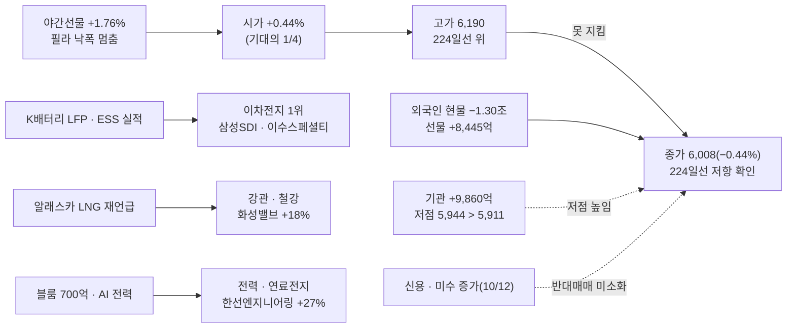

### 📗 저자 시황 판정 (`투자데이터 종합/3차 활용/1_거차재시/시_시황.md`)

> **한 줄 정의** [A-IMI-선정-07] : **사이드카 다음 날, 외국인 매도가 1/4로 줄고 기관이 받아 저점은 높였지만 224일선은 못 넘은 하락장 — 돈은 대장테마(호남)를 떠나 이차전지 · 전력 · LNG로 옮겨 갔다**

**① 지수 — 세 프레임** [시황 §2]
| 프레임 | 판정 | 근거 |
|:---|:---|:---|
| ① 이평선 위치 [A-선정-01] | **하락장 — 224일선 아래** | 6,008 < 224일선 6,141 · 5(6,372) < 10(6,648) < 60(6,683) < 45(6,737) < 20(6,752) — 단기 역배열 |
| ② 거래대금 + 20일선 + 고저점 | **하락장 — 단 저점 1회 높임** | 19.93조(66%) · 20일선 −11.0% / **저점 5,944 > 5,911** · 고점은 6,190 < 6,198(10/13 고가) — 아직 저점 · 고점 동반 상승 아님 |
| ③ 유동성 방향 | **예탁금 소폭 증가 · 신용 증가** | 예탁금 100.44조(+3,289억) · 신용 34.29조(+4,774억) · 미수 1.06조 — 들어온 돈이 빚이다 |
- **224일선 첫 시험 = 저항 확인** — 장중 6,190(224일선 +0.8%)까지 갔다가 −2.2% 아래 마감 [차_차트 §2.4 — 하향 추세에서 장기선은 뚫기 어렵다]

**② 장세 유형** [시황 §3]
| 분류 | 오늘 | 근거 · 대응 |
|:---|:---|:---|
| 차읽남 4대 장세 | **테마 순환 장세** | 대장테마 호남 약화 → 이차전지(실적 · LFP) · 전력(AIDC) · LNG(트럼프 재언급) · 서울고터 — **하루짜리 순환** 성격 |
| 월독프 6유형 | 지수 하락장(외인 매도 → **기관** 받음) | 개인은 팔았다 — 어제까지와 다르다 |
| 지수 국면별 [소와곰] | **바닥 확인 전** | 저점 높임 1회 — 바닥 확인은 고점도 높여야 |

**③ 하락의 성격 · 바닥 신호** [시황 §6]
| 질문 | 판정 | 근거 |
|:---|:---|:---|
| 6.1 기계적 vs 판단 | **판단 매도 둔화 · 기계적(반대매매) 미소화** | 외국인 현물 1/4 · 신용 · 미수 증가 = 반대매매 물량은 아직 남아 있다 |
| 6.3 공포의 끝 | **절반** | 외국인 지수선물 3일째 ✅ · 현물 매도 축소 / 콜 매수 ❌ · VKOSPI 하락 |
| 6.4 급반등 3조건 | **2/3** | ① 역사적 임계점 ✅(PER 4.54배 · 닷새 −13%) ② **반대매매 소화 ❌ — 신용 34.29조 · 미수 1.06조로 오히려 늘었다** ③ 기계적 프로그램 매도 ✅(10/13 비차익 −2.75조) |
| 6.6 받아주는 손 | **기관 +9,860억 · 기타법인 +6,983억** | 개인 −3,897억 — 받는 손이 개인에서 기관으로 바뀌었다 |
- **[주간 0720]** *"반대매매를 막으려고 더 넣은 돈은 한 번 더 빠지면 못 버틴다"* — 10/12 급락일에 신용 +4,774억 · 미수 +720억 = **바로 그 돈** → 한 번 더 밀리면 반대매매 물량이 나온다 → **관종 · 현금 준비, 추격 금지**

**④ 실적 · 이벤트** [시황 §8 · §11]
- **오늘 밤 미 9월 CPI**(예상 전월 0.6% · 근원 0.2% · 전년 3.7%) + 베이지북 — 10/15 시초 방향
- 실적 : 이차전지 **3분기 반등 기대 · 삼성SDI 목표가 상향(신한)** · HMM 3Q 영업익 1조 기대 → **실적 장세 쪽 돈**
- 대형 호재 무반응 진행 중(삼성 — 약 보름)

**⑤ 지수 하락 시 헤지 테마** [시황 §7]
- 고정 헤지 5종 **미등장**(반등 시도일) · 중동(사우디-후티 충돌) → **해운 재등장**(팬오션 +10.53% · HMM +5.90%)

### 🧭 대응 (10/15 국장 — 단계 S1)

| 영역 | 대응 | 근거 |
|:---|:---|:---|
| **단계** | **S1 — 대장테마의 대장주만 · 보수** | 🚦 S0 조건 1/3 |
| **비중** | 삼전·하닉 **500만** / 그 외 **250만** · 당일 청산 · **오버나잇 금지 · 칼 손절** | [F-상천-리스크-01] · RC-16 |
| **대장테마 · 대장주** | **이차전지 · ESS(1일차 → 10/15 2일차) → 이수스페셜티케미컬**(+10.13% · 736억 — RC-25 상승률 1위) · 거래대금 대장 삼성SDI(5,024억) / 에스엠벡셀 상은 **우주 배터리 — 다른 줄기** | 🧵 1순위 · RC-25 |
| ⚠️ 2일차 경계 | 하락장에서 **전날 1위 테마가 다음 날 약화 · 이탈 3회째**(10/08 감염병 · 10/12 ESS · **10/14 호남**) → 10/15 이차전지 2일차도 같은 위험 → **장 초반 대장 시가 지지 확인 전 진입 금지** | 아래 ❓ RC 후보 |
| 진입 조건(S1) | 대장 **시가 지지 → 전일 종가 → 거래대금 많은 자리** 순 · **가장 강한 지지구간에서 지지 확인 뒤만** | `차_차트` §4.6 · RC-45 |
| 지수 | 저항 **224일선 6,141 → 오늘 고가 6,190 · 10/13 시가 6,186** / 지지 **6,000 → 오늘 저가 5,944 → 10/13 저가 5,911** | 아래 📐 |
| 반도체 대형주 | S1 범위 밖 — 대형 호재 무반응 · 외국인 현물 6일째 | 진입 판단은 사용자 |
| 그 밖 테마 | 전력(한선엔지니어링 · LS머트리얼즈) · LNG 강관 · 서울고터 · 해운 · 호남(유신) → **관찰만** | S1은 대장테마 하나 |

### 📐 코스피 사다리 (10/14 종가 기준 · HTS 일봉)

| 선 | 값 | 종가 대비 | 거리 | 역할 |
|:---|---:|---:|:---|:---|
| 100일 · 120일 | 7,248.5 · 7,199.0 | +20.6 · +19.8% | `▲▲▲▲▲▲▲▲` | |
| 20일 · 45일 | 6,751.5 · 6,737.2 | +12.4 · +12.1% | `▲▲▲▲▲▲` | |
| 60일 · 10일 | 6,682.9 · 6,648.4 | +11.2 · +10.6% | `▲▲▲▲▲` | |
| 5일 | 6,371.6 | +6.04% | `▲▲▲` | 역전의 발판 [차_차트 §2.4] |
| *10/13 시가 · 오늘 고가* | *6,186.1 · 6,190.7* | *+2.95 · +3.03%* | `▲▲` | ┐ 저항 덩이 6,141~6,191 |
| **224일** | **6,141.2** | **+2.20%** | `▲` | ┘ **첫 시험에서 저항 확인** |
| *오늘 시가* | *6,062.1* | *+0.89%* | `▲` | 오늘 강도선 |
| **종가** | **6,008.81** | — | `◆` | |
| 라운드 6,000 | 6,000 | −0.15% | `▼` | |
| **오늘 저가** | **5,944.7** | −1.07% | `▼` | **저점 높임** |
| 10/13 저가 | 5,911.1 | −1.63% | `▼` | 깨지면 저점 높임 무효 |

### 🔥 트리거

| 층 | 요인 | 이전 → 지금 | 상태 | 신호 |
|:---:|:---|:---|:---|:---:|
| 1 | 외국인 | −5.22조 | **−1.30조**(6일째 · 규모 1/4) · 지수선물 3일째 +8,445억 | 🟡 |
| 1 | **224일선** | 이탈 | **장중 회복 · 종가 실패 = 저항 확인** | 🔴 |
| 1 | 저점 | 5,911 | **5,944 — 저점 높임 1회** | 🟢 |
| 1 | 변동성 | VKOSPI 48.5 | **44.9(−7.5%)** | 🟢 |
| 1 | **신용 · 미수** | 33.81조 | **34.29조 · 미수 1.06조(10/12)** — 반대매매 대기 | 🔴 |
| 1 | CPI | — | 오늘 밤 | 🟡 |
| 2 | **이차전지 · ESS** | 이탈(10/12) | **1위 재등장** — 삼성SDI · SK이노 · LG엔솔 · 이수스페셜티 +10.13% · 롯데에너지머티 · 엘앤에프 · 포스코퓨처엠(LFP · ESS 실적) | 🟢 |
| 2 | **전력 · 에너지** | — | **2위** — 한선엔지니어링 +26.93%(805억) · LS머트리얼즈(블룸 700억) · LS에코에너지 | 🟢 |
| 2 | **알래스카 LNG** | — | **3위** — 화성밸브 +18.09% · 대양금속 · 대한제강 · TCC스틸 · 삼미금속(트럼프 대만 44억 달러) | 🟢 |
| 2 | 호남 클러스터 | 1위(10/13) | **약화** — 유신 +10.90%만(3위 칸) · 서산 · 금호전기 미등장 | 🔴 |
| 2 | 개별 | | 유니켐 상(로봇 전자피부) · 천일고속 상 · 동양고속 · 대성산업(서울고터) · 제주항공 +24.66% · 글로벌테크놀로지(CPO) · 해운(후티) · 에스엠벡셀 상(위성 배터리) | 🟡 |
| 2 | 소부장 · 품절주 · 바이오 · 보안 | 10/13 강세 | **이탈** | 🔴 |

### 💰 수급 (억 원)

| 주체 | 코스피 현물 | 코스닥 현물 | 지수선물 | 주식선물 | 달러선물 |
|:---|---:|---:|---:|---:|---:|
| 개인 | −3,897 | +4,264 | −3,260 | +363 | +505 |
| **외국인** | **−12,989** | −2,629 | **+8,445** | +5,544 | −4,829 |
| 기관계 | **+9,860** | −1,806 | −4,680 | −5,869 | +4,324 |
| └ 금융투자 | +6,683 | −906 | −6,051 | −3,724 | +4,395 |
| └ 투신 | +348 | −723 | +2,603 | −1,892 | +63 |
| 기타법인 | +6,983 | +126 | −505 | −37 | −137 |

- 외국인 현물 6일 합계 **약 16.4조** — 오늘은 1/4 / **코스닥은 외국인 · 기관 동반 매도**(−2,629 · −1,806억) → 코스닥 −1.57%

### 🧵 주도 테마 (Signal Evening 14148 · 일차 = `_매매제안방법.md` §0-4 6)

| 순위 | 테마(줄기) | 등급 | 일차(10/14 → 10/15) | 대장 이력 | 거래대금 |
|:---:|:---|:---:|:---:|:---|:---|
| 1 | **이차전지 · ESS · LFP** | A | **1 → 2일차**(0일차 10/13 LG엔솔 LFP — 10/12 빠짐 뒤 새 재료) | 0일차 10/13 LG엔솔 +3.02%(개별) → 1일차 10/14 **이수스페셜티케미컬 +10.13%**(상승률) · 삼성SDI +5.54%(5,024억) · 엘앤에프 +6.50% · 롯데에너지머티 +8.38% · 포스코퓨처엠 | 삼성SDI 5,024억 · LG엔솔 2,790억 |
| 1-b | 우주 배터리 | — | 0 → 1일차 | 에스엠벡셀 상(363억 · 저궤도 위성 배터리) | |
| 2 | **전력 · 에너지(AIDC · 연료전지)** | B+ | 0 → 1일차 | **한선엔지니어링 +26.93%**(805억) · 비나텍 · LS머트리얼즈 +6.75%(1,650억) · LS에코에너지 · 가온전선 | LS머트리얼즈 1,650억 |
| 3 | **알래스카 LNG(강관 · 철강)** | B+ | 0 → 1일차(9/30 · 10/01 뒤 새 파동) | **화성밸브 +18.09%** · 대양금속 +16.24% · 대한제강 +13.77% · TCC스틸 · 삼미금속 | |
| 3-b | 호남 반도체 클러스터 | C | **2 → 3일차** | 10/12 금호전기 상 → 10/13 서산 상(2연상) → 10/14 **유신 +10.90%(교체 · 약화)** · 서산 · 금호전기 미등장 | 유신 282억 |
| — | 서울고터 재개발 | B | 재등장(같은 재료) | 10/07 동양고속 상 → 10/08 동양고속 상 → 10/12 동양고속 → (10/13 빠짐) → 10/14 **천일고속 상** · 동양고속 +22.13% · 대성산업 +17.26% | |
| — | 해운 | C | 새 0일차(후티 · HMM 실적 기대) | 팬오션 +10.53%(1,192억) · HMM +5.90% | |
| — | 개별 | | | 유니켐 상 · 제주항공 +24.66% · 글로벌테크놀로지 +10.87%(CPO) · 대주전자재료 | |
| ✕ | 이탈 | | | 반도체 소부장 · 품절주 · 바이오 · 보안(10/13) | |

- **서울고터 일차** : 하루 빠졌다가 **같은 재료**로 다시 나왔다 — §0-4 6은 "새 재료면 새 0일차"만 정했다 → **같은 재료 재등장은 규칙 빈칸**(아래 ❓)

### ✅ 직전 명제 채점

**1013A 국장마감후 명제**

| # | 명제 | 결과 | 채점 |
|:---:|:---|:---|:---:|
| 1 | 10/14 코스피 종가 6,000 위 | 6,008.81 | ✅ |
| 2 | 외국인 조 단위 매도 6일째(최하) | −1.30조 | ✅ |
| 3 | 코스닥 > 코스피 | −1.57% < −0.44% | ❌ |
| 4 | 호남 클러스터 2일차 이브닝 1~3위 유지 | 3위 칸 안 유신만 · 서산 미등장 | △ |

> [!caution] 총평
> **지수는 6,000을 지키고 저점을 높였지만 224일선 첫 시험에서 밀렸다.** 외국인 매도가 1/4로 줄고 기관이 받은 것은 바닥 쪽 신호, **신용 · 미수가 급락일에 오히려 늘어난 것은 아직 바닥이 아닌 신호**다. 테마는 대장테마(호남)가 약해지고 이차전지 · 전력 · LNG로 돌았다 — **원장 B · C에 셋 다 없었다.**

> [!example] 📊 예측 채점 → [[예측대조_2026#2026-10-14 (수)|원장 10/14]]
> - **A : 5/8** — 중 3/4 · 하 1/3 · 최하 1/1
> - **B : 1위 소부장 · 기판 ❌ · 2위 호남 △(유신) · 3위 조선 ❌** / 실제 = 이차전지 · 전력 · 알래스카 LNG
> - **C : ✅2 · △1 · ❓10**(다이제스트 TODAY ISSUE 5개가 하나도 주도에 안 나왔다)

### 📋 볼 것

> [!todo] 오늘 밤 (미국 10/14)
> - [ ] **미 9월 CPI**(전월 0.6% · 근원 0.2% 예상) · 베이지북 · 10년 금리
> - [ ] 필라 · SKHY · 야간선물

> [!todo] 10/15(목) 국장
> - [ ] **저점 높임 유지** — 5,944 · 5,911 위에서 224일선(6,141) 재시험
> - [ ] **외국인 현물 1조 미만 + 선물 4일째** — 공포 끝 신호 나머지 절반(콜 매수)
> - [ ] **반대매매** — 신용 · 미수 늘어난 물량이 장 초반에 나오는가
> - [ ] **이차전지 2일차** — 이수스페셜티 · 삼성SDI 시가 지지(하락장 2일차 약화 3회째 경계)

### ❓ 검증 대상 명제 · 사용자 확인

| # | 명제 | 기준 | 채점 |
|:---:|:---|:---|:---:|
| 1 | 10/15 코스피 **장중 저가 5,944 위**(저점 높임 유지) | 장중 저가 | ⬜ |
| 2 | 외국인 코스피 현물 **순매도 1조 미만** — 확신도 하 | > −1조 | ⬜ |
| 3 | **이차전지 · ESS 2일차 이브닝 1~3위 유지** — 확신도 하(2일차 경계) | 이브닝 | ⬜ |
| 4 | 코스피 거래대금 **20조 이상** | HTS | ⬜ |

> [!question] 사용자 확인 2건
> 1. **RC 후보 — "하락장에서 전날 1위 테마는 다음 날 약화"** : 10/08(감염병 이탈) · 10/12(ESS 이탈) · 10/14(호남 → 유신만) **3회**, 예외 10/13(호남 1위 유지) 1회. 10/12 교훈 ①에서 "3번째면 RC 후보"로 정했다 → **등재할지** · 그리고 **S1 대장테마를 "전날 1위"로 정하는 지금 규칙에 "장 초반 대장 시가 지지 확인 뒤"를 붙일지**
> 2. **일차 규칙 빈칸** : 하루 빠졌다가 **같은 재료**로 다시 나온 테마(서울고터 10/14)는 **이어 셀지(4일차) · 새로 셀지(0일차)**
> - (1013A의 RC-45 조건 ② 보완안은 오늘 판정에 영향 없음 — 코스닥 하락비율 52%라 어느 안이든 S1)

> [!missing] 못 판정한 것
> - **서산 · 금호전기 10/14 등락**(이브닝 미등장 — S1 대장 결과 미확인) · 삼전 · 하닉 등락(KTOP30 +0.13%로만)
> - 클로징 10/14 원본 없음 · 프로그램 매매(차익 · 비차익) 오늘 값 없음

> [!info]- 출처 · 형
> **출처**
> - 사용자 제공 : HTS 코스피 일봉 창 · 시장 요약표(10/14 18:56~19:06) · 증시주변 10/12 기준
> - 시그널리포트 원본 : **이브닝 14148** · 다이제스트 14143 · 클로징 14142(10/13)
>
> **형** : 국장마감후
> - 태그 : `[본인시황 1014A]` · 요인값 → [[요인값변천사_2026#2026-10-14 (국장마감후)]] · 예측 채점 → [[예측대조_2026#2026-10-14 (수)]] · 단계 → [[시황단계_백테스트]]

---

## 2026-10-14 (수) — 미장마감후
#시황/미장마감후 #단계/S1 #요인/반도체 #요인/외국인 #요인/CPI

> [!danger] 🔴 단계 **S1 — 대장테마 대장주만 · 보수**(1013A · 규칙) · 하락장 — **사이드카 다음 날, 야간선물이 처음으로 반등했다**
> 미국 10/13 : S&P 7,805.64(**−0.02%**) · 나스닥 27,204.38(−0.15%) · **필라 12,208.9(−0.23% — 닷새째지만 거의 보합)** · SOXL −0.65% / 은행 실적 엇갈림(**JPM EPS 5.57 vs 예상 5.90 미달** · GS · C 상회 · WFC 매출 미달) · J&J −6.8%
> 금리 : 채권 재개 — **미 10년 5.213(−3.5bp) · 30년 5.564** · 2년 4.793 / 유가 WTI 94.89(+0.8%) · 두바이 110
> 야간선물 **961.40(+16.60, +1.76%)** — HTS [5401] · 주간 종가 944.80 · 코스피 환산 약 **6,142** = **224일선 6,133(10/13 이탈 → 저항) 바로 위**
> **비중 삼전·하닉 500만 / 그 외 250만 · 당일 청산 · 오버나잇 금지** · 보유 없음 · 대장테마 **호남 반도체 클러스터 2일차 → 서산(2연상)** · ==오늘 밤 미 9월 CPI · 베이지북 · BoA · MS 실적==
> ⚠️ 단계는 규칙대로 S1 — **1013A의 RC-45 조건 ② 보완안(① 외국인 현물 조 단위면 ② 충족 / ② 지수 −3%↑ + 하락비율 70%↑면 S0)을 채택하면 오늘은 S0(쉼)**이다(사용자 확인 대기)

### 🎛 한눈에

| 지표 | 값 | 변화 | 신호 | 한 줄 |
|:---|---:|:---|:---:|:---|
| S&P 500 · 나스닥 | 7,805.64 · 27,204.38 | −0.02% · −0.15% | 🟡 | 은행 실적 엇갈림 · 보합 |
| **필라 반도체** | **12,208.9** | **−27.9 (−0.23%)** | 🟡 | 닷새째 하락이지만 **낙폭이 멈춤**(−2.59% → −0.23%) |
| SOXX · SOXL | 543.84 · 127.57 | −0.19% · −0.65% | 🟡 | |
| QQQ · TQQQ | 743.64 · 78.79 | −0.32% · −1.04% | 🟡 | |
| 러셀2000 · SKHY | **미확인** | — | ⬜ | |
| **미 10년** ✔체크 | **5.213** | **−0.035** | 🟢 | 휴장 뒤 재개 — 유가 하락 구간에 내림(장중 5.20) |
| 미 2년 · 20년 · 30년 | 4.793 · 5.611 · 5.564 | +0.002 · −0.039 · −0.035 | 🟢 | 장기만 내림 · CPI 앞 |
| **일본 30년** ✔체크 · 일본 10년 | 4.039 · 3.004 | −0.017 · +0.003 | 🟢 | |
| **WTI** ✔체크 · 브렌트 · 두바이 | **94.89** · 106.46 · 110.09 | +0.80% · +0.73% · +1.04% | 🔴 | 두바이 110 — 중동 원유 강세 |
| 금 | 4,181.65 | +0.10% | 🟡 | |
| 원/달러 | 1,341.31 | **+6.73** | 🔴 | 원화 약세로 전환(외국인 매도 · 위험 회피) |
| VIX | 15.27 | +0.39% | 🟢 | 미국은 공포 없음 — VKOSPI 48.53(10/13)과 정반대 |
| 미 선물(05:21) | S&P 7,853.50 · 나스닥100 30,774.50 | −0.06% · −0.40% | 🟡 | |
| **야간선물** | **961.40**(HTS [5401]) | **+16.60 (+1.76%)** | 🟢 | 거래량 24,472 · 코스피 환산 약 **6,142** |

> [!info]- 신호등 기준
> 🟢 국장에 우호 · 🟡 중립·경계 · 🔴 역풍. 판정은 **국장 대형주에 미치는 영향** 기준 · ✔체크 = 사용자 매일 확인 항목(`checklist.json`) · 표의 "코스피200 선물(F) 961.60 −4.63%"는 기준이 다른 값이라 쓰지 않았다

### 🧮 이익 · 할인율 장부 (시험)

| 칸 | 지난밤 | 방향 |
|:---|:---|:---:|
| **분자 — 이익** | 반도체 : CXMT 악재 이틀째 소화 · 필라 낙폭 축소 / OCP : **AMD 서버 CPU에 LPDDR5X(SOCAMM2)** · 삼성 · AMD CXL 메모리 확장 = 메모리 수요 쪽 기사 / 국내 : 코스피 12MF PER **4.54배 — 종가 기준 사상 최저**(클로징) = 이익 전망 35~51% 삭감까지 가격에 반영 | ↔ |
| **분모 — 장기 할인율** | 10년 5.213(−3.5bp) — CPI(오늘 밤) 앞 | ↔ |
| **분모 — 위험 프리미엄** | 미국 VIX 15 / **한국 VKOSPI 48.53** — 위험은 한국에만 | ⬇(한국) |
| **수급**(국장) | 외국인 5일 **15.1조**(1013A) · **지수선물 +3,897억(2일째 매수)** · 비차익 −2.75조 · **신용 33.81조 — 10/08 증가분 반대매매 D+2** | ↔ |

- 판정 : **미국은 반도체 낙폭이 멈췄고, 야간선물은 처음으로 +1.76% 되돌렸다.** 국장 하락은 "외국인 판단 매도 + 자사주가 받아주던 손 빠짐"이었는데, 이제 PER 4.5배 · 닷새 −13%로 가격이 먼저 극단에 왔다. 오늘의 핵심은 **반대매매(D+2) 투매가 장 초반 한 번 더 나오는지, 그걸 받아주는 손(외국인 선물 3일째 · 기관)이 있는지**다

### 🔗 오늘의 인과

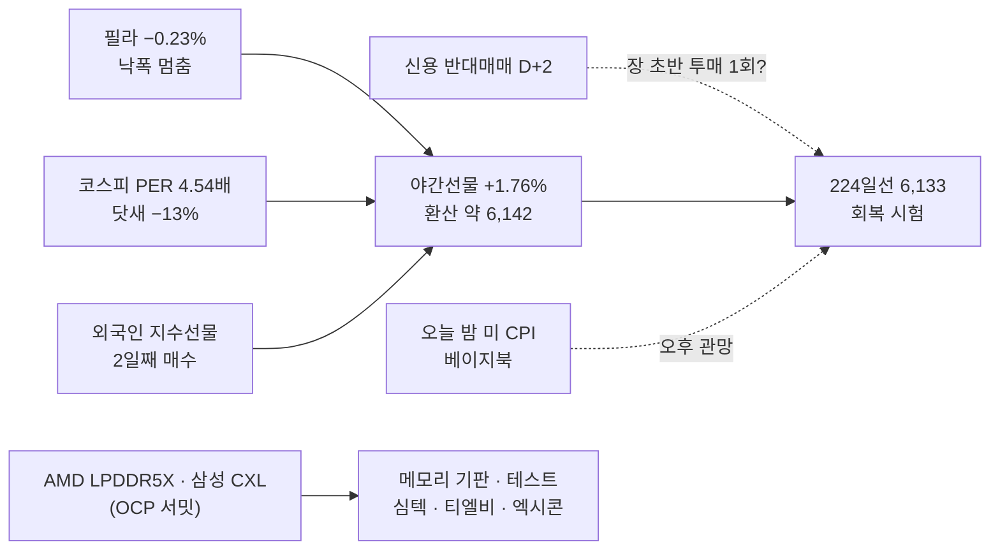

### 📗 저자 시황 판정 (`투자데이터 종합/3차 활용/1_거차재시/시_시황.md`)

> **한 줄 정의** [A-IMI-선정-07] : **닷새 −13% · 사이드카 다음 날, 미국 반도체가 멈추고 야간선물이 처음 되돌린 하락장 — 오늘은 "반대매매 투매를 누가 받나"를 보는 날이고, 돈은 호남 클러스터 · 소부장 개별에 남아 있다**

**① 지수 — 세 프레임** [시황 §2]
| 프레임 | 판정 | 근거 |
|:---|:---|:---|
| ① 이평선 위치 [A-선정-01] | **하락장**(224일선까지 이탈) | 10/13 종가 6,035.35 < 224일선 6,132.7 · 60일선 6,697.1(−9.9%) |
| ② 거래대금 + 20일선 + 고저점(차읽남) | **하락장** | 20일선 아래 · 닷새 저점 하락 / 거래대금은 1013A 참조 |
| ③ 유동성 방향 | **신용 증가(10/08) → 반대매매 단계** | 신용 33.81조 — 줄어드는 과정이 바닥 조건 |

**② 장세 유형** [시황 §3]
| 분류 | 오늘 | 근거 · 대응 |
|:---|:---|:---|
| 차읽남 4대 장세 | **대형주 투매 + 개별 · 정책 테마 버팀** | 10/13 코스피 −5.46% vs 코스닥 −1.43% · 호남 클러스터 서산 2연상 · 소부장 개별 강세 · 품절주 헤지(신라섬유 상) |
| 월독프 6유형 | **지수 하락장** | 외인 매도 → 개인 · 기관(저점 매수 — 클로징) |
| 지수 국면별 [소와곰] | **바닥 확인 전** — "지수가 바닥에서 오를 때는 바닥권 종목" | 바닥 확인 뒤 낙폭 큰 종목 순환 |

**③ 하락의 성격 · 바닥 신호** [시황 §6]
| 질문 | 판정 | 근거 |
|:---|:---|:---|
| 6.1 기계적 vs 판단 | **판단 매도 + 기계적 청산(반대매매) 시작** | 외국인 판단 매도 5일 · **신용 반대매매 D+2(10/14)** · 사이드카 = 패닉 → 저자 : 기계적 청산은 **물량 소화 뒤 빠른 복귀 가능** |
| 6.2 악재의 실체 | 반쯤 | CXMT(실체 있음) · 오픈AI(반박됨) · 자사주 종료(실체) — **"이 정도로 빠질 일인가"(클로징)** |
| 6.3 공포의 끝 | **절반 이상** | 외국인 **지수선물 2일째 매수** ✅ · 콜 매수 · 현물 매도 축소 미확인 |
| 6.4 급반등 3조건 | **약 2/3** | ① **역사적 임계점 — PER 4.54배 사상 최저 · 닷새 −13%** ✅ ② 반대매매 소화 — **오늘 진행 중** △ ③ 기계적 프로그램 매도(비차익 −2.75조) ✅ |
| 6.6 받아주는 손 | **기관 저점 매수 등장(10/13 장중 — 클로징)** | 오늘 외국인 선물 3일째 + 기관이면 손이 생긴다 |
| [주간 0720] | **"패닉셀 뒤 한 번 더 빠지는 자리가 진짜 기회"** | 반대매매 투매 1회 → 직전 저점(5,911) 지키는가 |

**④ 실적 · 이벤트** [시황 §8 · §11]
- **오늘 밤 미 9월 CPI**(+ 베이지북 · BoA · MS · 블랙록 실적) — **장 마감 뒤** 발표 → 오늘 국장은 오후 관망 가능
- 대형 호재 무반응 진행 중(삼성 — 약 보름 쉼) · 미국 4개 선물 : 다우 · S&P · 나스닥100 약보합 · 러셀2000 미확인
- **하락 닷새째 시초 하향 관찰**(10/13 교훈 ②) : 오늘은 야간선물이 **+**라 해당 없음 — 다만 반대매매로 **NXT · 장 초반 갭을 반납하는지**가 같은 시험

**⑤ 지수 하락 시 헤지 테마** [시황 §7] *(10/13 교훈 ① — 고정 헤지 5종 한 줄)*
| 악재 | 수혜 쪽 | 오늘 |
|:---|:---|:---|
| 고정 헤지 5종 | **식량 · 방산 · 희토류 · 품절주 · 원자재** | 10/13 품절주(신라섬유 상) — **반등일이면 헤지는 밀린다** |
| 중동 · 두바이 110 | 에너지 · 해운 · 방산 | 마스가 1 · 2번함 국내 건조(방사청장) — 조선 |

**⑥ 오늘 장전 · 장중 판정 순서 — NXT 이후판** [§0-5 3-15]
1. **08:10~08:45 NXT 프리장** — 야간선물 +1.76%를 삼전 · 하닉이 따라가는가 / **반대매매 물량이 NXT에서 먼저 나오는가**
2. **08:45 코스피200 선물 · 0780 — 외국인 선물 3일째 매수인가**
3. 08:50~55 예상체결 → 09:00 본장이 **NXT 저점을 지키는가**
4. **장 초반 5~10분** — 반대매매 투매가 한 번 더 나오면 **5,911(10/13 저가) · 6,000** 지지 확인 → **되돌린 뒤 첫 눌림이 직전 저점을 안 깨는지** [상천유니온 240718]
5. 대량 프로그램 매도면 **10시 이후 수급 전환** 대기 · 오후는 CPI 앞 관망

### 🧭 대응 (10/14 국장 — 단계 S1)

| 영역 | 대응 | 근거 |
|:---|:---|:---|
| **단계** | **S1 — 대장테마의 대장주만 · 보수**(규칙) — 보완안 채택 시 S0 | 1013A 🚦 · RC-45 |
| **비중** | 삼전·하닉 **500만** / 그 외 **250만** · 당일 청산 · **오버나잇 금지 · 칼 손절** | [F-상천-리스크-01] · RC-16 |
| **대장테마 · 대장주** | **호남 반도체 클러스터 2일차 → 서산(10/12 · 10/13 2연상 · 879억)** · 금호전기(+3.88% · 4,053억)는 거래대금 1위 | 1013A 🧵 |
| 진입 조건(S1) | **2연상 다음 날 갭 순서** — 갭상승 : 시가 지지 → 전일 종가(상한가) → 거래대금 많은 자리 / 갭하락 : 거래대금 많은 자리 → 상한가 종가 회복 · **가장 강한 지지구간에서 지지 확인 뒤만** | `차_차트` §4.6 · RC-45 |
| E21 폭락장 오전 | **해당 없음**(야간선물 +1.76%) | §0-5 3-8 |
| 지수 | 시초 약 **6,142** — 위 **224일선 6,133(저항 → 회복 시험) · 10/13 시가 6,186** / 아래 **6,000 · 10/13 저가 5,911** | 1013A 사다리 |
| 반도체 대형주 | **S1 범위 밖** — 대형 호재 무반응 · 주봉 5 · 20주선 꺾임(클로징) / 반등은 **외국인 현물 매도 축소**로만 확인 | 진입 판단은 사용자 |
| 그 밖 테마 | 메모리 기판 · 테스트(AMD LPDDR5X · CXL — OCP) · 조선(마스가) · LS머트리얼즈(블룸에너지 700억) → **관찰만** | S1은 대장테마 하나 |

### ✅ 1013A 볼 것 확인 (오늘 밤 분)

| 항목 | 결과 | 채점 |
|:---|:---|:---:|
| 필라 · SKHY · 마이크론 — 닷새째 하락인가 · 야간선물이 되돌리는가 | 필라 **−0.23%(닷새째 · 거의 보합)** · **야간선물 +1.76% 되돌림** / SKHY · 마이크론 종가 미확인 | ✅ |
| JPM · GS · C · WFC 실적 / CPI 앞 금리 | JPM 미달 · GS · C 상회 · WFC 매출 미달 / 10년 5.213(−3.5bp) | 확인 |
| 1013A 명제 1~4 | 10/14 국장마감후 채점 | ⏳ |

### 📮 일정 관리 방 전달용 (일정 파일 `updated_at` 2026-10-12 · 읽은 시각 10/14 05:35)

> 이 방은 읽기만 한다 — 1013 전달용 5건이 아직 반영 전이다. 오늘 추가 :
> 1. **10/14(수) 밤 미 9월 CPI · 베이지북 · BoA · 모건스탠리 · 블랙록 실적** — 파일에 없음
> 2. SEDEX 2026 · 월드 시티테크 엑스포(~10/16) · 엔비디아 AI 데이 서울(11/09~10 — 파일에 있음 ✅)

> [!missing] 못 판정한 것
> - 러셀2000 · SKHY · 마이크론 10/13 종가 / 은행 실적 뒤 미국 지수 마감 이유(장중 기사만)
> - 반대매매 금액 · 신용 최신 잔고
> - 장전뉴스 10/14(07:40 이후)

---

## 2026-10-13 (화) — 국장마감후
#시황/국장마감후 #단계/S1 #요인/외국인 #요인/반도체 #테마/호남 #사이드카

> [!danger] 🔴 단계 **S1 — 대장테마 대장주만 · 보수**(10/14 적용 · 규칙) · 하락장 — **매도 사이드카 · 224일선 이탈 · 대형주만 무너졌다**
> 단계 근거 : 위치 **하락장 · 224일선 아래** ✅ · 코스닥 하락비율 **75%** ✅ · 외국인 현물 **−5.22조** + 지수선물 **+3,897억 매수** ❌ → **S0 조건 2/3 = S1** · 바닥 신호 **1/4**
> KOSPI **6,035.35(−5.46%)** · 시가 6,186.08(−3.10%) → **저가 5,911.11(−7.41%)** · **224일선 6,132.7 아래 종가(−1.6%)** · 닷새 약 **−13%** · 거래대금 **26.80조** · 비차익 프로그램 **−2.75조**
> **KOSPI200 −6.25% vs 코스닥 −1.43%** — 삼전 **−7.39%** · 하닉 **−10.09%**(7.63조) / 외국인 코스피 **−5.22조**(5일 15.1조) · 코스닥은 **+1,957억 매수**
> **⚠️ 1012A의 S1 판정 첫 실전 결과 : 코스피 −5.46%(지수 기준 ❌) · 코스닥 −1.43%에 대장테마는 상한가(테마 기준 △)** — 아래 🚦
> 대장테마 = **호남 반도체 클러스터(10/14 2일차)** · 대장 **교체 → 서산(2연상)** · 금호전기 +3.88%(4,053억) / 품절주 헤지(신라섬유 상) · 소부장 개별 강세
> **비중 삼전·하닉 500만 / 그 외 250만 · 당일 청산 · 오버나잇 금지** · ==10/14 밤 미 CPI · 신용 반대매매 D+2 구간 → 오버나잇 절대 금지==

### 🚦 단계 판정 (`_시황판단방법.md` §0-5 2-1 · RC-45)

| 항목 | 오늘 | S0 조건 | 결과 |
|:---|:---|:---|:---:|
| ① 위치 | 6,035.35 < 60일선 6,697.1(−9.9%) · **224일선 6,132.7 아래** | 상승장 아님 | ✅ |
| ② 외국인 현물 · 지수선물 | 현물 **−52,209억** · 지수선물 **+3,897억**(2일째 매수) | 동시 순매도 | ❌ |
| ③ 코스닥 하락비율 | **75%**(코스피 72%) | 60% 이상 | ✅ |
| **판정** | S0 조건 2/3 | | **S1** |

**1012A S1 판정 검증 — 첫 실전**
| 잣대 | 결과 | 채점 |
|:---|:---|:---:|
| 지수(백테스트 잣대 — 다음 날 코스피 · 코스닥) | 코스피 **−5.46%** · 코스닥 −1.43% | ❌ |
| 테마(S1이 실제로 허용한 것 — 대장테마 대장주) | 대장테마 호남 클러스터 **이브닝 1위 칸 유지 · 서산 2연상** / 우리가 고른 대장 금호전기는 +3.88% | △ |
- **읽은 것** : 외국인 지수선물 매수(이틀째)는 **공포 끝 신호가 아니었다** — 현물 −5.22조 · 비차익 −2.75조와 같이 나왔다(현물 매도의 헤지 청산 · 차익 쪽 성격 가능, 확정 아님). **② 조건 하나로 S0을 막은 것이 이틀 연속 지수 기준으로 틀렸다**
- 다만 **코스피 대형주만 무너지고 코스닥 · 테마는 버텼다**(9/14 다음 날과 같은 모양) — S0이었으면 서산 상한가 · 소부장 강세를 버렸다
- → 조건 ② 보완은 **사용자 확인 대기**(아래 ❓) — 오늘은 규칙대로 **S1**, 단 대형주는 완전 배제

- **바닥 신호 1/4** : §6.3 외국인 선물 매수 ✅(2일째) · 콜 매수 ❌(−28억) · 풋 −42억(매도 쪽, 소액) = 절반 / §6.4 급반등 3조건 **1/3**(아래) / §2.2 ❌ / 5일선(6,558) 회복 ❌
- **E21 폭락장 오전** : 오늘이 폭락일(−5.46% · 사이드카)이었다 — 10/14 시초가 또 크게 빠지면 *"강한 종목에서, 전날 밑꼬리 이탈 손절"* 언급
- 지수 상승 수급장 : 해당 없음

### 🎛 한눈에

| 지표 | 값 | 변화 | 신호 | 한 줄 |
|:---|---:|:---|:---:|:---|
| **KOSPI** | 6,035.35 | −348.89 (−5.46%) | 🔴 | 시가 6,186.08 · 고가 6,198.46 → **저가 5,911.11(−7.41%)** · LC 19.68% · HC −35.70% |
| KOSPI200 · KOSPI100 · KTOP30 | 942.07 · 7,316.83 · 16,758.41 | **−6.25% · −6.39%** · −4.97% | 🔴 | **매도 사이드카**(두 달 만 · 이브닝 기사) |
| **KOSDAQ** · 코스닥150 | 837.03 · 1,432.43 | **−1.43%** · −1.30% | 🟡 | 코스피의 1/4만 빠졌다 — 대형주 단독 붕괴 |
| 하락비율 | 코스피 **72%**(247 / 630) · 코스닥 **75%**(422 / 1,250) | | 🔴 | 코스닥 상한가 8 |
| 거래대금 | 코스피 **26.80조**(전일 117%) · 코스닥 6.84조 | 30조의 89% | 🔴 | **하락에 거래가 붙었다** = 투매 |
| **외국인 현물(코스피)** | **−52,209억** | −2.51조 → **−5.22조** | 🔴 | **5일째 조 단위 · 5일 15.1조** |
| 외국인 지수선물 · 달러선물 | +3,897억 · **+13,260억** | | 🟡 | 선물은 이틀째 매수 / **달러 매수 → 원화 약세 1,341** |
| 프로그램 | 차익 +944억 · **비차익 −27,549억** | | 🔴 | 외국인 바스켓 매도 |
| 개인 · 기관 · 기타법인 | **+30,171억** · +17,125억(금융투자 +19,744) · +4,666억 | | 🟡 | 개인 + 금융투자가 받았다 |
| 삼성전자 · SK하이닉스 | **−7.39% · −10.09%** | 5.62조 · **7.63조** | 🔴 | CXMT · 외국인 올해 199조 순매도(기사) |
| VKOSPI | **48.53** | **+19.15%** | 🔴 | 이틀 연속 급등 — 공포 본격화 |
| F 202612 | 944.80 | −63.45 (−6.29%) | 🔴 | 풋 1,005 +141% |
| 원/달러 · 국고 3년 | 1,341.00 · 3.85 | +5.20 · −0.06 | 🟡 | 원화 약세 전환 |
| 미니 S&P · 나스닥(17:57) | 7,856.75 · 30,746.75 | −0.02% · −0.49% | 🟡 | |
| 니케이 · 상해 · 항셍 | 67,778 · 3,801 · 24,345 | **−1.82%** · +0.10% · +0.30% | 🟡 | 일본도 반도체로 빠짐 · 중화권은 보합 |
| 증시주변(10/08) | 예탁금 100.11조 · **신용 33.81조(+2,946억)** · 미수 9,915억(+599억) | | 🔴 | **휴장 전 신용이 늘었다** → 반대매매 물량 |

### 🔗 오늘의 인과

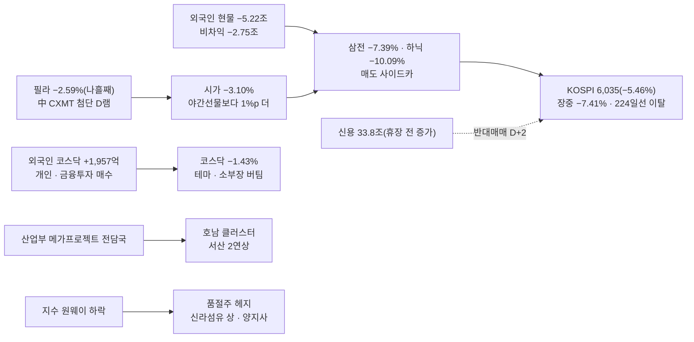

### 📗 저자 시황 판정 (`투자데이터 종합/3차 활용/1_거차재시/시_시황.md`)

> **한 줄 정의** [A-IMI-선정-07] : **외국인이 닷새 15조를 던져 사이드카가 걸린 대형주 투매장 — 코스피 대형주만 무너졌고, 코스닥 · 테마(호남 · 소부장 · 품절주)는 버텼다**

**① 지수 — 세 프레임** [시황 §2]
| 프레임 | 판정 | 근거 |
|:---|:---|:---|
| ① 이평선 위치 [A-선정-01] | **하락장 — 224일선까지 이탈** | 6,035 < 224일선 6,132.7 · 60일선 −9.9% · 5(6,558) < 60(6,697) < 10(6,736) < 20(6,803) = 단기 역배열 |
| ② 거래대금 + 20일선 + 고저점 | **하락장 3/3** | 26.80조(30조 미달이지만 **하락에 거래 증가 = 투매**) · 20일선 −11.3% · 닷새 저점 · 고점 하락 |
| ③ 유동성 방향 | **빠지는 중** | 예탁금 100.11조(10/08, −2,697억) · 9/29 정점 대비 −7.6조 / **신용은 +2,946억 늘었다** |
- **지수 −5.46% = 저자 "−3% 이상"** → 내 종목이 지수와 같이 빠졌는지 따로 본다 — 오늘 테마는 지수와 반대로 갔다

**② 장세 유형** [시황 §3]
| 분류 | 오늘 | 근거 · 대응 |
|:---|:---|:---|
| 차읽남 4대 장세 | **개별 · 정책 테마 장세** | 대형주 투매 속 국내 정책(호남) · 개별 계약(야스 2,000억 · 인텍플러스 309억) · M&A(롯데손보) |
| 월독프 6유형 | **지수 하락장 — 헤지 테마가 나왔다** | **품절주(신라섬유 상 · 양지사)** = 저자 고정 헤지 · "품절주 연쇄 양지사 → 신라섬유" 그대로 |
| 장세별 베팅 | **하락장 = 보수적 낮은 타점 · 매도는 짧게** | S1 |

**③ 하락의 성격** [시황 §6]
| 질문 | 판정 | 근거 |
|:---|:---|:---|
| 6.1 기계적 vs 판단 | **판단 매도 + 기계적 시작** | 외국인 현물 −5.22조 · 비차익 −2.75조(판단 바스켓) / **사이드카 · 장중 −7.41%** — 신용 반대매매는 D+2(10/14~15)부터 |
| 6.2 악재의 실체 | **실체 있음 + 수급** | CXMT 기술 진전 · 외국인 올해 199조 순매도(기사) · "AI 리스크 = 자본조달 비용"(인텔 · 브로드컴 CEO) |
| 6.3 공포의 끝 | **절반** | 외국인 지수선물 +3,897억(2일째) ✅ · 콜 −28억 ❌ · 풋 −42억(매도 쪽 · 소액) |
| 6.4 급반등 3조건 | **1/3** | ① 역사적 낙폭 임계점 **△ 접근**(닷새 −13% · 사이드카 · 장중 −7.4% = 서킷 −8% 직전) ② 신용 반대매매 소화 **❌**(10/08 신용 증가 · D+2 전) ③ 기계적 프로그램 매도 **△**(비차익 −2.75조) |
| 6.6 받아주는 손 | **개인 +3.02조 · 금융투자 +1.97조** | 외국인은 코스닥만 샀다 |
| 6.5 헤드라인 vs 구조 | **구조**(외국인 연간 비중 축소 · 메모리 경쟁) | 대형주는 계속 쉰다 |
- **[주간 0720] 최악 시나리오** : *"패닉셀 후 서킷이 걸리고 한 번 더 빠지는 것인데, 그 자리가 진짜 기회"* · *"반대매매를 막으려고 더 넣은 돈은 한 번 더 빠지면 못 버틴다 — 그 물량이 어디까지 나오는지를 봐야"* → **급반등 자리 = 관종 · 현금만 준비**(사지 않는다)

**④ 실적 · 이벤트** [시황 §8 · §11]
- **대형 호재 무반응 진행 중** [A-주간-판단-04] — 삼성 실적 뒤 사흘 하락(−2.42 · −4.39 · −7.39%)
- **10/14(수) 밤 CPI** · 이번 주 TSMC · ASML · 미 은행 실적(오늘 밤) — 클로징 *"CPI가 금리 걱정을 덜어주거나 TSMC · ASML이 업황을 보여주면 반등에 힘"*
- 실적 셀온 : **에이피알 −19.60%**(3Q 컨센 5% 하회) — 실적 시즌 눈높이가 높다

**⑤ 지수 하락 시 헤지 테마** [시황 §7]
| 악재 | 저자 표 | 오늘 실제 |
|:---|:---|:---|
| 지수 원웨이 하락 | **고정 헤지 = 식량 · 방산 · 희토류 · 품절주 · 원자재** · 품절주 연쇄(양지사 → 신라섬유) | **품절주 신라섬유 상 · 양지사 +5.76%** — 저자 표 그대로 |
| 중동 | 에너지 · 원유 · 방산 · 물류 | 미등장(유가 소폭 하락 · 러-우 에너지 휴전) |
| 외국인 대형주 매도 | (저자 표 없음) | 피해 = 반도체 대형주 → 회피 / **반대로 소부장 개별 강세** |

### 📐 코스피 사다리 (10/13 종가 기준 · HTS 일봉)

| 선 | 값 | 종가 대비 | 거리 | 역할 |
|:---|---:|---:|:---|:---|
| 100일 | 7,263.3 | +20.35% | `▲▲▲▲▲▲▲▲` | |
| 120일 | 7,199.7 | +19.29% | `▲▲▲▲▲▲▲▲` | |
| 20일 | 6,802.7 | +12.71% | `▲▲▲▲▲▲▲` | |
| 45일 | 6,750.3 | +11.85% | `▲▲▲▲▲▲` | |
| 10일 | 6,736.4 | +11.62% | `▲▲▲▲▲▲` | |
| 60일 | 6,697.1 | +10.96% | `▲▲▲▲▲` | |
| 5일 | 6,558.2 | +8.66% | `▲▲▲▲` | |
| *10/12 저가 · 종가* | *6,368.5 · 6,384.2* | *+5.5 · +5.8%* | `▲▲▲` | |
| *오늘 시가 · 고가* | *6,186.1 · 6,198.5* | *+2.50 · +2.70%* | `▲▲` | **오늘 강도선(시가)** |
| **224일** | **6,132.7** | **+1.61%** | `▲` | **오늘 종가 이탈 — 이제 저항** |
| **종가** | **6,035.35** | — | `◆` | |
| 라운드 6,000 | 6,000 | −0.59% | `▼` | |
| **저가** | **5,911.1** | **−2.06%** | `▼▼` | 장중 −7.41% |
| 서킷 1단계(−8%) 환산 | 약 5,553 | −8.0% | `▼▼▼▼▼▼▼▼` | [F-주간-판단-02] 서킷 가격대 기록 |

- 저항 : **224일선 6,133 → 시가 6,186 → 6,368~6,384(10/12)** / 지지 : **6,000 → 오늘 저가 5,911**

### 🔥 트리거

| 층 | 요인 | 이전 → 지금 | 상태 | 신호 |
|:---:|:---|:---|:---|:---:|
| 1 | **외국인** | 4일 9.86조 | **5일 15.1조**(오늘 −5.22조) · 비차익 −2.75조 · 지수선물 +3,897억 | 🔴 |
| 1 | **사이드카 · 224일선** | — | **매도 사이드카(두 달 만)** · 224일선 이탈 · 장중 −7.41% | 🔴 |
| 1 | 변동성 | VKOSPI 40.7 | **48.53(+19.15%)** | 🔴 |
| 1 | 신용 | 33.52조 | **33.81조(+2,946억, 10/08)** — 반대매매 대기 | 🔴 |
| 1 | 원화 | 1,331.6 | 1,341.0 — 외국인 달러선물 +1.33조 | 🔴 |
| 2 | **호남 반도체 클러스터** | 0일차 | **1일차 — 대장 교체 서산 2연상**(879억) · HC보광산업 +12.37% · 금호전기 +3.88%(4,053억) / 산업부 메가프로젝트 전담국 | 🟢 |
| 2 | **반도체 소부장(개별)** | 약화(10/12) | **대형주 반대로 강세** — 야스 +16.14%(LGD 2,000억) · 삼화전기 +15.83%(MLCC) · 네오티스 +11.40% · 에스티아이 +9.84%(2나노) · 인텍플러스 · 두산테스나 · PSK홀딩스 | 🟢 |
| 2 | **품절주(헤지)** | — | **신규 0일차** — 신라섬유 상 · 양지사 | 🟢 |
| 2 | 바이오 | 이탈 | **새 0일차** — 국제약품 +15.40%(1,419억 · 페스트 감시 강화) · HLB바이오스텝 +12.05%(리픽투 NCCN 등재) | 🟡 |
| 2 | 보안 | 반복 | **새 0일차** — 안랩 +10.51% · 라온시큐어 · 파수AI | 🟡 |
| 2 | 개별 | | 롯데손보 +7.94%(신한 인수) · 가온전선(美 원전 케이블) · 하이브 · **LG엔솔 +3.02%(엘앤에프 LFP 조 단위)** / **에이피알 −19.60% · 올릭스 −14.31%** | 🟡 |
| 2 | 해운 · 전고체 · 의료기기 | 0일차(10/12) | **이탈**(1일차) | 🔴 |

### 💰 수급 (억 원)

| 주체 | 코스피 현물 | 코스닥 현물 | 지수선물 | 주식선물 | 달러선물 |
|:---|---:|---:|---:|---:|---:|
| 개인 | **+30,171** | −2,554 | +1,237 | −711 | −2,725 |
| **외국인** | **−52,209** | **+1,957** | +3,897 | +4,007 | **+13,260** |
| 기관계 | +17,125 | +469 | −5,279 | −3,697 | −10,535 |
| └ 금융투자 | **+19,744** | +1,803 | +2,671 | +2,115 | −8,174 |
| └ 투신 | −4,108 | −723 | −6,774 | −4,873 | −238 |
| 기타법인 | +4,666 | +145 | +144 | +401 | −842 |

- 외국인 **코스피 현물 −5.22조 · 코스닥 +1,957억** — 대형주만 판다 / 프로그램 비차익 **−2.75조** · 차익 +944억
- 외국인 지수선물 +3,897억 · 주식선물 +4,007억 — 현물 매도분 헤지 청산 성격일 수 있다(확정 아님)

### 🧵 주도 테마 (Signal Evening 14140 · 일차 = `_매매제안방법.md` §0-4 6)

| 순위 | 테마(줄기) | 등급 | 일차(10/13 → 10/14) | 대장 이력 | 거래대금 |
|:---:|:---|:---:|:---:|:---|:---|
| 1 | **호남 반도체 클러스터** | A | **1 → 2일차** | 0일차 10/12 금호전기 상(1,324억) · 서산 상 → 1일차 10/13 **서산 상(2연상 · 879억) — 교체** · HC보광산업 +12.37% · 금호전기 +3.88%(4,053억) | 금호전기 4,053억 · 서산 879억 |
| 1-b | **반도체 소부장(개별)** | B+ | 10일차↑ | 10/08 두산테스나 → 10/12 엑시콘 → 10/13 **야스 +16.14%**(LGD 증착기 2,000억) · 삼화전기 +15.83% · 네오티스 · 에스티아이 · 인텍플러스 · 두산테스나 +7.43%(1,222억) · PSK홀딩스 | 두산테스나 1,222억 · PSK 528억 |
| 2 | **품절주(헤지)** | B | **0 → 1일차** | 0일차 10/13 **신라섬유 상** · 양지사 +5.76% | 소액(30 · 68억) |
| 3 | 바이오(감염병 · HLB) | B | **0 → 1일차**(새 파동) | 국제약품 +15.40%(1,419억) · 녹십자엠에스 / HLB바이오스텝 +12.05% · HLB글로벌 | 국제약품 1,419억 |
| — | 보안 | C | 0 → 1일차 | 안랩 +10.51% · 라온시큐어 +6.06%(2,583억) · 파수AI | 라온시큐어 2,583억 |
| — | 개별 | | | 롯데손보 · 가온전선 · 하이브 · LG엔솔(LFP) / 에이피알 −19.60% | |
| ✕ | 이탈 | | | 해운 · 전고체 · 의료기기 미용(1일차) · 서울고터 | |

### ✅ 직전 명제 채점

**1012A 국장마감후 명제**

| # | 명제 | 결과 | 채점 |
|:---:|:---|:---|:---:|
| 1 | 10/13 코스피 종가 6,300 위 | 6,035.35 | ❌ |
| 2 | 외국인 현물 순매도 1조 미만으로 축소(하) | −5.22조 | ❌ |
| 3 | 호남 반도체 클러스터 1일차 이브닝 재등장 | 1위 칸 · 서산 2연상 | ✅ |
| 4 | VKOSPI 40 아래 | 48.53 | ❌ |

> [!caution] 총평
> **방향(하락 · 외국인 · 대형주 약세 · 대장테마 유지)은 맞았고, 크기를 또 놓쳤다.** 야간선물 −2.09%를 시초 −2.1%로 봤는데 실제 시가는 −3.10%, 장중 −7.41%까지 갔다. **S1 판정은 지수 잣대로는 틀렸고(외국인 선물 매수가 공포 끝이 아니었다), 테마 잣대로는 반쯤 맞았다**(대장테마 1위 유지 · 대장은 서산으로 교체).

> [!example] 📊 예측 채점 → [[예측대조_2026#2026-10-13 (화)|원장 10/13]]
> - **A : 6/8** — 중 3/4 · 하 2/3 · 최하 1/1
> - **B : 1위 호남 ✅ · 2위 MLCC · 기판 △(삼화전기 · 네오티스) · 3위 해운 · 방산 ❌(헤지는 품절주로 나왔다)**
> - **C : ✅4 · △4 · ❓6**

### 📋 볼 것

> [!todo] 오늘 밤 (미국 10/13 — 은행 실적)
> - [ ] 필라 · SKHY · 마이크론 — **닷새째 하락인가** · 야간선물이 되돌리는가
> - [ ] JPM · GS · C · WFC 실적 / 10/14 밤 CPI 앞 금리

> [!todo] 10/14(수) 국장
> - [ ] **신용 반대매매(D+2)** — 장 초반 투매가 한 번 더 나오는가 [주간 0720 "한 번 더 빠지는 자리"]
> - [ ] **외국인 현물 매도 축소 + 선물 · 콜 매수** — 공포 끝 신호 나머지 절반
> - [ ] 224일선 6,133 회복 / 6,000 · 5,911 지지
> - [ ] **호남 클러스터 2일차 — 서산 3연상 · 대장 거래대금 50%↑** · 소부장 개별 강세가 이어지는가

### ❓ 검증 대상 명제 · 사용자 확인

| # | 명제 | 기준 | 채점 |
|:---:|:---|:---|:---:|
| 1 | 10/14 코스피 **종가 6,000 위** | 6,000 | ⬜ |
| 2 | **외국인 코스피 현물 조 단위 매도 6일째** — 확신도 최하 | −1조 | ⬜ |
| 3 | **코스닥 > 코스피**(등락률) | 등락률 | ⬜ |
| 4 | 호남 클러스터 2일차 이브닝 1~3위 유지 | 이브닝 | ⬜ |

> [!question] 사용자 확인 — RC-45 조건 ② 보완
> 외국인 지수선물 매수가 **이틀 연속 S0을 막았는데 지수는 −3.65% · −5.46%** 빠졌다. 보완 후보 :
> ① **외국인 현물이 조 단위(−1조 이하)면 선물 방향과 관계없이 ② 충족** ② **지수 −3% 이상 + 하락비율 70% 이상이면 ② 없이 S0** ③ 지금대로(테마는 버텼으니 S1 유지)
> — 백테스트 19일 + 10/12 · 10/13에 대 보면 **①도 ②도 새로 잡히는 날은 10/12 · 10/13 둘뿐**(나머지 외국인 조 단위 매도일은 코스닥 하락비율 60% 미만이라 그대로 제외) → 10/12는 다음 날 −5.46%로 맞았고, 10/13은 내일 결과로 본다 / 대가 : 10/13처럼 테마가 버틴 날도 쉬게 된다

> [!missing] 못 판정한 것
> - 사이드카 발동 시각 · 지속 시간(기사 제목만) / 삼전 · 하닉 종가(이브닝 등락률) / 서산 · 금호전기 장중 흐름(분봉 없음)
> - 클로징 10/13 원본 없음 · 증시주변은 10/08 기준(휴장 뒤 신용 · 반대매매 최신 미확인)

> [!info]- 출처 · 형
> **출처**
> - 사용자 제공 : HTS 코스피 일봉 창 · 시장 요약표(10/13 17:57~18:00) · 증시주변 10/08 기준 · 프로그램 차익 · 비차익
> - 시그널리포트 원본 : **이브닝 14140** · 다이제스트 14132 · 클로징 14131(10/12)
>
> **형** : 국장마감후
> - 태그 : `[본인시황 1013A]` · 요인값 → [[요인값변천사_2026#2026-10-13 (국장마감후)]] · 예측 채점 → [[예측대조_2026#2026-10-13 (화)]] · 단계 → [[시황단계_백테스트]]

---

## 2026-10-13 (화) — 미장마감후
#시황/미장마감후 #단계/S1 #요인/반도체 #요인/외국인 #테마/호남

> [!danger] 🔴 단계 **S1 — 대장테마 대장주만 · 보수**(1012A) · 하락장 — 미국은 지수 보합, **반도체만 나흘째 빠졌다**
> 미국 10/12(콜럼버스데이 · 채권 휴장) : S&P 7,806.14(**−0.07%**) · 나스닥 27,248.01(−0.43%) · **필라 12,246.4(−2.59%)** · SOXX −2.55% · **SOXL −7.95%** — 필라 30종목 전부 하락(장중 기사) · 마이크론 · 브로드컴 −4%대(장중) · **中 CXMT 첨단 D램 진전** · AI 지출 의심 지속
> 야간선물 **987.20(−21.05, −2.09%)** — HTS [5401] · 주간 종가 1,008.25 · 코스피 환산 약 **6,251** = **8월 저점권 6,300 아래 · 224일선 6,124 위**
> **비중 삼전·하닉 500만 / 그 외 250만 · 당일 청산 · 오버나잇 금지 · 칼 손절** · 보유 없음 · 대장테마 = **호남 반도체 클러스터 1일차 → 금호전기** · ==오늘 밤 미 은행 실적(JPM · GS · C · WFC) → 10/14 밤 CPI==

### 🎛 한눈에

| 지표 | 값 | 변화 | 신호 | 한 줄 |
|:---|---:|:---|:---:|:---|
| S&P 500 · 나스닥 | 7,806.14 · 27,248.01 | −0.07% · −0.43% | 🟡 | 지수는 보합 — 다우는 장중 +0.3~0.4%(기사) |
| **필라 반도체** | **12,246.4** | **−326.0 (−2.59%)** | 🔴 | **나흘째 하락**(10/07 13,066 → −6.3%) |
| SOXX · SOXL | 545.16 · 128.65 | −2.55% · **−7.95%** | 🔴 | |
| QQQ · TQQQ | 745.98 · 79.58 | −0.70% · −2.09% | 🔴 | |
| 러셀2000 | **미확인** | — | ⬜ | 검색으로 종가 못 찾음 [§0-5 3-12] |
| SK하이닉스 ADR(SKHY) | **미확인** | — | ⬜ | |
| **미 10년** ✔체크 | 5.238 | −0.006 | 🟡 | **채권시장 휴장** — 2 · 20 · 30년 변동 없음(4.791 · 5.650 · 5.599) |
| **일본 30년** ✔체크 · 일본 10년 | 4.055 · 3.002 | −0.001 · +0.001 | 🟢 | 금요일 큰 폭 하락 뒤 그대로 |
| **WTI** ✔체크 · 브렌트 · 두바이 | 93.33 · 106.19 · 108.96 | −0.44% · −0.43% · −0.27% | 🔴 | 90 위 · 러-우 에너지 휴전 · 이란 중재 의사로 소폭 하락 |
| 금 | 4,193.59 | +0.07% | 🟡 | |
| 원/달러 | **1,334.09** | **−6.16** | 🟡 | 원화 강세 지속 |
| VIX | 15.23 | +2.63% | 🟡 | 반도체 −2.6%에도 공포는 낮다 — **미국은 반도체만의 문제** |
| 미 선물(04:48) | S&P 7,854.25 · 나스닥100 30,888.25 | −0.07% · −0.71% | 🟡 | |
| **야간선물** | **987.20**(HTS [5401]) | **−21.05 (−2.09%)** | 🔴 | 거래량 20,746 · 코스피 환산 약 **6,251** |

> [!info]- 신호등 기준
> 🟢 국장에 우호 · 🟡 중립·경계 · 🔴 역풍. 판정은 **국장 대형주에 미치는 영향** 기준 · ✔체크 = 사용자 매일 확인 항목(`checklist.json`) · 표의 "코스피200 선물(F) 1,035.05"는 갱신 시각이 08/10이라 쓰지 않았다

### 🧮 이익 · 할인율 장부 (시험)

| 칸 | 지난밤 | 방향 |
|:---|:---|:---:|
| **분자 — 이익** | **반도체 이익 의심 계속** — AI 지출 의심 + **中 CXMT 첨단 D램 진전 → 메모리 경쟁** · 마이크론 −4%대 / 국내 : 삼성 실적 뒤 이틀 하락 = 대형 호재 무반응(1012A) | ⬇ |
| **분모 — 단기 · 장기 할인율** | 채권 휴장 — 10년 5.238 · 2년 4.791 그대로 / **10/14 밤 CPI**가 다음 분기점 | ↔ |
| **분모 — 위험 프리미엄(VIX)** | 15.23 — 낮다 | ↔ |
| **수급**(국장) | 외국인 4일 **9.86조** 매도 · 10/12 **지수선물 +7,522억 매수 전환**(공포 끝 신호 절반) · 삼성 자사주 매입 종료(하방 지지 약화 — 클로징) | ⬇ |

- 판정 : **미국은 지수가 아니라 반도체만 빠졌다**(VIX 낮음 · 다우 강보합) → 국장에선 **반도체 대형주 · 소부장이 다시 맞는 날**이고, 이미 나흘 −8% 빠진 지수가 −2% 더 시작한다. 다만 10/12 외국인 선물 매수 전환이 오늘도 이어지는지가 바닥 신호의 절반을 결정한다

### 🔗 오늘의 인과

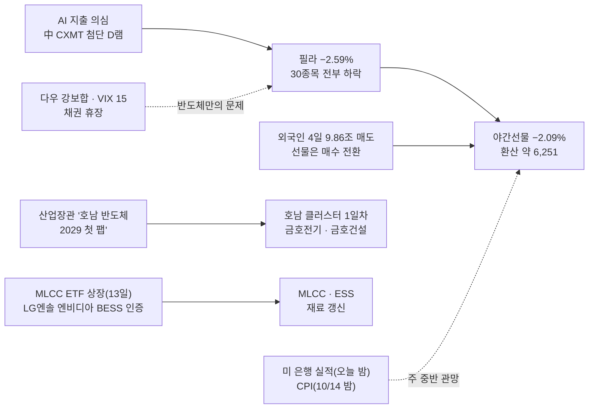

### 📗 저자 시황 판정 (`투자데이터 종합/3차 활용/1_거차재시/시_시황.md`)

> **한 줄 정의** [A-IMI-선정-07] : **외국인이 나흘 9.86조를 판 하락장에 미국 반도체 −2.6%가 한 번 더 얹혔다 — 지수는 6,250 부근에서 시작하고, 돈은 호남 반도체 클러스터 같은 국내 정책 재료에만 남았다**

**① 지수 — 세 프레임** [시황 §2]
| 프레임 | 판정 | 근거 |
|:---|:---|:---|
| ① 이평선 위치 [A-선정-01] | **하락장** | 10/12 종가 6,384.24 < 60일선 6,709.9(−5.1%) · 시초 약 6,251이면 **8월 저점권 6,300 아래** |
| ② 거래대금 + 20일선 + 고저점(차읽남) | **하락장 3/3** | 21.33조(30조의 71%) · 20일선 아래 · 나흘 저가권 마감 |
| ③ 유동성 방향 | **확인 필요** | 증시주변 최신 수치 없음(10/06 기준 예탁금 101.05조) — 반대매매 · 신용 감소 여부가 급반등 조건 ② |
- 시초 −2.1%는 차읽남 기준 **−3% 미만** — 그러나 나흘 누적 −8% 위에 얹히는 갭이라 **누적 −10%** 근처가 된다

**② 장세 유형** [시황 §3]
| 분류 | 오늘 | 근거 · 대응 |
|:---|:---|:---|
| 차읽남 4대 장세 | **개별 · 정책 테마 장세(약)** | 실적(삼성)은 무반응 · 반도체 대형주 이탈 → 남은 돈은 **국내 정책 재료(호남 클러스터)** · 개별 공시(엘앤씨바이오 820억) |
| 월독프 6유형 | **지수 하락장**(외인 매도 → 개인 받음) | 헤지 테마 → ⑤ |
| 장세별 베팅 [차읽남] | **하락장 = 보수적 낮은 타점 · 매도는 짧게** | S1 — 대장테마 대장주 하나 |

**③ 하락의 성격** [시황 §6]
| 질문 | 판정 | 근거 |
|:---|:---|:---|
| 6.1 기계적 vs 판단 | **판단 매도** | 외국인 4일 현물 매도 · 삼성 자사주 매입 종료(받아주던 손이 빠짐) · 미국 반도체 하락 |
| 6.2 악재의 실체 | **새 악재 실체 있음**(CXMT 기술 진전 — 경쟁) / AI 지출 의심은 블룸버그 반박으로 반쯤 약화 | 실체 있는 악재 = 되돌림 대상 아님 |
| 6.3 공포의 끝 | **절반**(10/12 외국인 지수선물 +7,522억) | 오늘 **선물 매수가 이어지고 콜 매수가 붙으면** 나머지 절반 |
| 6.4 급반등 3조건 | **0.5/3** | ① 누적 −10% 근처 = 임계점에 다가감(△) ② 반대매매 소화 미확인 ③ 기계적 매도 아님 |
| 6.6 받아주는 손 | **개인뿐 · 삼성 자사주 종료** | 주도주(반도체) 5일째 — 외국인 방향 전환이 신호 |
| 6.5 헤드라인 vs 구조 | **구조 쪽**(메모리 경쟁 · AI 이익) | 반도체 대형주는 쉬는 쪽(대형 호재 무반응 · 약 보름) |

**④ 실적 · 이벤트** [시황 §8 · §11]
- **대형 호재 무반응 진행 중** [A-주간-판단-04] — 삼성 실적 뒤 이틀 하락(1012A 해당) → 대형주 약 보름 쉼(10/27 무렵까지)
- **오늘 밤 미 은행 실적**(JPM · GS · C · WFC) · **10/14 밤 미 9월 CPI** · 이번 주 TSMC · ASML 실적(클로징 — "업황이 멀쩡하다는 걸 다시 보여주면 반등에 힘") → **월~수 관망 · 목요일 이후 방향**
- 미국 4개 선물 [A-선정-05] : 다우 강보합 · S&P 보합 · 나스닥100 −0.71% · **러셀2000 미확인** → 대형 가치주만 버티고 기술주 약세
- 야간선물이 빠졌으면 **장 초반 약세 전제** [A-IMI-진입-06]

**⑤ 지수 하락 시 헤지 테마** [시황 §7] *(10/12 교훈 ③ — 지수 큰 하락 예상일엔 헤지 "중")*
| 악재 | 수혜 쪽 | 오늘 볼 것 |
|:---|:---|:---|
| 반도체 · AI 이익 의심 | 국내 정책 재료(호남 클러스터) — 미국 반도체와 무관한 쪽 | 금호전기 · 금호건설(애프터 +2.69%) |
| 중동(브렌트 106 · 두바이 109) | 에너지 · 해운 · 방산 | 해운(10/12 0일차) — 단 유가 소폭 하락 · 러-우 에너지 휴전 |
| 고정 헤지 | 식량 · 방산 · 희토류 · 품절주 · 원자재 | 지수 원웨이 하락이면 먼저 스캔 |
| 메모리 경쟁(CXMT) | (저자 표 없음) | 피해 = 메모리 대형주 · 소부장 → 회피 |

**⑥ 오늘 장전 · 장중 판정 순서 — NXT 이후판** [§0-5 3-15]
1. **08:10~08:45 NXT 프리장** — 금호전기 갭 · 삼전 · 하닉이 야간선물(−2.09%) · 필라(−2.59%)를 얼마나 반영하나
2. **08:45 코스피200 선물 · 0780** — **외국인 선물 매수가 이어지는가**(10/12 +7,522억) · 1,000억↑이면 방향 고정
3. 08:50~55 예상체결 → 09:00 본장이 **NXT 저점을 지키는가**
4. 장 초반 5~10분 성격 확정 · 대량 프로그램 매도면 **10시 이후 수급 전환**까지 대기
5. 급락 중 반등은 **되돌린 뒤 첫 눌림이 직전 저점을 안 깨는 것**을 보고

### 🧭 대응 (10/13 국장 — 단계 S1)

| 영역 | 대응 | 근거 |
|:---|:---|:---|
| **단계** | **S1 — 대장테마의 대장주만 · 보수** | 1012A 🚦(S0 조건 2/3) · RC-45 |
| **비중** | 삼전·하닉 **500만** / 그 외 **250만** · 당일 청산 · **오버나잇 금지 · 칼 손절** | [F-상천-리스크-01] · RC-16 |
| **대장테마 · 대장주** | **호남 반도체 클러스터 1일차 → 금호전기**(0일차 상 · 1,324억) · 재료 갱신 : **산업장관 "2029년 첫 팹 완공 · 2030년 초 양산 · 의구심 갖지 않아도 돼"**(애프터 금호건설 +2.69%) | 1012A 🧵 · 다이제스트 14132 |
| 진입 조건(S1) | 1012A 그대로 — 상한가 다음 날 갭 순서(갭상승 : 시가 지지 → 전일 종가 → 거래대금 많은 자리 / 갭하락 : 거래대금 많은 자리 → 상한가 종가 회복) + **가장 강한 지지구간에서 지지 확인 뒤만** | `차_차트` §4.6 · RC-45 |
| **E21 폭락장 오전** | 야간선물 −2.09% · 필라 −2.59% — **폭락 아님(사용자 기준) · 언급 유지** : *"지수 폭락일 오전, 강한 종목에서, 전날 밑꼬리 이탈 손절"* | §0-5 3-8 |
| 지수 | 시초 약 **6,251** — 위 **6,300 · 6,368(10/12 저가) · 시가 6,578** / 아래 **224일선 6,124 · 라운드 6,000** | 1012A 사다리 |
| 반도체 대형주 | **S1 범위 밖** — 대형 호재 무반응(약 보름 쉼) + 필라 나흘째 + CXMT | 진입 판단은 사용자 |
| 그 밖 테마 | MLCC(ETF 13일 상장) · ESS(LG엔솔 엔비디아 BESS 인증) · 해운 · 엘앤씨바이오(820억 공시) → **관찰만** | S1은 대장테마 하나 |
| ⚠️ S0 경계 | 오늘 **외국인 현물 · 지수선물 동시 매도 + 코스닥 하락비율 60%↑**면 장 마감 뒤 **S0(쉼)** 판정 | RC-45 |

### ✅ 1012A 볼 것 확인

| 항목 | 결과 | 채점 |
|:---|:---|:---:|
| 미국 지수 · 필라 · SKHY · 야간선물 — **야간선물이 되돌리는지** | 되돌리지 못했다 — **야간선물 −2.09%** · 필라 −2.59% / SKHY 미확인 | ❌ |
| 하닉 60조↑ 추가 주주환원 발표 시점 | 다이제스트 일정 "10월 중" 그대로 · 발표 없음 | ⬜ |
| 1012A 명제 1~4 | 10/13 국장마감후 채점 | ⏳ |

### 📮 일정 관리 방 전달용 (일정 파일 `updated_at` 2026-10-12 · 읽은 시각 10/13 05:07)

> 이 방은 읽기만 한다 — 아래는 일정 관리 방에 넘길 내용
> 1. **10/14(수) 밤 미 9월 CPI** — 파일에 없음(1012A에서도 지적)
> 2. **10/13(화) 밤 미 은행 실적(JPM · GS · C · WFC) · 유나이티드헬스 · J&J** — 다이제스트 주간 일정
> 3. **이번 주 TSMC · ASML 3Q 실적**(날짜 확인 필요) · 세미콘 웨스트(~10/15) · KES 2026(~10/16)
> 4. **SK하이닉스 3Q 실적** — 다이제스트 **10/28** · 1012A는 10/27로 적음 → 확인
> 5. 삼성전자 3Q 컨퍼런스콜 10/29 · 현대차 테크 비전 10/23 · 10/26~27

> [!missing] 못 판정한 것
> - 러셀2000 · SKHY · 마이크론 10/12 종가(필라 세부는 장중 기사)
> - 증시주변(예탁금 · 신용 · 반대매매) 최신 수치
> - 장전뉴스 10/13(07:40 이후)

---

## 2026-10-12 (월) — 국장마감후
#시황/국장마감후 #단계/S1 #요인/외국인 #요인/반도체 #테마/호남

> [!danger] 🔴 단계 **S1 — 대장테마 대장주만 · 보수**(10/13 적용) · 하락장 — 갭은 작았는데 하루 종일 밀렸다
> 단계 근거 : 위치 **하락장**(60일선 −5.1%) ✅ · 코스닥 하락비율 **87%** ✅ · 외국인 현물 −2.51조 **+ 지수선물 +7,522억 매수** ❌(동시 매도 아님) → **S0 조건 2/3 = S1** · 바닥 신호 **0.5/4**
> KOSPI **6,384.24(−3.65%)** · 시가 6,578.17(**−0.72%**) = 사실상 고가 → 저가 6,368.49 근처 마감 · **나흘 연속 저가권 마감 · 나흘 약 −8%** · 거래대금 **21.33조**(30조의 71%) · 외국인 현물 **−2.51조(4일째 조 단위 · 4일 9.86조)**
> 코스닥 **849.19(−4.83%)** · 하락비율 코스피 **81%**(166 / 720) · 코스닥 **87%**(223 / 1,465) = **전 종목 하락** · VKOSPI **40.73(+10.65%)**
> 대장테마 = **호남 반도체 클러스터**(10/13 1일차) · 대장주 = **금호전기**(상 · 1,324억) — 해운 · 전고체 · 의료기기는 관찰만 / **10/08 버틴 ESS · HLB는 이탈**
> **비중 삼전·하닉 500만 / 그 외 250만 · 당일 청산 · 오버나잇 금지** · ==삼성 실적 뒤 이틀째 못 감 = 대형 호재 무반응 해당 → 대형주 약 보름 쉼== [A-주간-판단-04]
> *🔄 10/12 재작성 — 매매 단계 S0~S3(§0-5 2-1 · RC-45) 적용 · "보수 덮개 3일차" 표기를 단계로 바꿈(사용자 "오늘 시황 다시 작성해서 보고해")*

### 🚦 단계 판정 (`_시황판단방법.md` §0-5 2-1 · RC-45)

| 항목 | 오늘 | S0 조건 | 결과 |
|:---|:---|:---|:---:|
| ① 위치(프레임 ①) | 6,384.24 < 60일선 6,709.9(−5.1%) · 20일선 6,853.5(−7.35%) | 상승장 아님 | ✅ |
| ② 외국인 현물 · 지수선물 | 현물 **−25,094억** · 지수선물 **+7,522억** | 동시 순매도 | ❌ |
| ③ 코스닥 하락비율 | **87%**(코스피 81% — 보조) | 60% 이상 | ✅ |
| **판정** | S0 조건 2/3 · 하락장 | | **S1** |

- **보수 덮개**(하락추세 ✅ · 거래대금 감소 ✅ 71% · 악재 다수 ✅) 3/3 — 하락장은 이미 S1이라 더 내리지 않는다(§0-5 2-1)
- **바닥 신호 0.5/4** : §6.3 외국인 선물 매수 ✅ · 콜 매수 ❌ = 절반 / §6.4 급반등 3조건 0/3 / §2.2 되돌린 뒤 첫 눌림 저점 유지 ❌(저가권 마감) / 지수 5일선(6,751.8) 회복 ❌
- **지수 상승 수급장** : 해당 없음(하락일)
- **E21 폭락장 오전**(예외) : 오늘 −3.65% · 코스닥 −4.83% — 10/13 시초가 또 크게 빠지면 *"강한 종목에서, 전날 밑꼬리 이탈 손절"* 언급
- 백테스트 근거 : S0 후보 4건 다음 날 코스피 4/4 하락 / **오늘은 외국인 선물 매수로 S0이 아니다 = 새 기준의 첫 실전 검증**(`시황단계_백테스트.md` 누적 표)

### 🎛 한눈에

| 지표 | 값 | 변화 | 신호 | 한 줄 |
|:---|---:|:---|:---:|:---|
| **KOSPI** | 6,384.24 | −241.69 (−3.65%) | 🔴 | 시가 6,578.17 · 고가 6,589.69 → 저가 6,368.49 · LC 89.68% · HC −31.98% |
| KOSPI200 · KTOP30 | 1,004.92 · 17,635.49 | −3.79% · −3.44% | 🔴 | |
| **KOSDAQ** · 코스닥150 | 849.19 · 1,451.37 | **−4.83% · −5.31%** | 🔴 | 코스피보다 더 빠졌다 — 미국 러셀 주간 약세와 같은 방향 |
| 상승 / 하락 종목 | 코스피 166 / 720 · 코스닥 223 / 1,465 | 하락비율 **81% · 87%** | 🔴 | 쏠림이 아니라 전부 하락 — S0 조건 ③ 충족 |
| 코스피 거래대금 | **21.33조** | 전일의 87.5% · 기준 30조의 71% | 🔴 | 줄면서 빠졌다 |
| 코스닥 거래대금 | 6.42조 | 7조 미달 | 🔴 | 장 나쁨(§0-5 1) |
| **외국인 현물(코스피)** | **−25,094억** | −2.47조 → −2.51조 | 🔴 | **4일째 조 단위 · 4일 9.86조** · 씨티 "올해 외국인 순매도 사상 최대 전망" |
| **외국인 지수선물** | **+7,522억** | −12,468억 → **+7,522억** | 🟢 | **현물 매도 + 선물 매수 = 저자 "공포 끝" 신호 절반**(콜 매수는 아직 −36억) |
| 개인 · 기타법인 | **+21,346억** · +6,506억 | | 🟡 | 개인이 또 받았다(4일 약 10조) |
| 삼성전자 · SK하이닉스 | **−4.39% · −4.52%** | 거래대금 4.36조 · 4.77조 | 🔴 | 환산 약 250,500 · 약 1,605,000 — 이브닝 등락률로 환산 |
| VKOSPI | **40.73** | **+10.65%** | 🔴 | 지난 사흘은 변동성이 내려갔는데 오늘 처음 튀었다 = 정리 → 공포 |
| F 202612 | 1,008.25 | −40.00 (−3.82%) | 🔴 | 현물 1,004.92 대비 +3.33 |
| 원/달러 · 국고 3년 | **1,331.60** · 3.92 | **−10.40** · −0.06 | 🟢 | **주식은 팔고 원화는 강해졌다** — 외국인 달러선물 −7,044억 · 씨티 "무역흑자로 달러 공급 우위" |
| 미니 S&P · 나스닥(17:20) | 7,879.00 · 31,149.00 | +0.24% · +0.13% | 🟢 | 미국 선물은 멀쩡하다 |
| 상해 · 심천 · 항셍 | 3,797 · 2,327 · 24,271 | −0.43% · −1.79% · +0.25% | 🟡 | 니케이 휴장 — **한국만 크게 빠졌다** |

### 🔗 오늘의 인과

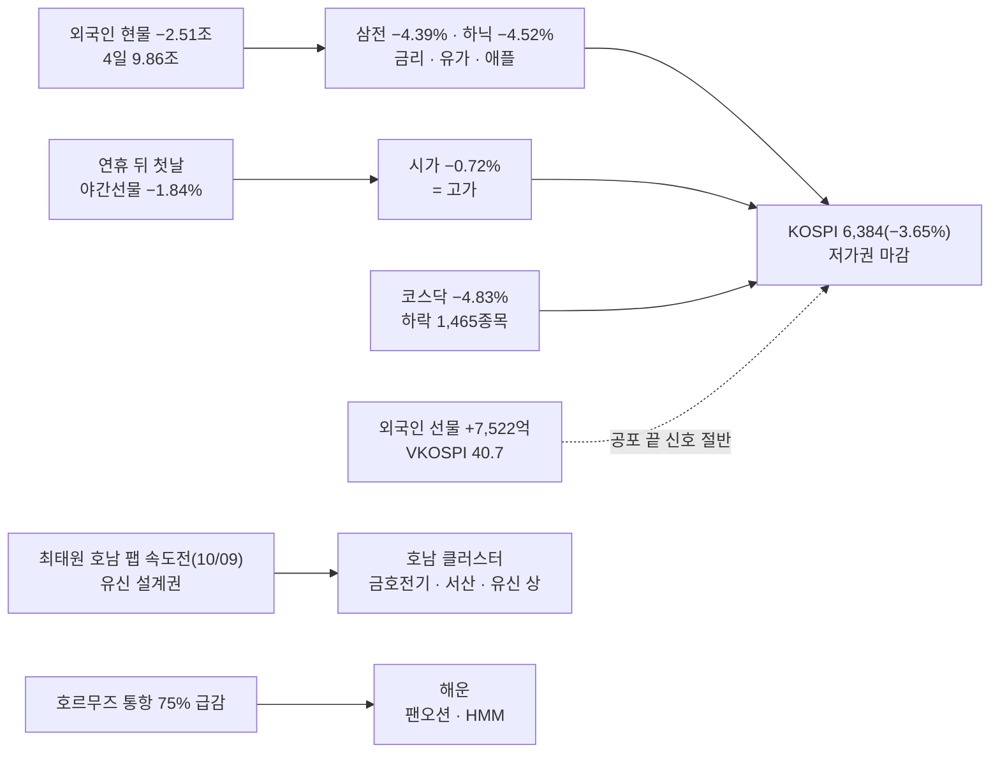

### 📗 저자 시황 판정 (`투자데이터 종합/3차 활용/1_거차재시/시_시황.md`)

> **한 줄 정의** [A-IMI-선정-07] : **외국인이 나흘 9.9조를 판 하락장 4일째 — 코스피 · 코스닥 할 것 없이 전 종목이 빠졌고, 돈은 호남 반도체 클러스터 · 해운 같은 새 재료로만 잠깐 갔다**

**① 지수 — 세 프레임** [시황 §2]
| 프레임 | 판정 | 근거 |
|:---|:---|:---|
| ① 이평선 위치 [A-선정-01] | **하락장** | 6,384 < 60일선 6,709.9(−5.1%) · **5일(6,752) < 10일(6,841) < 20일(6,854)** = 단기 역배열 · 120일(7,199) · 100일(7,283) 위 |
| ② 거래대금 + 20일선 + 고저점(차읽남) | **하락장 3/3** | 21.33조(30조 미달) · 20일선 −7.35% · **나흘 연속 저점 · 고점 하락** |
| ③ 유동성 방향 [A-주간-판단-03] | **빠지기 시작** | 예탁금 100.38조(10/07, **−6,690억**) · 신용 33.52조(−424억) · 미수 9,316억 / 9/29 107.7조 정점 뒤 **−7.3조** |
- **지수 −3.65% = 저자 "−3% 이상"** → 오늘부터 **내 종목이 지수와 같이 빠졌는지 따로 본다**(차읽남)

**② 장세 유형** [시황 §3]
| 분류 | 오늘 | 근거 · 대응 |
|:---|:---|:---|
| 차읽남 4대 장세 | **약한 테마주 장세**(실적주 장세 깨짐) | 삼성 실적에도 이틀 하락 · 실적 테마(ESS) 이탈 / 새 테마(호남 · 해운 · 전고체)가 하루짜리인지 내일 판별 |
| 월독프 6유형 | **지수 하락장**(외인 매도 → 개인 받음) | 헤지 테마 = **해운(물류)** — 저자 표 그대로 나왔다 |
| 장세별 베팅 [차읽남] | **하락장 = 보수적 낮은 타점 · 매도는 짧게** | 비중 절반 · 당일 청산 |

**③ 하락의 성격** [시황 §6]
| 질문 | 판정 | 근거 |
|:---|:---|:---|
| 6.1 기계적인가, 판단인가 | **판단 매도** | 만기 · 리밸런싱 없음 · 외국인 현물 4일째 조 단위 |
| 6.2 악재의 실체 | **실체보다 수급** | FT 악재는 약해졌고 미국 선물도 올랐는데 한국만 −3.65% → **외국인 비중 축소(씨티 "사상 최대 순매도 전망")** · 기사 : 금리 · 유가 압박으로 반도체 10월 역주행 |
| 6.3 공포의 끝(외인 현물 매도 + 선물 매수 · 콜 매수 전환) | **절반** | **현물 −2.51조 + 지수선물 +7,522억** ✅ / 콜 매수 전환 ❌(−36억) · VKOSPI 40.7 급등 = 공포가 처음 나왔다 |
| 6.4 급반등 3조건 | **0~1/3** | ① 나흘 −8% — 역사적 임계점인지 미확인 ② 신용 33.5조 높음 · **오늘 급락분 반대매매는 D+2(10/14) 이후** ③ 기계적 매도 없음 |
| 6.6 받아주는 손 | **개인 + 기타법인** | 개인 +2.13조 · 기타법인 +6,506억(자사주 추정) — 외국인 방향 전환은 선물에서만 |
| 6.5 헤드라인인가 구조인가 | **구조 쪽(외국인 연간 매도)** | 원화가 강한데 판다 = 환율 탓이 아니라 비중 축소 |

**④ 실적 · 이벤트** [시황 §8 · §11]
- **대형 호재 무반응 = 투심 부재 — 해당** [A-주간-판단-04] : 삼성 3Q 107조(10/08) 뒤 10/08 −2.42% · 10/12 −4.39% → **대형주 약 보름 쉼**(10/27 하닉 실적 무렵까지) · 대형주 진입은 사용자 판단, 클로드 제안은 테마 쪽 우선
- 이벤트 : 10/13~14 if(kakao) · **10/14(수) 21:30 미 9월 CPI** · **하닉 60조↑ 추가 주주환원 10월 중**(일정 파일 · 다이제스트) · 하닉 3Q 10/27(일정 파일, 다이제스트는 10/28) · 삼성 컨콜 10/29
- **하닉 추가 주주환원 발표는 대형 호재 후보** — 발표 다음 날 못 가면 무반응 한 번 더

**⑤ 지수 하락 시 헤지 테마** [시황 §7]
| 악재 | 저자 표 | 오늘 실제 |
|:---|:---|:---|
| 중동 · 호르무즈(통항 75% 급감 · 유조선 피격) | 에너지 · 원유 · 방산 · **물류** | **해운 등장**(팬오션 +6.97% · HMM +4.81% · STX그린로지스 +8.99%) — 정유 · 방산은 미등장 |
| 미국-이란 전쟁 장기화 · 곡물가 | **식량**(고정 헤지) | 다이제스트 TODAY ISSUE에 있었으나 이브닝 미등장 |
| 외국인 매도 · 반도체 대형주 | (저자 표 없음) | **피해 = 반도체 대형주 · 코스닥 대형** → 회피 [A-IMI-판단-10] |

### 🧭 대응 (10/13 국장 — 단계 S1)

| 영역 | 대응 | 근거 |
|:---|:---|:---|
| **단계** | **S1 — 대장테마의 대장주만 · 보수** | §0-5 2-1 · 위 🚦 |
| **비중** | 삼전·하닉 **500만** / 그 외 **250만** · 당일 청산 · **오버나잇 금지 · 칼 손절** | 하락장 [F-상천-리스크-01] · RC-16 |
| **대장테마 · 대장주** | **호남 반도체 클러스터 1일차 → 금호전기**(0일차 상 · 1,324억) | 🧵 1순위 · 이브닝 첫 줄 중 상한가 · 거래대금 큰 쪽 |
| **진입 조건(S1)** | ① **예상 흐름대로 가는가** — 상한가 다음 날 갭 순서 : 갭상승이면 **시가 지지 → 무너지면 전일 종가(상한가) → 거래대금 많은 자리** / 갭하락이면 **거래대금 많은 자리 → 상한가 종가 회복 여부** [`차_차트` §4.6] ② **가장 강한 지지구간에서 지지를 확인한 뒤만** — 되돌린 뒤 첫 눌림이 직전 저점을 안 깰 때 [상천유니온 240718] | 가격은 **금호전기 일봉 · 분봉을 받으면** 제안서로(지금은 자료 없음) |
| 그 밖 테마 | 해운(헤지) · 전고체 · 의료기기 미용 · 서울고터 3일차 → **관찰만**(S1은 대장테마 하나) | §0-5 2-1 |
| 반도체 대형주 | **대형 호재 무반응 해당 → 약 보름 쉼** · 외국인 4일 9.86조 · 대장테마 아님 → **S1 범위 밖**(진입 판단은 사용자) | [A-주간-판단-04] |
| 지수 | 저항 **시가 6,578 → 60 · 5 · 45일선 6,710~6,760** / 지지 **6,368(오늘 저가) → 6,300(8월 저점권 · HTS 확인 필요) → 224일선 6,124** | 아래 📐 |
| 장전 순서 | NXT 프리장 08:10~ → **08:45 코스피200 선물 · 0780**(외국인 선물 매수가 이어지는가) → 08:50~55 예상체결 → 09:00 본장이 NXT 저점을 지키는가 | §0-5 3-15 |

### 📐 코스피 사다리 (10/12 종가 기준 · HTS 일봉)

| 선 | 값 | 종가 대비 | 거리 | 역할 |
|:---|---:|---:|:---|:---|
| 100일 | 7,282.8 | +14.07% | `▲▲▲▲▲▲▲▲` | |
| 120일 | 7,199.1 | +12.76% | `▲▲▲▲▲▲▲▲` | |
| 20일 | 6,853.5 | +7.35% | `▲▲▲▲▲▲` | |
| 10일 | 6,841.0 | +7.15% | `▲▲▲▲▲▲` | |
| 45일 | 6,757.5 | +5.85% | `▲▲▲▲▲` | ┐ |
| 5일 | 6,751.8 | +5.76% | `▲▲▲▲▲` | │ 저항 뭉치 6,710~6,760 |
| **60일** | **6,709.9** | **+5.10%** | `▲▲▲▲` | ┘ |
| *오늘 시가 · 고가* | *6,578.2 · 6,589.7* | *+3.04 · +3.22%* | `▲▲▲` | 오늘 강도선(시가) |
| **종가** | **6,384.24** | — | `◆` | |
| 저가 | 6,368.5 | −0.25% | `▼` | |
| 8월 저점권 | 약 6,296(8/6 종가 · 웹) | −1.4% | `▼` | **HTS 일봉 확인 필요** |
| **224일** | **6,123.9** | **−4.08%** | `▼▼▼▼` | |
| 라운드 6,000 | 6,000 | −6.02% | `▼▼▼▼▼` | |

- 저항 : **시가 6,578 → 60 · 5 · 45일선 뭉치 6,710~6,760**(5% 위) / 지지 : 오늘 저가 6,368 → 6,300(8월 저점권) → **224일선 6,124**

### 🔥 트리거

| 층 | 요인 | 이전 → 지금 | 상태 | 신호 |
|:---:|:---|:---|:---|:---:|
| 1 | **외국인** | 3일 7.35조 | **4일 9.86조** · 그러나 **지수선물 +7,522억 매수 전환** · 달러선물 −7,044억 | 🔴 |
| 1 | **대형 호재 무반응** | 확인 대기 | **해당** — 삼성 실적 뒤 이틀 하락 → 대형주 약 보름 쉼 | 🔴 |
| 1 | 변동성 | VKOSPI 36.8 | **40.73(+10.65%)** — 공포가 처음 나왔다 | 🔴 |
| 1 | 원화 | 1,341 | **1,331.6(−10.4)** — 원화 강세 속 매도 | 🟡 |
| 1 | 유동성 | 예탁금 101조 | 100.38조(10/07) — 9/29 정점 대비 −7.3조 | 🔴 |
| 2 | **호남 반도체 클러스터** | — | **신규 0일차** — 금호전기 상(1,324억) · 서산 상 · 유신 상 · 금호건설 +20.29%(1,887억) | 🟢 |
| 2 | **해운(헤지)** | — | **신규 0일차** — 호르무즈 통항 75% 급감 | 🟢 |
| 2 | 전고체 | (9/30 이후 없음) | **새 0일차** — 나인테크 +9.06% · 이수스페셜티 +4.46%(다이제스트 TODAY ISSUE) | 🟡 |
| 2 | 의료기기 · 미용 | 화장품(10/07) | **새 0일차** — 리메드 +15.31% · 동국제약 · 뷰티스킨 | 🟡 |
| 2 | 반도체 소부장 | 10/08 반등 | **약화** — 엑시콘 +6.38% · 비아트론 +4.26%만 | 🟡 |
| 2 | 이차전지 · ESS | 10/08 1위 | **이탈**(1일차) | 🔴 |
| 2 | HLB 그룹 | 10/08 확산 | **이탈**(3일차 — 이브닝 미등장) | 🔴 |

### 💰 수급 (억 원)

| 주체 | 코스피 현물 | 코스닥 현물 | 지수선물 | 주식선물 | 달러선물 |
|:---|---:|---:|---:|---:|---:|
| 개인 | **+21,346** | +2,700 | −224 | −937 | +885 |
| **외국인** | **−25,094** | −455 | **+7,522** | −4,341 | **−7,044** |
| 기관계 | −2,872 | −2,259 | −7,028 | +5,198 | +6,159 |
| └ 금융투자 | +2,332 | −144 | −2,929 | +10,779 | +5,125 |
| └ 투신 | −2,988 | −2,090 | −3,507 | −3,231 | −78 |
| 기타법인 | +6,506 | +14 | −270 | +80 | +324 |

- **외국인 현물 −2.51조 · 지수선물 +7,522억** — 10/08(현물 −2.47조 · 선물 −1.25조 동시 매도)과 달라졌다
- 증시주변(10/07 기준) : 예탁금 **100.38조(−6,690억)** · 신용 33.52조(−424억) · 미수금 9,316억(−285억) · 선물예수금 39.54조

### 🧵 주도 테마 (Signal Evening 14129 · 일차 = `_매매제안방법.md` §0-4 6)

| 순위 | 테마(줄기) | 등급 | 일차(10/12 → 10/13) | 대장 이력 | 거래대금 |
|:---:|:---|:---:|:---:|:---|:---|
| 1 | **호남 반도체 클러스터** | A | **0 → 1일차** | 0일차 10/12 **금호전기 상**(1,324억) · 서산 상 · 유신 상(설계권 37%) > 금호건설 +20.29% · 도화엔지니어링 +13.91% · 동양파일 · 강동씨앤엘 · 남화토건 · 다스코 | 금호건설 1,887억 · 금호전기 1,324억 · 다스코 357억 |
| 1-b | 반도체 소부장(같은 칸) | C | 9일차↑ | 10/06 주성 → 10/07 케이씨텍 → 10/08 두산테스나 → 10/12 **엑시콘 +6.38%**(교체 · 약함) · 비아트론 +4.26% | 비아트론 411억 · 엑시콘 276억 |
| 2 | **의료기기 · 미용** | B | **0 → 1일차** | 0일차 10/12 **리메드 +15.31%**(504억 · 美 OEM 650대) > 동국제약 +5.36% · 뷰티스킨 · 디오 | |
| 3 | **해운(헤지)** | B | **0 → 1일차** | 0일차 10/12 **팬오션 +6.97%**(634억 · 기사 대장) · HMM +4.81%(678억) · STX그린로지스 +8.99%(22억 · 등락 1위) · 흥아해운 | |
| — | 전고체 | B | 0 → 1일차 | 0일차 10/12 **나인테크 +9.06%**(570억) · 이수스페셜티케미컬 +4.46%(682억) — 이전 파동 9/29 · 9/30 | |
| — | 서울고터 재개발 | C | **2 → 3일차** | 0일차 10/07 동양고속 상 · 천일고속 상 → 1일차 10/08 동양고속 상(508억) → 2일차 10/12 **동양고속 +8.68%**(1,047억) · 삼표시멘트 +4.66% | |
| — | 개별 | — | | 한화M&S +24.01%(김동선 공개매수) · 유니켐 +14.16%(로봇 전자피부) / **DN오토모티브 −20.43%** | |
| ✕ | 이탈 | | | **이차전지 · ESS(1일차)** · **HLB 그룹(3일차)** | |

- 반도체 칸은 **"대형주 −4.4% / 호남 클러스터 상한가"**로 갈렸다 — 반도체 재료가 장비 · 부품이 아니라 **지역 개발(건설 · 설계 · 전기)**로 옮겨 갔다
- 새 테마가 넷(호남 · 미용 · 해운 · 전고체) — 하락장에서 **하루짜리인지 1일차에 판별**

### ✅ 직전 명제 채점

**1008A 국장마감후 명제**

| # | 명제 | 결과 | 채점 |
|:---:|:---|:---|:---:|
| 1 | 10/12 코스피 종가 6,600 위 | 6,384.24 | ❌ |
| 2 | 외국인 조 단위 매도 4일째(최하) | −2.51조 | ✅ |
| 3 | 이차전지 · ESS 2일차 1~3위 유지 | 미등장(전고체만 개별주 칸) | ❌ |
| 4 | HLB바이오스텝 4연상 실패 | 이브닝 미등장 — 종가 미확인 | ❓ |

**1012 미장마감후 · 1009 확인 항목**

| 항목 | 결과 | 채점 |
|:---|:---|:---:|
| 삼전이 못 가면 대형 호재 무반응 | 삼전 −4.39% | **해당** |
| 시초 약 6,510(−1.7%) | 시가 6,578.17(−0.72%) — 갭은 예상의 절반 | △ |
| 장 초반 5~10분 저점 유지 | 시가가 고가 · 하루 종일 밀림 | ❌ |
| 헤지 테마(에너지 · 원유 · 방산) | **해운(물류)** 등장 — 10/11 헤지 표엔 저자의 "물류"가 빠졌고, 05:20 보강(C12)에서 유조선 해운을 넣었다(등급 약 → 실제 중) | △ |
| 05:20 🔄 강한 재료 순위 | ① 이차전지 ESS(B~A) **이탈**(전고체만 개별주 칸) · ② MLCC · ③ 냉각 · ⑤ 전력기기 미등장 · ④ 소부장 → **저전력 D램 새 갈래(엑시콘)** · ⑥ 헤지 → **해운** · ⑦ 보안 미등장 · 감염병 제외 → 미등장 | ❌(1순위) · 방향 일부 ✅ |

> [!caution] 총평
> **지수 방향 · 외국인 · 대형주 약세는 나흘째 맞았고, 낙폭(−3.65%)과 테마는 놓쳤다.** 시초 갭이 작아(−0.72%) 되돌림을 기대했지만, 장 초반 판정(시가 = 고가)대로 하루 종일 밀렸다. 테마는 10/08에 버틴 ESS · HLB가 모두 빠지고 **새 재료(호남 클러스터 · 해운 · 전고체)**로 돈이 옮겨 갔다.

> [!example] 📊 예측 채점 → [[예측대조_2026#2026-10-12 (월)|원장 10/12]]
> - **A : 6/8** — 상 1/1 · 중 4/5 · 하 1/2
> - **B : 1위 ESS ❌ · 2위 소부장 △ · 3위 정유 · 방산 ❌** / 실제 = 호남 클러스터 · 의료기기 미용 · 해운 / 밀려날 것 : 반도체 대형주 ✅
> - **C : 확인 가능 5개 ✅1 · △4**(C10 저전력 D램 · C11 전고체 · C12 해운 — 방향은 맞고 한 칸 낮게 봤다) · ❓14
> - **교훈** : ① 하락장에서 전날 버틴 테마 2일차를 1위로 걸지 않는다(10/08 · 10/12 두 번 연속 이탈 — 3번째면 RC 후보) ② 연휴 중 국내 재료(총수 발언)는 다이제스트 본문까지 ③ 큰 하락 예상일 헤지는 "중"

### 📋 볼 것

> [!todo] 오늘 밤 (미국 10/12 — 콜럼버스데이 · 채권 휴장)
> - [ ] 미국 지수 · 필라 · **SKHY** · 야간선물 — 한국만 빠진 날이라 **야간선물이 되돌리는지**
> - [ ] 하닉 60조↑ 추가 주주환원 발표 시점

> [!todo] 10/13(화) 국장
> - [ ] **단계 S1 검증** — 외국인 선물 매수가 이어지면 S1 유지 · 현물 · 선물 동시 매도로 돌아서면 장 마감 뒤 S0 판정
> - [ ] **금호전기(대장)** — 예상 갭 순서대로 가는가 · 가장 강한 지지구간에서 지지 확인이 나오는가(일봉 · 분봉 받으면 제안서)
> - [ ] **외국인 현물 매도가 1조 아래로 줄어드는가 · 선물 매수 이어지는가**(공포 끝 신호 나머지 절반 = 콜 매수)
> - [ ] **장전 순서(§0-5 3-15)** : NXT 프리장 갭 · 8:45 코스피200 선물 · 0780 · 9시 본장이 NXT 저점을 지키는가
> - [ ] 오늘 저가 **6,368 · 6,300** 지지 / 시가가 오늘 종가 위에서 나오면 **시가 6,578까지 되돌림 시험**
> - [ ] 호남 클러스터 · 해운 · 전고체 **1일차 — 대장 거래대금 50%↑ 유지인가**

### ❓ 검증 대상 명제 (다음 시황에서 채점)

| # | 명제 | 기준 | 채점 |
|:---:|:---|:---|:---:|
| 1 | 10/13 코스피 **종가 6,300 위** | 6,300 | ⬜ |
| 2 | 외국인 코스피 현물 **순매도 1조 미만으로 축소** — 확신도 하 | > −1조 | ⬜ |
| 3 | **호남 반도체 클러스터 1일차 이브닝 재등장** | 이브닝 | ⬜ |
| 4 | **VKOSPI 40 아래로 내려온다** | 종가 | ⬜ |

> [!missing] 못 판정한 것
> - 삼전 · 하닉 정확한 종가 — 이브닝 등락률로 환산 / HLB바이오스텝 · LG이노텍 · 비에이치 종가(웹 미색인)
> - 8월 저점(약 6,296)은 웹 검색 요약값 — **HTS 일봉으로 확인 필요**
> - 클로징 10/12 원본 없음 · 웹 마감 기사 미색인 — 하락 이유는 이브닝 기사(금리 · 유가 · 외국인)로만 판정
> - 하닉 3Q 실적일 : 일정 파일 10/27 · 다이제스트 10/28 — 다르다

> [!info]- 출처 · 형
> **출처**
> - 사용자 제공 : HTS 코스피 일봉 창 · 시장 요약표(10/12 17:20~17:25) · 증시주변 10/07 기준
> - 시그널리포트 원본 : **이브닝 14129** · 다이제스트 14124 · 장전뉴스 14126(10/12)
> - 일정 : `지표API/data/calendar/macro_calendar.json` **updated_at 2026-10-12**(읽기만) — 10/13~14 if(kakao) · 10/27 하닉 3Q · 10/29 삼성 컨콜 · 10월 중 하닉 추가 주주환원 / **미 CPI(10/14)는 파일에 없다**
>
> **형** : 국장마감후
> - 태그 : `[본인시황 1012A]` · 요인값 → [[요인값변천사_2026#2026-10-12 (국장마감후)]] · 예측 채점 → [[예측대조_2026#2026-10-12 (월)]]

---

## 2026-10-12 (월) — 미장마감후 (10/11 작성 · 미국 10/09 금요일 장 반영)
#시황/미장마감후 #모드/보수 #요인/반도체 #요인/AI #요인/애플

> [!danger] 🔴 모드 : 하락장(저자 프레임 ① — 60일선 아래) + 보수 덮개 2일차 — **오늘 적용**
> 미국 금요일 : **S&P 7,811.54(+0.59%) · 나스닥 27,366.17(+0.64%) · 다우 약 +0.8%** — 그러나 **필라 12,572.4(−0.41%) · SOXL −1.94%** = **넓게는 반등, 반도체만 사흘째 하락**
> 이유 : 블룸버그 **"오픈AI, 연말 연환산 매출 700억 달러 이상 예상"**(FT 500억 보도는 집계 방식 차이) → AI 의심 **일부 완화** / 대신 **애플 10월 아이폰18 프로 부품 주문 15~20% 축소**(닛케이 · 메모리 값 상승이 원인) → 애플 부품주 · 반도체 약세
> **러셀2000 +0.5%(주간 −0.9%)** — 미국도 **주간으로 중소형주만 빠졌다**(S&P 주간 +1.2%) · **10/08 야간선물 1,028.95(−1.84%) = 환산 약 6,504** 위에 금요일분(미 선물 +0.3~0.5% · 필라 −0.4%)을 더하면 **시초 약 6,510 (추정)**
> **비중 삼전·하닉 500만 / 그 외 250만 · 당일 청산 · 오버나잇 금지**(하락장 [F-상천-리스크-01]) · 보유 없음 · ==이번 주 10/14(수) 밤 미 9월 CPI가 가장 큰 일정==

### 🎛 한눈에

| 지표 | 값 | 변화 | 신호 | 한 줄 |
|:---|---:|:---|:---:|:---|
| S&P 500 · 나스닥 · 다우 | 7,811.54 · 27,366.17 · 51,654.95 | **+0.59% · +0.64%** · +0.83% | 🟢 | 이틀 하락 뒤 반등 · S&P 사상 최고 근처 |
| **러셀2000** | 2,806.98 | +0.46% (**주간 −0.9%**) | 🟡 | 주간으로 4개 지수 중 혼자 하락 — 중소형 약세 [A-선정-05] |
| **필라 반도체** | **12,572.4** | **−0.41%** | 🔴 | 지수는 올랐는데 반도체만 사흘째 하락(누적 약 −4.9%) |
| SOXX · SOXL | 559.40 · — | −0.69% · −1.94% | 🔴 | |
| QQQ · TQQQ | 751.27 · — | +0.49% · +1.31% | 🟢 | |
| SK하이닉스 ADR(SKHY) | **미확인** | — | ❓ | 금요일 종가 못 찾음 |
| **미 10년** ✔체크 | **5.244** | **+0.019** | 🟡 | 장중 오르내린 뒤 소폭 상승 · 5.3 아래 |
| 미 2년 · 20년 · 30년 | 4.791 · 5.650 · 5.599 | +0.031 · −0.005 · −0.008 | 🟡 | 단기만 올랐다(CPI 앞) |
| **일본 30년** ✔체크 · 일본 10년 | **4.067** · 3.016 | **−0.123** · −0.069 | 🟢 | 초장기 금리 큰 폭 하락 |
| **WTI** ✔체크 · 브렌트 · 두바이 | **91.66** · 104.42 · 108.96 | +0.53% · +0.33% · **+3.48%** | 🔴 | 90 위 유지 · 중동 원유(두바이) 상승 |
| 금 | **4,220.30** | **+1.52%** | 🟡 | 사상 최고 부근 |
| 원/달러 | 1,341.54 | −1.83 | 🟡 | |
| VIX | 14.84 | −3.70% | 🟢 | |
| 미 선물(마감) | S&P 7,859.75 · 나스닥100 31,108.75 | 10/09 06:00 대비 +0.48% · +0.28% | 🟢 | |
| **야간선물** | **1,028.95**(10/08 밤 · HTS [5401]) | **−19.30 (−1.84%)** | 🔴 | 10/09 휴장이라 **금요일 미장은 반영 안 됨** · 환산 약 6,504 |

> [!info]- 신호등 기준
> 🟢 국장에 우호 · 🟡 중립·경계 · 🔴 역풍. 판정은 **국장 대형주에 미치는 영향** 기준 · ✔체크 = 사용자 매일 확인 항목(`checklist.json`)

### 🧮 이익 · 할인율 장부 (시험)

| 칸 | 지난밤 | 방향 |
|:---|:---|:---:|
| **분자 — 이익** | **오픈AI 연말 700억 달러 이상(블룸버그)** — FT 500억은 9월 말 수치 · 집계 방식 차이(MS 애저 재판매분 제외) → **10/08 악재의 실체 약화** / **애플 10월 아이폰18 프로 부품 주문 15~20% 축소** — 메모리 값 상승이 원인으로 지목 = 메모리 값은 강하지만 **수요 쪽 부담** | ↔ |
| **분모 — 단기 할인율(2년)** | 4.791(+3.1bp) — CPI(10/14) 앞 | ⬆ |
| **분모 — 장기 할인율(10 · 30년)** | 10년 5.244(+1.9bp) · 30년 5.599(−0.8bp) — 진정 유지 · **일본 30년 −12.3bp** | ↔ |
| **분모 — 위험 프리미엄(VIX)** | 14.84 — 더 낮아졌다 | ⬇ |
| **수급**(국장) | 외국인 3일 7.35조 매도(1008A) · SKHY 보호예수 해제 매도 이틀치 반영 · 하닉 자사주 잔여(10월 중순 종료 예상) · **코스피 주간 −5.39%** | ⬇ |

- 판정 : **금요일 미국은 "AI 의심 완화 + 위험 선호"였지만 반도체는 애플 주문 축소에 다시 눌렸다.** 국장 입장에서 10/08 밤 야간선물(−1.84%)이 이미 반영한 악재(FT · 보호예수) 중 **FT 쪽은 실체가 약해졌고**, 새로 붙은 건 애플 부품주 악재다. 시초 −1.7% 안팎에서 **되돌림이 나오는지가 핵심**(저자 §6.2 : 실체 없는 악재의 급락은 되돌림 대상)

### 🔗 오늘의 인과

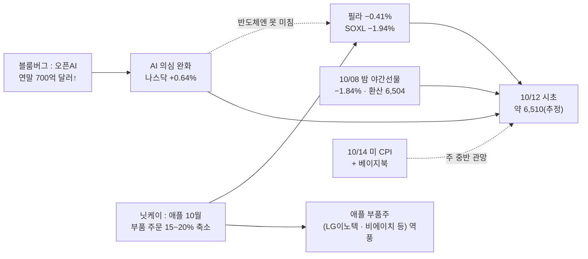

### 📗 저자 시황 판정 (`투자데이터 종합/3차 활용/1_거차재시/시_시황.md`)

> **한 줄 정의** [A-IMI-선정-07] : **사흘 7.35조를 판 외국인 앞에서 연휴를 보낸 하락장 — 미국은 반등했지만 반도체만 사흘째 밀렸고, 국장 돈은 이차전지 · 소부장 · HLB에만 남았다**

**① 지수 — 세 프레임** [시황 §2]
| 프레임 | 판정 | 근거 |
|:---|:---|:---|
| ① 이평선 위치 [A-선정-01] | **하락장** | 10/08 종가 6,625.93 < 60일선 6,728 · 시초 약 6,510이면 60일선과 −3% 차이 — **오늘 종가로 60일선 회복은 어렵다** |
| ② 거래대금 + 20일선 + 고저점(차읽남) | **하락장 3/3** | 10/08 23.20조(30조 미달) · 20일선 아래 · 사흘 저가 마감 |
| ③ 유동성 방향 [A-주간-판단-03] | **애매** | 예탁금 101.05조 · 신용 33.56조(10/06 기준) — 연휴 동안 새 수치 없음 |
- 시초 −1.7% 안팎은 [§0-5 3-3] **−1~−2% 무시 구간** 근처 — 갭 자체보다 **장 초반 5~10분 저점이 지켜지는지**로 판단

**② 장세 유형** [시황 §3]
| 분류 | 오늘 | 근거 · 대응 |
|:---|:---|:---|
| 차읽남 4대 장세 | **실적주 장세 + 약한 테마주 장세**(유지) | 10월 실적 시즌 · 미국 3분기 실적 시작(은행 · TSMC) / 테마는 10/08 버틴 쪽(ESS 1일차 · HLB 3일차 · 소부장 8일차↑ — 아래 🧵)이 이어가는지로 강약 판별 |
| 월독프 6유형 | **지수 하락장**(외인 · 기관 매도 → 개인 받음) | 헤지 테마 → 아래 ⑤ |
| 장세별 베팅 [차읽남] | **하락장 = 보수적 낮은 타점 · 매도는 짧게** | 비중 절반 · 당일 청산 |

**③ 하락의 성격** [시황 §6]
| 질문 | 판정 | 근거 |
|:---|:---|:---|
| 6.1 기계적인가, 판단인가 | **판단 매도 쪽** | 10/08 만기 · 리밸런싱은 끝났다 → 10/12 매도는 외국인 판단 · SKHY 보호예수 해제 차익 |
| 6.2 악재의 실체 | **약해졌다**(FT) / **새 악재**(애플) | FT 500억 = 9월 말 · 집계 방식 차이, 연말 700억↑(블룸버그) → **AI 이익 의심의 실체 약화 = 급락 시 되돌림 후보** / 애플 주문 축소는 로이터도 미확인 · 메모리 가격 상승이 원인이라 **메모리엔 양면** |
| 6.3 공포의 끝 | **아직 아니다** | 연휴 중 외국인 선물 방향 미확인 → 10/12 8:45 선물 · 투자자별로 확인 |
| 6.4 급반등 3조건 | **0/3** | 낙폭 −5.4%(주간) — 역사적 임계 아님 · 신용 높음 · 기계적 매도 끝 |
| 6.6 받아주는 손 | **개인뿐** | 반도체 대형주 **하락 4일째**(테마 일차와 다른 셈) — 4일째에 외국인 매수 전환이 나오면 반등 신호 |
| 6.5 헤드라인인가 구조인가 | 반도체 = 구조 질문(AI 이익) 이었지만 **금요일 반박 보도로 헤드라인 쪽으로 이동 중** | 판정은 외국인 방향으로 |

**④ 실적 · 이벤트** [시황 §8 · §11]
- **대형 호재 무반응 = 투심 부재** [A-주간-판단-04] : **오늘 삼전이 못 가면 해당**(1009에서 이어짐) — 해당이면 대형주 **약 보름 쉼**으로 본다
- **CPI 앞 관망** : 10/14(수) 21:30 미 9월 CPI(예상 전월 0.6% · 근원 0.2% · 전년 3.7%) + 베이지북 / 10/15 PPI · 소매판매 → 월~수 거래대금 줄 가능성
- 10/12 미국 콜럼버스데이 — **채권시장 휴장 · 주식은 정상**
- 미국 4개 선물 [A-선정-05] : 다우 · S&P · 나스닥 오름 · **러셀2000 일간 +0.5%, 주간 −0.9%** → **대형주만 오르고 중소형 약세 = 국내 중소형 · 테마에도 약한 신호**(주간 기준)
- **연휴 뒤 첫날** [A-IMI-진입-06] : 야간선물이 빠졌으면 장 초반 약세 전제

**⑤ 지수 하락 시 헤지 테마** [시황 §7]
| 악재 | 수혜 쪽(저자 표 · 연결) | 오늘 볼 것 |
|:---|:---|:---|
| 이란 · 중동(두바이유 +3.5% · WTI 91) | **에너지 · 원유 · 방산** | 정유 · 석유(흥구석유 · 한국석유 · 중앙에너비스) · 방산 — 10/08엔 미등장(반복 재료) |
| 금 사상 최고 4,220 | 원자재 · 귀금속 [소와곰 고정 헤지] | 금 관련주 — 지수 원웨이 하락 때만 |
| 애플 부품 주문 축소 | (저자 표 없음) | 피해 = **애플 부품주** → 회피 [A-IMI-판단-10] |

**⑥ 오늘 장전 · 장중 판정 순서 — NXT 이후판** [§0-5 3-15 · 시황 §2.1 · §2.2 · §10] *(10/11 정정 — 사용자 "코스피 200 확인도 적어놓자. NXT이전 자료긴하다")*
1. **08:10~08:45 NXT 프리장** — 8:00~8:04는 거른다 · **삼전 · 하닉 갭이 야간선물(−1.84%) · SKHY 하락을 얼마나 반영하는지** [A-주간-판단-02] · 연휴 뒤 공포 물량 **5~10분 밀고 반등** 패턴인지 [주간 0720] · **NXT 저점 기록**
2. **08:45 코스피200 선물 개장 + 0780 투자자별** — 외국인 선물 1,000억↑이면 방향 고정 [A-월독프-판단-01] *(NXT 이전 자료)* · 기준 : 10/08 밤 야간선물 1,028.95
3. **08:50~08:55 예상체결** — 관종 예상가 색 · [0183] 예상체결등락률상위 → 돈 쏠릴 섹터
4. **09:00 본장** — 프로그램이 NXT 갭을 맞춰주는가 · NXT 강세 종목이 던져지는가 [E7-IMI-청산-02] · **NXT 저점을 지키며 반등하는가**(이탈하면 추가매수 금지)
5. **9시 1~2분 조회순위 → 장 초반 5~10분 성격 확정** · 대량 프로그램 매도면 **10시 이후 수급 전환을 기다린다** [A-주간-판단-01]
6. 급락 중 반등은 **되돌린 뒤 첫 눌림이 직전 저점을 안 깨는 것**을 보고 판단 [상천유니온 240718] · 상승/하락 종목 수로 쏠림 판정 · 헤지 테마 스캔

### 🧵 테마 일차 표 (10/12 기준 · `_매매제안방법.md` §0-4 6)
*(10/11 정정 — 처음엔 대응 표에 "2일차", 원장 C5에 "4일차"로 섞어 적었다. 사용자 지적 "HLB는 3일차")*

| 테마(줄기) | 0일차 | 10/12 | 대장 이력 | 비고 |
|:---|:---|:---:|:---|:---|
| **HLB 그룹**(리보세라닙) | **10/06** — FDA 실사 VAI(이전 파동 9/28 · 9/29 리픽투 FDA 승인 → 9/30~10/02 빠짐) | **3일차** | 0일차 10/06 **HLB제약**(상 · 530억) → 1일차 10/07 **HLB바이오스텝**(그룹 유일 상 · 301억 — **교체**) → 2일차 10/08 **HLB바이오스텝**(3연상 · 328억) + 파나진 · 글로벌 상(**확산**) | 바이오스텝 종목 0일차도 10/06(첫 상한가 = 첫 등장) → 3일차 · RC-31 3일차 = 대장 + 재료 갱신 · 거래대금 유지 → **절반** |
| **이차전지 · ESS**(LG엔솔 실적) | **10/08** — LG엔솔 분기 최대 매출 · AI DC ESS(이전 파동 9/30~10/06 → 10/07 빠짐) | **1일차** | 0일차 10/08 **삼기에너지솔루션즈**(상 · 539억) · 동국산업(+22.34% · 946억) · 피노 · 삼아알미늄 / 대형 LG엔솔 +2.56% | 이전 파동 대장 : 9/30 이수스페셜티케미컬 → 10/02 덕우전자 · 동국산업 → 10/06 에코프로비엠 · 삼성SDI(대형 동반) |
| **반도체 소부장 · 후공정** | **9/28 이전**(끊긴 날 없음 — 10/02는 개별주 칸 오킨스전자) | **8일차↑** | 10/01 티에프이 · 에스앤에스텍 → 10/06 **주성엔지니어링**(+17.51% · 8,535억) → 10/07 **케이씨텍**(+14.53% · 1,344억 · 개별주 칸) → 10/08 **두산테스나**(+14.85% · 1,231억) · 저스템 / 거래대금은 주성(9,878억) | 일차가 길어 **대장 교체로 본다** · RC-31 4일차~ 해당(제안은 빼지 않고 언급) |
| 정유 · 석유(헤지) | 10/02 S-Oil · SK이노(개별주 칸) → 10/06~08 빠짐 | 나오면 **새 0일차** | — | |

### 🔄 다이제스트 10/12 보강 (05:20 · DESKTOP-PQ0PPL4) — 강한 재료 판정 [`재_재료.md`]

> 다이제스트 14124(10/12 05:00) 기준 · 판정 축 = 신선함 · 연관성 · 지속성 · 확장성(+펀더멘털) → 크기(키워드 · 금액 · 시총 대비) → 수명(시간 · 다른 주도주 · 전저점 · 15일선) · 등급 [C-진입-04] · 일차는 위 🧵 표
> **지수가 하락장이라 등급과 상관없이 비중 절반 · 당일 청산**(§0-5) — 아래 등급은 "어디를 볼지"의 순서다

| 순위 | 섹터 | 재료 | 신선 · 연관 · 지속 · 확장 | 크기 | 수명 · 일차 | 등급(잠정) | 볼 종목 |
|:---:|:---|:---|:---|:---|:---|:---:|:---|
| 1 | **이차전지**(ESS) | ESS 1일차 + 전고체 전망 · 디트로이트 배터리쇼(~10/15) | 신선 **중**(전고체 = 전망 기사) · 연관 **중** · 지속 **강** · 확장 **강** | 전고체 222억 달러(2036 전망) — **계약 아닌 전망** [§5.2] | ESS **1일차**(0일차 10/08 삼기에너지솔루션즈 상 · 540억) · **일정 있음**(배터리쇼) [§6.5] | **B~A** | 삼기에너지솔루션즈 · 동국산업 · LG엔솔 · 삼성SDI / 전고체 : 에코프로비엠 · 이수스페셜티케미컬 · 아이엘 |
| 2 | **반도체 · 전자부품**(MLCC) | 빅테크 장기계약(LTA) — 삼성전기 → 델타 MLCC **7,000억 "조만간 체결 예정"** · 올해 누적 4.6조(전망) | 신선 **중** · 연관 **강** · 지속 **강** · 확장 **강** | 금액 구체 · 다만 **"예정" = 미확정**(저자 §5.1 제목 · 내용 차이) | MLCC 파동 9/11~ · 삼성전기 10/07 −4.24%(LG전자 쇼크) | **B+**(체결 공시가 나오면 A) | 삼성전기 · MLCC 소형주 |
| 3 | **AI 데이터센터**(냉각) | LG전자 → 미 AI DC 인프라 기업 에어 **칠러 5조 "체결"** | 신선 **확인 필요**(이전 보도 여부) · 연관 **강** · 지속 **강** | 금액 크다 · 그러나 **LG전자 = 대형주**(시총 대비 영향 작다) · 10/07 3Q 쇼크 −10.54% | 냉각 단독 테마 일차 없음 | **B** | LG전자 · 냉각 소형주(10/12 반응 보고) |
| 4 | **반도체**(소부장 · 후공정 · 저전력 D램) | OSAT 한 달 +42% · 로봇용 저전력 D램 2030년 20배(TODAY ISSUE) · 소재 품귀 · ASML 부품값 10%↑ · 피엠티 삼전 72억(애프터 +5.31%) | 신선 **하**(8일차↑) · 연관 **강** · 지속 **강** | 숫자 많음 · 계약 금액 작다 | **8일차↑ — 신선도 하락 [D-IMI4]** · 로봇 D램은 **새 갈래** 후보 | **B**(대장만) | 제주반도체 · 심텍 · 하나마이크론 · 대덕전자 |
| 5 | **전력 · 에너지**(전력기기) | LS전선 메타 · 구글 버스덕트 5년 LTA(금액 없음) · HD현대일렉 변압기 LTA **"추진"** · 효성중공업 GW급 HVDC 검증 설비 | 신선 **하**(반복) · 연관 **중** · 지속 **중** | **금액 없음 · 추진 = 미확정** | 10/07 전기장비 업종 −5.44% — **최근 반응 약함** | **C~B** | — |
| 6 | **방산 · 해운 · 식량**(헤지) | 사우디 리야드공항 피격 · 호르무즈 유조선 피격 · 유조선 품귀(단독) · 곡물가 · KF-21 미사일 우협 · AUSA(~10/14) | 신선 **중** · 연관 **중** | 반대 재료 : 러-우 에너지 휴전 · 유가 보합 | 정유 · 석유 빠졌다 나오면 새 0일차 | **B**(지수 원웨이 하락일만 [시황 §7]) | 방산 · 유조선 해운 · 고려산업 · 한일사료 |
| 7 | **보안 · 양자** | 해킹 100만 건 · 한은 해킹 시도 | 신선 **하**(10/01부터 반복) | 정부 대응 없음 | 식상 | **C** | — |
| ✕ | **바이오 · 의료**(감염병) | **WHO "러 연구소 사망 직원, 페스트 확인 안 돼"** | **재료 소멸** [§4.4] | | | **제외** | 국제약품 · 진단주 — 하락 경계 |
| — | 개별 | 대화제약(中 유방암 적응증 · 애프터 +16%) · HDC(자사주 5.7% 소각) · 위고비 급여 신청 · 카카오 선물하기 스테이블코인(이프카카오 10/13~14 앞) | 개별 | | | 개별 | 장 초반 반응만 |

- *(정정 05:36 — 사용자 "MLCC · 전력 · 냉각 전부 강하다고 판단한 거야?") 처음엔 한경 단독 "빅테크 5년 계약" 기사 하나를 **A(확정형)**로 묶었다. 이 기사는 여러 회사를 모은 **동향 기사**이고, 본문은 MLCC "예정" · 전력기기 "추진(금액 없음)" · 냉각 "체결 5조"로 **확정 정도가 다르다** → 섹터별로 나눠 다시 매겼다*
- **판정** : 오늘 가장 볼 섹터는 **이차전지(ESS 1일차 · 0일차 상한가 · 일정)** — 재료 확정도는 **MLCC(체결 공시 대기)**가 가장 가깝다. 하락장이라 모두 **250만 · 대장만 · 당일**, 전일 기사는 **11시까지 시세가 나와야** 유효 [§4.5]
- 소부장은 재료는 계속 좋지만 **8일차라 새 갈래(로봇 D램 · OSAT)인지, 기존 대장의 연장인지**를 가른다 — 새 갈래면 0일차로 센다(10/11 일차 규칙)
- 감염병은 WHO 부정으로 **재료 소멸** — 10/08 교훈 ②("장 전 공식 부정 재료는 확신도 하")의 전형

### 🧭 대응 (10/12 국장)

| 영역 | 대응 | 근거 |
|:---|:---|:---|
| **모드** | **하락장 + 보수 덮개 2일차** | §0-5 저자 프레임 ① · 1008A 3/3 |
| **비중** | 삼전·하닉 **500만** / 그 외 **250만** · 당일 청산 · **오버나잇 금지 · 칼 손절** | [F-상천-리스크-01] · RC-16 |
| 지수 | 시초 추정 **약 6,510**(−1.7%) · 위 6,600 · **60일 6,728 · 45일 6,754.7**(저항) / 아래 라운드 **6,500** · 224일선 6,113 | 1008A 사다리 · 6,500 밑 일봉 지지 HTS 확인 필요 |
| **E21 폭락장 오전 매매** | 시초 −1.7% · 필라 −0.4% → **폭락 아님**(사용자 기준) — 언급만 유지 | §0-5 3-8 |
| 반도체 대형주 | 사흘 −4.5% + 갭하락 예상 · **AI 의심은 약해졌고 애플 악재는 새로 붙음** → 시초 뒤 되돌림 여부 · 외국인 방향 확인 / 진입 판단은 사용자 | 저자 : 확실히 물량이 실리고 뚫어줄 때만 |
| **테마(우선)** | **250만 · 대장만** — 10/08 버틴 쪽 : **이차전지 · ESS 1일차**(삼기에너지솔루션즈) · **HLB 그룹 3일차**(바이오스텝 · 절반) · **반도체 소부장 8일차↑**(대장 교체 확인) — 위 🧵 / **회피 : 애플 부품주** | 1008A · RC-31 · 러셀 주간 약세 · *(10/11 정정 : "2일차" 일괄 표기 → 테마별 일차)* |
| 확인 | 장 초반 5~10분 저점 · 외국인 방향 · 삼전이 못 가는지(대형 호재 무반응) | |

### ✅ 직전 명제 · 볼 것 확인

| 출처 | 항목 | 결과 | 채점 |
|:---|:---|:---|:---:|
| 1009 | 미국 10/09 금요일 장 | **반등**(S&P +0.59% · 나스닥 +0.64%) · **필라 −0.41%** | 확인 |
| 1009 ⑥.2 | FT 오픈AI 보도 반박 여부 | **블룸버그 : 연말 700억↑** · FT 수치는 9월 말 · 집계 차이 → 실체 약화 | 확인 |
| 1009 ④ | 러셀2000 | 일간 +0.5% · **주간 −0.9%**(4개 지수 중 혼자 하락) | 확인 |
| 1009 missing | SKHY 종가 | 금요일도 **미확인** | ❓ |
| 1008A 명제 1~4 | 10/12 국장 | 10/12 국장마감후 채점 | ⏳ |

- **보유 : 없음**

### 📌 원장 10/12 장전 예측 작성
- [[예측대조_2026#2026-10-12 (월)|예측대조 10/12]] — **10/08 교훈 ①②③ 적용** · 다이제스트 10/12는 아직 없음(받으면 C표 추가)

### 📮 일정 관리 방 전달용 (일정 파일 `updated_at` 2026-10-06 · 읽은 시각 10/11)

> 이 방은 읽기만 한다 — **1008 전달용 8건 · 1009 1건 아직 반영 전**
> - 추가 : **10/12 미 콜럼버스데이(채권 휴장)** · **10/14(수) 21:30 미 9월 CPI + 베이지북** · **10/15(목) 미 PPI · 소매판매** · 10/16 수입물가 · 미 3분기 실적 시즌(은행 · TSMC)

> [!missing] 못 판정한 것
> - **SKHY 금요일 종가** · 마이크론 · 엔비디아 등락률
> - **10월 1~10일 수출(관세청)** — 검색에 아직 안 나옴(보통 11일 발표)
> - 애플 부품주(국내) 직접 영향 크기 — 닛케이 보도 · 애플 · 로이터 미확인
> - 다이제스트 · 장전뉴스 10/12 — 아직 원본 없음

---

## 2026-10-09 (금) — 미장마감후 (국장 휴장 · 다음 거래일 10/12 월)
#시황/미장마감후 #모드/보수 #요인/반도체 #요인/AI #요인/유가

> [!danger] 🔴 모드 : 하락장(저자 프레임 ① — 60일선 아래) + 보수 덮개 2일차(1008A, 3/3) — 10/12 적용
> **필라 12,623.7(−3.39%)** · SOXL **−10.31%** · 나스닥 27,193.34(**−1.25%**) · S&P 7,765.47(−0.47%) — **이틀 연속 하락 · 반도체가 이끌었다**
> 이유 : **FT "오픈AI 연환산 매출이 추정보다 200억 달러 적다"** → AI 투자(반도체 이익) 의심 / **WTI 91.18(+3.29%)** — 미국의 이란 군사공격 카드 보도 → 물가 걱정
> 반대로 **미 10년 5.225(−5.3bp) · 30년 5.607(−5.4bp)** — 장기금리는 내려왔다 = **이번엔 분모가 아니라 분자(AI 이익)가 흔들렸다**
> 야간선물 **1,028.95(−19.30, −1.84%)** — HTS [5401] 체결가(거래량 31,076 · esignal 추정 1,028.55와 거의 같다) · 코스피 환산 약 **6,504** = 라운드 6,500 · **아직 미국 금요일(10/09 밤) 장이 남았다**
> **비중 삼전·하닉 500만 / 그 외 250만 · 당일 청산 · 오버나잇 금지**(하락장 [F-상천-리스크-01]) · ==10/12(월) = 연휴 사흘 · 미국 장 이틀 · 하닉 ADR 보호예수 해제 뒤 매도가 한꺼번에==

### 🎛 한눈에

| 지표 | 값 | 변화 | 신호 | 한 줄 |
|:---|---:|:---|:---:|:---|
| S&P 500 · 나스닥 | 7,765.47 · 27,193.34 | −0.47% · **−1.25%** | 🔴 | 이틀 연속 하락 — 나스닥이 S&P의 2.7배 |
| **필라 반도체** | **12,623.7** | **−442.4 (−3.39%)** | 🔴 | 엔비디아 · 마이크론 · 인텔 오후 하락(오픈AI 매출 보도) |
| SOXX · SOXL | 563.28 · 142.52 | −3.35% · **−10.31%** | 🔴 | |
| QQQ · TQQQ | 747.58 · 80.23 | −1.34% · −4.05% | 🔴 | |
| SK하이닉스 ADR(SKHY) | 170.39(추정) | −4.41%(추정) | 🔴 | Yahoo 시세 화면 — **시각 표시 없음, 10/08 종가로 추정** · 보호예수 해제 시점 · 서울 주가 대비 프리미엄 약 38%(블룸버그, 10/06 종가 기준) |
| **미 10년** ✔체크 | **5.225** | **−0.053** | 🟢 | 입찰 수요 · 2일 연속 진정 |
| 미 2년 · 20년 · 30년 | 4.760 · 5.655 · 5.607 | −0.004 · −0.053 · −0.054 | 🟢 | 장기 쪽이 더 내렸다 |
| **일본 30년** ✔체크 · 일본 10년 | 4.191 · 3.090 | −0.026 · −0.017 | 🟢 | |
| **WTI** ✔체크 · 브렌트 · 두바이 | **91.18** · 104.08 · 105.30 | **+3.29%** · +0.12% · −1.07% | 🔴 | 미국의 이란 군사공격 카드 보도 · 후티 |
| 금 | 4,158.30 | +0.03% | 🟡 | |
| 원/달러 | 1,343.37 | +1.44 | 🟡 | |
| VIX | 15.42 | +2.25% | 🟡 | 반도체 −3%인데 공포는 낮다 |
| 미 선물(06:00) | S&P 7,822.50 · 나스닥100 31,021.25 | −0.39% · −1.21% | 🔴 | |
| **야간선물** | **1,028.95**(HTS [5401]) | **−19.30 (−1.84%)** | 🔴 | 주간 종가 1,048.25 · 거래량 31,076 · 코스피 환산 약 **6,504** (esignal 추정 1,028.55) |

> [!info]- 신호등 기준
> 🟢 국장에 우호 · 🟡 중립·경계 · 🔴 역풍. 판정은 **국장 대형주에 미치는 영향** 기준 · ✔체크 = 사용자 매일 확인 항목(`checklist.json`)

### 🧮 이익 · 할인율 장부 (시험)

| 칸 | 지난밤 | 방향 |
|:---|:---|:---:|
| **분자 — 이익** | **FT : 오픈AI 연환산 매출 추정보다 200억 달러 적다** → AI 설비투자의 돈줄 의심 → 반도체 이익 추정 흔들림 / 국내 : 삼성 3Q 잠정 영업익 **107.4조(예상 상회)인데 셀온**(10/08) · LG엔솔 어닝 서프라이즈 | ⬇ |
| **분모 — 단기 할인율(2년)** | 4.760(−0.4bp) — 그대로 | ↔ |
| **분모 — 장기 할인율(10 · 30년)** | 10년 5.225 · 30년 5.607 — **이틀 연속 내림**(입찰 수요) / 그러나 유가 91 → 물가 걱정이 다시 올라올 자리 | ⬆ |
| **분모 — 위험 프리미엄(VIX)** | 15.42 — 낮다 | ↔ |
| **수급**(국장) | 외국인 3일 **7.3조** 매도(1008A) · **하닉 ADR 보호예수 해제 뒤 첫 미국 장 = −4.41%(추정)** · 하닉 자사주 남은 물량(10월 중순 종료 예상) | ⬇ |

- 판정 : **10/07 밤은 분모(장기금리)가, 10/08 밤은 분자(AI 이익)가 반도체를 눌렀다.** 금리가 내려도 반도체가 −3.4%라면 지금 반도체를 누르는 건 할인율이 아니라 **"AI에 들어가는 돈이 실제 매출로 돌아오나"**라는 이익 쪽 의심이다. 국장 대형주는 이미 사흘 −4.5%를 맞았지만, 이 의심은 삼성 호실적에도 셀온이 나온 10/08 국장과 같은 방향이다

### 🔗 오늘의 인과

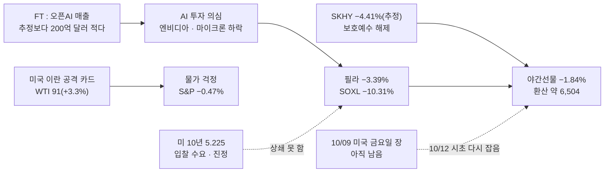

### 📗 저자 시황 판정 (`투자데이터 종합/3차 활용/1_거차재시/시_시황.md`)

> **한 줄 정의** [A-IMI-선정-07] : **외국인이 대형주를 사흘 7.35조 팔고 개인이 7.9조 받아낸 실적 시즌 하락장 — 돈은 코스닥 이차전지 · 반도체 소부장 일부에만 남았다**

**① 지수 — 세 프레임** [시황 §2]
| 프레임 | 판정 | 근거 |
|:---|:---|:---|
| ① 이평선 위치 [A-선정-01] | **하락장** | 10/08 종가 6,625.93 < 60일선 6,728 · 5일선 < 10일선 · 120일선(7,188)이 20일선 위 = 역배열 쪽 → **기법 매매 효율도 떨어진다** [A-진입-02] |
| ② 거래대금 + 20일선 + 고저점(차읽남) | **하락장 3/3** | 거래대금 23.20조 = 우리 기준 30조 미달 · 20일선 아래 · **사흘 연속 저가 마감 = 저점 · 고점 하락** |
| ③ 유동성 방향 [A-주간-판단-03] | **애매 — 돈은 아직 안 빠졌다** | 예탁금 101.05조(+2,064억) · 신용 33.56조(−691억)(10/06 기준) / 거래대금은 늘었는데 **하락에 실렸다**(만기 · 리밸런싱) |
- 지수 −2.62%는 차읽남 기준(−3% 이상)엔 못 미친다 — 내 종목과 지수 흐름 일치 여부를 따로 볼 날은 아니다(10/12 시초 −1.8%도 같다)

**② 장세 유형** [시황 §3]
| 분류 | 오늘 | 근거 · 대응 |
|:---|:---|:---|
| 차읽남 4대 장세 | **실적주 장세 + 약한 테마주 장세** | 10월 실적 시즌 — 삼성 107.4조(예상 상회)에 **셀온** · LG전자 쇼크 · LG엔솔 서프라이즈로 이차전지 버팀 / 테마는 **관련주 상한가로 강약 판별** — 10/08 감염병 이탈 · 소부장은 ETF 유입 → **강한 테마 아직 없음** |
| 월독프 6유형 | **지수 하락장**(외인 · 기관 매도 → 개인이 받음) | **"하락 원인에 따라 헤지 테마가 만들어진다"** → 아래 ⑤ |
| 지수 국면별 [소와곰] | 바닥에서 오를 때가 아니다 | 바닥권 종목 반등은 지수 바닥 확인 뒤 |
| 장세별 베팅 [차읽남] | **하락장 = 보수적 낮은 타점 · 매도는 짧게** | 비중 절반 · 당일 청산과 같은 방향 |

**③ 하락의 성격** [시황 §6]
| 질문 | 판정 | 근거 |
|:---|:---|:---|
| 6.1 기계적 청산인가, 판단 매도인가 | **섞였다 → 10/12엔 판단 매도 쪽이 남는다** | **기계적**(10/08) : 옵션만기 · ETF 19조 리밸런싱 — 금융투자 현물 −2.51조 / 선물 +1.77조 = 차익 정리 → **하루로 끝나는 물량** / **판단**: 외국인 3일 7.35조 · 지수선물 −1.25조 · 실적 셀온 · **AI 이익 의심(FT)** · 하닉 ADR 보호예수 해제 회피 → **시장이 소화할 시간이 필요** |
| 6.2 악재의 실체 | **확인 필요** | FT "오픈AI 연환산 매출 −200억 달러" — 보도 하나 · 오픈AI 반박 여부 미확인 / **실체가 없으면 급락은 되돌림 대상**(0703 사례 : 메타 주문 축소 사실무근) |
| 6.3 공포의 끝(외인 현물 매도 + 선물 매수 · 콜 매수 전환) | **아니다** | 외국인 현물 −2.47조와 **선물도 −1.25조 동시 매도** — 공포 종료 신호 반대 |
| 6.4 급반등 3조건 | **0/3** | ① 역사적 낙폭 임계점 아님(사흘 −4.5%) ② 신용 반대매매 소화 미확인(신용 33.56조 높음) ③ 기계적 프로그램 매도는 10/08 하루분 |
| 6.6 받아주는 손 | **개인뿐**(3일 약 7.9조) | 주도주가 사흘 밀리면 **3일차에 매수가 들어오는가** — 반도체 대형주는 10/12가 4일차 · 반등 신호는 외국인 방향 전환 |
| 6.5 헤드라인인가 구조인가 | **반도체 대형주 = 구조 쪽 질문**(AI 이익) / 유가 · 이란 = 헤드라인 | 헤드라인은 판단을 흔들 이유가 아니다 · 이익 의심은 실체 확인 전까지 비중으로 대응 |

**④ 실적 · 이벤트** [시황 §8 · §11]
- **셀온** [IMI 0826] : 삼성 107.4조는 예상(105.4조) **소폭 상회 = "압도적 상회"가 아니다 + 선반영** → 셀온이 규칙대로 나왔다
- **대형 호재 무반응 = 투심 부재** [A-주간-판단-04] : 숫자가 확정된 대형 호재에 다음 날 못 가면 **약 보름 쉰다** — 삼성 잠정은 지지 자리가 아닌 곳(60일선 이탈 중)에서 나와 그대로 적용하긴 이르다 · **10/12 삼전이 못 가면 해당**으로 본다
- **금리 · 유가 사상 최고 = 비중 축소 신호** [A-IMI-판단-14] : 10/07 미 10년 24년 최고 · 10/08 WTI 91 — 비중 절반과 같은 방향
- **연휴 전 현금 ↑** [A-IMI-진입-08] — 10/08 보유 정리로 맞췄다 · **야간선물이 빠졌으면 장 초반 약세 전제** [A-IMI-진입-06]
- 미국 4개 선물(다우 · S&P · 나스닥 · **러셀2000**) [A-선정-05] — 러셀2000 **미확인**(대형주만 오르고 러셀이 빠지면 국내 중소형 · 테마 약세 신호)

**⑤ 지수 하락 시 헤지 테마** [시황 §7]
| 악재 | 수혜 쪽(저자 표 · 연결) | 10/12 볼 것 |
|:---|:---|:---|
| 미국 이란 군사공격 카드 · 후티 사우디 공격 · WTI 91 | **에너지 · 원유 · 방산**(이스라엘-하마스 표와 같은 구조) | 정유 · 석유(흥구석유 · 한국석유 · 중앙에너비스 — 다이제스트 10/08 관련주) · 방산 |
| 고정 헤지 [소와곰] | 식량 · 방산 · 희토류 · 품절주 · 원자재 | 지수가 원웨이로 빠지는 날 먼저 스캔 |
| AI 이익 의심 | (저자 표 없음) | 피해 업종 = 반도체 대형주 · AI 인프라 → **회피** [A-IMI-판단-10] |

**⑥ 10/12 장중 판정 순서** [시황 §2.1 · §2.2 · §10]
1. **8:45 선물 · 투자자별**[0780] — 1,000억↑이면 방향이 잘 안 바뀐다
2. **장 초반 5~10분**으로 그날 성격 확정 · 9시 1~2분 실시간 조회순위 → 섹터 연결
3. 외인 매도 + 기관 매수면 대응 가능 / **대량 프로그램 매도면 10시 이후 수급 전환을 기다린다** [A-주간-판단-01]
4. 급락 중 반등은 **되돌린 뒤 첫 눌림이 직전 저점을 안 깨는 것**을 보고 판단 [상천유니온 240718]
5. 상승/하락 종목 수로 쏠림 판정 · 헤지 테마 스캔

### 🧭 대응 (10/12 국장 — 연휴 뒤)

| 영역 | 대응 | 근거 |
|:---|:---|:---|
| **모드** | **하락장 + 보수 덮개 2일차** — 장세 : 실적주 장세 + 약한 테마 · 하락 성격 : 판단 매도 쪽(아래 📗) | §0-5 저자 프레임 ① : 60일선(6,728) 아래 종가 = 하락장 · 보수 덮개 3/3(1008A) |
| **비중** | 삼전·하닉 **500만** / 그 외 **250만** · 당일 청산 · **오버나잇 금지 · 칼 손절** | [F-상천-리스크-01] · RC-16 |
| 지수 | 시초 추정 **약 6,500**(야간선물 환산 · 금요일 미장 전) — 위 **6,600 · 45일 6,754.7 · 60일 6,728.1**(이제 저항) | 1008A 사다리 |
| 지수 | 아래 : 라운드 **6,500** · 그 밑 일봉 지지는 HTS 확인 필요(1008A 못 판정) · 224일선 6,113 | |
| **E21 폭락장 오전 매매** | 필라 −3.39% · 야간선물 −1.84% — **사용자 : 이 정도는 자주 있는 일이라 폭락으로 보긴 어렵다, 언급은 계속** → *"지수 폭락일 오전, 강한 종목에서, 전날 밑꼬리 이탈 손절"* — 실시간 판단(제안서 없음) | §0-5 3-8 |
| 반도체 대형주 | **AI 이익 의심 + ADR 보호예수 매도 + 외국인 3일 7.3조** → 10/12 시초 갭하락 가능성 큼 · 장중 수급 확인 · 진입 판단은 사용자 | 저자 : 확실히 물량이 실리고 뚫어줄 때만 매수 |
| **테마(우선)** | **250만 · 대장만** — 10/08 버틴 쪽 : 이차전지(ESS · LG엔솔 실적) · 반도체 소부장 · HLB 그룹 / 감염병은 이탈 | 1008A · RC-31 |
| 확인 | **장 초반 5~10분 판정**(§0-5 3-7) — 갭하락 뒤 첫 5~10분 저점이 지켜지는가 · 외국인 방향 | |

### ✅ 직전 명제 · 볼 것 확인

| 출처 | 항목 | 결과 | 채점 |
|:---|:---|:---|:---:|
| 1008A 연휴 | 미국 10/08 — 장기금리 5.3 · 필라 · SKHY · 마이크론 | 10년 5.225(5.3 아래) / **필라 −3.39%** / SKHY −4.41%(추정) / 마이크론 하락(수치 미확인) | 확인 |
| 1008A 연휴 | 미국 10/09 밤 | **아직** — 10/12 새벽 시황에서 | ⏳ |
| 1008A 명제 1~4 | 10/12 국장 | 10/12 국장마감후 채점 | ⏳ |

- **보유 : 없음** — SK하이닉스 잔량 3주 10/08 전량 정리(사용자 10/09 확인)

### 📌 10/12 예측은 10/12 새벽에

- 원장 10/12 장전 예측은 **미국 금요일 장을 본 뒤 10/12 새벽**에 쓴다(휴장 사흘 — 지금 쓰면 입력이 하루치 빠진다)
- 그때 적용할 **10/08 교훈** : ① 그날 실적 내는 대형주 전부를 C표에 ② 장 전 공식 부정이 나온 재료는 2일차 확신도 "하" ③ 미리 알려진 기계적 수급(매수 쪽)은 그 종목군을 C표에 "중"

### 📮 일정 관리 방 전달용 (일정 파일 `updated_at` 2026-10-06 · 읽은 시각 10/09 06:15)

> 이 방은 읽기만 한다 — **1008 전달용 8건이 아직 반영 전**(파일 갱신 10/06 그대로)이다. 다음 월요일 갱신 때 같이 넘기면 된다
> - 추가 1건 : **10/12(월) 연휴 뒤 첫 거래일** — 미국 장 이틀 · 하닉 ADR 보호예수 해제 뒤 매도분이 한꺼번에 반영되는 날

> [!missing] 못 판정한 것
> - **SKHY 10/08 종가** — Yahoo 화면 170.39(−4.41%)는 시각 표시가 없다 · 마이크론 · 엔비디아 등락률
> - 다이제스트 10/09 · 장전뉴스 10/09 — 원본 없음(휴장일 발행 여부 미확인)

---

## 2026-10-08 (목) — 국장마감후
#시황/국장마감후 #모드/보수 #요인/외국인 #요인/반도체 #요인/실적

> [!danger] 🔴 모드 : 보수 2일차(10/12 적용) — 삼성 역대 최대 실적 날, 지수는 고가에서 저가로 사흘째 밀렸다
> KOSPI **6,625.93(−2.62%) = 저가 마감**(이틀 연속) · 시가 6,808.68(+0.07%) = 사실상 고가 · **60일선(6,728) · 45일선(6,755) 이탈** · 거래대금 **23.20조**(만기 · ETF 리밸런싱) · 외국인 현물 **−2.47조(3일째 조 단위)** · 금융투자 −2.51조 / 삼전 **−2.42%** · 하닉 **−2.44%** — **삼성 3Q 영업이익 약 107조(분기 최대)에도**
> 코스닥 **−0.69%** · 이차전지(ESS) · 반도체 소부장 · HLB 그룹이 버텼다
> **비중 삼전·하닉 500만 / 그 외 250만 · 당일 청산** · ==10/09(한글날) ~ 10/11 휴장 — 미국 장 이틀(10/08 · 10/09 밤) · 하닉 ADR 보호예수 해제 뒤 첫 거래가 10/12 국장에 한꺼번에==

### 🎛 한눈에

| 지표 | 값 | 변화 | 신호 | 한 줄 |
|:---|---:|:---|:---:|:---|
| **KOSPI** | 6,625.93 | −177.97 (−2.62%) | 🔴 | 시가 6,808.68 → 고가 6,810.83 → **저가 = 종가** · 사흘 −4.5% |
| KOSPI200 · KTOP30 | 1,044.52 · 18,264.10 | −2.71% · −2.76% | 🔴 | 대형주 전체 |
| KOSDAQ | 892.27 | −6.16 (−0.69%) | 🟡 | 상승 618 / 하락 1,031 · 코스피보다 덜 빠졌다 |
| 코스피 거래대금 | **23.20조** | 전일의 113% · 기준 30조의 77% | 🔴 | 만기 · ETF 리밸런싱으로 늘었고 **하락에 실렸다** |
| **외국인 현물(코스피)** | **−24,662억** | −3.12조 → −2.47조 | 🔴 | **3일째 조 단위** · 지수선물 **−12,468억** |
| **기관 · 금융투자** | −20,814억 · **−25,146억** | | 🔴 | 금융투자 현물 −2.5조 · 선물 +1.77조 — 만기 · 리밸런싱 차익거래 |
| 개인 · 기타법인 | **+37,654억** · +7,755억 | | 🟡 | 개인 3.77조가 받았다(3일 합계 약 7.9조) |
| 삼성전자 · SK하이닉스 | **−2.42% · −2.44%** | 이브닝 | 🔴 | 환산 약 262,000 · 약 1,681,000 — **하닉 박스 하단 170만 아래** |
| 이차전지 | LG엔솔 +2.56% · 삼성SDI +1.25% | | 🟢 | **LG엔솔 3Q 매출 9조 분기 최대** · ESS |
| VKOSPI | 36.81 | −3.41% | 🟡 | 사흘째 −2%대 하락인데 변동성은 내려간다 — 공포가 아니라 정리 |
| 미니 S&P · 나스닥(17:25) | 7,830.75 · 31,268.25 | −0.28% · −0.43% | 🟡 | |
| 니케이 · 항셍 · 상해 | 69,042 · 23,786 · 3,812 | −1.42% · −1.43% · −0.79% | 🔴 | 아시아 전체 약세 |
| 원/달러 · 국고 3년 | 1,340.10 · 3.98 | +1.10 · +0.02 | 🟡 | |

### 🔗 오늘의 인과

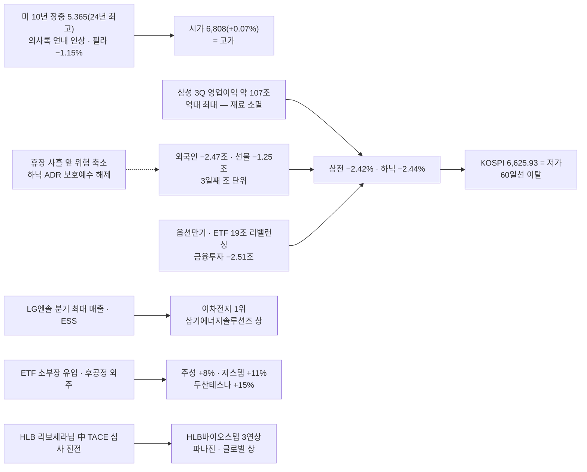

### 🧭 대응 (10/12 국장 — 연휴 뒤)

| 영역 | 대응 | 근거 |
|:---|:---|:---|
| **모드** | **보수 2일차** | 하락추세 ✅(사흘 저가권 · 60일선 이탈 · 5 < 10일선) · 거래대금 미달 ✅(77%) · 악재 다수 ✅(외국인 3일 7.3조 · 장기금리 · 실적 소멸 · 휴장 공백) = **3/3** [[규칙후보#RC-12. 매매 모드 4단계 — 보수 · 평시 · 강세 · 초강세 (5축 정의) ★ 2026-09-22 개정\|RC-12]] |
| **비중** | 삼전·하닉 **500만** / 그 외 **250만** · 당일 청산 | 보수 |
| 지수 | 위 : **45일 6,754.7 · 60일 6,728.1**(이제 저항) → 1차 지지였던 6,765~6,795 | 오늘 깨진 자리 |
| 지수 | 아래 : 라운드 **6,600 · 6,500** — 6,600대는 처음 내려온 가격(9월 이후) · 일봉 지지는 HTS로 확인 필요 | 224일선 6,113까지 −7.7% |
| 반도체 대형주 | **연휴 동안 미국 장 이틀 + 하닉 ADR 보호예수 해제 뒤 첫 매도** → 10/12 시초에 한꺼번에 반영 · **장중 수급 확인 주의** | 진입 판단은 사용자 |
| **테마(우선)** | **250만 · 대장만** — 이차전지(ESS · LG엔솔 실적) · 반도체 소부장 · 후공정 · HLB 그룹(재료 갱신 — RC-31 리셋 후보) / 감염병(페스트)은 **2일차에 이탈** | RC-31 · RC-25 |
| 경계 | **사흘 저가 마감 + 외국인 7.3조** — 반등은 개인 순매수가 아니라 외국인 방향 전환이 신호 | |

### 📐 코스피 사다리 (10/08 종가 기준)

| 선 | 값 | 종가 대비 | 거리 | 역할 |
|:---|---:|---:|:---|:---|
| 120일 | 7,194.3 | +8.58% | `▲▲▲▲▲▲▲▲` | |
| 10일 | 6,904.4 | +4.20% | `▲▲▲▲` | |
| 20일 | 6,882.0 | +3.87% | `▲▲▲▲` | |
| 5일 | 6,869.3 | +3.67% | `▲▲▲▲` | |
| *오늘 시가 · 고가* | *6,808.7 · 6,810.8* | *+2.76%* | `▲▲▲` | |
| 45일 | 6,754.7 | +1.94% | `▲▲` | ┐ **오늘 이탈 — 이제 저항** |
| **60일** | **6,728.1** | **+1.54%** | `▲▲` | ┘ |
| **종가 = 저가** | **6,625.93** | — | `◆` | |
| 224일 | 6,113.1 | −7.74% | `▼▼▼▼▼▼▼▼` | |

- 장중 : 시가 6,808.68 · 고가 6,810.83(+0.10%) → 내리 밀려 **저가 6,625.93 = 종가** · LC 31.39% · HC −29.40%
- **5(6,869) < 20(6,882) < 10(6,904)** — 단기선이 모두 종가 위 3.7~4.2%

### 🔥 트리거

| 층 | 요인 | 이전 → 지금 | 상태 | 신호 |
|:---:|:---|:---|:---|:---:|
| 1 | **외국인** | −1.76 → −3.12 → **−2.47조** | 3일 7.35조 · 지수선물 −1.25조 · 주식선물 −3,642억 | 🔴 |
| 1 | **실적** | LG전자 미달(10/07) | **삼성 3Q 영업이익 약 107조(역대 최대) → 삼전 −2.42%**(재료 소멸) / **LG엔솔 매출 9조 분기 최대 → +2.56%** — 같은 실적일, 반대 반응 | 🟡 |
| 1 | 장기금리 | 10년 장중 5.365 | 의사록 "연내 인상" · 국고 3년 3.98 | 🔴 |
| 1 | 수급 이벤트 | — | **옵션만기 · ETF 19조 리밸런싱 — 금융투자 현물 −2.51조** · 소부장 유입(주성 +8% · 저스템 +11%) | 🟡 |
| 1 | 휴장 공백 | — | 10/09 ~ 10/11 · 미국 이틀 · 하닉 ADR 보호예수 해제 뒤 매도 | 🔴 |
| 2 | **이차전지 · ESS** | 이탈(10/07) | **1위 재등장** — LG엔솔 실적 · 삼기에너지솔루션즈 상(AI DC ESS) · 동국산업 +22%(원통형 · 휴머노이드) · 피노 · 삼아알미늄 | 🟢 |
| 2 | **반도체 소부장 · 후공정** | 되돌림(10/07) | **반등** — 두산테스나 +14.85% · 저스템 +11.17% · 주성 +8.08%(9,878억) · 에이팩트 · 티엘비 · 대덕전자 | 🟢 |
| 2 | **HLB 그룹** | 바이오스텝 단독(10/07) | **확산** — 바이오스텝 3연상 · 파나진 · 글로벌 상 · 제넥스 +20% / 리보세라닙 中 TACE 병용 허가심사 진전 | 🟢 |
| 2 | 바이오 신약 | — | **펩트론 하한가(릴리 평가 종료)** · 알테오젠 −6.23%(키트루다 SC 유럽 판결) | 🔴 |
| 2 | 감염병(페스트) | 1위(10/07) | **이탈** — 국전 +7.4%만 개별 / 국제약품 윗꼬리 음봉 | 🔴 |
| 2 | 개별 | 고속주(10/07) | **동양고속 상 · 천일고속 +22.57%(2일째 — 서울고속터미널 재개발)** · 알멕 · 보원케미칼(태양광 EVA) | 🟡 |

### 💰 수급 (억 원)

| 주체 | 코스피 현물 | 코스닥 현물 | 지수선물 | 주식선물 | 달러선물 |
|:---|---:|---:|---:|---:|---:|
| 개인 | **+37,654** | +491 | −1,462 | +1,399 | +4,039 |
| **외국인** | **−24,662** | +562 | **−12,468** | −3,642 | −2,913 |
| 기관계 | −20,814 | −958 | +14,002 | +2,165 | −1,126 |
| └ 금융투자 | **−25,146** | +510 | **+17,695** | +8,275 | −1,377 |
| └ 투신 | +4,127 | −1,366 | −3,883 | −3,281 | +197 |
| └ 연기금 등 | −321 | +73 | +227 | −2,849 | — |
| 기타법인 | +7,755 | −69 | −72 | +78 | +68 |

- **금융투자 현물 −2.51조 · 선물 +1.77조** = 만기 · 리밸런싱 차익 정리(현물 매도 · 선물 매수)
- 외국인 **현물 · 지수선물 동시 대량 매도**(선물 −1.25조) — 휴장 앞 위험 축소
- 증시주변(10/06 기준) : 예탁금 101.05조(+2,064억) · 신용 33.56조(−691억) · 미수금 9,601억

### 🧵 주도 테마 (Signal Evening 14117)

| 순위 | 테마 | 등급 | 일차 | 대장 · 주도 | 거래대금 |
|:---:|:---|:---:|:---:|:---|:---|
| 1 | **이차전지 · ESS** | A | 재등장 | **삼기에너지솔루션즈 상** > 동국산업 +22.34% > 피노 +17.21% > 삼아알미늄 +13.33% · LG엔솔 +2.56% · 삼성SDI +1.25% | 삼성SDI 3,902억 · LG엔솔 3,648억 · 동국산업 946억 · 피노 719억 · 삼기에너지 539억 |
| 2 | **반도체 소부장 · 후공정**(대형주 제외) | A | 반등 | 두산테스나 +14.85% > 저스템 +11.17% > 주성 +8.08% > 에이팩트 · 티엘비 · 대덕전자 / 삼전 · 하닉 −2.4% | 주성 9,878억 · 대덕전자 2,079억 · 두산테스나 1,231억 · 저스템 672억 |
| 3 | **BIO — HLB 그룹** | B+ | **3일차(재료 갱신)** | **HLB바이오스텝 상(3연상)** · HLB파나진 상 · HLB글로벌 상 > HLB제넥스 +20% · 헬릭스미스 +14.83% / 펩트론 하한가 · 알테오젠 −6.23% | HLB바이오스텝 328억 · HLB테라퓨틱스 296억 |
| — | 개별 | — | — | 동양고속 상 · 천일고속(2일째) · 알멕 +17.54% · 보원케미칼 +17.24% · 국전 +7.40% | 천일고속 531억 · 동양고속 508억 |

- **반도체는 "대형주 −2.4% / 소부장 +8~15%"로 갈렸다** — ETF 리밸런싱(삼전 매도 · 소부장 매수)이 그대로 보였다
- HLB 그룹은 **새 재료(中 TACE 병용 허가심사)**로 그룹 전체에 퍼졌다 → RC-31 리셋 후보(1일차로 다시 셀지는 연휴 뒤)

### ✅ 직전 명제 채점

**1008 미장마감후 명제**

| # | 명제 | 결과 | 채점 |
|:---:|:---|:---|:---:|
| 1 | 하닉 종가 1,700,000(박스 하단) 아래 | 약 1,681,000(−2.44%) | ✅ |
| 2 | 코스피 거래대금 20조 이상 | 23.20조 | ✅ |
| 3 | BIO 감염병 1~2위 유지 | 감염병 이탈 — BIO는 HLB 그룹으로 3위 | ❌ |
| 4 | 삼전 등락률 > 하닉 | −2.42% > −2.44% | ✅(근소) |

**1007A 국장마감후 명제**

| # | 명제 | 결과 | 채점 |
|:---:|:---|:---|:---:|
| 1 | 10/08 종가 60일선(약 6,739) 위 | 6,625.93 | ❌ |
| 2 | 삼성 잠정 영업이익 ≥ 108조 | 약 107조 | ❌(근소) |
| 3 | 외국인 조 단위 매도 3일째(최하) | −2.47조 | ✅ |
| 4 | BIO(페스트) 2일차 대장권 거래대금 50%↑ | 국제약품 918억(1일차 263억의 3.5배) — **단 윗꼬리 음봉 · 이브닝 이탈** | △ |

> [!caution] 총평
> **대형주 · 지수 판단은 사흘째 맞았고(하닉 박스 하단 이탈 · 외국인 · 거래대금), 테마는 또 1위를 놓쳤다.** 10/07 교훈 ②("잠정실적 발표 대형주의 업종을 C에")를 삼성에만 쓰고 **같은 날 실적을 낸 LG엔솔(이차전지 1위)**은 빠뜨렸다.

> [!example] 📊 예측 채점 → [[예측대조_2026#2026-10-08 (목)|원장 10/08]]
> - **A : 5/7** — 중 3/4 · 하 1/2 · 최하 1/1
> - **B : 1위 BIO 감염병 ❌(BIO는 HLB로 3위) · 2위 유리기판 ❌ · 3위 GX △(보원케미칼 개별)** / 실제 = **이차전지 ESS · 반도체 소부장 · HLB 그룹** / 밀려날 것 : 바이오 신약(펩트론 하한가) ✅ · 반도체 대형주 ✅

### 📋 볼 것

> [!todo] 연휴(10/09 ~ 10/11)
> - [ ] **미국 10/08 · 10/09 밤** — 장기금리 5.3 · 필라 · **SKHY(보호예수 해제 뒤)** · 마이크론
> - [ ] 러시아 페스트 · HLB(中 TACE) 후속 · 엔비디아 · TSMC 9월 매출(10/10 무렵)

> [!todo] 10/12(월) 국장
> - [ ] 외국인 **4일째 조 단위인가 · 방향 전환인가**
> - [ ] 코스피 **60일선(6,728) 회복 / 6,600 지지**
> - [ ] 이차전지 · 소부장 · HLB 그룹 2일차 대장 거래대금 50%↑

### ❓ 검증 대상 명제 (다음 시황에서 채점)

| # | 명제 | 기준 | 채점 |
|:---:|:---|:---|:---:|
| 1 | 10/12 코스피 **종가 6,600 위** | 6,600 | ⬜ |
| 2 | 외국인 코스피 현물 **조 단위 매도 4일째** — 확신도 최하 | −1조 | ⬜ |
| 3 | **이차전지 · ESS 2일차 1~3위 유지** | 이브닝 | ⬜ |
| 4 | HLB바이오스텝 **4연상 실패**(종가 상한가 아님) | 종가 | ⬜ |

> [!missing] 못 판정한 것
> - 삼전 · 하닉 정확한 종가 — 이브닝 등락률로 환산(기사마다 장중 값 −1.86% · −2.03%가 섞여 있다)
> - 삼성 잠정 매출 · 컨센서스 대비 정확한 %(기사 "약 107조 · 예상 상회")
> - 9월 이후 코스피 6,600대 아래 일봉 지지 — HTS 일봉 필요
> - 하닉 ADR(SKHY) 10/07 미국 장 결과

> [!info]- 출처 · 형
> **출처**
> - 사용자 제공 : HTS 코스피 일봉 창 · 시장 요약표(10/08 17:25~17:30) · 증시주변 10/06 기준
> - 시그널리포트 원본 : **이브닝 14117**(10/08)
> - 웹 : [이투데이 마감](https://www.etoday.co.kr/news/view/2633993) · [블록미디어 마감](https://www.blockmedia.co.kr/archives/1149217) · [서울신문](https://www.seoul.co.kr/news/economy/securities/2026/10/08/20261008500218) · [뉴스1](https://www.news1.kr/finance/general-stock/6314602)
>
> **형** : 국장마감후
> - 태그 : `[본인시황 1008A]` · 요인값 → [[요인값변천사_2026#2026-10-08 (국장마감후)]] · 예측 채점 → [[예측대조_2026#2026-10-08 (목)]]

---

## 2026-10-08 (목) — 미장마감후
#시황/미장마감후 #모드/보수 #요인/금리 #요인/반도체 #요인/이벤트

> [!danger] 🔴 모드 : 보수 1일차(1007A) — 미국 장기금리가 24년 만의 최고를 찍고, 반도체가 미국에서도 빠졌다
> S&P **7,801.73(−0.22%)** · 나스닥 27,538.69(−0.22%) · 다우 −0.66% — 이틀 연속 최고 뒤 숨 고르기 / **필라 13,066.2(−1.15%)** · SOXL −3.29%
> **미 10년 장중 5.365%(2002년 4월 뒤 최고) · 30년 5.732%** → 10년물 입찰 무난 → 마감 **5.286(+1.8bp)** · 2년은 **4.775(−1.7bp)** = 장기만 올랐다
> **FOMC 의사록(9월)** : 위원들이 **연내 인상**을 예상 — 시장 반영 확률은 약 20%(시점 언급 없음)
> 야간선물 **1,077.45(−1.30, −0.12%)**(05:54 수령) — 정규장 종가 1,078.75 대비 → 코스피 환산 약 **6,796** = 1차 지지(6,765~6,795) 윗단 · **60일선(6,739) 위** 출발
> **비중 삼전·하닉 500만 / 그 외 250만 · 당일 청산** · ==10/08 = 삼성 잠정 · 옵션만기 · 반도체 ETF 19조 리밸런싱 · **하닉 ADR 보호예수 해제** · 휴장 전날(10/09 한글날 ~ 10/11) → 오버나잇 금지== · **하닉 잔량 3주 오늘 전량 정리(사용자 결정 10/07)**

### 🎛 한눈에

| 지표 | 값 | 변화 | 신호 | 한 줄 |
|:---|---:|:---|:---:|:---|
| S&P 500 · 나스닥 | 7,801.73 · 27,538.69 | −0.22% · −0.22% | 🟡 | 사상 최고 뒤 하루 쉼 — 장중 금리 급등에 밀렸다가 입찰 뒤 낙폭 줄임 |
| 다우 | 51,179.87 | −0.66% | 🟡 | 은행주 약세(금리 → 대출 우려) |
| **필라 반도체** | **13,066.2** | **−151.7 (−1.15%)** | 🔴 | 지수의 5배 — **반도체가 하락을 이끌었다** |
| SOXX · SOXL | 582.82 · 158.85 | −1.12% · −3.29% | 🔴 | |
| QQQ · TQQQ | 757.73 · 83.62 | −0.25% · −0.75% | 🟡 | |
| **미 10년** ✔체크 | **5.286** | **+0.018** | 🔴 | **장중 5.365 = 2002년 4월 뒤 최고** → 입찰 뒤 되돌림 |
| 미 2년 · 20년 · 30년 | 4.775 · 5.715 · 5.673 | −0.017 · +0.030 · +0.032 | 🔴 | **단기 내리고 장기 오름 = 장기 할인율만 상승**(30년 장중 5.732) |
| **일본 30년** ✔체크 · 일본 10년 | 4.217 · 3.107 | −0.013 · +0.014 | 🟡 | |
| **WTI** ✔체크 · 브렌트 · 두바이 | 89.28 · 101.24 · 106.44 | +1.13% · +1.04% · −0.71% | 🔴 | 후티 사우디 공격 우려 — 브렌트 100 위 유지 |
| 금 | 4,138.05 | −0.06% | 🟡 | 달러 강세 |
| 원/달러 | 1,339.79 | +1.76 | 🟡 | |
| VIX | 15.08 | +0.47% | 🟢 | 금리가 올라도 공포는 낮다 |
| 미 선물(05:18) | S&P 7,851.50 · 나스닥100 31,391.25 | −0.29% · −0.29% | 🟡 | |
| **야간선물** | **1,077.45** | **−1.30 (−0.12%)** | 🟡 | 필라 −1.15%의 1/10 — 국장은 이틀 하락으로 먼저 맞았다 · 코스피 환산 약 **6,796** |
| SK하이닉스 ADR(SKHY) | **미확인** | — | ⬜ | **보호예수 해제 10/07 만료 → 10/08 매도 가능** : ADS 약 263만 주(약 4.9억 달러) · 보통주 1,779만 주 상당 |

> [!info]- 신호등 기준
> 🟢 국장에 우호 · 🟡 중립·경계 · 🔴 역풍. 판정은 **국장 대형주에 미치는 영향** 기준 · ✔체크 = 사용자 매일 확인 항목(`checklist.json`)

### 🧮 이익 · 할인율 장부 (시험)

| 칸 | 지난밤 | 방향 |
|:---|:---|:---:|
| **분자 — 이익** | **오늘 삼성 3Q 잠정** — 컨센서스 영업이익 **105.4조**(다이제스트 · 에너지경제) / 일정 파일은 **108조** — 기준이 다르다 · 전날 **LG전자 3Q 잠정 −24.8% 미달**로 실적 시즌 경계 / 삼성 HBM4E 엔비디아 품질 통과 · 난야 D램 최대 20% 인상 전망 | ⏳ |
| **분모 — 단기 할인율(연준 · 2년)** | 의사록 = 연내 인상 예상, 그러나 2년 **4.775(−1.7bp)** — 시장은 크게 안 믿는다(확률 약 20%) | ↔ |
| **분모 — 장기 할인율(물가 · 10 · 30년)** | **10년 장중 5.365 · 30년 5.732 = 24년 최고** · 프랑스 10년 5% 위 · 유가 101 · 달리오 "금리 오르면 AI 거품이 터지는 시점" | ⬇ |
| **분모 — 위험 프리미엄(VIX)** | 15.08 — 낮다 | ↔ |
| **수급**(국장) | 외국인 2일 **4.9조** 매도 · 오늘 **옵션만기 + 반도체 ETF 19조 리밸런싱**(골드만 "기계적 매도") · **하닉 ADR 보호예수 해제** vs 하닉 자사주 78.31%(10/06 · 남은 522만 주 · 7~8거래일) | ⬇ |

- 판정 : **분모(장기 할인율)가 다시 나빠졌고, 분자(삼성 잠정)는 오늘 장 전에 나온다.** 장기금리가 오르는 날 가장 약한 건 멀티플이 높은 성장주 — 필라 −1.15%가 그 모양이다. 국장은 이미 이틀 −2.9%(하닉 −6.4%)를 먼저 맞았으므로, 오늘은 **"추가 하락 폭"보다 "삼성 잠정 · 만기 · ETF 동시호가가 어느 쪽으로 기울이는가"**가 크다

### 🔗 오늘의 인과

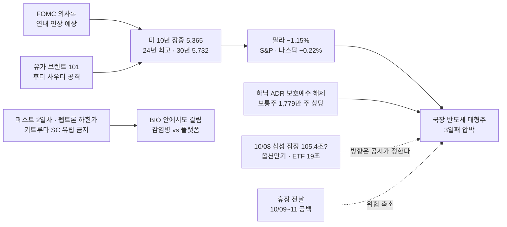

### 📌 오늘 국장 예측 → [[예측대조_2026#2026-10-08 (목)|원장 10/08]]

> [!question] 장전 예측 (05:38) — 원장 10/07 교훈 적용
> - **지수** : 시초 **약 −0.1%(6,796 부근 · 범위 6,750~6,830)** **[중 — 야간선물 05:54 수령 후 하 → 중]** · 종가 **60일선(약 6,739) 위** **[하]** · 코스닥 · 코스피 우열은 걸지 않는다(교훈 ①의 반대 경우 — 급락 다음 날도 같다)
> - **삼성 잠정** : 영업이익 ≥ 105.4조 **[하]** — 발표가 대형주 방향을 정한다(교훈 ② → C1 · C2)
> - **주도 테마** : ① BIO 감염병(페스트 2일차) **[중]** ② 유리기판(비아트론 애프터 +22%) **[하]** ③ 녹색전환 GX(태양광 · 풍력) **[하]** / 밀려날 것 : **바이오 플랫폼 · 신약(펩트론 · 알테오젠)** · 반도체 대형주 — B는 확신도 상한 중(교훈 ③)
> - **외국인 현물** : 조 단위 매도 3일째 **[최하]** — 방향을 고르지 않는다

### 🧭 대응 (10/08 국장)

| 영역 | 대응 | 근거 |
|:---|:---|:---|
| **모드** | **보수 1일차** | 1007A 판정 그대로 — 20일선 종가 이탈 · 외국인 2일 조 단위 · 거래대금 66% · 악재 다수 |
| **비중** | 삼전·하닉 **500만** / 그 외 **250만** | 보수 = 기본값의 절반 [[규칙후보#RC-16. 등급별 배정액 차등 + 배정액 내 분할\|RC-16]] |
| **보유** | **당일 청산 · 오버나잇 금지** | 보수 ⑤ + **휴장 전날(10/09 ~ 10/11 3일 공백)** + 이벤트 4중 — 스윙 보유분도 같다(RC-40 7) |
| 지수 | 위 : **20일선 약 6,900 · 5일선 약 6,912 · 10일선 약 6,943** — 덩이 저항 | 1007A 사다리(10/07 값) |
| 지수 | 아래 : **1차 지지 6,765(10/01 저가) · 45일선 6,754 · 60일선 6,739** | 60일선까지 −0.95% |
| ⚠️ **SK하이닉스 잔량 3주** | **오늘 전량 정리(사용자 결정)** — 시초 추정 **약 1,700,000~1,715,000**(야간선물 −0.12%와 필라 −1.15% 사이 어림 · 10/07 종가 1,723,000 대비 −0.5~−1.3%) = **박스 하단 1,700,000 위** 출발 → 첫 저항 **60일선 약 1,731,000** · 그다음 1,749,000~1,750,000 | 인계 A-2 · 규칙 후보 ② "보유 종목 계획은 새벽 시초 추정으로 다시 잡는다" — 야간선물 반영(05:54) · SKHY 종가는 미확인 · 진입 · 청산 판단은 사용자 |
| 반도체 대형주 | **삼성 잠정(장 전 공시 관례) → 동시호가 → ETF 리밸런싱 · 만기 동시호가(14:50~15:20)** — 오후 수급이 몰린다 | 골드만 "8일 변동성 확대" · 삼전 자사주 종료 무렵 |
| 테마 | **250만 · 당일 · 대장만** — BIO 감염병 2일차(국제약품 · HLB바이오스텝 제안서 [[매매제안_20261008_국제약품]] · [[매매제안_20261008_HLB바이오스텝]]) | 돌발 재료 2일차 = 대장권 거래대금 50%↑ 확인 [[규칙후보#RC-31\|RC-31]] |
| 경계 | **펩트론 애프터 하한가(릴리 계약 없이 평가 종료) · 키트루다 SC 유럽 8개국 판매 금지 → 알테오젠** — 클로징 "바이오 전반 확산 경계" | 감염병 · 진단은 재료가 다르다 — 같이 빠지는지 시초 확인 |

### 🔥 트리거

| 층 | 요인 | 이전 → 지금 | 상태 | 신호 |
|:---:|:---|:---|:---|:---:|
| 1 | **장기금리** | 5.278(진정) | **장중 5.365 = 24년 최고** → 마감 5.286 · 30년 5.732 · 프랑스 10년 5% 위 | 🔴 |
| 1 | **연준** | — | 9월 의사록 = **연내 인상 예상**(시점 없음 · 시장 확률 약 20%) | 🟡 |
| 1 | 유가 | WTI 89.77 | WTI 89.28 · 브렌트 101.24 — 후티 · 사우디 | 🔴 |
| 1 | **실적 시즌** | LG전자 −10.54% | **오늘 삼성 잠정** — 컨센 105.4조(일정 파일 108조) | ⏳ |
| 1 | 외국인 | −3.12조 | 3일째 여부 — 오늘 만기 · ETF가 겹쳐 금액이 왜곡될 수 있다 | 🔴 |
| 2 | **SK하이닉스** | −2.82% · ★핵심 지지 아래 | **ADR 보호예수 해제일** · 필라 −1.15% / 자사주 남은 522만 주 · **10월 중 60조 이상 추가 주주환원 예정**(다이제스트 일정) | 🔴 |
| 2 | **BIO 감염병** | 1일차(돌발) | **2일차** — WHO 두 번째 사망 확인 요청 · 루비오 정보 공개 촉구 → 재료 이어짐 | 🟢 |
| 2 | BIO 플랫폼 · 신약 | — | **펩트론 −25%(애프터)** · 알테오젠(키트루다 SC) 악재 / 한미사이언스 +13.94%(애프터 — 에페 GLP-1 허가 · 신동국 2% 추가 매수) | 🟡 |
| 2 | 유리기판 | 10/07 ❌ | **비아트론 +22.35%(애프터)** — 삼성전기 유리기판 글라스 본더 공동개발 · 연내 초도 공급 | 🟢 |
| 2 | 녹색전환(GX) | — | **정부 10년 1,000조**(재정 200조 + 정책금융 790조) · 10대 녹색산업 · 국내생산세액공제 | 🟢 |
| 2 | 조선 · 방산 | — | 트럼프 측근 매코믹 상원의원 **오늘 방한** 연설 | 🟡 |
| 2 | 보안 | 라온시큐어 단독 | 금융권 해킹 → **집단소송** 준비(재료 3일째) | 🟡 |

### ✅ 직전 명제 채점

> 1007A 명제(10/08 국장)는 **국장마감후**에 채점한다. 지금 채점할 수 있는 것만 :

| 출처 | 항목 | 결과 | 채점 |
|:---|:---|:---|:---:|
| 1007A 오늘 밤 | 03:00 FOMC 의사록 · 미 10년 · 유가 | 의사록 = 연내 인상 예상 / 10년 장중 5.365 → 5.286 / WTI 89.28 | 확인 |
| 1007A 오늘 밤 | SKHY · 마이크론 · 필라 | 필라 −1.15% · SOXX −1.12% / **SKHY · 마이크론 종가 미확인** | △ |
| 1007A 오늘 밤 | 야간선물 — 60일선(6,739) 앞 출발인가 | 1,077.45(−0.12%) → 환산 약 6,796 = **60일선 위 출발** | ✅ |

### ❓ 검증 대상 명제 (국장마감후 채점)

| # | 명제 | 기준 | 채점 |
|:---:|:---|:---|:---:|
| 1 | 하닉 종가 **1,700,000(박스 하단) 아래** | 종가 | ⬜ |
| 2 | 코스피 거래대금 **20조 이상**(만기 · ETF 리밸런싱) | HTS | ⬜ |
| 3 | **BIO 감염병** 이브닝 테마 **1~2위 유지** | 이브닝 | ⬜ |
| 4 | 삼전 등락률 **>** 하닉 등락률 | 등락률 | ⬜ |

### 📮 일정 관리 방 전달용 (일정 파일 기준일 : `updated_at` 2026-10-06 · 읽은 시각 10/08 05:38)

> 이 방은 읽기만 한다 — 아래는 **일정 관리 방에 넘길 내용**이다
> 1. **10/08 SK하이닉스 ADR 보호예수 해제** — ADS 약 263만 주(약 4.9억 달러) · 보통주 1,779만 주 상당 (파일에 없음)
> 2. **10/08 반도체 ETF 정기변경(약 19조) 집행** — 지금은 옵션만기 note 안에 "18조"로 들어 있음 → 금액 19조(골드만 · 클로징) 확인
> 3. **10/08 삼성 잠정 컨센서스** — 파일 108조 vs 다이제스트 105.4조(에너지경제) → 출처 맞추기
> 4. **10/09(목) 한글날 휴장** — 파일에 없음(휴장 전날 오버나잇 판단에 필요)
> 5. **10/08 TSMC 9월 매출 · EU-중국 고위급 통상회담(10/08~09)** — 다이제스트 주간 일정
> 6. **SK하이닉스 추가 주주환원(60조 이상) "10월 중"** — 파일은 날짜 없음 → "10월 중"으로 / **하닉 3Q 실적 10/27** — 파일에 없음
> 7. **10/13 애플 AI 스마트홈 허브 공개(LG전자 협력)** — 신규
> 8. 디지털자산기본법 "발의 예정" — 날짜 없음, 최신 여부 확인

> [!missing] 못 판정한 것
> - **SKHY · 마이크론 10/07 종가** — 검색에서 못 찾음
> - 삼성 잠정 발표 시각 · 실제 숫자(장 전 공시 관례)
> - 장전뉴스 10/08(07:40 이후)

---

## 2026-10-07 (수) — 국장마감후
#시황/국장마감후 #모드/보수 #요인/외국인 #요인/반도체 #요인/실적

> [!danger] 🔴 모드 : 보수 1일차(10/08 즉시 적용) — 외국인 3조를 판 날, 반등을 다 반납하고 저가에 끝났다
> KOSPI **6,803.90(−1.98%) = 저가 마감** · 시가 6,864.25(−1.11%) → 장중 고가 **6,977.77(+0.52%)** → 오후 내리 밀림 · **20일선(6,900.5) 아래 · 60일선(6,739.2) 위** · 코스닥 **−2.34%**(하락 1,060) · 외국인 현물 **−3.12조**(2일 연속 조 단위) · 삼전 −1.29% · **하닉 −2.82%(1,723,000 = ★핵심 지지 선 1,760,000 · 60일선 아래)**
> **비중 삼전·하닉 500만 / 그 외 250만 · 당일 청산** · ==10/08 = 삼성 잠정 · 옵션만기 · ETF 정기변경 · 하닉 ADR 보호예수 해제 · 휴장 전날 → 오버나잇 금지== · 반도체 대형주 : 외국인 이틀 4.9조 매도 · **실적 시즌 경계(LG전자 잠정 −10.54%)** → **장중 수급 확인 주의**

### 🎛 한눈에

| 지표 | 값 | 변화 | 신호 | 한 줄 |
|:---|---:|:---|:---:|:---|
| **KOSPI** | 6,803.90 | −137.49 (−1.98%) | 🔴 | **고가(+0.52%)에서 −2.5% 밀려 저가 마감** — 오전 반등 전부 반납 |
| KOSPI200 · KTOP30 | 1,073.63 · 18,782.42 | −2.03% · −2.09% | 🔴 | 어제와 달리 **대형주 전체**가 빠졌다 |
| **KOSDAQ** | 898.43 | −21.49 (**−2.34%**) | 🔴 | 상승 596 / **하락 1,060** · 코스닥150 −3.04% · **900 반납** — 어제 +2.98% 되돌림 |
| 코스피 거래대금 | 19.70조 | 전일의 98% · 기준 30조의 **66%** | 🔴 | 빠지는 날 거래가 그대로 — 매도가 실린 하락 2일째 |
| 코스닥 거래대금 | 7.63조 | 기준 7조의 109% | 🟡 | |
| **외국인 현물(코스피)** | **−31,246억** | −1.76조 → **−3.12조** | 🔴 | **2일 연속 조 단위 · 규모 확대** |
| 외국인 현물(코스닥) | −3,253억 | 매수 → **매도** | 🔴 | 기관 −2,267억과 **동반 매도**(어제 동반 매수의 반대) |
| 개인 · 기타법인 | **+33,566억** · +6,860억 | | 🟡 | 개인 3.36조가 받았다 |
| 삼성전자 · SK하이닉스 | 268,500 · **1,723,000** | −1.29% · **−2.82%** | 🔴 | 삼전 = 1차 지지 구간 안 / **하닉 = ★핵심 지지 선 아래** |
| LG전자 · 삼성전기 | — | **−10.54%** · −4.24% | 🔴 | **LG전자 3Q 잠정 예상 하회** → 전자제품 업종 −9.72% |
| 반도체 소부장 | 주성 −11.13% · 원익IPS −7.22% | | 🔴 | 이틀 오른 소부장이 가장 크게 되돌림 |
| VKOSPI | 38.11 | **−5.34%** | 🟡 | **−2%인데 변동성은 내려갔다** — 공포가 아니라 정리 매도 |
| 옵션(10월물) | 콜 1,095 −79.30% · 풋 1,095 +125.00% | | 🔴 | 만기(10/08) 하루 전 |
| 원/달러 · 국고 3년 | 1,338.50 · 3.96 | +0.40 · +0.02 | 🟡 | |
| 니케이 · 항셍 | 70,035.71 · 24,130.50 | −0.92% · −0.62% | 🟡 | 아시아도 약했다 — 오늘은 한국만의 날은 아니다 |
| 미니 S&P · 나스닥(17:36) | 7,874.75 · 31,421.00 | +0.01% · −0.20% | 🟡 | |

> [!info]- 신호등 기준
> 🟢 국장에 우호 · 🟡 중립·경계 · 🔴 역풍. 판정은 **국장 대형주에 미치는 영향** 기준

### 🔗 오늘의 인과

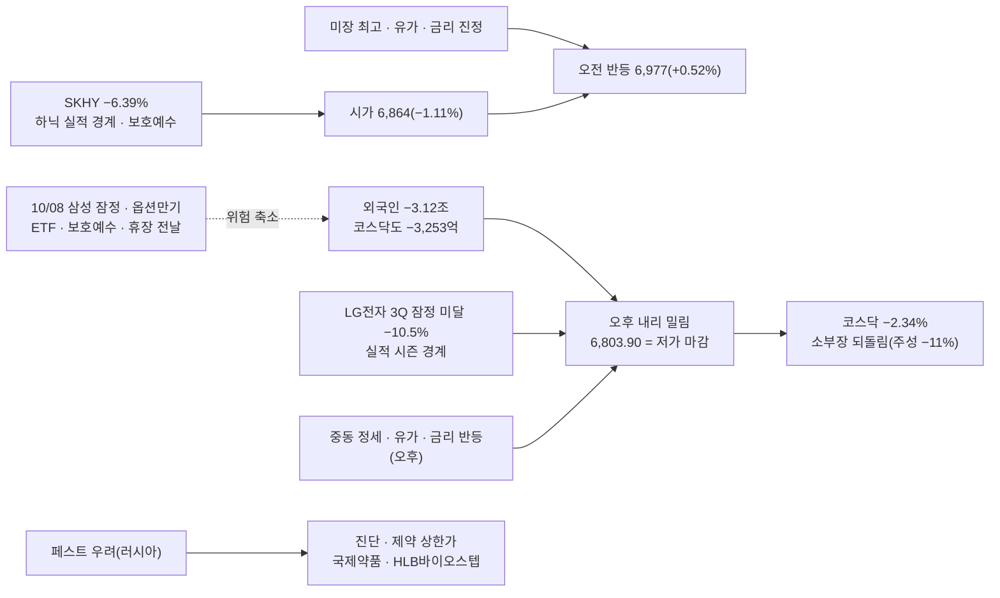

### 🧭 대응 (10/08 국장)

| 영역 | 대응 | 근거 |
|:---|:---|:---|
| **모드** | **보수 1일차(즉시)** | [F-IMI-리스크-09] 하락추세 △(20일선 종가 이탈 · 5일선 < 10일선 · 저가 마감 / 60일선 위라 중기 하락은 아님) · **거래대금 미달 ✅(66%)** · **악재 다수 ✅**(외국인 2일 4.9조 · 실적 경계 · LG전자 쇼크 · 이벤트 4중) = **2~2.5/3** · 1006A 기준 "20일선 종가 이탈 + 외국인 조 단위 지속 = 보수 후보" 둘 다 충족 / 보수 전환은 **1일차부터 즉시** [[규칙후보#RC-12. 매매 모드 4단계 — 보수 · 평시 · 강세 · 초강세 (5축 정의) ★ 2026-09-22 개정\|RC-12]] |
| **비중** | 삼전·하닉 **500만** / 그 외 **250만** | 보수 = 기본값의 절반 [[규칙후보#RC-16. 등급별 배정액 차등 + 배정액 내 분할\|RC-16]] |
| **보유** | **당일 청산 · 오버나잇 금지** | 보수 ⑤ + **휴장 전날(10/09~11 공백)** + 이벤트 당일 — 스윙 보유분도 같다(RC-40 7) |
| 지수 | 위 : **20일선 6,900.5 · 5일선 6,911.7 · 10일선 6,942.6** — 회복해도 저항 덩이 | 오늘 고가 6,977.8은 10일선 위까지 갔다가 밀렸다 |
| 지수 | 아래 : **60일선 6,739.2 · 45일선 6,754.0** → 1차 지지 6,765~6,795(10/01 저가 6,765) | 60일선까지 −0.95% |
| **반도체 대형주** | 하닉 **1,723,000 = ★핵심 지지 선 1,760,000 · 60일선(10/07 1,730,850) 아래 종가** — RC-40 9 초안 기준 **3단계(직전 지지구간 종가 이탈 = 중기 하락)** / 삼전 268,500 = 1차 지지 구간(267,500~272,500) 안 · 20일선(267,675) 위 | **추세 이탈 판단은 사용자**(RC-40 9) · 내일은 삼성 잠정 + 하닉 ADR 보호예수 해제 + ETF 정기변경이 한날 → **장중 수급 확인 주의** |
| 테마 | **250만 · 당일 · 대장만** — BIO(페스트 · 진단 · 제약) 1일차 · 화장품 / 보안은 라온시큐어 단독(2,958억) | 돌발 재료 테마는 다음 날 유지 확인 [[규칙후보#RC-31\|RC-31]] |
| 경계 | **실적 시즌 시작 — LG전자 잠정 미달 −10.54%** · 내일 삼성 잠정(컨센서스 108조) · 예탁금 10/02 하루 −3.80조 | |

### 📐 코스피 사다리 (10/07 종가 기준)

| 선 | 값 | 종가 대비 | 거리 | 역할 |
|:---|---:|---:|:---|:---|
| 120일 | 7,187.9 | +5.64% | `▲▲▲▲▲▲` | |
| *오늘 고가* | *6,977.8* | *+2.56%* | `▲▲▲` | 오전 반등 꼭대기 |
| 10일 | 6,942.6 | +2.04% | `▲▲` | 저항 |
| 5일 | 6,911.7 | +1.58% | `▲▲` | 저항 |
| **20일** | **6,900.5** | **+1.42%** | `▲` | **오늘 종가 이탈** |
| **종가 = 저가** | **6,803.90** | — | `◆` | |
| *1차 지지(10/01 저가)* | *6,765.1* | *−0.57%* | `▼` | |
| 45일 | 6,754.0 | −0.73% | `▼` | ┐ 다음 지지 |
| **60일** | **6,739.2** | **−0.95%** | `▼` | ┘ |
| 224일 | 6,101.5 | −10.32% | `▼▼▼▼▼▼▼▼▼▼` | |

- 장중 : 시가 **6,864.25(−1.11%)** → 고가 **6,977.77(+0.52%, 10일선 위)** → 오후 밀림 → **저가 6,803.81 ≈ 종가 6,803.90** — 고가 대비 −2.49% 장대음봉 · LC 34.92% · HC −27.51%
- **5일선(6,911.7) < 10일선(6,942.6)** 2일째 · 종가가 5 · 10 · 20일선 모두 아래 — 단기선이 전부 위로 갔다

### 🔥 트리거

| 층 | 요인 | 이전 → 지금 | 상태 | 신호 |
|:---:|:---|:---|:---|:---:|
| 1 | **외국인** | −1.76조 → **−3.12조** | **조 단위 2일째 · 확대** · 코스닥도 매도 전환 · 지수선물 −2,916억 · 주식선물 −3,032억 | 🔴 |
| 1 | **실적 시즌** | — | **LG전자 3Q 잠정 예상 하회 → −10.54%** · 반도체 실적 경계(하닉 10/27 · 삼성 잠정 10/08) · 성과급 충당금 · 원화 강세 환산 감소 | 🔴 |
| 1 | 미국 | 사상 최고 | 미 선물 보합(나스닥 −0.20%) — **오전 반등은 만들었지만 오후를 지키지 못했다** | 🟡 |
| 1 | 유가 · 금리 | 진정(새벽) | 오후 **중동 정세 악화 → 유가 · 금리 반등**(스페셜경제) | 🔴 |
| 1 | 이벤트 | — | **10/08 FOMC 의사록(03:00) → 삼성 잠정 · 옵션만기 · ETF 정기변경 · 하닉 ADR 보호예수 해제 · 휴장 전날** | 🔴 |
| 2 | **SK하이닉스** | −3.69% | **−2.82%(1,723,000)** — ADR −6.39% 일부 반영 · ★핵심 지지 선 · 60일선 아래 종가 | 🔴 |
| 2 | 반도체 소부장 · 전자부품 | 10/06 재가동(주성 +17.5%) | **되돌림** — 주성 −11.13% · 원익IPS −7.22% · 삼성전기 −4.24% / 케이씨텍만 +14.53%(이틀째) | 🔴 |
| 2 | **BIO** | HLB 상 2(10/06) | **페스트 우려(러시아 · WHO 정보 요청)** → 국제약품 상 · 녹십자엠에스 +26.89% · 휴마시스 · 신풍제약 / HLB바이오스텝 상(리라푸그라티닙 유럽 본심사) | 🟢 |
| 2 | 화장품 | — | "조정 과도" 리포트 · 아모레 · 한국콜마 +5% · 한국화장품제조 +11.90% | 🟢 |
| 2 | 보안 | 1위(상한가 2) | **라온시큐어 단독 +12.37%(2,958억)** — 테마 확산 없음 | 🟡 |
| 2 | 우주 | 발사일 | 명단 없음 — 발사일 매도 트리거 ✅ | 🟡 |

### 💰 수급 (억 원)

| 주체 | 코스피 현물 | 코스닥 현물 | 지수선물 | 주식선물 | 달러선물 |
|:---|---:|---:|---:|---:|---:|
| 개인 | **+33,566** | +5,785 | +430 | +241 | −322 |
| **외국인** | **−31,246** | **−3,253** | **−2,916** | **−3,032** | −1,813 |
| 기관계 | −9,322 | −2,267 | +1,835 | +2,787 | +2,135 |
| └ 금융투자 | −5,064 | +793 | +3,151 | +1,695 | +2,878 |
| └ 투신 | −164 | −1,149 | −2,744 | −845 | −174 |
| 기타법인 | +6,860 | −292 | +651 | +4 | +85 |

- **외국인 현물 · 지수선물 · 주식선물 · 코스닥 전부 매도** — 10/06(코스닥은 매수)보다 넓어졌다
- 받은 쪽 : **개인 +3.36조** · 기타법인 +6,860억(하닉 자사주 추정 — 10월 중순 종료 예상)
- 증시주변(10/02 기준) : **예탁금 100.84조(−3.80조)** · 미수금 9,883억 · 신용 33.63조(+1,474억) · 선물예수금 40.19조(+1.81조) — 예탁금은 빠지는데 신용은 늘었다

### 🧵 주도 테마 (Signal Evening 14106)

| 순위 | 테마 | 등급 | 일차 | 대장 · 주도 | 거래대금 |
|:---:|:---|:---:|:---:|:---|:---|
| 1 | **BIO(감염병 · 진단 · 제약)** | A | 1일차(돌발) | **국제약품 상 · HLB바이오스텝 상** > 녹십자엠에스 +26.89% > 휴마시스 +19.77% > 국전 +15.66% > 진매트릭스 > 신풍제약 +13.86% · 셀리드 · 인벤티지랩 | 녹십자엠에스 812억 · 국전 417억 · 신풍제약 330억 · HLB바이오스텝 301억 |
| 2 | **화장품** | B | — | 한국화장품제조 +11.90% > 펌텍코리아 · 코스메카코리아 · 한국콜마 · 코스맥스(3Q 영업이익 +85% 전망) | 한국화장품제조 962억 · 한국콜마 723억 · 코스맥스 616억 |
| — | 개별 | — | — | **동양고속 상 · 천일고속 상** · 대성산업 · 삼표시멘트(서초 재건축) · **알파칩스 상(1:1 무상증자)** · SAMG엔터 +27.16% · **케이씨텍 +14.53%(1,344억)** · **라온시큐어 +12.37%(2,958억)** · 삼미금속 +11.27%(2,319억) · 하이브 +6.37% | 라온시큐어 2,958억 · 삼미금속 2,319억 · 삼표시멘트 1,440억 · 케이씨텍 1,344억 |

- 대장 판정 [[규칙후보#RC-25. 테마 대장 판정 순서 — 상한가 > 먼저 들어간 순 > 상승률 > 거래대금 (사용자 정의, 2026-09-16)\|RC-25]] : BIO = **국제약품(상 · 265억)** · 거래대금은 녹십자엠에스 812억
- **반도체는 섹션이 없다** — 케이씨텍만 개별로. 기판 · 유리기판 · 이차전지 소재는 명단에서 빠졌다
- 지수 −2%에서 상한가 5개(국제약품 · HLB바이오스텝 · 동양고속 · 천일고속 · 알파칩스) — **재료 개별주 장세**

### ✅ 직전 명제 채점

**1007 미장마감후 명제** (10/07 국장)

| # | 명제 | 결과 | 채점 |
|:---:|:---|:---|:---:|
| 1 | 하닉 종가가 ★핵심 지지 손절선(1,760,000) 아래 | **1,723,000** | ✅ |
| 2 | 코스피 종가 20일선(약 6,895) 아래 | **6,803.90** < 6,900.5 | ✅ |
| 3 | 코스닥 > 코스피 | −2.34% < −1.98% | ❌ |
| 4 | 보안 2일차 1~3위 유지 | 섹션 없음 — 라온시큐어 개별만 | ❌ |

**1006A 국장마감후 명제** (10/07 국장)

| # | 명제 | 결과 | 채점 |
|:---:|:---|:---|:---:|
| 1 | 코스피 종가 20일선(약 6,895) 위 | 6,803.90 | ❌ |
| 2 | 외국인 현물 조 단위 매도 2일째(최하) | **−3.12조** | ✅ |
| 3 | 보안 2일차 대장권 거래대금 50%↑ | 라온시큐어 **2,958억**(1일차 783억의 3.8배) · 아톤 미확인 | ✅ |
| 4 | 하닉 종가 177만 위 | 1,723,000 | ❌ |

> [!caution] 총평
> **하닉 · 지수 방향은 맞았고(새벽 시황 명제 1 · 2), 테마는 또 놓쳤다.** 코스닥이 전날 +2.98%였던 다음 날을 "코스닥 > 코스피"로 본 것이 틀렸다 — **급등 다음 날의 코스닥은 되돌림이 먼저다.** 보안은 대장 하나(라온시큐어)로 좁아졌다.

> [!example] 📊 예측 채점 → [[예측대조_2026#2026-10-07 (수)|원장 10/07]]
> - **A : 5/7** — 중 3/4 · 하 1/2 · **최하 1/1**(외국인 조 단위 — 맞았지만 방향은 계속 고르지 않는다)
> - **B : 1위 보안 △(개별만) · 2위 기판 · 유리기판 ❌ · 3위 이차전지 소재 ❌** / 실제 1~2위 = **BIO(페스트 — 돌발) · 화장품** / 밀려날 것 : 우주 ✅ · 반도체 대형주 ✅

### 📋 볼 것

> [!todo] 오늘 밤 (10/08 새벽)
> - [ ] **03:00 FOMC 의사록** · 미 10년 · 유가(중동)
> - [ ] **SKHY(하닉 ADR) — 보호예수 해제 전날 밤** · 마이크론 · 필라
> - [ ] 야간선물 — 60일선(6,739) 앞 출발인가

> [!todo] 10/08 국장 (휴장 전날 · 보수)
> - [ ] **삼성 잠정실적**(장 전 공시 관례) — 컨센서스 108조 대비 · LG전자처럼 하회면 대형주 3일째
> - [ ] **옵션만기 · ETF 정기변경 집행** — 삼전 매도 · 하닉 매수가 실제로 보이는가 · 동시호가
> - [ ] **하닉 ADR 보호예수 해제** — 하닉 ★핵심 지지 안(170만~177만) 회복 여부 · 60일선
> - [ ] 코스피 **60일선(6,739) 지지** · 외국인 3일째
> - [ ] BIO(페스트) 2일차 — 돌발 재료 유지 여부

### ❓ 검증 대상 명제 (다음 시황에서 채점)

| # | 명제 | 기준 | 채점 |
|:---:|:---|:---|:---:|
| 1 | 10/08 코스피 **종가 60일선(약 6,739) 위** | 60일선(10/08 값) | ⬜ |
| 2 | **삼성 잠정 영업이익 ≥ 컨센서스 108조** | 공시 | ⬜ |
| 3 | 외국인 코스피 현물 **조 단위 매도 3일째** — 확신도 최하 | −1조 | ⬜ |
| 4 | BIO(페스트) 2일차 **대장권 거래대금 50%↑** | 국제약품 265억 · 녹십자엠에스 812억의 50% | ⬜ |

> [!missing] 못 판정한 것
> - **하닉 · 삼전 장중 OHLC · NXT 종가** — 기사 종가만(일봉 · 분봉 미입력)
> - 외국인 순매도 종목별 금액 · 프로그램 매매
> - 오후 하락 원인 "중동 정세 → 유가 · 금리 반등"은 한 기사(스페셜경제)만 — 장중 수치 확인 못 함
> - 기사마다 외국인 금액이 다르다(3조848억 · 3조1,078억 · 3조1,095억) — HTS **−31,246억**을 썼다
> - 보안 대장 아톤 · 유리기판(제이앤티씨) · 포스코퓨처엠 등락 미확인

### 📝 상세

> [!note]- 1. 오전 반등 → 오후 저가 마감
> 1. 시가 6,864.25(−1.11%) — 야간선물 환산(약 6,854)과 거의 같다
> 2. 오전 미국 사상 최고 · 유가 · 금리 진정으로 **6,977.77(+0.52%)까지 반등 — 10일선(6,942.6) 위**
> 3. 오후 외국인 매도 확대 · LG전자 실적 쇼크 · 중동 뉴스 → **종가 = 저가 6,803.90**
> 4. 9/22 · 9/30 · 10/06은 "갭 상승 반납", 오늘은 **"갭 하락 → 반등 → 반등 반납"** — 어느 쪽이든 **장중 고점에서 외국인이 팔았다**

> [!note]- 2. 외국인 — 이틀 4.9조, 오늘은 전부 팔았다
> 1. 코스피 현물 −3.12조 · 코스닥 −3,253억 · 지수선물 −2,916억 · 주식선물 −3,032억 · 달러선물 −1,813억
> 2. 기사 : 반도체 실적 발표 앞 경계 · 단기 급등 차익실현(한경) · 삼성 잠정 앞 관망(스페셜경제)
> 3. 9/1~10/2 −20.3조(한경 10/04) → 10/06 −1.76조 → 10/07 −3.12조 — 10월에도 멈추지 않았다

> [!note]- 3. 실적 시즌 첫 신호 — LG전자
> 1. LG전자 3Q 잠정 **예상 하회 → −10.54%** · 전자제품 업종 **−9.72%** · 전기장비 −5.44% · 자동차 −3.05%(현대차 −3.45%)
> 2. 내일 삼성 잠정(컨센서스 108.1조 · 30조 특별배당 전망) — **컨센서스가 높을수록 하회 위험이 크다**는 것을 하루 먼저 보여줬다

> [!note]- 4. 관측 타임라인 (한국시간)
> | 시각 | 관측 |
> |:---|:---|
> | 10/07 (새벽) | 야간선물 1,089.10(−1.26%) · SKHY −6.39% |
> | 10/07 09:00 | **KOSPI 시가 6,864.25(−1.11%)** |
> | 10/07 오전 | 장중 고가 6,977.77(+0.52%, 시각 미상) |
> | 10/07 12:23 | 누리호 5차 발사 예정 |
> | 10/07 오후 | 외국인 매도 확대 · 낙폭 확대 |
> | 10/07 15:30 | **KOSPI 6,803.90(−1.98%) = 저가 · KOSDAQ 898.43(−2.34%)** · 삼전 268,500 · 하닉 1,723,000 |
> | 10/07 16:09 | 항셍 −0.62% |
> | 10/07 (저녁) | Signal Evening 14106 |
> | 10/07 17:36~17:39 | 미니 S&P +0.01% · 미니나스닥 −0.20% · 원/달러 1,338.50 — 사용자 HTS |

> [!info]- 출처 · 형
> **출처**
> - 사용자 제공 : HTS 코스피 일봉 창(OHLC · 이평선 9종 · LC/HC) · 시장 요약표(등락 · 지수 · 선물옵션 · 해외 · 환율 · 금리 · 상품 · 투자자 · 증시주변 10/02 기준) — 2026-10-07 17:36~17:39
> - 시그널리포트 원본 : **이브닝 14106**(10/07)
> - 웹 : [한경 10/07](https://www.hankyung.com/article/2026100787356) · [스페셜경제 10/07](https://www.speconomy.com/news/articleView.html?idxno=418687) · [신아일보](https://www.shinailbo.co.kr/news/articleView.html?idxno=5069720) · [뉴스핌](https://www.newspim.com/news/view/20261007001279) · [서울신문](https://www.seoul.co.kr/news/economy/securities/2026/10/07/20261007500231)
>
> **형** : 국장마감후
> - 태그 : `[본인시황 1007A]` · 요인값 → [[요인값변천사_2026#2026-10-07 (국장마감후)]] · 예측 채점 → [[예측대조_2026#2026-10-07 (수)]]

---

## 2026-10-07 (수) — 미장마감후
#시황/미장마감후 #모드/평시 #요인/반도체 #요인/외국인 #요인/이벤트

> [!warning] 🟡 모드 : 평시 2일차(1006A) — 미국은 사상 최고, 그런데 **미국에서도 하닉만 빠졌다**
> S&P **사상 최고(7,819 · 첫 7,800 마감)** · 나스닥 **사상 최고** · 필라 +0.34% · 미10년 **5.278(−3.5bp)** · 2년 4.795 / 그러나 **SK하이닉스 ADR(SKHY) −6.39%**($182.56) · DRAM ETF −2% · 마이크론 +0.3%
> 야간선물 **1,089.10(−1.26%)** → 코스피 시초 약 **6,854 = 20일선(6,894.7) 아래** 출발
> **비중 삼전·하닉 1,000만 / 그 외 500만** · ==10/07 밤 = 삼성 잠정 전날 · 10/08 = 삼성 잠정 · 옵션만기 · ETF 정기변경 집행 · **하닉 ADR 보호예수 해제** · 휴장 전날 → 오버나잇 금지== · 하닉 : **고유 악재 + 이벤트 몰림 → 장중 수급 확인 주의**

### 🎛 한눈에

| 지표 | 값 | 변화 | 신호 | 한 줄 |
|:---|---:|:---|:---:|:---|
| S&P 500 · 나스닥 | 7,819.04 · 27,599.79 | +0.58% · +0.45% | 🟢 | **둘 다 사상 최고** — AMD · 마벨 · 엔비디아 |
| **필라 반도체** | 13,217.8 | +0.34% | 🟡 | SOXX −0.01% · SOXL −0.04% — 반도체 전체는 보합 |
| **SK하이닉스 ADR(SKHY)** | **$182.56** | **−6.39%** | 🔴 | **실적 경계 · 원화 강세 · 성과급 충당금 · 10/08 보호예수 해제** |
| 마이크론 · 샌디스크 | — | +0.3% · −2% | 🟡 | 같은 메모리인데 마이크론은 버텼다 → **하닉 고유 요인** |
| **미 10년** ✔체크 | 5.278 | **−0.035** | 🟢 | 5.3 아래로 되돌림 |
| 미 2년 · 30년 | 4.795 · 5.655 | −0.038 · −0.009 | 🟢 | 단기 · 장기 같이 내림 |
| **일본 30년** ✔체크 | 4.230 | −0.013 | 🟡 | |
| **WTI** ✔체크 · 브렌트 | 89.77 · 100.97 | +0.37% · +0.39% | 🟡 | 사우디 공항 · 정유시설 후티 공습 / 중동 수출 증가 |
| 금 | 4,191.97 | +0.12% | 🟡 | |
| 원/달러 | **1,337.77** | −3.87 | 🟡 | 원화 강세 지속 — **하닉 ADR 하락 이유 중 하나(원화 환산 이익 감소)** |
| VIX | 15.01 | −3.29% | 🟢 | |
| 미 선물(05:15) | S&P +0.63% · 나스닥100 +0.57% | | 🟢 | |
| **야간선물** | **1,089.10** | **−13.90 (−1.26%)** | 🔴 | 정규장 종가 1,103.00 대비 — 코스피 환산 약 **6,854** |

> [!info]- 신호등 기준
> 🟢 국장에 우호 · 🟡 중립·경계 · 🔴 역풍. 판정은 **국장 대형주에 미치는 영향** 기준 · ✔체크 = 사용자 매일 확인 항목(`checklist.json`)

### 🧮 이익 · 할인율 장부

| 변수 | 지난밤 | 방향 |
|:---|:---|:---:|
| **이익**(하닉) | **실적 경계** — 원화 강세(1,337원)로 환산 이익 감소 · **성과급 충당금 확대**(삼전 · 하닉 둘 다) · 모건스탠리 "美 데이터센터 전력난 → 메모리 주문 지연 가능성" / 반대 : 마이크론 +0.3% · "엔비디아도 저전력 D램 못 구해" | ▼ |
| 할인율 — 단기 · 장기 | 2년 4.795 · 10년 5.278 · 30년 5.655 — **셋 다 내림** | ▼(우호) |
| 위험 프리미엄 | VIX 15.01 · S&P · 나스닥 사상 최고 | ▼(우호) |
| **수급**(하닉) | **ADR 보호예수 해제 10/08**(ADR 1억 7,790만 주 = 보통주 1,779만 주) · ETF 정기변경 10/08 집중(삼전 비중 축소 → 하닉 매수, 골드만 "하닉에 유입") · 자사주 하루 약 60만 주(76.24%, 10월 중순 종료 예상) | ↔ |

- 판정 : **미국 시장 전체의 분모(할인율 · 위험)는 좋아졌는데, 하닉의 분자(이익 추정)와 수급(보호예수 해제)이 따로 나빠졌다.** 10/06 국장 하닉 −3.69%는 "외국인이 국장 대형주를 판다"였는데, 지난밤은 **미국 투자자도 하닉 ADR을 팔았다** — 국장만의 문제가 아니라 **하닉 고유 요인**

### 🔗 오늘의 인과

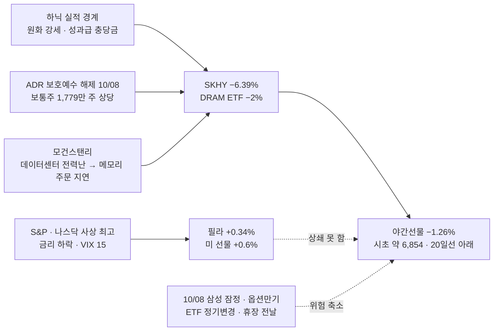

### 📌 오늘 국장 예측 → [[예측대조_2026#2026-10-07 (수)|원장 10/07]]

> [!question] 장전 예측 (05:31) — 원장 10/06 교훈 적용
> - **지수** : 시초 약 −1.3%(6,854) **[중 — 외국인 매도 국면 갭 할인 · 범위 넓힘]** · 종가 **20일선(6,895) 아래 · 60일선(6,747) 위** **[하]** · 코스닥이 코스피보다 강하다 **[중]** · 반도체 대형주 < 코스피 · 하닉 < 삼전 **[중]**
> - **주도 테마** : ① 보안(2일차 — 정부 특별대응 1개월) **[중]** ② 반도체 기판 · 유리기판(삼성전기 · 제이앤티씨) **[중]** ③ 이차전지 소재(LFP 6조) **[하]** / 밀려날 것 : **우주(발사일)** · 반도체 대형주
> - **외국인 현물** : 조 단위 매도 **[최하]** — 방향을 고르지 않는다

### 🧭 대응 (10/07 국장)

| 영역 | 대응 | 근거 |
|:---|:---|:---|
| **모드** | **평시 2일차** | 1006A 판정 유지. **20일선 종가 이탈 + 외국인 조 단위 2일째면 보수 후보**(1006A 기준) — 국장마감후 판정 [[규칙후보#RC-12. 매매 모드 4단계 — 보수 · 평시 · 강세 · 초강세 (5축 정의) ★ 2026-09-22 개정\|RC-12]] |
| **비중** | 삼전·하닉 **1,000만** / 그 외 **500만** | |
| **보유** | **10/07 밤 = 삼성 잠정 전날** → 이벤트 전날 판단 / **10/08 = 휴장 전날 → 오버나잇 금지** | RC-12 공통 예외 · 스윙 보유분도 적용(RC-40 7) |
| 지수 | 시초 약 **6,854** = 20일선 6,894.7 **아래** 출발 → 위 20일선 · 5일선 6,925 · 10일선 6,952가 저항 | 10/06 저가 6,897.38(20일선 터치) |
| 지수 | 아래 **60일선 6,746.6 · 45일선 6,727.1** | 20일선 아래 마감이면 다음 지지 |
| ⚠️ **SK하이닉스** | **ADR −6.39%** → 국장 추가 하락 추정 약 **−2~−3%**(ADR 하락분 − 10/06 국장 −3.69% 이미 반영분, 환율 무시 어림) → **약 1,72만~1,74만 출발 가능** = **★핵심 지지 손절선 1,760,000 아래 · 60일선 1,730,850 부근** | **추정** — NXT 프리마켓(08:00~)으로 확인. 보유 6주(1,810,000) 계획은 아래 "보유분 확인" |
| 반도체 대형주 | 하닉 고유 악재 + 10/08 보호예수 해제 · ETF 정기변경(삼전 매도 · 하닉 매수) · 삼성 잠정 → **장중 수급 확인 주의** | 진입 판단은 사용자(§2-4) |
| 테마 | **500만 · 대장만** — 보안 2일차(대장권 거래대금 50%↑ 확인) · 유리기판 · LFP / **우주는 발사일(12:23 발사) = 매도 트리거** | [A-IMI-진입-05] · [[규칙후보#RC-31\|RC-31]] |

> [!danger] 보유분 확인 — SK하이닉스 6주(매수 1,810,000)
> - 10/07 제안서(GJ 10/06 18:15)의 사용자 결정 : **10/07 장중 절반(3주) 정리 · 절반(3주) 보유** · 보유분 손절 = **대각 구간 하단(10/07 1,782,669) 종가 이탈 시 전량** · 그림 손절 = 60일선 1,730,850 이탈
> - 지난밤 **ADR −6.39%**로 시초가 그 계획을 세울 때보다 **약 2~3% 낮을 수 있다**(추정) — 시초부터 **대각 구간 하단 · ★핵심 지지 손절선(1,760,000) 아래**에서 열릴 가능성
> - 제안서는 고치지 않았다(수정 컨펌 대상) — 계획대로 갈지, 시초 기준으로 다시 정할지는 사용자 판단

### 📐 코스피 사다리 (10/06 종가 기준)

| 선 | 값 | 종가 대비 | 거리 | 역할 |
|:---|---:|---:|:---|:---|
| 10일 | 6,951.6 | +0.15% | `▲` | 저항 |
| **10/06 종가** | **6,941.39** | — | `◆` | |
| 5일 | 6,925.1 | −0.24% | `▼` | |
| **20일** | **6,894.7** | −0.67% | `▼` | 10/06 저가가 멈춘 자리 |
| *오늘 시초(예상)* | *약 6,854* | *−1.26%* | `▼` | 야간선물 환산 |
| 60일 | 6,746.6 | −2.81% | `▼▼▼` | 다음 지지 |
| 45일 | 6,727.1 | −3.09% | `▼▼▼` | |

### 🔥 트리거

| 층 | 요인 | 이전 → 지금 | 상태 | 신호 |
|:---:|:---|:---|:---|:---:|
| 1 | **하닉 고유 요인** | 국장 −3.69%(10/06) | **ADR −6.39%** — 실적 경계(10/27 발표, 메모리 마지막 실적) · 원화 강세 · 성과급 충당금 · **ADR 보호예수 해제 10/08** · 9월 +47% 급등 부담 | 🔴 |
| 1 | 금리 | 10년 5.309 · 30년 5.665 | **10년 5.278 · 2년 4.795 · 30년 5.655 — 모두 하락** | 🟢 |
| 1 | 미국 주식 | 나스닥 최고 | **S&P 첫 7,800 마감 · 나스닥 최고** — AMD +3%(메타 뮤즈 · 에이전트 → CPU) · 마벨 인베스터데이 | 🟢 |
| 1 | 메모리 업황 | 마이크론 확인 | 모건스탠리 **데이터센터 전력난(2028년까지 필요 전력의 34% 부족) → 메모리 주문 지연 가능성** / 반대 : 저전력 D램 품귀 · 엔비디아 자사주 1,500억 달러 | 🟡 |
| 1 | 환율 | 1,339.3 → **1,337.8** | 원화 강세 — 수출주 이익 추정 감소 · 한국 3Q 순이익 전망 −4.85%(서울경제) | 🟡 |
| 1 | 유가 | 브렌트 100.23 → 100.97 | 사우디 공항 · 정유시설 후티 공습 | 🟡 |
| 2 | **보안** | 1일차(상한가 2) | **2일차** — 금감원 해킹 IP 28개 특정 · 신한 현장검사 · 소비자경보 · 정부 특별대응 1개월 | 🟢 |
| 2 | **반도체 기판 · 유리기판** | 10/06 재가동 | 삼성전기 유리기판 패키지 검증(2027년말 양산) · **제이앤티씨 애프터 +14.81%**(TGV 구리 충진 — 고객사 브로드컴 추정) · 태성 FC-BGA 수주 | 🟢 |
| 2 | **이차전지 소재** | 10/06 전고체 | **포스코퓨처엠-삼성SDI LFP 양극재 6조**(물량 2배) | 🟢 |
| 2 | 우주 | D-1(4번째) | **발사일(12:23)** — 매도 트리거 | 🟡 |
| 2 | 기타 | — | TSMC 성숙공정 최대 10% 인상 → 팹리스(PMIC · DDI · MCU) 가격 인상 검토 · 중대형 변압기 수출 +55% · 베어로보틱스 수주잔고 4,000대 · 단일종목 레버리지 개인 손실 2.3조 · 삼전닉스 특허소송 | 🟡 |

### 🧵 주도 테마 예측 (10/06 국장 → 10/07 적용)

| 순위 | 테마 | 등급 | 일차 | 10/06 대장 · 주도 | 오늘 재료 |
|:---:|:---|:---:|:---:|:---|:---|
| 1 | **보안** | A | **2일차** | 샌즈랩 상 · 라온시큐어 상 · 아톤 1,228억 | 금감원 IP 28개 · 정부 특별대응 1개월 — 정부 대응 계속(교훈 ①) |
| 2 | **반도체 기판 · 유리기판** | A | 재가동 2일 | 주성 +17.5% · LG이노텍 +12.2% · 삼성전기 · 이수페타시스 | 삼성전기 유리기판 · 제이앤티씨 애프터 · 태성 수주 |
| 3 | 이차전지 소재 | B+ | 2일차 | 에코프로비엠 +11.4% · 삼성SDI +8.7% | **LFP 6조 계약** |
| — | 밀려날 것 | — | — | 알멕 · 스피어(우주) · 삼전 · 하닉 | 누리호 발사일 · 하닉 ADR |

- ⚠️ 보안 · 이차전지는 **2일차** — 대장 거래대금 50%↑(아톤 1,228억 · 라온시큐어 783억 / 에코프로비엠 973억 · 삼성SDI 3,516억) [[규칙후보#RC-31\|RC-31]]

### ✅ 1006A "오늘 밤" 채점

| # | 볼 것 | 결과 | 채점 |
|:---:|:---|:---|:---:|
| 1 | 미 2년 · 10년 — 장기금리 5.3 위 유지 | 10년 **5.278**(5.3 아래) · 2년 4.795 | ❌(5.3 위 유지 안 함 — 우호) |
| 2 | 필라 · 엔비디아 vs 국장 대형주 괴리 | 필라 +0.34% · S&P 최고 / **SKHY −6.39%** — 괴리가 **미국 안에서도** 나타났다 | ✅(괴리 지속) |
| 3 | 美 무역수지 · 연준 연설 → FOMC 의사록 | 의사록은 **10/08 03:00** | ⏳ |

- **1006 미장마감후 명제 ④ "미 2년 하락 · 10년 상승 지속"** → 2년 하락 ✅ · **10년 하락 ❌** → **❌**

### 📋 볼 것

> [!todo] 오늘 국장 (10/07)
> - [ ] **하닉 NXT 프리마켓 · 시초** — ADR −6.39%가 얼마나 반영되는가 · ★핵심 지지 1,760,000 · 60일선 1,730,850
> - [ ] 코스피 **20일선(6,894.7) 종가 회복 / 60일선(6,746.6)** — 보수 후보 판정
> - [ ] **외국인 현물 조 단위 2일째인가**(1006A 명제 2) · 전기전자 집중 여부
> - [ ] 보안 2일차 · 기판(유리기판) · LFP 대장 거래대금
> - [ ] **12:23 누리호 발사** — 우주 매도 트리거 · 14:00 리사 수(AMD 게이머 데이)

> [!todo] 오늘 밤 · 내일
> - [ ] **10/08 03:00 FOMC 의사록**
> - [ ] **10/08 삼성 잠정실적**(컨센서스 영업이익 약 108조) · **옵션만기** · **ETF 정기변경 집행** · **하닉 ADR 보호예수 해제** · **휴장 전날 → 오버나잇 금지**

### ❓ 검증 대상 명제 (다음 시황에서 채점)

| # | 명제 | 기준 | 채점 |
|:---:|:---|:---|:---:|
| 1 | 10/07 **하닉 종가가 ★핵심 지지 손절선(1,760,000) 아래** | 1,760,000 | ⬜ |
| 2 | 코스피 **종가 20일선(약 6,895) 아래** | 20일선(10/07 값) | ⬜ |
| 3 | **코스닥 > 코스피**(외국인 · 기관 코스닥 동반 매수 4번째) | 등락률 | ⬜ |
| 4 | 보안 2일차 **1~3위 유지** | 이브닝 | ⬜ |

> [!missing] 못 판정한 것
> - **하닉 국장 시초 추정(약 1,72만~1,74만)** — ADR 등락률과 국장 10/06 하락분을 빼서 어림한 값(환율 · ADR 프리미엄 무시). ADR 가격을 원화로 환산한 절대값은 쓰지 않았다
> - SKHY 마감 하락률 출처가 **−4%(장중 $187.25) · −6.39%(마감 $182.56)**로 섞여 있다 — 마감값을 썼다
> - 마이크론 · 마벨 · AMD의 정확한 마감 등락률(검색 기사 수치만)
> - 10/06 국장 마감 뒤 하닉 NXT 이후 움직임(17:36 1,783,000까지)

> [!info]- 📮 일정 관리 방 전달용 (macro_calendar.json 기준 — 없거나 보강할 것)
> | 날짜 | 제목 | 중요도(제안) | note | 출처 |
> |:---|:---|:---:|:---|:---|
> | **10/08** | **SK하이닉스 ADR 보호예수 해제** | 상 | ADR 1억 7,790만 주 = 보통주 1,779만 주 상당(IPO 90일) | FX Leaders · 24/7 Wall St |
> | 10/07 | 9월 FOMC 의사록 | 상 | 10/07 14:00 ET (한국 10/08 03:00) | 다이제스트 14101 주간 일정 |
> | 10/08 | 국내 주식형 ETF 리밸런싱 집중 | 중 | 삼전 비중 축소 · 하닉 · 소부장 유입(골드만) — 기존 '옵션만기' note 보강 | 연합 · 24/7 Wall St |
> | **10/27** | SK하이닉스 3분기 실적 | 상 | 10/27 두 곳(Investing · 24/7 Wall St) / 10/28 한 곳(Quartr) | 검색 |
> | 10/09 | 한글날 휴장 | 중 | 미국 장은 열림 → 10/12(월) 반영 | — |

### 📝 상세

> [!note]- 1. 하닉 ADR — 미국에서도 하닉만 빠졌다
> 1. SKHY 10/06 마감 **$182.56(−6.39%)** · 장중 $187.25(−4%) — 9월 +47% 급등 뒤 20일선 이탈(FX Leaders)
> 2. 원인(24/7 Wall St · FX Leaders) : 메모리 3사 중 **마지막 실적(10/27)** 앞 경계 · **원화 강세 → 해외 이익 환산 감소** · **삼전 · 하닉 성과급 충당금 확대** · **ADR 보호예수 해제 10/08**(ADR 177.9M = 보통주 17.79M)
> 3. 같은 날 마이크론 +0.3% · 샌디스크 −2% · DRAM ETF −2% · QQQ +0.6% — **하닉에 집중된 약세**
> 4. 반대 : 골드만 Heather Oh — **반도체 펀드 리밸런싱이 이번 주 하닉엔 유입 · 삼전엔 유출**(기계적 매수)
> 5. 국장 연결 : 10/06 국장 −3.69%(외국인 전기전자 −1.54조) → 미국 ADR이 같은 방향으로 더 빠짐 → 야간선물 −1.26%

> [!note]- 2. 미국 — 금리가 내려오자 사상 최고
> 1. S&P **7,818.93(+0.58%) = 첫 7,800 마감** · 나스닥 **27,599.79(+0.45%) 최고** · 다우 +0.49%
> 2. 10년 5.281 · 2년 4.795 · 30년 5.655 — 유가 · 금리 하락이 주식을 밀었다(CNBC · TheStreet)
> 3. AMD +3%(메타 '뮤즈' — AI 에이전트가 CPU 수요를 키운다) · 마벨 인베스터데이(AI 매출 전망 상향 기대)
> 4. 달리오 *"중 · 일이 미 국채 수요를 줄일 수 있다"* · 美 국가부채 40조 달러 — 장기금리 불씨는 남았다

> [!note]- 3. 국내 재료
> 1. **유리기판** : 삼성전기 패키지 검증(2027년말 양산) · 제이앤티씨 TGV 구리 충진 시간 분 단위로(애프터 +14.81%) · 필옵틱스 · 태성 FC-BGA 69억 수주
> 2. **이차전지** : 포스코퓨처엠-삼성SDI LFP 양극재 6조(기존 NCA 계약 통합 · 물량 2배)
> 3. **보안** : 금감원 해킹 IP 28개 특정 · 신한 2.5만 명 유출 현장검사 · 소비자경보 '주의' · 정부 특별대응 1개월
> 4. 반도체 기타 : TSMC 성숙공정 최대 10% 인상 → 팹리스 가격 인상 · 저전력 D램 품귀 · 삼전닉스 · 서울반도체 특허소송(단독) · 엔비디아 자사주 1,500억 달러
> 5. 전력 · 로봇 : 변압기 수출 +55% · 베어로보틱스 수주잔고 4,000대
> 6. 정책 : 산업장관 "알래스카 LNG 전략적 가치"(수위 조절) · '프로젝트 스타' 24억 달러 10/1 송금 · 독파모 2차 모델 교체 · 단일종목 레버리지 개인 손실 2.3조
> 7. 일정 : 중국 휴장 · 누리호 12:23 · 리사 수 · FOMC 의사록(10/08 03:00) · HLB제약 추가상장 · 엘리스그룹 청약(~8일) · 바이오재팬(~9일)

> [!note]- 4. 관측 타임라인 (한국시간)
> | 시각 | 관측 |
> |:---|:---|
> | 10/06 15:30 | KOSPI 6,941.39(−0.89%) · 하닉 1,773,000(−3.69%) |
> | 10/06 17:36 | 하닉 NXT 1,783,000 |
> | 10/06 22:30~ | SKHY 장중 −4%($187.25) |
> | 10/07 05:00 | 미장 마감 — S&P · 나스닥 사상 최고 · 필라 +0.34% · **SKHY −6.39%($182.56)** · 10년 5.278 — 확정 |
> | 10/07 05:00 | Signal Digest 14101 |
> | 10/07 05:15~05:25 | 입력 수집 — 원/달러 1,337.77 · 브렌트 100.97 · 미 선물 |
> | 10/07 (새벽) | **야간선물 1,089.10(−1.26%)** |
> | 10/07 08:00 | NXT 프리마켓 — **하닉 시초 확인** |

> [!info]- 출처 · 형
> **출처**
> - 사용자 제공 : 해외 지표표(04:59~05:25) · **야간선물 1,089.10(−13.90, −1.26%)**
> - 일정 : **`지표API/data/calendar/macro_calendar.json` (updated_at 2026-10-06 · 10/07 05:30 읽음)** · `checklist.json`(WTI · 미10년 · 일본30년)
> - 시그널리포트 원본 : **클로징 14098**(10/06) · **다이제스트 14101**(10/07) · 이브닝 14096(10/06, 1006A에서 반영)
> - 웹 : [24/7 Wall St — SK하이닉스 −4% · 골드만 리밸런싱](https://247wallst.com/investing/2026/10/06/sk-hynix-falls-4-on-earnings-caution-before-a-rebalancing-goldman-says-favors-it-sandisk-slips-2-micron-holds-firm/) · [FX Leaders — SKHY −6% · 보호예수](https://www.fxleaders.com/news/2026/10/06/skhy-stock-drops-6-as-sk-hynix-earnings-caution-hits-record-rally/) · [TipRanks 10/06 메모리](https://www.tipranks.com/news/why-are-memory-stocks-micron-sandisk-and-sk-hynix-trending-lower-today-october-6) · [CNBC 10/06](https://www.cnbc.com/2026/10/05/stock-market-today-live-updates.html) · [TheStreet 10/06](https://www.thestreet.com/stock-market-today/stock-market-today-dow-jones-sp-500-nasdaq-updates-oct-06-2026)
> - [[예측대조_2026]] 10/06 장후 총평 "다음에 바꿀 것" 적용 · 테마기사 10/06 이브닝 · 10/07 모닝 추가
>
> **형** : 미장마감후
> - 태그 : `[본인시황 1007]` · 요인값 → [[요인값변천사_2026#2026-10-07 (미장마감후)]]

---

## 2026-10-06 (화) — 국장마감후
#시황/국장마감후 #모드/평시 #요인/외국인 #요인/반도체 #요인/보안

> [!info] 🔵 모드 : 평시(10/07부터) — 미장이 아니라 외국인이 국장 대형주를 정했다
> KOSPI **6,941.39(−0.89%)** · **시가 7,044.67 = 고가** → 저가 6,897.38(**20일선 6,894.7 터치**) · 종가 **5일선 위 · 10일선(6,951.6) 아래** · 외국인 현물 **−1.76조(전기전자 −1.54조)** · 삼전 −1.45% · **하닉 −3.69%** / 코스닥 **+2.98%**(상승 1,012) · 코스피 상승 425 · 하락 461
> **비중 삼전·하닉 1,000만 / 그 외 500만** · 오버나잇은 종가가 근거 지지 위인 물량만 · ==10/07 = 삼성 잠정 전날(이벤트 전날 판단) · 10/08 = 휴장 전날 → 오버나잇 금지== · 반도체 대형주 : 외국인 조 단위 매도 재개 → **장중 수급 확인 주의**

### 🎛 한눈에

| 지표 | 값 | 변화 | 신호 | 한 줄 |
|:---|---:|:---|:---:|:---|
| **KOSPI** | 6,941.39 | −62.35 (−0.89%) | 🔴 | **시가 = 고가(+0.58%)** → 저가 −1.52% → 20일선에서 반등 · 초강세 하루 만에 끝 |
| KOSPI200 · KOSPI100 | 1,095.83 · 8,534.02 | −1.19% · −1.27% | 🔴 | **큰 종목일수록 더 빠졌다** |
| KTOP30(주가 가중) | 19,183.57 | −0.09% | 🟡 | 고가주 삼성전기 · 삼성SDI가 하닉 하락을 상쇄 |
| **KOSDAQ** | **919.92** | +26.63 (**+2.98%**) | 🟢 | 상승 1,012 / 하락 645 · 코스닥150 **+4.13%** · **900 회복** |
| 코스피 거래대금 | 19.11조 | 전일의 **120%** · 기준 30조의 **64%** | 🟡 | 빠지는 날 거래가 늘었다 — 매도가 실린 하락 |
| 코스닥 거래대금 | 8.66조 | 기준 7조의 **124%** | 🟢 | 돈은 코스닥으로 |
| **외국인 현물(코스피)** | **−17,582억** | 10/01 −0.35조 → **−1.76조** | 🔴 | **조 단위 매도 재개** — 전기전자만 −1.54조(88%) |
| 외국인 현물(코스닥) | +1,198억 | | 🟢 | 기관 +1,087억과 **동반 매수**(10/01에 이어) |
| 삼성전자 · SK하이닉스 | 272,000 · **1,773,000** | −1.45% · **−3.69%** | 🔴 | 하닉 = **★핵심 지지 177만 구간 위 · ★대각 아래 종가** |
| 시총 상위 상승 | 삼성전기 · 삼성SDI · LG엔솔 | +5.95% · **+8.70%** · +5.12% | 🟢 | MLCC 공급계약 · 전고체 협력 |
| 원/달러 | 1,339.30 | −3.1원 | 🟢 | 원화 강세 지속 — 그래도 외국인은 팔았다 |
| 국고채 3년 | 3.93 | 10/01 4.01 → | 🟢 | 국내 금리는 내려왔다 |
| VKOSPI | 40.26 | −1.71% | 🟡 | 40대 유지 |
| 미니 S&P · 미니나스닥(17:25) | 7,843.00 · 31,382.25 | +0.21% · +0.21% | 🟢 | 국장 마감 뒤에도 미국 선물은 올랐다 |
| 니케이 · 항셍 | 70,683.98 · 24,280.56 | +1.05% · +1.00% | 🟢 | **아시아에서 한국만 빠졌다** |

> [!info]- 신호등 기준
> 🟢 국장에 우호 · 🟡 중립·경계 · 🔴 역풍. 판정은 **국장 대형주에 미치는 영향** 기준

### ❓ 사용자 질문 — "미장은 오르는데 왜 국장은 약하지?"

> [!abstract] 답 : 국장 전체가 약한 게 아니라 **외국인이 파는 코스피 반도체 대형주가 약했다**
> 1. **약한 곳이 좁다** — 코스피 상승 425 · 하락 461(거의 반반) · 코스닥 +2.98%(상승 1,012) · 일본 · 홍콩 +1%. 빠진 건 **KOSPI200(−1.19%) · 삼전 · 하닉 · 삼바**이고, 외국인 매도 −1.76조 중 **전기전자 −1.54조**가 그 자리다
> 2. **미장 상승분은 이미 값에 들어 있었다** — 10/05 밤 필라는 **+0.28%뿐**(10/02 +2.40%는 그날 야간선물 +1.29%로 선반영). 야간선물 환산 시초 약 7,090(+1.24%)인데 **실제 시가 7,044.67(+0.58%)**로 절반만 열렸고, 그 시가가 **고가**였다
> 3. **외국인은 미장 호재 갭을 파는 데 쓴다** — 9/22(120일선 앞) · 9/30(5일선 앞) · **10/06(시가=고가)** 세 번째. 9/1~10/2 외국인 코스피 **−20.3조**, 순매수일 22일 중 7일 · 보유율 하닉 49% · 삼전 46%대까지 내려왔다(한경 10/04)
> 4. **원화 강세인데 왜 팔았나**(추정) — 반도체 급등 차익 + 원화 강세로 **달러 환산 차익 확정** + 장기금리(미10년 5.3 · 유럽 국채 불안) + **이벤트 앞 위험 축소**(삼성 잠정 10/08 D-2 · 옵션만기 · 휴장 전날)
> 5. **같은 사건, 다른 받는 곳**(§0-3) — 미장을 올린 AI · 이익 재료를 오늘 국장에서는 대형주가 아니라 **기판(LG이노텍 +12.2%) · 소부장(주성 +17.5%) · MLCC(삼성전기) · 이차전지 소재**가 받았다. 외국인 · 기관도 코스닥은 샀다
>
> **한 줄** : *"미장 → 국장"이 아니라 "미장 → 국장 중소형 · 외국인 → 국장 대형주"로 갈라졌다. 대형주 방향은 지금 외국인 수급이 정한다.*

### 🔗 오늘의 인과

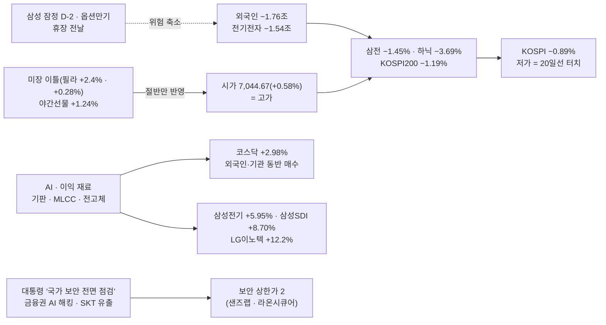

### 🧭 대응 (10/07 국장)

| 영역 | 대응 | 근거 |
|:---|:---|:---|
| **모드** | **평시**(초강세 → 두 단계 하향) | 종가 6,941.39 : 5일선 6,925.1 위 · **10일선 6,951.6 아래** → 초강세(5·10일선 모두 위) ✕ · 강세(10일선 위) ✕ → **평시**. 내려가는 전환은 **다음 시황에서 바로** / 보수 조건 : 하락추세 ✕(20일선 위) · 거래대금 미달 ✅(64%) · 악재 다수 △(외국인 조 단위 재개 · 장기금리 vs 미장 최고 · 원화 강세 · 이익 재료) = **1~1.5/3 → 보수 아님** [[규칙후보#RC-12. 매매 모드 4단계 — 보수 · 평시 · 강세 · 초강세 (5축 정의) ★ 2026-09-22 개정\|RC-12]] |
| **비중** | 삼전·하닉 **1,000만** / 그 외 **500만** | 평시 기본값 [[규칙후보#RC-16. 등급별 배정액 차등 + 배정액 내 분할\|RC-16]] |
| **보유** | 오버나잇은 **종가가 매수 근거 지지 위**인 물량만 / **10/07 밤 = 삼성 잠정 전날** → 이벤트 전날 판단 대상 / **10/08 = 휴장 전날(10/09 한글날) → 오버나잇 금지** | RC-12 공통 예외 ① |
| 지수 | 위 : **10일선 6,951.6 → 7,000 → 오늘 시가 · 고가 7,044.7** | 10일선 종가 회복이면 내일 강세 후보(올라가는 전환은 2일차) |
| 지수 | 아래 : **5일선 6,925.1 → 20일선 6,894.7(오늘 저가 6,897.4)** → 60일선 6,746.6 | **20일선 종가 이탈 + 외국인 조 단위 지속 = 보수 후보** |
| **반도체 대형주** | 외국인 조 단위 매도 재개(전기전자 −1.54조) → **장중 수급 확인 주의** / **하닉 종가 1,773,000 = ★대각(10/06 약 1,797,800) 아래 종가 마감 — 장중 이탈 아닌 종가 이탈은 처음** · ★핵심 지지 170만~177만(손절 1,760,000) 위 | 진입 판단은 사용자(`_시황판단방법.md` §2-4) · 대각 종가 이탈 = [[규칙후보#RC-26\|RC-26]] 손절 기준 — 10/05 제안서 기준 재판정 필요 |
| 테마 | **500만 · 대장만** — **보안 1일차**(대통령 지시 + 금융권 AI 해킹 · SKT 유출 · 상한가 2) · 기판 · 이차전지 소재 · HLB / 우주는 **10/07 발사일 = 매도 트리거** | [A-IMI-진입-05] · [[규칙후보#RC-31\|RC-31]] |
| 경계 | **아시아에서 한국 대형주만 빠졌다** · 외국인 9월 20조 매도 흐름 · 이벤트 3중(잠정 · 옵션 · 휴장) | |

### 📐 코스피 사다리 (10/06 종가 기준)

| 선 | 값 | 종가 대비 | 거리 | 역할 |
|:---|---:|---:|:---|:---|
| 100일 | 7,317.7 | +5.42% | `▲▲▲▲▲` | 저항 |
| **120일** | **7,179.4** | **+3.43%** | `▲▲▲` | 저항 — 9/22 · 9/23 막힌 자리 |
| *오늘 시가 = 고가* | *7,044.67* | *+1.49%* | `▲` | 갭 반납 자리 |
| *라운드* | *7,000* | *+0.85%* | `▲` | |
| **10일** | **6,951.6** | **+0.15%** | `▲` | **바로 위 — 종가 회복하면 강세 후보** |
| **종가** | **6,941.39** | — | `◆` | |
| 5일 | 6,925.1 | −0.24% | `▼` | 첫 지지 |
| **20일** | **6,894.7** | −0.67% | `▼` | ┐ **오늘 저가 6,897.4가 정확히 멈춘 자리** |
| *오늘 저가* | *6,897.38* | *−0.63%* | `▼` | ┘ |
| 60일 | 6,746.6 | −2.81% | `▼▼▼` | 1차 지지 |
| 45일 | 6,727.1 | −3.09% | `▼▼▼` | |
| 224일 | 6,089.0 | −12.28% | `▼▼▼▼▼▼▼▼▼▼▼▼` | |

- 장중 : 시가 **7,044.67(+0.58%) = 고가** → 저가 **6,897.38(−1.52%)** → 종가 6,941.39 — **시가 대비 −1.47% 음봉, 아랫꼬리 0.6%**
- **5일선(6,925) < 10일선(6,952)** — 단기선이 꼬이기 시작했다(10/01 "5 > 10 > 20 > 60 정배열"에서 한 칸 무너짐)
- 사용자 캡처 원자료 : LC 31.90% · HC −26.04%

### 🔥 트리거

| 층 | 요인 | 이전 → 지금 | 상태 | 신호 |
|:---:|:---|:---|:---|:---:|
| 1 | **외국인** | 10/01 −0.35조 → 10/02 매도(수치 없음) → **−1.76조** | **조 단위 재개** — 전기전자 집중 · 원화 강세에도 매도 · 9월 −20.3조 흐름 | 🔴 |
| 1 | 장기금리 | 미10년 **5.309** · 30년 5.665 | 이투데이 "프랑스 재정 → 유럽 국채 불안 → 장기금리 상승 압력" | 🔴 |
| 1 | AI · 이익 | 나스닥 사상 최고 · 필라 +0.28% | **국장에서는 중소형이 받았다** — 기판 · MLCC · 소부장 · 이차전지 소재 | 🟢 |
| 1 | 환율 · 국내금리 | 1,341.7 → **1,339.3** · 국고 3년 4.01 → **3.93** | 원화 강세 · 금리 하락 — 외국인 매도의 원인은 아니다 | 🟢 |
| 1 | 이벤트 | — | **10/07 누리호 · 리사 수 · FOMC 의사록(밤) → 10/08 삼성 잠정 · 옵션만기 → 10/09 휴장** | 🟡 |
| 2 | **보안** | 9/11 1위 이후 반복 재료 | **대통령 "국가 핵심 시스템 보안 전면 점검" 지시** · 금융당국 10/04 긴급회의 · SKT 고객정보 2,321만 건 다크웹 — 정부 대응이 한 단계 올라갔다 | 🟢 |
| 2 | **반도체 기판 · 소부장** | 1일차 → 숨 고르기 | **재가동** — K-PCB 수출 역대 최대 · 대만 CCL 상한가 · ETF 정기변경(주성 · 이수페타시스) | 🟢 |
| 2 | 반도체 대형주 | ETF 정기변경 · 잠정 D-2 | **외국인 매도에 밀림** — 하닉 −3.69%(ETF 매수 기대와 반대) | 🔴 |
| 2 | **이차전지 소재** | 46시리즈(10/02) | **전고체(에코프로비엠 · 삼성SDI 협력) · LFP** → 에코프로비엠 +11.41% · 삼성SDI +8.70% | 🟢 |
| 2 | BIO | 10/02 역방향 | **HLB 계열 상한가 2**(FDA 실사 VAI → NDA 재제출) · 삼천당제약 5일째(CPHI) | 🟢 |
| 2 | 우주 | 10/02 2위 | **4번째로 약해짐**(알멕 +15.79% · 277억) — 발사 D-1 선반영이 작았다 | 🟡 |
| 2 | 알래스카 강관 | 이탈 | **재등장** — 美 부통령 "한국과 세부 협의 남아" · TCC스틸 +11.37% | 🟡 |

### 💰 수급 (억 원)

| 주체 | 코스피 현물 | 코스닥 현물 | 지수선물 | 주식선물 | 달러선물 |
|:---|---:|---:|---:|---:|---:|
| 개인 | +7,908 | −2,119 | +4,299 | −386 | −1,630 |
| **외국인** | **−17,582** | **+1,198** | **−2,543** | +1,248 | +4,432 |
| 기관계 | −228 | +1,087 | −2,564 | −249 | −2,802 |
| └ 금융투자 | +1,114 | +974 | +1,046 | +177 | −3,124 |
| └ 투신 | −611 | +240 | −3,927 | −883 | −302 |
| 기타법인 | **+9,929** | −69 | +808 | −613 | +921 |

- 외국인 **현물 · 선물 동반 매도**(−1.76조 · −2,543억) — 10/02 "현물 매도 · 선물 매수"에서 선물도 매도로
- 받은 쪽 : **기타법인 +9,929억**(자사주 추정 — 10/01 기준 매입 막바지 93.5% · 71.3%라 받침이 오래가지 못한다) + 개인 +7,908억
- **코스닥은 외국인 · 기관 동반 매수**(3번째) — 외국인은 한국을 떠나는 게 아니라 **코스피 대형주에서 코스닥으로 자리를 바꾸는 중**일 수 있다(추정)
- 옵션 : 10월물 콜 1,110 **−62.92%** · 풋 1,110 +8.13% — 만기(10/08) 앞 콜 가치 급감

### 🧵 주도 테마 (Signal Evening 14096)

| 순위 | 테마 | 등급 | 일차 | 대장 · 주도 | 거래대금 |
|:---:|:---|:---:|:---:|:---|:---|
| 1 | **보안** | A | **1일차(정부 격상)** | **샌즈랩 상 · 라온시큐어 상** > 아톤 +26.91% > 지니언스 +20.83% > 케이씨에스 +19.05% > 에스피소프트 · 에스투더블유 +16.21% · 안랩 +15.58% · 아이씨티케이 · 한컴위드 | **아톤 1,228억** · 에스투더블유 1,092억 · 라온시큐어 783억 · 한컴위드 776억 · 안랩 577억 |
| 2 | **반도체(기판 · MLCC · 소부장 · 후공정)** | A | 재가동 | **주성엔지니어링 +17.51%** > 케이씨텍 +16.74% > LG이노텍 +12.20% > 두산테스나 +12.25% > 두산 +9.47% > 이수페타시스 +8.83% > 코리아써키트 > 삼성전기 +5.95% · 심텍 | **삼성전기 1.21조** · 주성 8,535억 · LG전자(개별) · LG이노텍 2,696억 · 두산 1,918억 · 이수페타시스 1,870억 |
| 3 | **BIO** | B+ | 재부상 | **HLB제약 상 · HLB바이오스텝 상** > HLB생명과학 +25.03% > HLB +17.18% > 삼천당제약 +16.43% > 디앤디파마텍 +10.58% | HLB 2,633억 · 삼천당제약 716억 · 디앤디파마텍 525억 |
| 4 | 우주 | B | D-1 | 알멕 +15.79% > 에이치브이엠 +9.26% > 스피어 +8.94%(특수합금 공급계약 2건) > 센서뷰 | 스피어 922억 · 알멕 277억 |
| — | 개별 | — | — | **이차전지 소재**(에코프로비엠 +11.41% · 포스코퓨처엠 +9.42% · 엘앤에프 · 삼성SDI +8.70% — 전고체 협력) · 하이젠알앤엠 +18.99% · **강관**(TCC스틸 +11.37% · KBI동양철관) · LG전자 +7.64%(칠러 5GW) · 한컴 | 삼성SDI 3,516억 · LG전자 2,780억 · 에코프로 1,260억 |

- 대장 판정 [[규칙후보#RC-25. 테마 대장 판정 순서 — 상한가 > 먼저 들어간 순 > 상승률 > 거래대금 (사용자 정의, 2026-09-16)\|RC-25]] : 보안 = **상한가 2(샌즈랩 498억 · 라온시큐어 783억)** — 거래대금은 아톤 1,228억이 1위
- 반도체는 **대형주(삼전 · 하닉) 빠지고 기판 · 소부장 · MLCC만** — 10/01(대형주 + 소부장 동반)과 다른 모양
- 밀려난 것 : **통신장비 · 광**(10/02 1위 → 2일차 이탈 — 이탈 규칙 그대로) · 유가주

### ✅ 직전 명제 채점

**1006 미장마감후 명제** (10/06 국장)

| # | 명제 | 결과 | 채점 |
|:---:|:---|:---|:---:|
| 1 | 코스피 **고가가 120일선(약 7,170) 아래** | 고가 **7,044.67** | ✅ |
| 2 | 반도체 대형주(삼전·하닉 평균) ≥ 코스피 · 하닉 > 삼전 | 평균 **−2.57%** < −0.89% · 하닉 −3.69% < 삼전 −1.45% | ❌ |
| 3 | 우주 테마 1~3위 등장(누리호 D-1) | **4번째** 섹션(알멕 +15.79%) | ❌ |
| 4 | 미 2년물 하락 · 10년물 상승 지속 | 10/07 새벽 | ⏳ |

> [!caution] 총평
> **반도체 대형주를 "ETF 정기변경으로 하닉이 산다"로 본 게 틀렸다** — ETF 재배분 매수(수천억)보다 외국인 매도(전기전자 −1.54조)가 훨씬 컸다. **수급 재료끼리 부딪히면 외국인 쪽 숫자 크기를 먼저 본다.**
> 갭 판단은 맞았다 — 120일선까지 못 갔다(9/22 반납 이력 적용 ✅). 다만 **갭을 지키지 못하는 정도가 아니라 시가가 고가**였다.

> [!example] 📊 예측 채점 → [[예측대조_2026#2026-10-06 (화)|원장 10/06]]
> - **A : 2/7** — **상 0/1 · 중 0/2 · 하 2/3 · 최하 0/1** — 확신도가 거꾸로 맞았다(하만 맞음)
> - **B : 1위 반도체 ✅(실제 2위 — 단 대형주 ✕ · 기판·소부장만) · 2위 우주 △(4위) · 3위 통신장비·광 ❌** / 밀려날 것 : 유가주 ✅ · **BIO ❌(3위)**
> - 가장 크게 틀린 것 : **보안 1위를 "약"으로 본 것**(C11) — 대통령 지시로 반복 재료가 격상됐다

### 📋 볼 것

> [!todo] 오늘 밤 (10/07 새벽 채점)
> - [ ] 미 2년 · 10년 — 장기금리 5.3 위 유지인가(1006 명제 4)
> - [ ] 필라 · 엔비디아 — 미장 반도체가 계속 강한데 국장 대형주만 빠지는 괴리가 이어지는가
> - [ ] 美 8월 무역수지 · 연준 연설 → **10/07 밤 FOMC 의사록**

> [!todo] 10/07 국장
> - [ ] **외국인 현물 조 단위 매도 2일째인가** — 전기전자 집중 여부
> - [ ] 코스피 **10일선(6,951.6) 종가 회복 / 20일선(6,894.7) 이탈** 어느 쪽인가
> - [ ] **하닉 177만(★핵심 지지) 종가 유지** · ★대각(10/07 약 1,809,800) 회복 여부
> - [ ] **보안 2일차** — 대장권(샌즈랩 · 라온시큐어 · 아톤) 거래대금 50%↑ [[규칙후보#RC-31\|RC-31]]
> - [ ] **누리호 발사일 = 우주 매도 트리거** · 리사 수 14:00 → AMD 연관
> - [ ] 코스닥 > 코스피 이어지는가 · 외국인 · 기관 코스닥 동반 매수 4번째인가

### ❓ 검증 대상 명제 (다음 시황에서 채점)

| # | 명제 | 기준 | 채점 |
|:---:|:---|:---|:---:|
| 1 | 10/07 코스피 **종가 20일선(약 6,895) 위** | 20일선(10/07 값) | ⬜ |
| 2 | 외국인 코스피 현물 **조 단위 매도 2일째** — 확신도 최하(방향 고르지 않기) | −1조 | ⬜ |
| 3 | **보안 2일차 대장권 거래대금이 1일차의 50% 이상** | 아톤 1,228억 · 라온시큐어 783억의 50% | ⬜ |
| 4 | **하닉 종가 177만 위**(★핵심 지지 유지) | 1,770,000 | ⬜ |

> [!missing] 못 판정한 것
> - **삼전 · 하닉 시가 · 고가 · 저가** — 종가만(이투데이). 하닉이 장중 ★핵심 지지 손절선(1,760,000) 아래로 갔는지 모른다
> - **★대각 10/06 값** : 10/05 제안서는 10/05를 거래일로 놓고 1,797,774(10/05)를 적었다. 10/05가 휴장이라 거래일 기준이면 10/06 = 약 1,797,800 · 달력 기준이면 약 1,809,800 — **어느 쪽이든 종가 1,773,000은 대각 아래**
> - 프로그램 매매 · 업종 전체 등락(이투데이 상 · 하위 3개씩만) · 거래대금 HTS 19.1조 vs 기사 수치 대조 안 함
> - 외국인 매도 원인 — 기사는 "차익실현 · 금리 · 지정학"까지만. **환차익 확정 · 이벤트 앞 위험 축소는 클로드 추정**
> - 증시주변(10/01 기준) : 예탁금 104.64조(−267억) · 미수금 9,837억(−1,183억) · 신용 33.48조(+907억) — 2거래일 지연이라 오늘 매도와 연결 못 함

### 📝 상세

> [!note]- 1. 시가 = 고가 — 갭 반납 세 번째
> 1. 야간선물(10/06 새벽) 1,127.05(+1.24%) → 코스피 환산 약 7,090. 실제 시가 **7,044.67(+0.58%)** — 절반만 열렸다
> 2. 그 시가가 **고가** → 저가 6,897.38(−1.52%)은 **20일선 6,894.7에서 정확히 멈췄다** → 종가 6,941.39
> 3. 정규장 지수선물 F202612 **1,103.00(−0.92%)** — 야간 1,127.05에서 −2.1%
> 4. 9/22(120일선 앞 갭 → 반납) · 9/30(5일선 앞 갭 → 반납) · **10/06(시가 = 고가 → 음전)** — 이 기간 **미장 호재 갭 = 외국인 매도 자리**가 세 번 반복됐다. 원장 다음에 바꿀 것 ②로 넘긴다

> [!note]- 2. 외국인 — 원화 강세에도 판 이유
> 1. 코스피 현물 **−1.76조** · 전기전자 **−1.54조** · 지수선물 −2,543억 / 코스닥 +1,198억
> 2. 한경(10/04) : 9/1~10/2 코스피 **−20.3조**(22거래일 중 순매수 7일) · 삼전닉스 집중 · 보유율 하닉 49% · 삼전 46%대 · 원인 = **반도체 급등 차익 · 지정학 · 금리** · 전망 = "3분기 실적 발표를 계기로 복귀 가능"
> 3. 이투데이(10/06) : "프랑스 재정 → 유럽 국채 불안 → 장기금리 상승 압력 · 고금리 부담"
> 4. 클로드 추정 : 원화 1,339원 = 달러 기준 차익을 확정하기 좋은 환율 · **삼성 잠정(10/08) · 옵션만기 · 휴장 전날**을 앞둔 위험 축소
> 5. 반대 신호 : 코스닥 외국인 매수 · 달러선물 +4,432억 · 주식선물 +1,248억 — **한국 전체를 버리는 매도는 아니다**

> [!note]- 3. 미장 재료는 중소형이 받았다
> 1. **기판** : LG이노텍 +12.20%(반도체 기판 1.4조 투자) · 이수페타시스 · 코리아써키트 · 심텍 · 두산 +9.47%(전자BG CCL — 대만 CCL 상한가 연동)
> 2. **MLCC** : 삼성전기 +5.95%(1.21조) — AI 서버 MLCC **6번째 2,900억 공급계약**
> 3. **소부장 · 후공정** : 주성엔지니어링 +17.51%(8,535억 — ETF 정기변경 · CXMT) · 케이씨텍 +16.74% · 두산테스나 +12.25%(테슬라 AI5)
> 4. **이차전지 소재** : 에코프로비엠 +11.41% · 삼성SDI +8.70% — **전고체 협력** · LFP 전환 / LG엔솔 +5.12%
> 5. **냉각** : LG전자 +7.64%(북미 칠러 5GW 장기공급 — 약 3조 추산)

> [!note]- 4. 보안 — 반복 재료가 정부 격상으로 1위
> 1. 9/11 1위(젠슨 황 · 中 해커) 이후 반복 재료였는데 오늘 **대통령 "AI로 누구나 해킹 가능 — 국가 핵심 시스템 보안 전면 점검" 지시**
> 2. 금융권 : 신한 → KB · 하나 · BNK · 저축은행 정보유출 · 무단접근 흔적 → 10/04 금융당국 긴급회의 · "금융권 제로트러스트 전면 전환"
> 3. **SKT 고객정보 2,321만 건 다크웹 판매글**(단독)
> 4. 장전 예측은 C11 "금융권 해킹 반복 → 보안 **약**" — 반복 재료라 낮게 봤다. **정부 대응 단계가 올라가면 반복 재료도 새 재료다**

> [!note]- 5. 관측 타임라인 (한국시간)
> | 시각 | 관측 |
> |:---|:---|
> | 10/06 (새벽) | 야간선물 1,127.05(+1.24%) |
> | 10/06 09:00 | **KOSPI 시가 7,044.67(+0.58%) = 고가** |
> | 10/06 오전 | 대통령 보안 전면 점검 지시(10:18 기사) · 보안주 상한가 |
> | 10/06 장중 | 저가 6,897.38(−1.52%, 20일선 터치 · 시각 미상) → 반등 |
> | 10/06 15:30 | **KOSPI 6,941.39(−0.89%) · KOSDAQ 919.92(+2.98%)** · 삼전 272,000(−1.45%) · 하닉 1,773,000(−3.69%) |
> | 10/06 16:08 | 항셍 +1.00% |
> | 10/06 17:06 | Signal Evening 14096 |
> | 10/06 17:25~17:30 | 미니 S&P · 미니나스닥 +0.21% · 원/달러 1,339.30 — 사용자 HTS |

> [!info]- 출처 · 형
> **출처**
> - 사용자 제공 : HTS 코스피 일봉 창(OHLC · 이평선 9종 · LC/HC) · 시장 요약표(등락 종목 · 지수 · 선물옵션 · 해외 · 환율 · 금리 · 상품 · 투자자 · 증시주변 10/01 기준) — 2026-10-06 17:25~17:30
> - 시그널리포트 원본 : **이브닝 14096**(10/06)
> - 웹 : [이투데이 10/06 마감](https://www.etoday.co.kr/news/view/2632946) · [한경 10/04 외국인 20조 매도](https://www.hankyung.com/article/202610042304i) · [전자신문 10/05 삼전닉스 17조](https://www.etnews.com/20261005000060)
>
> **형** : 국장마감후
> - 입력 : HTS 일봉 창 · 시장 요약표 · 이브닝(md) · 웹 기사
> - 태그 : `[본인시황 1006A]` · 요인값 → [[요인값변천사_2026#2026-10-06 (국장마감후)]] · 예측 채점 → [[예측대조_2026#2026-10-06 (화)]]

---

## 2026-10-06 (화) — 미장마감후
#시황/미장마감후 #모드/초강세 #요인/금리 #요인/반도체

> [!success] 🟢 모드 : 초강세 1일차 — 연휴 사흘 동안 미국은 이틀 올랐고, 장기금리는 이틀 더 올랐다
> **10/05(월) 국장 휴장(개천절 대체공휴일)** → 오늘이 10/02 이후 첫 장 — 미국 **10/02 · 10/05 두 밤을 한 번에** 받는다 : 필라 **+2.40% · +0.28%** · 나스닥 **사상 최고(27,477)** / 미10년 **5.309(5.3 돌파)** · 30년 **5.665(신고점권)** · 2년 **4.818(하락)**
> 야간선물 **1,127.05(+1.24%)** → 코스피 시초 약 **7,090** = 120일선(약 7,170) 1% 아래
> **비중 삼전·하닉 2,000만 / 그 외 1,000만(분할)** · 오버나잇 허용 · ==이번 주 사흘뿐 — 10/08(목) 삼성 잠정실적 · 옵션만기 · 휴장 전날(10/09 한글날)== · 반도체 대형주 : 외국인 9월 하닉 11.6조 순매도 → **장중 수급 확인 주의**

### 🎛 한눈에

| 지표 | 값 | 변화 | 신호 | 한 줄 |
|:---|---:|:---|:---:|:---|
| **KOSPI(10/02)** | 7,003.74 | +32.39 (+0.46%) | 🟢 | 갭하락(6,938) → **7,000 · 5일선 회복** · 보수 해제 확정 |
| KOSDAQ(10/02) | 893.29 | −1.00 (−0.11%) | 🟡 | 전일 +4.48% 다음 날 숨 고르기 |
| 코스피 거래대금(10/02) | 15.98조 | 전일의 88% · 기준 30조의 53% | 🔴 | 오르는데 거래가 준다 |
| S&P · 나스닥(10/05) | 7,774.11 · **27,477.31** | +0.67% · +1.05% | 🟢 | **나스닥 사상 최고** — 메타 · MS · 엔비디아 · 스페이스X |
| **필라 반도체** | 13,172.7 | 10/02 +2.40% → 10/05 **+0.28%** | 🟢 | 이틀 합계 약 +2.7% |
| SOXX · SOXL | 589.51 · 164.27 | +0.10% · +0.34% | 🟡 | |
| **미 10년** | **5.309** | +0.029 | 🔴 | **5.3 돌파 · 52주 고점** |
| 미 20년 · **30년** | 5.712 · **5.665** | +0.036 · +0.035 | 🔴 | 30년 9/30 고점(5.644) 위 |
| **미 2년** | 4.818 | −0.007 | 🟢 | **단기는 내리고 장기는 오른다** |
| ISM 서비스(9월) | 54.9 | 8월 55.4 | 🟡 | **가격지수 74.0(+1.4)** — 제조업 77.9에 이어 물가 압력 |
| WTI · 브렌트 | 89.16 · **100.23** | 10/02 102.86에서 하락 | 🟡 | G7 재고 방출 · 중동 수출 회복 · 사우디 11월 아시아 OSP −3달러 |
| 금 | 4,168.42 | +0.28% | 🟡 | |
| 원/달러 | **1,341.71** | 10/02 새벽 1,358.9에서 −17원 | 🟢 | 원화 강세 — 외국인에 우호, 원화 환산 이익엔 감점 |
| VIX | 15.52 | +1.37% | 🟢 | 15대 유지 |
| 일본 · 대만 | 닛케이 장중 70,000 · **대만 가권 역대 최고** · TSMC 신고가 | | 🟢 | 국장이 쉬는 동안 아시아 반도체가 먼저 올랐다 |
| **야간선물** | **1,127.05** | **+13.85 (+1.24%)** | 🟢 | 코스피 환산 약 **7,090** |

> [!info]- 신호등 기준
> 🟢 국장에 우호 · 🟡 중립·경계 · 🔴 역풍. 판정은 **국장 대형주에 미치는 영향** 기준

### 🧮 이익 · 할인율 장부 (시험 — 마켓프로 틀)

> 주가 = 이익 × 멀티플 = 이익 ÷ (할인율 − 성장률). 뉴스를 **어느 변수를 건드렸나**로 나눈다

| 변수 | 국장이 쉰 사흘 | 방향 |
|:---|:---|:---:|
| **이익**(분자) | 삼성 **내년 HBM 가격 3배** 제시(단독, 10/02) · 마이크론 아시아 증설 → 소부장 · 삼성 3Q 컨센서스 **영업이익 108.1조**(10/08 발표) / 원화 −17원은 원화 환산 이익엔 감점 | ▲ |
| 할인율 — 단기 | 고용 2.9만 → 10월 동결 굳음 · 2년물 4.818 하락 | ▼(우호) |
| **할인율 — 장기** | 10년 **5.309** · 30년 **5.665** — ISM 제조 가격 77.9 · 서비스 가격 74.0 | ▲(역풍) |
| 위험 프리미엄 | VIX 15대 · 나스닥 사상 최고 | ▼(우호) |
| 한국 수급 | 원화 강세 · 반도체 ETF 정기변경(삼전 비중 축소 → 하닉 · 소부장) / 외국인 9월 하닉 11.6조 매도 | ↔ |

- 판정 : **분자(이익)는 오르고, 분모는 앞(단기 · 위험)이 내려가고 뒤(장기)가 올라간다.** 미국 주식은 분모 뒤쪽을 계속 무시 중 — 10년물 5.3 돌파에도 나스닥 사상 최고
- 오늘 국장에 대입 : 이익 쪽 재료(HBM 가격 · 삼성 잠정 D-2)가 가장 직접적인 건 **반도체 대형주**

### 🔗 오늘의 인과

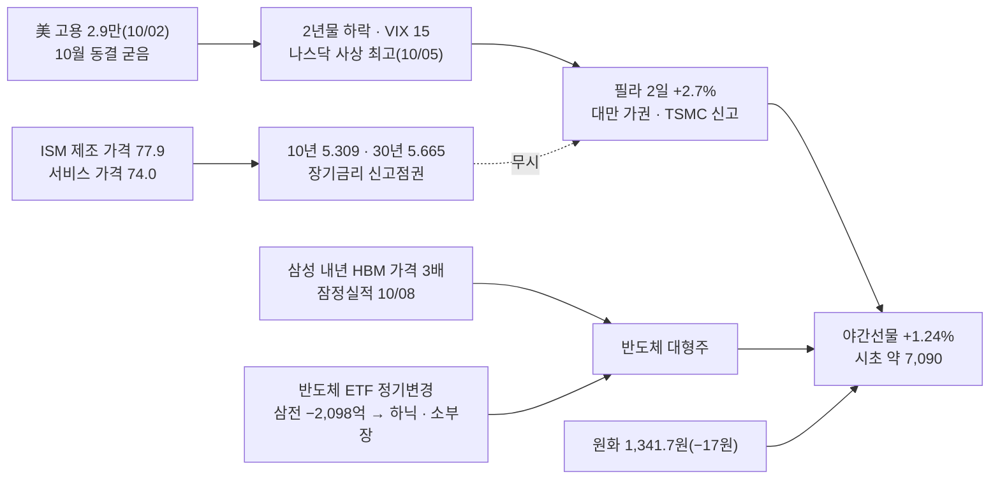

### 📌 오늘 국장 예측 → [[예측대조_2026#2026-10-06 (화)|원장 10/06]]

> [!question] 장전 예측 (05:31) — 장후에 원장에서 채점 · 원장 10/02 교훈 적용
> - **지수** : 시초 약 +1.2%(7,090) **[상]** · 종가 **5일선 위 · 120일선(약 7,170) 아래** **[하 — 갭 출발일]** · 코스피가 코스닥보다 강하다 **[하]** · 거래대금 20조 미달 **[하]** · 반도체 대형주 ≥ 코스피 **[중]**
> - **주도 테마** : ① 반도체(대형 + 소부장 — ETF 정기변경 · HBM 가격) **[중]** ② **우주(누리호 10/07 D-1)** **[중]** ③ 통신장비 · 광(2일차) **[하]** / 밀려날 것 : 유가주(브렌트 100 하향) · BIO
> - **외국인 현물** : 순매수 전환 **[최하]** — 방향을 고르지 않는다

### 🧭 대응 (10/06 국장)

| 영역 | 대응 | 근거 |
|:---|:---|:---|
| **모드** | **초강세 1일차** | 10/02 종가 7,003.74 > 5일선 6,914.7 → 보수 해제 확정 · **10/01 · 10/02 이틀 연속 5 · 10일선 위** → 초강세(올라가는 전환 2일차 적용) · 보수 조건 1/3(거래대금 감소만) [[규칙후보#RC-12. 매매 모드 4단계 — 보수 · 평시 · 강세 · 초강세 (5축 정의) ★ 2026-09-22 개정\|RC-12]] |
| **비중** | 삼전·하닉 **2,000만** / 그 외 **1,000만** — **분할** | 상한이 두 배가 됐어도 거래대금은 기준의 절반 — 원샷 금지 [F-IMI-진입-07] |
| **보유** | **오버나잇 허용**(종가가 근거 지지 위) · 근거 유지 시 2~3일 | 단 **10/08(목) = 삼성 잠정실적 · 옵션만기 · 휴장 전날** → 그날 공통 예외로 재판단 |
| 지수 | 시초 약 **7,090** → 위 **120일선 약 7,170**(10/02 값 7,170.5) · 100일선 7,323 | ⚠️ **9/22 120일선 위 갭 → 전량 반납** 이력 — 이평선 앞 갭은 쫓지 않는다 |
| 지수 | 아래 첫 지지 **7,000 라운드 · 5일선 약 6,937(10/06 값) · 10일선 6,929** | 10/06 5일선 = 9/28 종가 탈락으로 6,915 → 약 6,937 |
| 반도체 대형주 | 이익 재료(HBM 가격 3배 · 잠정 D-2) + ETF 정기변경(하닉 · 소부장 매수 / 삼전 −2,098억) / 외국인 9월 하닉 11.6조 매도 · 10/02도 매도 → **장중 수급 확인 주의** | 진입 판단은 사용자(`_시황판단방법.md` §2-4) |
| 테마 | **대장만** · 우주는 **누리호 발사 D-1** — 발사일(10/07)이 매도 트리거 [A-IMI-진입-05] | |
| 경계 | 장기금리 신고점권 · 오르는데 거래 감소 · 사흘짜리 주 | |

### 📐 코스피 사다리 (10/02 종가 기준)

| 선 | 값 | 10/02 종가 대비 | 거리 | 역할 |
|:---|---:|---:|:---|:---|
| 100일 | 7,323.3 | +4.56% | `▲▲▲▲▲` | 저항 |
| **120일** | **7,170.5** | **+2.38%** | `▲▲` | **저항 — 9/22 · 9/23 막힌 자리** |
| *오늘 시초(예상)* | *약 7,090* | *+1.24%* | `▲` | 야간선물 환산 |
| **10/02 종가** | **7,003.74** | — | `◆` | 7,000 회복 |
| 10일 | 6,929.0 | −1.07% | `▼` | ┐ 첫 지지 |
| 5일(10/06 값) | 약 6,937 | −0.95% | `▼` | ┘ |
| 20일 | 6,876.6 | −1.82% | `▼▼` | |
| 60일 | 6,758.5 | −3.50% | `▼▼▼` | 1차 지지 |
| 224일 | 6,076.4 | −13.24% | `▼▼▼▼▼▼▼▼▼▼▼▼▼` | |

- 10/02 장중 : 시가 **6,938.27(−0.47%)** → 저가 6,927.88 → 고가 7,011.04 → 종가 7,003.74 — 갭하락을 메우고 **7,000 위 마감**(5거래일 만) · LC 38.88% · HC −25.38%
- 클로징 14084 : *"장 막판 외국인이 매도 규모를 줄이고 기관이 사들이면서 상승 마감 · 외국인은 현물은 팔았지만 선물은 하루 내내 샀다"* · *"코스닥은 9월 중순 이후 5일선을 단 한 번도 내주지 않았다 · 최근 20거래일 기관 순매수 상위 10개가 전부 소부장"*

### 🔥 트리거

| 층 | 요인 | 이전 → 지금 | 상태 | 신호 |
|:---:|:---|:---|:---|:---:|
| 1 | **장기금리** | 10년 5.242 → 5.274 → **5.309** · 30년 5.606 → 5.628 → **5.665** | **고용 쇼크에도 계속 오른다** — 물가(ISM 가격 77.9 · 74.0) | 🔴 |
| 1 | 단기금리 · 연준 | 고용 2.9만 · 실업률 4.2% | **10월 동결 굳음** · 2년물 하락 · 이번 주 FOMC 의사록(10/07) | 🟢 |
| 1 | **AI 자본지출 · 메모리** | 마이크론 확인 | **삼성 내년 HBM 가격 3배**(Gb당 4달러대 중후반) · 나스닥 사상 최고 · 대만 TSMC 신고가 · K-PCB 수출 역대 최대 페이스 | 🟢 |
| 1 | 환율 | 1,361.5 → **1,341.7** | 원화 강세 | 🟢 |
| 1 | 유가 | 브렌트 102.86 → **100.23** | G7 재고 방출 · 사우디 OSP 인하 / 이란 호르무즈 공격 재증가 | 🟡 |
| 2 | **반도체 대형주** | 외국인 9월 하닉 11.6조 매도 | **ETF 정기변경** — 18.9조 규모 7종, 삼전 비중 축소(약 2,098억 매도) → 하닉 · 한미반도체 · 주성 · 이수페타시스 · 원익IPS / **삼성 3Q 컨센서스 매출 201.7조 · 영업이익 108.1조**(10/08) | 🟢 |
| 2 | **우주** | 10/02 2위(나라스페이스 +23%) | **누리호 5차 10/07 발사(위성 15기)** · 국제우주대회 · 스페이스X +6% | 🟢 |
| 2 | 통신장비 · 광 | 10/02 1위(티엠씨 · 머큐리 상) | 2일차 | 🟡 |
| 2 | 기타 | — | 고속도로 유휴부지 AI 데이터센터 · LG전자 북미 칠러 LTA · 삼성전기 MLCC · LFP 소재 · 금융 해킹 반복 · 최태원 회장 지분 9,440억 매각 | 🟡 |

### 🧵 주도 테마 예측 (10/02 국장 → 10/06 적용)

| 순위 | 테마 | 등급 | 일차 | 10/02 대장 · 주도 | 오늘 재료 |
|:---:|:---|:---:|:---:|:---|:---|
| 1 | **반도체(대형 + 소부장)** | A | 재료 갱신 | (10/02 이브닝 섹션 없음 — 클로징 "기관 소부장 매수") | 필라 2일 +2.7% · HBM 가격 3배 · ETF 정기변경 · 대만 신고 · 잠정 D-2 |
| 2 | **우주** | B+ | **1일차 · 이벤트 D-1** | 나라스페이스 +22.95% · LK삼양 +17.61% | 누리호 10/07 · 국제우주대회 · 스페이스X |
| 3 | 통신장비 · 광 | B | 2일차 | **티엠씨 +29.95% · 머큐리 상** · 빛샘전자 · 우리로 · 성호전자 | (새 재료 없음) |
| — | 밀려날 것 | — | — | S-Oil +11.69% · SK이노 +10.32%(유가) · 에이프릴바이오 −20% | 브렌트 100 하향 |

- ⚠️ 우주는 **발사일(10/07)이 매도 트리거** — 오늘은 발사 전날의 선반영 날 [A-IMI-진입-05]
- ⚠️ 통신장비 · 광은 **2일차** — 대장 거래대금 50%↑(티엠씨 994억 · 빛샘전자 1,644억 · 성호전자 2,787억) [[규칙후보#RC-31\|RC-31]]

### ✅ 직전 명제 채점

**1002 미장마감후 명제** (10/02 국장 + 10/02 미장)

| # | 명제 | 결과 | 채점 |
|:---:|:---|:---|:---:|
| 1 | 10/02 종가 5일선(약 6,908) 위 → 보수 해제 확정 | **7,003.74** > 6,914.7 | ✅ |
| 2 | 고가 7,000 위 · 종가 7,000 아래 | 고가 7,011.04 · **종가 7,003.74(7,000 위)** | ❌ |
| 3 | 반도체 대형주 ≥ 코스피 | 하닉 정규 +0.44% ≈ 코스피 +0.46% · 삼전 미입력 | ❓ |
| 4 | 고용 예상 하회 → 미10년 5.2 아래 | 고용 2.9만(하회 ✅) · **10년 5.274(상승)** | ❌ |

**1001A 국장마감후 명제** (10/02 국장)

| # | 명제 | 결과 | 채점 |
|:---:|:---|:---|:---:|
| 1 | 종가 5일선 위 → 해제 확정 | ✅ | ✅ |
| 2 | 반도체 소부장 2일차 대장권 50%↑ | 이브닝 섹션 미등장(클로징 "소부장 매수세") | ❓ |
| 3 | 외국인 현물 순매수 전환(최하) | 현물 매도(클로징) | ❌ |
| 4 | 거래대금 20조 회복 | 15.98조 | ❌ |

> [!caution] 총평
> **고용이 약하면 금리가 내린다는 명제가 틀렸다** — 단기(2년)는 내렸지만 장기(10년 · 30년)는 이틀 연속 올랐다. 이번 주 내내 **단기는 연준을, 장기는 물가를 들었다**. 금리 명제는 앞으로 **단기 · 장기를 나눠** 건다.

> [!example] 📊 예측 채점 → [[예측대조_2026#2026-10-02 (금)|원장 10/02]]
> - **A : 3/6**(❓1) — 중 3/3 ✅ · **상 0/1**(A1 시가 6,938.27 — 기준 6,940에 1.7p 미달) · 하 · 최하 0/2
> - **B : 1위 반도체 ❌ · 2위 원전 △ · 3위 BIO ❌** / 실제 1~3위 = **통신장비 · 광 · 우주 · 이차전지(46시리즈)** — 셋 다 못 봤다 · 밀려날 것(철강 · 로봇) ✅

### 📋 볼 것

> [!todo] 오늘 국장 (10/06)
> - [ ] **시초 7,090 갭이 120일선(7,170) 앞에서 유지되는가** — 9/22 갭 반납 재현 여부
> - [ ] **외국인 현물 방향** — 원화 1,341원 · 대만 신고 · ETF 정기변경이 매수로 이어지는가
> - [ ] **반도체 대형주 vs 코스피** · 삼전(ETF 매도) vs 하닉(ETF 매수) 갈림
> - [ ] 우주 D-1 대장 · 통신장비 · 광 2일차 거래대금
> - [ ] 거래대금 20조 회복 — 연휴 뒤 첫날

> [!todo] 오늘 밤 · 이번 주
> - [ ] 美 8월 무역수지 · 보먼 연설(10/06) → **10/07 FOMC 의사록 · 로건 · 윌리엄스**
> - [ ] 10년 5.3 · 30년 5.7 — 장기금리가 더 가는가
> - [ ] **10/07 누리호 발사 · 리사 수 방한(14:00 게이머 데이)** → **10/08 삼성 잠정실적 · 옵션만기 · 휴장 전날**

### ❓ 검증 대상 명제 (다음 시황에서 채점)

| # | 명제 | 기준 | 채점 |
|:---:|:---|:---|:---:|
| 1 | 10/06 코스피 **고가가 120일선(약 7,170) 아래** — 갭이 이평선까지 못 간다 | 7,170 | ⬜ |
| 2 | **반도체 대형주(삼전·하닉 평균) ≥ 코스피** · 하닉 > 삼전 | 등락률 | ⬜ |
| 3 | 우주 테마 1~3위 등장(누리호 D-1) | 이브닝 | ⬜ |
| 4 | 미 **2년물 하락 · 10년물 상승**(커브 가팔라짐) 지속 | 10/07 새벽 | ⬜ |

> [!missing] 못 판정한 것
> - **10/02 투자자별 수급 숫자** — 클로징 문장만(외국인 현물 매도 · 선물 매수 · 기관 매수)
> - 10/02 삼전 종가 · 반도체 소부장 실제 등락(이브닝 섹션 없음)
> - 10/06 5일선(약 6,937)은 10/01 5일선에서 역산한 추정값 · 10일선 10/06 값은 계산 못 함
> - 최태원 SK 회장 지분 매각 9,440억 — **어느 종목 지분인지** 기사 제목만으로 확인 못 함
> - 30년물 5.665가 "2002년 이후 최고"인지 — 보도는 "52주 신고점"까지만 확인

### 📝 상세

> [!note]- 1. 연휴 사흘 — 국장이 못 본 두 밤
> 1. **10/02(금) 밤** : 고용 2.9만 · 실업률 4.2% → 필라 +2.40% · 나스닥 +1.19% · VIX 15.31 / 10년 5.274 · 30년 5.628(올랐다)
> 2. **10/05(월) 밤** : ISM 서비스 54.9 · 가격 74.0 → 나스닥 **사상 최고 27,477** · S&P +0.67% / 10년 **5.309** · 30년 **5.665**(52주 신고) · 2년 4.818(하락)
> 3. 그 사이 아시아 : 닛케이 장중 70,000 돌파(미 인상 기대 후퇴) · **대만 가권 역대 최고 · TSMC 신고가**
> 4. 국장 10/02 야간선물 1,127.55(+1.29%) → 10/06 새벽 1,127.05(+1.24%) — **이틀 치 미국이 이미 들어 있다**

> [!note]- 2. 반도체 — 이익 재료와 수급 재료가 겹쳤다
> 1. **삼성 내년 HBM4 가격 Gb당 4달러대 중후반 제시**(단독, 10/02 — "3배") · 마이크론 아시아 증설 → 한미반도체 · 저스템 · 씨엠티엑스 수혜 기사
> 2. **반도체 ETF 7종(18.9조) 10월 정기변경** — 삼전 비중 축소 약 2,098억 매도 → 하닉 · 한미반도체 · 주성엔지니어링 · 이수페타시스 · 원익IPS로 재배분
> 3. **삼성 3Q 잠정 10/08** — 에프앤가이드 컨센서스 매출 201.7조 · 영업이익 **108.1조**(분기 첫 100조) · 2Q 89.4조
> 4. 역풍 : 외국인 9월 하닉 11.6조 · 10/02 삼전 · 하닉 매도 / 삼성 HBM4 수율 80%대 / 반도체 호황 속 범용 · 전자 업종 그늘

> [!note]- 3. 금리 — 단기와 장기가 다른 말을 듣는다
> 1. 2년물 4.818(−0.7bp) — 연준(10월 동결)을 들었다
> 2. 10년 5.309(+2.9bp) · 30년 5.665(+3.5bp) — 물가(ISM 제조 가격 77.9 · 서비스 가격 74.0)를 들었다
> 3. 다이제스트 : *"美, 금리 인상 속도조절 관측에도 — 韓 포함 금리 상승 시간문제"* · 유로화 17개월 최저(프랑스 재정) · 이번 주 연준 연설 줄줄이 · 10/07 FOMC 의사록

> [!note]- 4. 국내 재료 · 일정
> 1. **우주** : 누리호 5차 **10/07** 발사(역대 최다 위성 15기) · 국제우주대회
> 2. 데이터센터 : 고속도로 유휴부지 AI 데이터센터(정부) · LG전자 북미 칠러 장기공급계약 · K-PCB 1~8월 수출 +14.4%(역대 최대 페이스) · 대만 CCL 상한가
> 3. 이차전지 : LFP · 음극재로 다각화(포스코퓨처엠 · 에코프로비엠 · 엘앤에프)
> 4. 보안 : 금융권 해킹 3분의 1 반복(단독)
> 5. 일정 : 中 휴장 · 코스닥데이(~7일) · 서울AI로봇쇼 · CPHI(~8일) · 노벨상 · 삼성바이오 유증 기준일 / **10/07 누리호 · 리사 수 14:00 · FOMC 의사록 → 10/08 삼성 잠정 · 옵션만기 → 10/09 휴장**
> 6. 대미투자 : 한미, 알래스카 LNG **"검토 착수" 서면 합의**(10/04) · 트럼프 "美에 공장 안 지으면 관세 300%까지"

> [!note]- 5. 관측 타임라인 (한국시간)
> | 시각 | 관측 |
> |:---|:---|
> | 10/02 15:30 | KOSPI 7,003.74(+0.46%) · KOSDAQ 893.29(−0.11%) — 연휴 전 마지막 장 |
> | 10/02 21:30 | 美 고용 2.9만 · 실업률 4.2% |
> | 10/02 22:17 | 클로징 14084 "다시 7000선" |
> | 10/03 05:00 | 미장 마감 — 필라 +2.40% · 10년 5.274 |
> | 10/05 | **국장 휴장(개천절 대체공휴일)** · 닛케이 장중 70,000 · 대만 가권 최고 |
> | 10/05 23:00 | 美 ISM 서비스 54.9 · 가격 74.0 |
> | 10/06 05:00 | 미장 마감 — 나스닥 사상 최고 · 필라 +0.28% · 10년 5.309 · 30년 5.665 — 확정 |
> | 10/06 05:00 | Signal Digest 14089 |
> | 10/06 05:15~05:25 | 입력 수집 — 원/달러 1,341.71 · 브렌트 100.23 · 미 선물 |
> | 10/06 (새벽) | **야간선물 1,127.05(+1.24%)** |

> [!info]- 출처 · 형
> **출처**
> - 사용자 제공 : 해외 지표표(04:34~05:25) · **야간선물 1,127.05(+13.85, +1.24%)** · 10/03 HTS 코스피 일봉 창(10/02 OHLC · 이평선)
> - 시그널리포트 원본 : **클로징 14084**(10/02) · **이브닝 14082**(10/02) · **다이제스트 14089**(10/06)
> - 웹 : [CNBC 10/05](https://www.cnbc.com/2026/10/04/stock-market-today-live-updates.html) · [Yahoo 10/05](https://finance.yahoo.com/markets/stocks/articles/stock-market-today-oct-5-135537124.html) · [ISM 서비스 9월](https://www.prnewswire.com/news-releases/services-pmi-at-54-9-september-2026-ism-services-pmi-report-302898421.html) · [BLS 9월 고용](https://www.bls.gov/news.release/empsit.nr0.htm) · [CNBC 10/02 국채](https://www.cnbc.com/2026/10/02/treasury-yields-bonds-nonfarm-payrolls.html)
> - [[예측대조_2026]] 10/02 장후 총평 "다음에 바꿀 것" 적용 · [[초안_마켓프로식_20261003]](이익 · 할인율 장부 시험)
>
> **형** : 미장마감후(연휴 뒤 첫 장 — 10/02 국장 결과 채점 포함)
> - 태그 : `[본인시황 1006]` · 요인값 → [[요인값변천사_2026#2026-10-06 (미장마감후)]]

---

## 2026-10-02 (금) — 미장마감후
#시황/미장마감후 #모드/보수 #요인/금리 #요인/반도체 #요인/고용

> [!warning] 🟡 모드 : 보수 8일차 · **해제 후보 2일차** — 미장이 국장의 반도체 반등을 확인했다, 금리는 장중 신고점 뒤 되돌림
> 필라 **+1.59%**(나스닥 +0.04%를 크게 앞섬) · **마이크론 정규장 +3%** · 미10년 장중 **5.344(2002년 이후 최고) → 마감 5.242(−6.9bp)** · 브렌트 **102.36(100 재돌파)**
> 야간선물 **1,107.70(보합)** → 코스피 시초 약 **6,971 = 7,000 라운드 바로 아래** — 10/01 +1.95%에 이미 반영
> **비중 삼전·하닉 500만 / 그 외 250만 · 당일 청산** · ==금요일 + 오늘 밤 21:30 미국 9월 고용보고서 → 오버나잇 금지== · **종가가 5일선(약 6,908) 위면 보수 해제 확정(10/05부터)**

### 🎛 한눈에

| 지표 | 값 | 변화 | 신호 | 한 줄 |
|:---|---:|:---|:---:|:---|
| S&P 500 | 7,670.36 | +18.82 (+0.25%) | 🟢 | 장 초반 하락 → 금리 되돌림에 회복 |
| 나스닥 | 26,871.60 | +10.53 (+0.04%) | 🟡 | |
| **필라 반도체** | 12,829.0 | +200.4 (**+1.59%**) | 🟢 | **나스닥을 1.5%p 앞섬** — 마이크론 정규장 +3% |
| SOXX · SOXL | 576.33 · 153.69 | +1.35% · **+3.94%** | 🟢 | |
| QQQ · TQQQ | 742.03 · 78.70 | +0.31% · +0.86% | 🟡 | |
| **미 10년** | 5.242 | **−0.069** | 🟢 | 장중 **5.344 = 2002년 이후 최고** → 늦은 오전부터 되돌림 |
| 미 20년 · 30년 | 5.642 · 5.606 | −0.044 · −0.033 | 🟢 | |
| 일본 10년 · 30년 | 3.126 · 4.190 | **+0.075** · +0.069 | 🟡 | 일본 금리는 반대로 상승 |
| **ISM 제조업(9월)** | 54.5 | 예상 55.0 · 8월 54.6 | 🟡 | **가격지수 77.9(예상 72, +6.8p)** — 물가 압력 |
| **WTI · 브렌트** | 92.92 · **102.36** | 10/01 새벽 90.54 · 98.08에서 **급등** | 🔴 | **브렌트 100 재돌파** — 美 3번째 항모 중동 파견 보도 |
| 금 | 4,208.07 | +0.14% | 🟡 | |
| 원/달러 | 1,358.88 | +2.22 | 🟡 | 국장 마감(1,361.5)보다 조금 낮다 |
| VIX | 16.38 | +0.24% | 🟢 | |
| 미 선물(05:12) | S&P +0.17% · 나스닥100 **+0.30%** | | 🟢 | |
| **야간선물** | **1,107.70** | **−0.05 (0.00%)** | 🟡 | 코스피 환산 약 **6,971** — 보합 출발 |

> [!info]- 신호등 기준
> 🟢 국장에 우호 · 🟡 중립·경계 · 🔴 역풍. 판정은 **국장 대형주에 미치는 영향** 기준

### 🔗 오늘의 인과

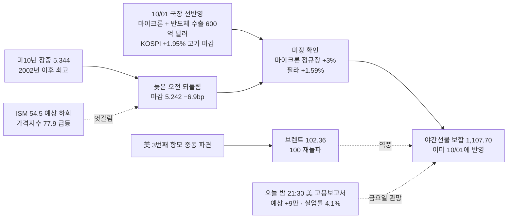

- **이번엔 국장이 먼저였다**(§0-3) — 마이크론 실적(10/01 05:05)에 미국 시간외는 보합이었지만, 국장이 09:00 수출 신기록과 함께 먼저 반영했고, 미장 정규장(+3%)이 그 방향을 **확인**했다. 야간선물 보합 = 추가 재료는 없다

### 📌 오늘 국장 예측 → [[예측대조_2026#2026-10-02 (금)|원장 10/02]]

> [!question] 장전 예측 (05:30) — 장후에 원장에서 채점 · 원장 10/01 교훈 3개 적용
> - **지수** : 시초 보합(6,971 부근) **[상]** · 종가 **5일선(약 6,908) 위 = 보수 해제 확정** **[중]** · 코스닥이 코스피보다 강하다 **[하]** · 거래대금 코스피 20조 미달 **[중]** · 반도체 대형주 ≥ 코스피 **[중]**
> - **주도 테마** : ① 반도체 소부장·후공정(2일차 — 한 칸 낮춤) **[중]** ② 원전(원전 8기 후속 · 1,200억 달러) **[하]** ③ BIO(2일차) **[하]** / 밀려날 것 : 철강(대한제강 1일차) · 로봇(대장 없음)
> - **재료 반응** : 마이크론 → 삼전·하닉 **중** · 반도체 소부장 **중** · 원전 **중** · BIO **중** · 구리 · MCU · 데이터센터 냉각 · 로봇연합 **약** · 삼성전자 우선주(소각 거절) **무** · 유가주 **약**
> - **외국인 현물** : 순매수 전환 **[최하]** — 방향을 고르지 않는다(10/01 교훈 ①)

### 🧭 대응 (10/02 국장)

| 영역 | 대응 | 근거 |
|:---|:---|:---|
| **모드** | **보수 8일차 · 해제 후보 2일차** | 1001A : 해제 조건 1/3 충족 1일차 → **오늘 종가가 5일선 위면 해제 확정, 적용은 10/05부터**(올라가는 전환은 2일차) [[규칙후보#RC-12. 매매 모드 4단계 — 보수 · 평시 · 강세 · 초강세 (5축 정의) ★ 2026-09-22 개정\|RC-12]] |
| **비중** | 삼전·하닉 **500만** / 그 외 **250만** | 오늘까지 보수 [[규칙후보#RC-16. 등급별 배정액 차등 + 배정액 내 분할\|RC-16]] |
| **보유** | **당일 청산 · 오버나잇 금지** | **금요일**(RC-03) + **오늘 밤 21:30 美 9월 고용보고서**(예상 +9만 · 실업률 4.1% · 임금 +3.0%) — 결과는 10/05(월) 국장에 첫 반영 |
| 지수 | 시초 약 **6,971** → 바로 위 **7,000 라운드 · 120일선 7,158** | 10/01 고가 마감 다음 날 — **위는 막히는 자리, 오늘 할 일은 지키는 것** |
| 지수 | **해제 기준 = 5일선(10/02 값 약 6,908)** · 10일선 6,900 부근 | 10/02 5일선 = 9/23 종가(약 7,081)가 빠지면서 **약 6,908로 내려온다**(10/02 종가 = 10/01 종가 가정) |
| 지수 | 밀리면 20일선 6,854 → 1차 지지 6,765~6,795 | |
| 반도체 대형주 | 미장 확인(필라 +1.59% · 마이크론 +3%) → 방향은 우호 / 클로징 : *"외국인이 삼전·하닉을 다시 사기 시작하느냐가 다음 단계"* · 자사주 매입 막바지 → **장중 수급 확인 주의** | 진입 여부는 사용자 장중 판단(`_시황판단방법.md` §2-4) |
| 테마 | **250만 · 당일 · 대장만** — 반도체 소부장 **2일차**(대장 거래대금 50%↑ 확인) · 원전 · BIO 2일차 | [[규칙후보#RC-31\|RC-31]] |
| 경계 | **금요일 + 고용보고서 → 오후 관망** · 10/01 상승은 거래대금 16.6조(55%)로 가벼웠다 · 코스닥은 박스 상단 돌파 뒤 **900~950 매물**(클로징) · 브렌트 100 재돌파 | |

### 📐 코스피 사다리 (10/01 종가 기준 · 오늘 시험할 자리)

| 선 | 값 | 10/01 종가 대비 | 거리 | 역할 |
|:---|---:|---:|:---|:---|
| 120일 | 7,157.9 | +2.68% | `▲▲▲` | 저항 — 9/22 · 9/23 막힌 자리 |
| *라운드* | *7,000* | *+0.41%* | `▲` | 바로 위 |
| *오늘 시초(예상)* | *약 6,971* | *0.00%* | `◆` | 야간선물 보합 |
| **10/01 종가 = 고가** | **6,971.35** | — | `◆` | |
| 5일(10/02 값) | 약 6,908 | −0.91% | `▼` | ┐ **해제 기준** — 10/01 값 6,930에서 내려온다 |
| 10일 | 6,900.4(10/01 값) | −1.02% | `▼` | ┘ |
| 20일 | 6,854.5 | −1.68% | `▼▼` | |
| 60일 | 6,776.0 | −2.80% | `▼▼▼` | ┐ 1차 지지 |
| *10/01 저가* | *6,765.06* | *−2.96%* | `▼▼▼` | ┘ |

- 클로징 : *"코스피는 장중 60일 이동평균선에서 지지를 확인한 뒤 상승 전환"* · *"매도 강도가 약해진 것과 핵심 반도체 대형주에 외국인 매수가 돌아온 것은 다르다"* · *"시장도 단기간에 빠르게 올랐으니 상승의 폭과 단기 과열 여부를 함께 살펴야"*

### 🔥 트리거

| 층 | 요인 | 이전 → 지금 | 상태 | 신호 |
|:---:|:---|:---|:---|:---:|
| 1 | **금리** | 미10년 5.298 → 장중 **5.344** → 마감 **5.242** | **신고점 찍고 되돌림** — 골드만 "연준 추가 인상 10월 → 12월로, 아예 안 올릴 수도" · 美 국채 "최악의 한 달" | 🟢 |
| 1 | 물가·경기 | PCE 둔화(9/30) | ISM 54.5(예상 55.0) · **가격지수 77.9** — 경기 둔화 + 물가 압력 엇갈림 | 🟡 |
| 1 | **고용(오늘 밤)** | 8월 +16.2만 | **9월 예상 +9만 · 실업률 4.1% · 임금 +3.0%(2021년 5월 이후 최저)** — 클로징 *"고용 둔화가 확인되면 금리 하향 안정화에 힘"* | 🟡 |
| 1 | **유가** | 브렌트 98.08 → **102.36** | **100 재돌파** — 美 3번째 항모 중동 파견 보도 · 中 석유제품 수출 사실상 중단 · 트럼프 "호르무즈 사흘간 역대 최대 운송" | 🔴 |
| 1 | 환율 | 1,361.50 → 1,358.88 | 원화 약세 멈춤 | 🟡 |
| 1 | **AI 자본지출** | 마이크론 시간외 보합 → **정규장 +3%** · 필라 +1.59% | **국장 선반영을 미장이 확인** · 마이크론 공급계약 확약 320억 달러 · 삼전닉스 올해 합산 영업익 650조 전망 · 브로드컴 앤트로픽 최대 57조 지원 | 🟢 |
| 2 | 반도체 소부장·후공정 | 10/01 전방위 1일차 | **2일차** — HBM ASP +121%(10/01 장중 기사, 신선도 낮음) · MCU(TinyML) | 🟢 |
| 2 | 반도체 대형주 | 외국인 −0.35조 · 기타법인 +1.62조 | 외국인 복귀 확인 전 · **삼성전자 우선주 소각 거절**(단독) · 하닉 60조↑ 주주환원 10월 중 | 🟡 |
| 2 | **원전** | 트럼프 발표(원전 8기) | **후속** — 원전수출기획위 · APR1400 2기 · AP1000 6기 프레임워크 · **1,200억 달러 신규 원전 오하이오 등 4개 주** · NES 2026 11/27~29 | 🟢 |
| 2 | BIO | 10/01 재부상 | **2일차** — 삼천당제약 아포텍스 계약 확대 · 10월 제약·바이오 이벤트 | 🟢 |
| 2 | 기타 | — | 칠레 구리 15년 최저 · LG전자 美 데이터센터 칠러 공장 · LG·카카오모빌리티·로보티즈 로봇연합 · 3대 메가프로젝트 예타 면제 89조 · 국고채 발행 5조 축소(초과세수) | 🟡 |

### 🧵 주도 테마 예측 (10/01 국장 → 10/02 적용)

| 순위 | 테마 | 등급 | 일차 | 10/01 대장·주도 | 오늘 재료 |
|:---:|:---|:---:|:---:|:---|:---|
| 1 | **반도체 소부장·후공정** | A | **2일차** | 윈팩 +26% · 티에프이 · 에스앤에스텍 · 대덕전자 · 세미파이브 · 하닉 3.77조 | 마이크론 정규장 +3% · 필라 +1.59% · HBM +121% |
| 2 | **원전** | B | 1일차(발표 → 후속) | (10/01 이브닝 미등장) | 원전수출기획위 · 원전 8기 · 1,200억 달러 |
| 3 | BIO | B | **2일차** | 알지노믹스 +23% · 지투지바이오 · 삼천당제약 | 삼천당제약 계약 확대 |
| — | 신규상장 | — | — | 브릴스 +56%(1일차) | **오늘 신규상장 없음**(진코스텍 청약 ~6일) |

- ⚠️ 1·3위는 **2일차** — 대장 거래대금이 1일차의 50% 이상이어야 이어진다(윈팩 330억 · 대덕전자 2,470억 · 세미파이브 1,869억 · 삼천당제약 858억) [[규칙후보#RC-31\|RC-31]]
- ⚠️ 원전은 10/01 이브닝에 없었다 — 발표 당일엔 철강(대한제강)이 먼저 움직였다. **후속 위원회 뉴스로 붙을지**가 관건
- 밀려날 것 : **철강**(대한제강 1일차) · **로봇**(정책에도 대장 없음) · 코스닥 급등 다음 날 차익

### ✅ 1001A 국장마감후 "오늘 밤" 채점

| # | 볼 것 | 결과 | 채점 |
|:---:|:---|:---|:---:|
| 1 | 미 ISM → 미10년 5.3 돌파 여부(1001 명제 ④) | ISM 54.5(예상 하회) · 가격지수 77.9 / 미10년 **장중 5.344 돌파 → 마감 5.242** | ❌(마감 기준) |
| 2 | 마이크론 정규장 반응 — 국장 선반영을 미장이 확인하는가 | **정규장 +3%** | ✅ |
| 3 | 필라가 나스닥을 앞서는가 | **+1.59% > +0.04%** | ✅ |
| 4 | 알래스카 · 원전 8기 팩트시트 확정 | 원전수출기획위 "**프레임워크 합의 후속 조치**" — 확정 문서 여부는 미확인 | △ |
| 5 | 고용보고서 앞 금리 · 달러 | 미10년 −6.9bp · 원/달러 1,358.9 | 🟢 우호 |

- **1001 미장마감후 명제 ④ "미10년 5.3 돌파(ISM 뒤)"** → 장중은 돌파(5.344), **마감 5.242 → ❌**

### 📋 볼 것

> [!todo] 오늘 국장 (10/02)
> - [ ] **종가가 5일선(약 6,908) 위인가** → 보수 해제 확정(10/05부터)
> - [ ] **7,000 라운드에서 막히는가** — 고가 마감 다음 날 첫 시험
> - [ ] **외국인이 삼전·하닉을 사는가**(클로징의 "다음 단계") · 기타법인(자사주) 규모
> - [ ] 반도체 소부장 2일차 대장 거래대금 50%↑(1001A 명제 ②)
> - [ ] 원전 — 후속 뉴스로 테마가 서는가
> - [ ] 코스피 거래대금 20조 회복(1001A 명제 ④) · 오후 관망 정도

> [!todo] 오늘 밤 (10/05 월 아침 채점)
> - [ ] **21:30 美 9월 고용보고서** — 비농업 +9만 · 실업률 4.1% · 임금 +3.0% 대비 → 미10년 5.2 아래로?
> - [ ] 브렌트 100 위 유지 여부 · 중동 항모
> - [ ] 주말 변수(중동 · 대미투자 팩트시트)

### ❓ 검증 대상 명제 (다음 시황에서 채점)

| # | 명제 | 기준 | 채점 |
|:---:|:---|:---|:---:|
| 1 | 10/02 코스피 **종가가 5일선(약 6,908) 위** → 보수 해제 확정 | 10/02 5일선 | ⬜ |
| 2 | **고가가 7,000을 넘지만 종가는 7,000 아래**(라운드 저항) | 7,000 | ⬜ |
| 3 | 반도체 대형주(삼전·하닉 평균)가 **코스피보다 강하거나 같다** | 등락률 ≥ 코스피 | ⬜ |
| 4 | 美 고용 비농업 **예상(+9만) 하회** → 미10년 5.2 아래 | 10/03 새벽 | ⬜ |

> [!missing] 못 판정한 것
> - **10/02 5일선 정확값** — 10/01 5일선 6,930.2에서 역산한 9/23 종가(약 7,081)로 계산한 추정값(약 6,908)이다. 10일선 10/02 값은 계산 못 함
> - 원전이 10/01 국장에서 실제로 움직였는지 — 이브닝 미등장, 약·무 구분 불가
> - 미10년이 왜 늦은 오전에 꺾였는지 — 골드만 인상 시점 후퇴 · ISM 하회가 겹친 것으로 보이나 **단일 원인은 특정 못 함**

### 📝 상세

> [!note]- 1. 금리 — 신고점 뒤 되돌림
> 1. 미10년 장중 **5.344%** — 2002년 4월 이후 최고. 30년물도 24년 만의 수준
> 2. 늦은 오전부터 되돌림 → 10년 **5.242(−6.9bp)** · 30년 5.606 — 주식도 같이 회복(S&P +0.25%)
> 3. 재료 : ISM 제조업 **54.5**(예상 55.0 · 8월 54.6) — 경기는 조금 약했고, **가격지수 77.9**(예상 72 · +6.8p)는 물가 압력 / 골드만 *"연준 추가 인상 10월 → 12월, 아예 안 올릴 수도"* / 美 국채 *"최악의 한 달 — 매도 → 금리 상승 → 매도 악순환"*
> 4. 국내 : **반도체 초과세수로 10월 국고채 발행 5조 축소 · 3.5조 바이백** — 국내 금리엔 우호
> 5. 오늘 밤 **21:30 고용보고서**(예상 +9만 · 실업률 4.1% · 임금 +3.0%) — 클로징 *"고용 둔화가 확인되면 국채 금리의 하향 안정화에 힘"*

> [!note]- 2. 반도체 — 국장이 먼저, 미장이 확인
> 1. 10/01 05:05 마이크론 발표 → 시간외 보합 → **국장 09:00 수출 신기록과 함께 먼저 반영**(삼전 +2.79% · 하닉 +3.21% · 소부장 전방위) → **미장 정규장 마이크론 +3% · 필라 +1.59%가 확인**
> 2. 마이크론 : 매출 4배 · **고객 공급계약 확약 320억 달러** · AIDC 실적 11배 · 4년치 매출의 35% 확보
> 3. 국내 : 삼전닉스 올해 합산 영업익 **650조** 전망 · HBM 내년 ASP +121%(HBM4 12단 스택당 600 → 1,300달러) · 메리츠 *"2027년 이익 추정치 일제히 재상향"*
> 4. 역풍 : **삼성전자 우선주 소각 거절**(단독, 괴리율 축소 방안은 강구) · 클로징 *"외국인 매도 강도 약화 ≠ 매수 복귀"*

> [!note]- 3. 유가 — 100을 다시 넘었다
> 1. 브렌트 **+4% 이상 → 102.36** — 美 세 번째 항공모함 중동 파견 보도
> 2. 中 석유제품 수출 사실상 중단 · 美 "유럽 비축 경유 방출 안 하면 수출 금지" 경고 · 젤렌스키 러 사마라 석유시설 타격
> 3. 반대 : 트럼프 *"호르무즈 사흘간 역대 최대 운송 · 곧 승리"*
> 4. 9/30 클로징의 기준 *"100 저항을 못 넘으면 유가 충격 약화"* → **다시 넘었다** — 금리·물가에 역풍

> [!note]- 4. 국내 재료 — 오늘 볼 줄기
> 1. **원전** : 원전수출기획위 — 한미 **원전 8기(APR1400 2 · AP1000 6)** 프레임워크 후속, 한전·한수원 팀코리아 · **1,200억 달러 신규 원전 오하이오 등 4개 주** · NES 2026(경주 11/27~29)
> 2. **반도체** : HBM ASP +121% · MCU 온디바이스 AI(TinyML 2031년 41억 개) · 한전·SK하이닉스 반도체 산단 전력 협력
> 3. **BIO** : 삼천당제약-아포텍스 캐나다 황반변성 확대 · 삼성바이오에피스-테바 · 릴리 경구 GLP-1
> 4. 기타 : 칠레 구리 15년 최저 · LG전자 美 버지니아 칠러 공장 · LG·카카오모빌리티·로보티즈 로봇연합 · 3대 메가프로젝트 예타 면제 89조 · 중견기업 데카코어 1조(하나마이크론에서 발표) · 유로존 PMI 52.9(52개월 최고) · 크래프톤 블랙버짓 개발 취소 · 中 K팝 공연 줄취소
> 5. 일정 : 중국 휴장 · **美 9월 고용보고서** · 뷰노 유증 기준일 · 디알텍 보호예수 해제 · 진코스텍 청약(~6일) · **오늘 신규상장 없음**

> [!note]- 5. 관측 타임라인 (한국시간)
> | 시각 | 관측 |
> |:---|:---|
> | 10/01 15:30 | KOSPI 6,971.35(+1.95%) = 고가 · KOSDAQ 894.29(+4.48%) |
> | 10/01 22:25 | 클로징 14074 "금리 부담 속 증시 반등" |
> | 10/01 23:00 | 美 9월 ISM 제조업 54.5 · 가격지수 77.9 |
> | 10/02 (새벽) | 미10년 장중 5.344(2002년 이후 최고) → 되돌림 |
> | 10/02 05:00 | 미장 마감 — S&P +0.25% · 나스닥 +0.04% · **필라 +1.59%** · 마이크론 +3% · 미10년 5.242 — 확정 |
> | 10/02 05:00 | Signal Digest 14075 |
> | 10/02 05:12~05:22 | 입력 수집 — 브렌트 102.36 · 원/달러 1,358.88 · 미 선물 |
> | 10/02 (새벽) | **야간선물 1,107.70(보합)** |
> | 10/02 21:30 | 美 9월 고용보고서 — 국장 첫 반영 **10/05(월)** |

> [!info]- 출처 · 형
> **출처**
> - 사용자 제공 : 해외 지표표(04:59~05:22) · **야간선물 1,107.70(−0.05, 0.00%)**
> - 시그널리포트 원본 : **클로징 14074**(10/01 22:25) · **다이제스트 14075**(10/02 05:00)
> - 웹 : [ISM 9월(Reuters)](https://www.investing.com/news/economic-indicators/us-manufacturing-steady-in-september-input-prices-increase-4927718) · [CNBC 10/01 시장](https://www.cnbc.com/2026/09/30/stock-market-today-live-updates.html) · [Yahoo 10/01 칩주 · 금리](https://finance.yahoo.com/markets/live/stock-market-today-thursday-oct-1-dow-sp-500-nasdaq-080602402.html) · [MUFG 고용 프리뷰](https://www.mufgresearch.com/macro/us-labor-update-october-1-2026) · [Bloomberg 고용 예상](https://www.bloomberg.com/news/articles/2026-09-26/us-jobs-report-seen-showing-90-000-payrolls-4-1-unemployment-rate)
> - [[예측대조_2026]] 10/01 장후 총평 "다음에 바꿀 것" 3개를 오늘 예측에 적용
> - [[이벤트캘린더]] : 10/02 美 고용보고서 · 10/07 삼성전자 3Q 가이던스 · 누리호 · 10/08 리사 수 방한 · 하닉 주주환원 10월 중
>
> **형** : 미장마감후
> - 입력 : 해외 지표표 · 야간선물 · 클로징 14074 · 다이제스트 14075 · 웹 검색(ISM · 마이크론 · 금리 · 고용 프리뷰)
> - 태그 : `[본인시황 1002]` · 요인값 → [[요인값변천사_2026#2026-10-02 (미장마감후)]]

---

## 2026-10-01 (목) — 국장마감후
#시황/국장마감후 #모드/보수 #요인/반도체 #요인/수출

> [!danger] 🔴 모드 : 보수 7일차 · **해제 후보 1일차** — 1차 지지를 깼다가 고가로 마감한 장대양봉, 다만 거래가 없었다
> KOSPI **6,971.35(+1.95%) = 고가 마감** · 저가 6,765.06(1차 지지 −0.3% 이탈 후 회복) · **5·10·20·60일선 모두 위** · 코스닥 **+4.48%** · 외국인 현물 **−3,491억(조 단위 끝)** · 거래대금 **16.6조(기준의 55%)**
> **비중 삼전·하닉 500만 / 그 외 250만 · 당일 청산** · ==10/02 = 금요일 + 밤 미국 9월 고용보고서 — 오버나잇 금지== · 반도체 대형주 : 외국인 매도 급감 · 기타법인(자사주 추정) +1.62조 3일째 · 자사주 막바지 → **장중 수급 확인 주의**

### 🎛 한눈에

| 지표 | 값 | 변화 | 신호 | 한 줄 |
|:---|---:|:---|:---:|:---|
| **KOSPI** | 6,971.35 | +133.31 (+1.95%) | 🟢 | **시가 −0.34% → 저가 −1.07% → 고가 마감** · 9/22 · 9/30과 반대 모양 |
| **KOSDAQ** | 894.29 | +38.38 (**+4.48%**) | 🟢 | 상승 1,230 / 하락 423 · 코스닥150 **+5.79%** · 4일 연속 코스피보다 강함 |
| 코스피 거래대금 | 16.6조 | 기준 30조의 **55%** · 평소의 81% · 9/30 대비 −11.5% | 🔴 | **오르는데 거래가 줄었다** — 지속성 의심(§2-3) |
| 코스닥 거래대금 | 8.31조 | 기준 7조의 **119%** | 🟢 | 돈은 코스닥으로 |
| **외국인 현물(코스피)** | −3,491억 | 9/30 −2.26조 → **−0.35조** | 🟡 | **4일 연속 매도지만 조 단위 끝** |
| 외국인 현물(코스닥) | +3,370억 | 매수 전환 | 🟢 | 기관 +5,698억과 **동반 매수** |
| 개인 · 기타법인(코스피) | −16,751억 · **+16,244억** | 기타법인은 역산(합계 0) | 🟡 | 기타법인 3일째 +1.6조대 — 삼전·하닉 자사주 추정(매입 막바지 : 93.5% · 71.3%) |
| 삼성전자 · SK하이닉스 | +2.79% · +3.21% | 거래대금 3.55조 · 3.77조 | 🟢 | **마이크론 + 9월 반도체 수출 600억 달러 첫 돌파** |
| 원/달러 | 1,361.50 | +5.8원 | 🟡 | 원화 약세 2일째 |
| 국고채 3년 | 4.01 | 보합 | 🟡 | |
| 미 10년(10/01 새벽) | 5.298 | 5.3 턱밑 | 🔴 | 오늘 밤 ISM |
| 니케이 | 68,956.72 | +3.30% | 🟢 | 중국·홍콩 휴장 |
| VKOSPI | 41.59 | −3.35% | 🟢 | 상승 + 변동성 하락 = 건강 |

> [!info]- 신호등 기준
> 🟢 국장에 우호 · 🟡 중립·경계 · 🔴 역풍. 판정은 **그날 방향**이 아니라 **국장 대형주에 미치는 영향** 기준이다

### 🔗 오늘의 인과

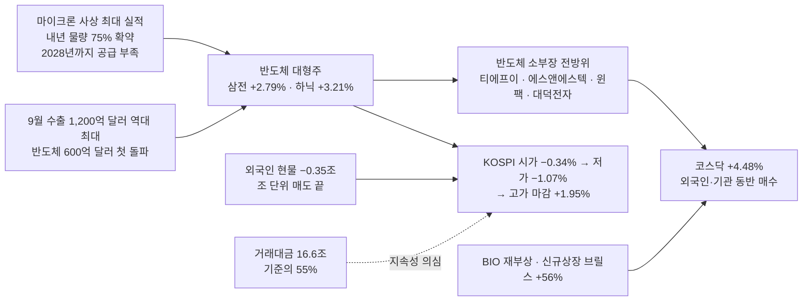

### 🧭 대응 (10/02 국장)

| 영역 | 대응 | 근거 |
|:---|:---|:---|
| **모드** | **보수 7일차 · 해제 후보 1일차** | [F-IMI-리스크-09] 거래대금 미달 ✅(55%) · 악재 다수 ❌(외국인 매도 급감 · 마이크론 · 수출 신기록 — 남은 것은 금리 고점 · 원화 약세) · 하락추세 ❌ = **1/3 → 해제 조건 충족 1일차.** 올라가는 전환은 **2일차 적용** → 10/02 종가가 5일선(6,930) 위면 **10/05부터 해제**, 위치(5·10일선 위)로는 "초강세" [[규칙후보#RC-12. 매매 모드 4단계 — 보수 · 평시 · 강세 · 초강세 (5축 정의) ★ 2026-09-22 개정\|RC-12]] |
| **비중** | 삼전·하닉 **500만** / 그 외 **250만** | 해제 전까지 보수 [[규칙후보#RC-16. 등급별 배정액 차등 + 배정액 내 분할\|RC-16]] |
| **보유** | **당일 청산 · 오버나잇 금지** | **금요일**(RC-03) + **10/02 밤 미국 9월 고용보고서** — 모드와 무관한 공통 예외 |
| 지수 | **첫 지지 = 5일선 6,930 · 10일선 6,900** | 오늘 이 위로 올라섰다 — 내일 지키면 해제 확정 |
| 지수 | 위 : **7,000 라운드 → 120일선 7,158** | ⚠️ **미장 호재 갭으로 이평선·라운드 앞에서 출발하면 반납 주의** — 9/22(120일선) · 9/30(5일선) 두 번 갭 전량 반납 |
| 지수 | 1차 지지는 **6,765~6,795**(오늘 저가 · 60일선 6,776)로 내려왔다 | 오늘 장중 한 번 깨고 회복 |
| 반도체 대형주 | 외국인 매도 급감 + 마이크론 + 수출 신기록 → 방향은 우호 / 단 **자사주 매입 막바지**(기타법인 버팀목 소진 예정) → **장중 수급 확인 주의** | 진입 여부는 사용자 장중 판단(`_시황판단방법.md` §2-4) |
| 테마 | **250만 · 당일 · 대장만** — 반도체 소부장 **2일차**(대장 거래대금 50%↑ 확인) · BIO 재부상 1일차 · 브릴스 1일차 | [[규칙후보#RC-31\|RC-31]] |
| 경계 | **오르는데 거래가 없다**(16.6조, 9/30보다 −11.5%) · 개인 −1.68조 매도로 받은 상승 · 미수금 1.15조(3일 연속 증가) | 금요일 + 고용보고서 앞이라 오후 관망 가능 |

### 📐 지수 위치 — 이평선 사다리 (10/01 종가 기준)

| 선 | 값 | 종가 대비 | 거리 | 역할 |
|:---|---:|---:|:---|:---|
| 100일 | 7,328.1 | +5.12% | `▲▲▲▲▲` | 저항 |
| 120일 | 7,157.9 | +2.68% | `▲▲▲` | 저항 — **9/22 · 9/23 막힌 자리** |
| *라운드* | *7,000* | *+0.41%* | `▲` | 바로 위 |
| **종가 = 고가** | **6,971.35** | — | `◆` | |
| 5일 | 6,930.2 | −0.59% | `▼` | ┐ **오늘 회복 · 첫 지지** |
| 10일 | 6,900.4 | −1.02% | `▼` | ┘ |
| 20일 | 6,854.5 | −1.68% | `▼▼` | |
| 60일 | 6,776.0 | −2.80% | `▼▼▼` | ┐ 1차 지지 |
| *오늘 저가* | *6,765.06* | *−2.96%* | `▼▼▼` | ┘ |
| 45일 | 6,677.0 | −4.22% | `▼▼▼▼` | |
| 224일 | 6,064.0 | −13.02% | `▼▼▼▼▼▼▼▼▼▼▼▼▼` | |

- 장중 : 시가 **6,814.49(−0.34%)** → 저가 **6,765.06(−1.07%)** = 1차 지지(6,783~6,795) **장중 이탈** → 회복 → **고가 6,971.36 = 종가** — 시가 대비 **+2.30% 장대양봉, 고가 마감**
- **5 > 10 > 20 > 60 단기 정배열** — 120·100일선은 아직 위
- 사용자 캡처 원자료 : LC 32.47% · HC −25.72%

### 🔥 트리거

| 층 | 요인 | 이전 → 지금 | 상태 | 신호 |
|:---:|:---|:---|:---|:---:|
| 1 | **AI 자본지출 · 메모리** | 마이크론 시간외 보합 → **국장 반영 강함** | 마이크론 영업이익 +1,097% · **내년 물량 75% 확약 · 2028년까지 수요 > 공급** · **9월 반도체 수출 600억 달러 첫 돌파 · 전체 1,200억 달러 역대 최대** | 🟢 |
| 1 | **외국인** | 현물 −2.26조 → **−0.35조** · 선물 −1.31조 → −0.11조 | **매도 급감**(4일째 매도지만 조 단위 끝) · 코스닥은 매수 전환 | 🟡 |
| 1 | 금리 | 미10년 5.298 · 30년 5.642(2002년 이후 최고) | 고점 유지 — 오늘 국장은 무시했다 | 🔴 |
| 1 | 환율 | 1,351.7 → **1,361.5** | 원화 약세 2일째 | 🟡 |
| 1 | 대미투자 | 알래스카 발표 예고 | **트럼프 직접 발표 — "대형 원전 8기 + 알래스카 LNG 파이프라인 포함"**(러트닉 : 원전 8기 1,200억 달러) / 한미 팩트시트는 아직 "검토" | 🟡 |
| 2 | **반도체 소부장·후공정·기판** | 9/30 기판 이탈 | **전방위 재가동** — 소부장(티에프이 · 에스앤에스텍 · 에스티아이 · 제우스 · 동진쎄미켐) · 후공정(윈팩 2일째 · 드림텍) · 기판(대덕전자 복귀) · 설계(세미파이브) · MLCC(아모텍 · 삼화콘덴서) | 🟢 |
| 2 | **BIO** | 9/30 이탈 | **재부상** — 알지노믹스 · 지투지바이오 · 앱클론 · 삼천당제약 · 올릭스 · 보로노이(재료 분산) | 🟢 |
| 2 | 알래스카 LNG 강관 | 9/30 상한가 2개 | **명단 이탈**(발표 다음 날) — 대신 **철강**(대한제강 +16.82% · "美 에너지 인프라 투자 발표") | 🟡 |
| 2 | 로봇 | 정책 0일차 | **대장 없음** — HT로보틱스 +12.75%(월드클래스 플러스) · 수술로봇(리브스메드 · 고영) · 세나테크놀로지로 분산 | 🟡 |
| 2 | 통신장비·광 · ESS | 2일차 | **명단 이탈** | 🟡 |

### 💰 수급 (억 원)

| 주체 | 코스피 현물 | 코스닥 현물 | 지수선물 | 주식선물 | 달러선물 |
|:---|---:|---:|---:|---:|---:|
| 개인 | **−16,751** | −8,881 | +1,134 | +1,219 | −1,309 |
| **외국인** | **−3,491** | **+3,370** | −1,079 | −2,957 | +4,722 |
| 기관계 | +3,998 | **+5,698** | −209 | +1,526 | −3,413 |
| └ 금융투자 | +1,910 | +3,247 | −3,993 | +632 | −802 |
| └ 투신 | −142 | +1,643 | +3,452 | +1,584 | +23 |
| └ 연기금 | +233 | +731 | +456 | −681 | — |
| 기타법인(역산) | **+16,244** | — | — | — | — |

- 외국인 코스피 현물 **−3.66 → −3.08 → −2.26 → −0.35조** — 4일째 매도지만 **조 단위가 끝났다**. 선물도 −1.31조 → −0.11조
- **코스닥은 외국인 +3,370억 · 기관 +5,698억 동반 매수** → §2-4 "둘 다 매수 = 적극" — 오늘 돈은 코스닥 쪽이었다
- 코스피 상승은 **개인이 −1.68조 팔고 기타법인(자사주 추정)이 +1.62조 받은** 구조 — 9/29 · 9/30과 같다. 자사주 매입이 끝나면 이 받침이 사라진다
- 프로그램 : 차익 −170억 · 비차익 −3,628억 = **−3,798억**(지수가 올랐는데 프로그램은 매도)

### 🧵 주도 테마 (Signal Evening 10/01 — PDF 텍스트)

| 순위 | 테마 | 등급 | 일차 | 대장 · 주도 | 거래대금 |
|:---:|:---|:---:|:---:|:---|:---|
| 1 | **반도체(대형 + 소부장 · 후공정 · 기판 · MLCC)** | A | 마이크론 1일차 | 상한가 없음 → 상승률 : **윈팩 +26.03%**(2일째) > 아모텍 +17.33% > 티에프이 +16.12% > 에스앤에스텍 +15.39% > 드림텍 +14.59% > 에스티아이 +13.91% > 디아이 +13.08%(삼전 검사장비 153억) > 대덕전자 +12.75% > 제주반도체 +12.64% > 세미파이브 +12.48% · 삼전 +2.79% · 하닉 +3.21% | **하닉 3.77조 · 삼전 3.55조** · 삼성전기 9,315억 · 제주반도체 2,678억 · 대덕전자 2,470억 · 삼화콘덴서 1,921억 · 세미파이브 1,869억 · 디아이 1,003억 |
| 2 | **BIO** | B+ | 재부상 | 알지노믹스 +23.28%(유럽 희귀의약품 권고) > 지투지바이오 +23.06% > 앱클론 +20.36% > 삼천당제약 +15.39% > 올릭스 +14.05% > 보로노이 +13.38% > 인제니아 +11.35% | 삼천당제약 858억 · 올릭스 489억 · 인제니아 425억 |
| 3 | **신규상장 · 개별** | B | — | **브릴스 +56.15%**(상장 첫날 · 6,230억) · 덕우전자 상(46시리즈 배터리 부품 4,000억 수주) · 대한제강 +16.82%(美 에너지 인프라 → 철강) · 리브스메드 +19.74% · 고영 +10.02%(수술로봇) · 코스모로보틱스 +15.03% · HT로보틱스 +12.75% · 한국화장품제조 +12.64%(유커) | 브릴스 6,230억 · 코스모로보틱스 2,278억 · 고영 1,045억 · HT로보틱스 1,004억 |

- 대장 판정 [[규칙후보#RC-25. 테마 대장 판정 순서 — 상한가 > 먼저 들어간 순 > 상승률 > 거래대금 (사용자 정의, 2026-09-16)\|RC-25]] : 반도체에 상한가가 없다 → **상승률 1위 윈팩(330억, 가볍다) · 거래대금은 하닉·삼전**. 진대장은 대형주, 당일 대장은 후공정 윈팩
- ⚠️ 반도체는 **기판(9/29) → 후공정·광(9/30) → 전방위(10/01)**로 사흘째 옮겨 다니며 이어졌다. 오늘은 **마이크론 + 수출 신기록이라는 새 재료**가 붙어 1일차로 다시 센다(RC-31 리셋)
- 밀려난 것 : **알래스카 LNG 강관**(발표 다음 날 — 예측 ✅) · 통신장비·광 · ESS(2일차 탈락)

### ✅ 직전 명제 채점

**0930A 국장마감후 명제**

| # | 명제 | 결과 | 채점 |
|:---:|:---|:---|:---:|
| 1 | 10/01 저가가 1차 지지(6,783) 위 | 저가 **6,765.06** — 장중 −0.27% 이탈 후 회복 | ❌(종가는 ✅) |
| 2 | 외국인 현물 1조 미만 순매도 또는 순매수(확신도 최하) | **−3,491억** | ✅ |
| 3 | 알래스카 LNG 1일차 대장권 거래대금이 0일차의 50% 미만 | 강관 **명단 이탈** · 거래대금 미확인 | ❓ |
| 4 | 코스피 거래대금 20조 회복 | **16.6조** | ❌ |

**1001 미장마감후 명제**

| # | 명제 | 결과 | 채점 |
|:---:|:---|:---|:---:|
| 1 | 종가 1차 지지(6,783) 위 | **6,971.35** | ✅ |
| 2 | 외국인 현물 조 단위 4일째 | −3,491억 | ❌ |
| 3 | 반도체 대형주 ≤ 코스피 | 삼전 +2.79% · 하닉 +3.21% > +1.95% | ❌ |
| 4 | 미10년 5.3 돌파(ISM 뒤) | 오늘 밤 | ⏳ |

- **0930 미장 명제 ③ "마이크론 → 10/01 삼전·하닉 시초 상승"** : 종가는 +2.8~3.2% ✅ · 시초는 데이터 없음(코스피 시초 −0.34%라 시초 상승은 아니었을 가능성) → **△**

> [!caution] 총평 — 확인 가능한 7개 중 2.5개
> **외국인 예측이 또 엇갈렸다.** 0930A(확신도 최하로 "1조 미만")는 맞았고, 1001 미장(방향을 바꿔 "조 단위 지속")은 틀렸다 — **외국인 현물은 방향을 고르지 말고 계속 최하 확신도로 둔다.**
> **반도체 대형주 약세 예측도 틀렸다** — 마이크론 시간외 보합을 국장도 무시할 거라 봤지만, **9월 수출 신기록(09:00)**이 겹쳐 대형주가 코스피보다 강했다.

> [!example] 📊 예측 채점 → [[예측대조_2026#2026-10-01 (목)|원장 10/01]]
> - **A : 4/7 적중**(시초 · 코스닥 > 코스피 · 모드 · 거래대금 ✅ / 종가 위치 · 외국인 · 반도체 대형주 ❌) — 확신도 **상 2/2 · 중 2/3 · 하 0/2**
> - **B : 1위 로봇 △(분산, 대장 없음) · 2위 통신장비·광 ❌ · 3위 ESS △** / 밀려날 것 : 강관 ✅ · **반도체 대형주 ❌(오히려 1위) · BIO ❌(2위로 복귀)**
> - 가장 크게 틀린 것 : **반도체를 "밀려날 것"으로 본 것** — 오늘 1위 테마였다

### 📋 볼 것

> [!todo] 오늘 밤 (10/02 아침 채점)
> - [ ] **미 9월 ISM 제조업** → 미10년 5.3 돌파 여부(1001 명제 4)
> - [ ] 마이크론 **정규장** 반응 — 국장이 먼저 반영한 방향을 미장이 확인하는가
> - [ ] 필라가 나스닥을 앞서는가
> - [ ] 알래스카 · 원전 8기 — 한미 팩트시트 "검토" → 확정 여부
> - [ ] 10/02(금) 밤 미국 9월 고용보고서 앞 금리 · 달러

> [!todo] 10/02 국장
> - [ ] **5일선 6,930을 종가로 지키는가** — 지키면 **보수 해제 확정(10/05부터)**
> - [ ] 시초가 7,000 · 120일선 앞 **갭 출발이면 반납 여부** — 세 번째 시험
> - [ ] **외국인 현물 순매수 전환인가** · 기타법인(자사주) 매수 규모가 줄어드는가
> - [ ] **반도체 소부장 2일차** — 대장권(윈팩 330억 · 대덕전자 2,470억 · 세미파이브 1,869억) 거래대금 50%↑인가
> - [ ] **코스피 거래대금 20조 회복** — 상승의 지속성
> - [ ] BIO 재부상 2일차 · 브릴스 1일차

### ❓ 검증 대상 명제 (다음 시황에서 채점)

| # | 명제 | 기준 | 채점 |
|:---:|:---|:---|:---:|
| 1 | 10/02 코스피 **종가가 5일선 위** → 보수 해제 확정 | 5일선(10/02 값) | ⬜ |
| 2 | **반도체 소부장 2일차 대장권 거래대금이 1일차의 50% 이상** | 대덕전자 2,470억 · 세미파이브 1,869억의 50% | ⬜ |
| 3 | 외국인 코스피 현물 **순매수 전환** — 확신도 최하(방향 고르지 않기) | 0 | ⬜ |
| 4 | 코스피 거래대금 **20조 회복** | 20조(HTS) | ⬜ |

> [!missing] 못 판정한 것
> - **기타법인 +1.62조** — 표에 없어 합계 0으로 역산했다. 자사주인지는 추정
> - **삼전·하닉 시초** — 종가(이브닝)만 있다. 0930 명제 ③의 "시초 상승"은 △로 둠
> - **9월 수출입동향 세부**(이브닝 제목만) — 반도체 600억 달러 첫 돌파 · 전체 1,200억 달러 역대 최대
> - 알래스카 LNG 강관 · 통신장비 · ESS 실제 등락 — 이브닝 미등장, 약·무 구분 불가
> - 9/30 거래대금 HTS 18.8조 vs 연합 25.1조 불일치 — 이번에도 HTS 기준(16.6조)으로만 판정

### 📝 상세

> [!note]- 1. 반전 — 1차 지지를 깨고 고가로 끝났다
> 1. 시가 6,814.49(−0.34%)는 1차 지지(6,783~6,795) 바로 위 — 미장마감후 예측(약 6,796)과 같다
> 2. 장중 **6,765.06**까지 밀려 1차 지지를 0.3% 깼다 → 회복 → **고가 6,971.36에서 마감**(종가 = 고가)
> 3. 9/22 · 9/30은 "갭상승 → 전량 반납", 10/01은 **"갭하락 → 지지 이탈 → 고가 마감"** — 정반대
> 4. 다만 **거래대금 16.6조(기준 55%, 9/30보다 −11.5%)** — §2-3 "지수가 올라도 거래대금이 기준 미달이면 지속성을 의심" / 상승을 받친 것은 기관 +0.4조 · 기타법인 +1.62조(자사주 추정)이고 **개인은 −1.68조 팔았다**

> [!note]- 2. 시장 폭 — 코스피·코스닥 모두 골고루
> 1. 코스피 상승 542 / 하락 332 + 지수 +1.95% → **② 골고루**
> 2. 코스닥 상승 **1,230** / 하락 423 + 지수 **+4.48%** → **② 골고루(강)** · 코스닥150 +5.79% · 코스닥 선물 +5.90%
> 3. 9/28 이후 처음으로 **양 시장 모두 상승 종목이 더 많은 날** — 쏠림(①·③)에서 확산(②)으로

> [!note]- 3. 반도체 — 새 재료 두 개가 겹쳤다
> 1. **마이크론** : 사상 최대 분기(영업이익 전년 대비 +1,097%) · **"내년 물량 75% 이미 확약"** · 2027 · 2028년에도 수요가 공급을 웃돈다 — 미국 시간외는 보합이었지만 **국장은 강하게 반영**
> 2. **9월 수출** : **반도체 600억 달러 첫 돌파 · 전체 1,200억 달러 역대 최대**(09:00 발표)
> 3. 돈의 길 : 대형주(하닉 3.77조 · 삼전 3.55조) → 소부장(티에프이 · 에스앤에스텍 · 에스티아이 · 제우스 · 동진쎄미켐 · 브이엠) → 후공정(윈팩 · 드림텍 · 한양디지텍 — 삼전 DDR5 모듈 외주) → 기판(대덕전자) · 설계(세미파이브 — 로봇 AI칩 턴키 추가) · MLCC(아모텍 · 삼화콘덴서 · 삼성전기)

> [!note]- 4. 대미투자 — 발표는 나왔고 강관은 빠졌다
> 1. 트럼프가 백악관에서 한국의 대미 투자 계획을 직접 발표 — **"대형 원자력 발전소 8기와 알래스카 LNG 파이프라인도 포함"** · 러트닉 : 원전 8기 1,200억 달러
> 2. 한미 팩트시트에는 아직 "검토" — 확정 여부는 남았다
> 3. 반응 : 9/30 상한가 2개였던 **강관은 명단에서 빠졌다**(발표 다음 날 매도 트리거 ✅) · 대신 **철강**(대한제강 +16.82% · 고려제강 · 동국제강)이 "美 에너지 인프라 투자 발표"로 올랐다

> [!note]- 5. 증시주변 (9/29 기준 — 2거래일 지연)
> | 날짜 | 고객예탁금 | 미수금 | 신용잔고 | 선물예수금 |
> |:---|---:|---:|---:|---:|
> | 9/29 | **107.73조(+3.24조)** | **1.15조(+817억)** | 32.92조(+618억) | 39.29조(−2.36조) |
> | 9/28 | 104.49조(+2.85조) | 1.07조(+1,781억) | 32.86조 | 41.65조 |
> | 9/23 | 101.63조 | 8,881억 | 32.78조 | 41.49조 |
>
> - 예탁금 **3거래일 +6.7조**(101.6 → 107.7조) · 미수금 3일 연속 증가 — 개인 대기자금과 레버리지가 함께 늘었다

> [!note]- 6. 관측 타임라인 (한국시간)
> | 시각 | 관측 |
> |:---|:---|
> | 10/01 05:05 | 마이크론 실적 발표 — 시간외 보합 |
> | 10/01 (새벽) | 야간선물 1,084.85(−0.61%) |
> | 10/01 09:00 | **KOSPI 시가 6,814.49(−0.34%)** · 9월 수출입동향 발표(반도체 600억 달러 첫 돌파) |
> | 10/01 장중 | 저가 6,765.06(−1.07%, 시각 미상) → 반등 |
> | 10/01 15:30 | **KOSPI 6,971.35(+1.95%) = 고가 · KOSDAQ 894.29(+4.48%)** |
> | 10/01 17:45~17:46 | 미니 S&P 보합 · 미니나스닥 +0.33% · 원/달러 1,361.50 |
> | 10/01 (저녁) | Signal Evening(사용자 제공 PDF — 텍스트만) |

> [!info]- 출처 · 형
> **출처**
> - 사용자 제공 : HTS 지수 창(KOSPI 이평선 8종) · 시장 요약표(등락 종목 · 프로그램 · 업종지수 · 선물옵션 · 해외 · 환율·금리 · 상품 · 투자자 · 증시주변 9/29 기준) — 2026-10-01 17:45~17:46
> - **Signal Evening 2026.10.01(목)** — 사용자 제공 PDF(`Downloads`), **텍스트만 추출해 확인**(사용자 지정 · `pdftotext`)
> - [[이벤트캘린더]] : 10/02 밤 미국 9월 고용보고서 · 10/07 삼성전자 3Q 가이던스 · 누리호
>
> **형** : 국장마감후
> - 입력 : HTS 지수 창 · 시장 요약표 · 이브닝 PDF(텍스트)
> - 태그 : `[본인시황 1001A]` · 요인값 → [[요인값변천사_2026#2026-10-01 (국장마감후)]] · 예측 채점 → [[예측대조_2026#2026-10-01 (목)]]

## 2026-10-01 (목) — 미장마감후
#시황/미장마감후 #모드/보수 #요인/금리 #요인/반도체 #요인/대미투자

> [!danger] 🔴 모드 : 보수 6일차 — 마이크론은 숫자로 이겼는데 주가는 보합, 금리는 30년물 신고점
> 마이크론 매출 **542.3억 달러(예상 510.7억)** · 다음 분기 가이던스 **615억(예상 570.2억)** → 시간외 **보합** / 필라 **−0.01%** · 미10년 **5.298(+3.8bp, 5.3 턱밑)** · 30년 **5.642 = 2002년 이후 최고** · 원/달러 **1,356.6(+5.0원)**
> 야간선물 **1,084.85(−0.61%)** → 코스피 시초 약 **6,796 = 1차 지지(6,783~6,795) 바로 위**
> **비중 삼전·하닉 500만 / 그 외 250만 · 당일 청산** · ==시초부터 1차 지지 시험 — 지지 확인 전 매수 금지== · 반도체 대형주 : 외국인 3일 연속 조 단위 + **자사주 매입 막바지(삼전 93.5% · 하닉 71.3%)** → **장중 수급 확인 주의**

### 🎛 한눈에

| 지표 | 값 | 변화 | 신호 | 한 줄 |
|:---|---:|:---|:---:|:---|
| S&P 500 | 7,655.90 | −15.29 (−0.20%) | 🟡 | PCE 둔화로 올랐다가 금리 상승에 되밀림 · 9월 월간 하락 |
| 나스닥 | 26,861.06 | +63.52 (+0.24%) | 🟡 | 3대 지수 중 유일한 상승 · 다우 −0.86% |
| **필라 반도체** | 12,628.6 | −0.6 (**−0.01%**) | 🟡 | 9/29 +1.32% 뒤 보합 — 마이크론 발표(장 마감 후) 전 |
| SOXX · SOXL | 568.64 · 147.56 | +0.21% · +0.38% | 🟡 | |
| QQQ · TQQQ | 739.77 · 78.03 | +0.25% · +0.74% | 🟡 | |
| **마이크론(시간외)** | — | **보합** | 🟡 | **숫자·가이던스 모두 예상 상회인데 무반응** — 마진 가이던스만 소폭 하회 |
| **미 10년** | 5.298 | **+0.038** | 🔴 | **5.3 턱밑** — PCE 둔화에도 상승 |
| 미 20년 · 30년 | 5.685 · **5.642** | +0.040 · **+0.048** | 🔴 | **30년 2002년 이후 최고**(9/30 장중 5.613 넘음) |
| 일본 10년 · 30년 | 3.051 · 4.121 | −0.030 · −0.052 | 🟢 | |
| WTI · 브렌트 | 90.54 · 98.08 | 9/30 새벽 88.93 · 95.66에서 **반등** | 🔴 | WTI 90 재돌파 — 트럼프 "이란 제재 완화 없다" |
| 금 | 4,187.15 | 보합(9/30 새벽 4,208.65) | 🟡 | 9월 월간 하락 · 한국은행 13년 만에 실물 금 매입 |
| 원/달러 | 1,356.64 | **+4.98** | 🔴 | 원화 강세 3일 → 약세 전환 |
| VIX | 16.38 | +2.12% | 🟡 | |
| 미 선물(05:07) | S&P −0.19% · 나스닥100 **+0.24%** | | 🟡 | |
| **야간선물** | **1,084.85** | **−6.65 (−0.61%)** | 🔴 | 코스피 환산 약 **6,796** — 1차 지지 경계 |

> [!info]- 신호등 기준
> 🟢 국장에 우호 · 🟡 중립·경계 · 🔴 역풍. 판정은 **국장 대형주에 미치는 영향** 기준

### 🔗 오늘의 인과

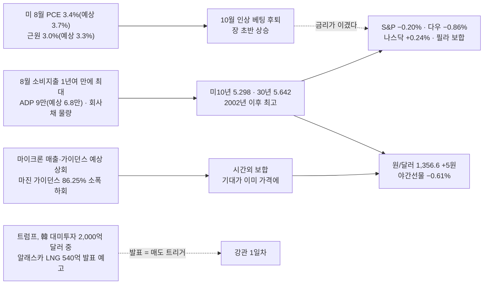

### 📌 오늘 국장 예측 → [[예측대조_2026#2026-10-01 (목)|원장 10/01]]

> [!question] 장전 예측 (05:26) — 장후에 원장에서 채점 · 원장 9/30 교훈 3개 적용
> - **지수** : 시초 약 −0.6%(6,796) **[상]** · 종가 **1차 지지(6,783) 위 · 20일선(6,848) 아래** **[하 — 갭 출발일이라 한 단계 낮춤]** · 코스닥이 코스피보다 강하다 **[중]** · 거래대금 코스피 20조 미달 **[중]** · 모드 보수 유지 **[상]**
> - **주도 테마** : ① 로봇(정부 AI로봇 20만 대 · 특화단지) **[중]** ② 통신장비·광(FCC C밴드 경매 · 코닝 광섬유) **[중]** ③ 이차전지·ESS **[하]** / 밀려날 것 : **알래스카 LNG 강관(발표 다음 날)** · 반도체 대형주
> - **재료 반응** : 로봇 **중** · 통신장비·광 **중**(2일차라 한 칸 낮춤) · ESS **중** · 원전(대미투자 패키지) **중** · 마이크론 → 삼전·하닉 **약** · HBM 소부장 **약** · 알래스카 LNG **약** · 데이터센터 냉각 **약** · 신규상장 브릴스 **중**
> - **외국인 현물** : **조 단위 순매도 지속**(4일째) **[중]** — 9/28~30 세 번 "축소"를 걸었다가 틀렸다. 이번엔 방향을 바꿔서 건다

### 🧭 대응 (10/01 국장)

| 영역 | 대응 | 근거 |
|:---|:---|:---|
| **모드** | **보수 6일차** | [F-IMI-리스크-09] 거래대금 미달 ✅(9/30 코스피 18.8조) · 악재 다수 ✅(30년물 신고점 · 외국인 3일 조 단위 · 원화 약세 전환) · 하락추세 ❌(60일선 위) = 2/3 → 유지 [[규칙후보#RC-12. 매매 모드 4단계 — 보수 · 평시 · 강세 · 초강세 (5축 정의) ★ 2026-09-22 개정\|RC-12]] |
| **비중** | 삼전·하닉 **500만** / 그 외 **250만** | [[규칙후보#RC-16. 등급별 배정액 차등 + 배정액 내 분할\|RC-16]] 보수 · 시드 5,000만 |
| **보유** | **당일 청산** | 보수 ⑤ · **10/02는 금요일**(RC-03) · 미국 9월 고용보고서가 **10/02 밤**(한국시간) |
| 지수 | 시초 약 **6,796** = **1차 지지 6,783~6,795(9/29 저가 · 60일선)에서 바로 시작** | 9/29 · 9/30 두 번 이 위에서 멈췄다 — 세 번째 시험 |
| 지수 | **1차 지지 종가 이탈 → 45일선 6,672까지 공백(−2.4%)** | 이탈하면 보수 유지 + 매수 보류 |
| 지수 | 위 : **20일 6,848 · 10일 6,866**(9/30 이탈한 선 = 저항) → 5일 6,940 | 9/30 값 기준 |
| 반도체 대형주 | **마이크론 무반응 · 자사주 매입 막바지(삼전 93.5% · 하닉 71.3%)** — 9월 기타법인 32조가 외국인·개인 매도를 받았는데 그 버팀목이 곧 끝난다 → **장중 수급 확인 주의** | 진입 여부는 사용자 장중 판단(`_시황판단방법.md` §2-4) |
| 테마 | **250만 · 당일 · 대장만** — 오늘은 **정책 0일차(로봇)** · **2일차(통신장비·광 · ESS)** | 아래 주도 테마 표 |
| 테마 | **알래스카 LNG = 발표 다음 날 → 매도 트리거** [A-IMI-진입-05] | 0930A에서 정한 규칙 그대로 |
| 이벤트 | **09:00 9월 수출입동향**(반도체 수출) · 중국·홍콩 휴장 · 밤 미국 **9월 ISM 제조업** | 수출입동향은 개장과 같은 시각 — 시초 방향에 섞인다 |

### 📐 코스피 사다리 (9/30 종가 기준 · 오늘 시험할 자리)

| 선 | 값 | 9/30 종가 대비 | 거리 | 역할 |
|:---|---:|---:|:---|:---|
| 5일 | 6,939.5 | +1.48% | `▲` | 9/30 시초가 꺾인 곳 |
| 10일 | 6,866.0 | +0.41% | `▲` | ┐ 9/30 이탈 — **저항** |
| 20일 | 6,847.7 | +0.14% | `▲` | ┘ |
| **9/30 종가** | **6,838.04** | — | `◆` | |
| *9/30 저가* | *6,818.39* | *−0.29%* | `▼` | |
| *오늘 시초(예상)* | *약 6,796* | *−0.61%* | `▼` | 야간선물 환산 |
| 60일 | 6,794.6 | −0.64% | `▼` | ┐ **1차 지지** — 시초가 바로 여기 |
| *9/29 저가* | *6,782.99* | *−0.81%* | `▼` | ┘ |
| 45일 | 6,672.2 | −2.43% | `▼▼` | 이탈 시 다음 |

- 클로징 : *"외인과 기관이 같이 팔아대니 코스피는 5일선을 넘지 못했다"* · *"월말·분기말 연기금 리밸런싱 물량까지 나왔다"* · *"월말과 월초는 시장의 변곡점에 대한 힌트를 주는 시기"*

### 🔥 트리거

| 층 | 요인 | 이전 → 지금 | 상태 | 신호 |
|:---:|:---|:---|:---|:---:|
| 1 | **금리** | 미10년 5.240 → **5.298** · 30년 5.573 → **5.642** | **PCE 둔화도 못 눌렀다** — 소비지출 강세 · ADP 9만 · 회사채 물량. 바클레이즈 "30년 6% 가능" | 🔴 |
| 1 | **물가·연준** | — | PCE 3.4%(예상 3.7%) · 근원 3.0%(예상 3.3%) → **10월 인상 확률 후퇴** · 연준 2인자 "인상 당장은 아냐" · 2Q GDP 1.5 → **2.2%** 상향 | 🟢 |
| 1 | 환율 | 1,351.70 → **1,356.64** | 원화 강세 멈춤 | 🔴 |
| 1 | 유가 | WTI 88.93 → **90.54** · 브렌트 95.66 → **98.08** | 트럼프 "이란 제재 완화 없다" → 반등. 브렌트 100 아래는 유지 | 🟡 |
| 1 | **AI 자본지출** | 필라 +1.32% → **−0.01%** | **마이크론 숫자는 강함**(HBM4 매출 10억 달러 돌파 · 12단 램프 HBM3E의 2배 속도) / **반응은 보합** · D램 4분기 최대 +20% · 앤트로픽 10년 구매약정 5,180억 달러 | 🟡 |
| 2 | 반도체 대형주 | 외국인 3일 조 단위 | **자사주 매입 막바지** — 삼전 93.5% · 하닉 71.3% · 9월 외국인 −21.5조 / 하닉 60조↑ 주주환원 10월 중 · 삼전 3Q 가이던스 10/07 | 🔴 |
| 2 | **알래스카 LNG** | 0일차(9/30 상한가 2개) | **발표 예고** — 백악관 "韓 2,000억 달러 중 540억 알래스카 LNG" · 원전 포함 / 산업부 "아직 협의 중" → **발표 다음 날** | 🟡 |
| 2 | **로봇** | — | **0일차 정책** — 국가첨단전략산업위 "2030년 AI로봇 20만 대 · 휴머노이드 생산 20%" · 대구·경북 로봇 특화단지 · 삼성 로봇 로드맵 · 서울AI로봇쇼 10/06 | 🟢 |
| 2 | **통신장비·광** | 9/30 1일차(코닝 광섬유) | **FCC 어퍼 C밴드 경매**(1,000억 달러↑) → KMW +30.3% · 대한광통신 이익 추정 5배 | 🟢 |
| 2 | 이차전지·ESS | 9/30 1일차(전고체 · 태양광) | 글로벌 ESS 1~7월 +36% · **광양만권 이차전지 특화단지 10조** · 클로징 *"바닥을 충분히 다지는 흐름"* | 🟢 |
| 2 | 신규상장 | 덕산넵코어스 0일차 | **오늘 브릴스 상장** | 🟡 |

### 🧵 주도 테마 예측 (9/30 국장 → 10/01 적용)

| 순위 | 테마 | 등급 | 일차 | 9/30 대장·주도 | 오늘 재료 |
|:---:|:---|:---:|:---:|:---|:---|
| 1 | **로봇** | B+ | **0일차** | — (9/29 빅웨이브로보틱스 신규상장) | 정부 AI로봇 20만 대 · 특화단지 · 삼성 로봇 로드맵 · 로봇쇼 10/06 |
| 2 | **통신장비·광** | B | 1~2일차 | 빛샘전자 · 성호전자(CPO) · KMW +30.3% | FCC C밴드 경매 · AT&T-코닝 광섬유 · 대한광통신 실적 |
| 3 | 이차전지·ESS | B | 2일차 | 이수스페셜티케미컬 +17.21% · 한화솔루션 +4.31% | ESS +36% · 광양만권 특화단지 · 클로징 관심 |
| — | 신규상장 | — | 0일차 | 덕산넵코어스 +23.15% | **브릴스** |

- ⚠️ 1위 로봇은 **관련주 35개로 흩어진 정책 재료** — 대장이 안 서면 약으로 끝난다. 상한가가 나오는지로 판정 [[규칙후보#RC-25. 테마 대장 판정 순서 — 상한가 > 먼저 들어간 순 > 상승률 > 거래대금 (사용자 정의, 2026-09-16)\|RC-25]]
- ⚠️ 2·3위는 **2일차** — 대장 거래대금이 1일차의 50% 이상이어야 이어진다 [[규칙후보#RC-31\|RC-31]]
- 밀려날 것 : **알래스카 LNG 강관**(발표 다음 날) · **반도체 대형주**(마이크론 무반응 · 자사주 막바지) · BIO

### ✅ 0930A 국장마감후 "오늘 밤" 채점

| # | 볼 것 | 결과 | 채점 |
|:---:|:---|:---|:---:|
| 1 | 마이크론 실적 — 가이던스 · 마진 · HBM4 비중 | 매출 542.3억(예상 510.7억) · EPS 33.42(31.61) · 마진 87.0%(86.1%) / 가이던스 매출 615억(570.2억) · **마진 86.25%(86.4%) 소폭 하회** · HBM4 10억 달러 돌파 → **숫자 강함 · 주가 보합** | ✅(숫자) · △(반응) |
| 2 | PCE · GDP · ADP → 미10년 5.3 돌파 여부 | PCE 둔화 · GDP 2.2% · ADP 9만 → **미10년 5.298 — 돌파 직전에서 멈춤** | ✅ |
| 3 | 트럼프 알래스카 LNG 韓투자 발표 | 백악관이 **9/30 11:30 ET(한국 10/01 00:30) 발표 예고** · 540억 달러 · 2,000억 달러 패키지(원전 포함) — **실제 발표 내용은 확인 못 함** | ❓ |
| 4 | 필라가 마이크론 반응을 따라가는가 | 필라 정규장(−0.01%)은 **발표 전에 끝났다** → 시간외 마이크론 보합 · 나스닥100 선물 +0.24% | ❓ |

- **0930 미장마감후 명제 ④ "미10년 5.3 돌파 없이 유지"** → **✅ (5.298, 간신히)** / 명제 ③ "마이크론 → 10/01 삼전·하닉 시초 상승" → 가이던스는 HBM 수요를 재확인했지만 **시간외 보합 · 야간선물 −0.61%** → **오늘 시초로 채점**(⏳, 빗나갈 가능성 큼)

### 📋 볼 것

> [!todo] 오늘 국장 (10/01)
> - [ ] **1차 지지 6,783~6,795를 세 번째로 지키는가** — 시초가 바로 여기. 종가 이탈이면 45일선 6,672까지 공백
> - [ ] **09:00 9월 수출입동향** — 반도체 수출이 대형주 하방을 받치는가
> - [ ] **외국인 현물 4일 연속 조 단위인가 · 기타법인(자사주) 매수 규모가 줄어드는가**
> - [ ] 삼전·하닉 시초 — 마이크론 무반응이 그대로 이어지는가(0930 명제 ③)
> - [ ] **로봇 정책 0일차에 상한가 대장이 서는가** · 통신장비·광 · ESS 2일차 대장 거래대금 50%↑인가
> - [ ] 알래스카 LNG 강관 — 발표 다음 날 **시가 대비 밀리는가**
> - [ ] 신규상장 브릴스 · 덕산넵코어스 1일차

> [!todo] 오늘 밤 (10/02 아침 채점)
> - [ ] **미 9월 ISM 제조업** → 미10년 5.3 돌파 여부
> - [ ] 알래스카 LNG 발표 실제 내용 확인(원전 · 한국 기업 이름)
> - [ ] 마이크론 정규장 반응 — 시간외 보합이 정규장에서 어느 쪽으로 가는가
> - [ ] 10/02(금) 밤 미국 9월 고용보고서 전 금리 움직임

### ❓ 검증 대상 명제 (다음 시황에서 채점)

| # | 명제 | 기준 | 채점 |
|:---:|:---|:---|:---:|
| 1 | 10/01 코스피 **종가가 1차 지지 위** | 6,783 | ⬜ |
| 2 | 외국인 코스피 현물 **조 단위 순매도 4일째** | −1조 이하 | ⬜ |
| 3 | 반도체 대형주(삼전·하닉 평균)가 **코스피보다 약하거나 같다** | 등락률 ≤ 코스피 | ⬜ |
| 4 | 미10년 **5.3 돌파**(ISM 뒤) | 10/02 새벽 5.3 이상 | ⬜ |

> [!missing] 못 판정한 것
> - **알래스카 LNG 실제 발표 여부와 내용** — 검색 결과는 "발표 예정" 기사뿐이다(한국 10/01 00:30 예정). 중앙일보 *"서울은 의구심"* · 산업부 *"아직 협의 중"*
> - **마이크론 시간외 최종 등락률** — "보합"까지만 확인. 야간선물 수신 시각과 마이크론 발표(05:05) 선후도 확인 못 함
> - **9/30 코스피 거래대금 불일치** — 0930A는 HTS 기준 **18.8조**, 연합(다이제스트)은 **25.1조** — 기준이 다른지 확인 필요(0930A는 보고 뒤라 고치지 않았다)
> - 삼전·하닉 9/30 종가 — 4일째 입력에 없다

### 📝 상세

> [!note]- 1. 금리 — 좋은 물가도 못 누른 금리
> 1. **8월 PCE 3.4%**(예상 3.7%, 전월 3.7%) · **근원 3.0%**(예상 3.3%, 전월 3.3%) → 10월 인상 베팅 후퇴, 장 초반 S&P 상승
> 2. 그러나 **8월 소비지출이 1년여 만에 가장 많이 늘었고** · ADP 9월 **9만**(예상 6.8만, 8월 3.6만으로 하향) · 2Q GDP **2.2%**(1.5에서 상향) · 회사채 발행 물량 → 30년물 장중 **5.63**, 마감 **5.642 = 2002년 이후 최고**
> 3. 미10년 **5.298** — 0930 명제 ④ "5.3 돌파 없이 유지"는 간신히 맞았다
> 4. 바클레이즈 : *"30년물 6%까지 갈 수 있다"* — 시장은 높은 중립금리를 경기 순환으로 보지만 구조적일 수 있다는 경고
> 5. 다음 : **오늘 밤 ISM 제조업 → 10/02 밤 9월 고용보고서**(한국시간)

> [!note]- 2. 마이크론 — 이겼는데 안 올랐다
> 1. 4분기(회계) 매출 **542.3억 달러**(예상 510.7억) · 조정 EPS **33.42**(31.61) · 조정 마진 **87.0%**(86.1%) · 영업현금흐름 439.7억
> 2. 1분기 가이던스 매출 **615억 ± 15억**(예상 570.2억) · EPS **38.15**(35.40) · **마진 약 86.25%(예상 86.4%) — 유일한 하회**. 회사 설명 : *"가격 상승 속도가 느려져 마진 확대 폭이 줄어든다"*
> 3. HBM4 매출 **10억 달러 돌파** · 12단 램프가 HBM3E의 **2배 속도**
> 4. 시간외 **보합** — 숫자가 예상을 크게 넘었는데도 무반응 = **기대가 이미 가격에 들어 있었다** + **마진 정점 신호**(가격 상승 둔화)
> 5. 국장 연결 : 삼전·하닉은 **자사주 매입 막바지**(취득률 93.5% · 71.3%) — 9월 기타법인 32조가 외국인·개인 34조 매도를 받았다. 백길현(유안타) *"마이크론 실적이 메모리 투심의 촉매"* → 촉매가 무반응이면 **버팀목이 빠지는 시점과 겹친다**

> [!note]- 3. 알래스카 LNG — 발표일 다음 날
> 1. 로이터 : 트럼프 9/30 오후 한국 전략투자기금 활용 계획 발표 가능 — **알래스카 LNG 약 540억 달러** · 블룸버그 : 원전 포함 **약 2,000억 달러**
> 2. 백악관 : *"미국 에너지 · 알래스카 자원 · 원자력 르네상스"* — 알래스카 상원 경합 지역 유세 성격(같은 주 아이오와 제철소 발표)
> 3. 한국 쪽 : 산업부 9/22 국회 보고 — 엔시날은 추진 결정, **원전·알래스카는 협의 중** → 중앙일보 *"서울의 의구심에도"*
> 4. 대응 : 9/30 강관 상한가 2개(동일스틸럭스 · KBI동양철관)는 **발표 전 선반영** → 오늘은 **발표 다음 날 = 매도 트리거** [A-IMI-진입-05]. **원전**이 패키지에 들어가면 원전주가 새 갈래가 될 수 있다(확인 필요)

> [!note]- 4. 국내 재료 — 오늘 볼 줄기
> 1. **로봇** : 국가첨단전략산업위 — 2030년 민관 AI로봇 **20만 대** · 휴머노이드 세계 생산 **20%** · 대구·경북 로봇 · 창원 방산 · 전남 이차전지 특화단지(2042년까지 민간 13조) · 내년 국산 휴머노이드 공공 보급 / 삼성 RX 로봇 로드맵(공장 → 가정) · **서울AI로봇쇼 10/06~08**
> 2. **통신장비** : FCC 어퍼 C밴드 경매(면허 3,248개 · 1,000억 달러↑) → **KMW +30.3%** · 스페이스X CAPEX / **광** : 대한광통신 영업이익 추정 10억 → 57억(광섬유 km당 12~14 → 22달러) · 9/30 AT&T-코닝 계약
> 3. **이차전지·ESS** : 글로벌 ESS 1~7월 210GWh(+36%) · **광양만권 이차전지 특화단지(약 10조, 포스코 7사 3.86조)** · 클로징 *"블루웨이브 모멘텀 · 가격 메리트"*
> 4. **반도체** : D램 4분기 최대 +20% · 파운드리 2분기 +25% · 어플라이드-키옥시아 차세대 메모리 · 리사 수 AMD 방한 10/08 · 하닉 주주환원 10월 중
> 5. **데이터센터 냉각** : 삼성(플랙트 광주 2,400억 · CDU) · LG 수주 경쟁
> 6. 기타 : 中 인프라 161조 집행 → 건설기계(HD건설기계) · 한국은행 실물 금 매입 · 보로노이 경영권 매각 추진 · 현대모비스 램프사업 6,000억 매각 · 해킹 과징금 법 시행(10/01)
> 7. 일정 : **신규상장 브릴스** · 9월 수출입동향 · 중국·홍콩 휴장 · 미 ISM 제조업 · 나이키 실적 · 매드업 보호예수 해제

> [!note]- 5. 관측 타임라인 (한국시간)
> | 시각 | 관측 |
> |:---|:---|
> | 9/30 15:30 | KOSPI 6,838.04(−0.48%) · KOSDAQ 855.91(+0.72%) |
> | 9/30 21:15 · 21:30 | 미 ADP 9만 · **8월 PCE 3.4% · 근원 3.0%** · 2Q GDP 2.2% |
> | 9/30 22:41 | 클로징 14064 "유가 하락에도 무거웠던 시장" |
> | 10/01 00:30(예고) | 트럼프 韓 대미투자 · 알래스카 LNG 발표 — **실제 여부 미확인** |
> | 10/01 05:00 | 미장 마감 — S&P −0.20% · 나스닥 +0.24% · **필라 −0.01%** · 미10년 5.298 · 30년 5.642 — 확정 |
> | 10/01 05:00 | Signal Digest 14066 |
> | 10/01 05:05 | **마이크론 실적 발표**(4:05 PM ET) → 시간외 보합 — 필라 정규장 **이후** = 필라에 미반영 |
> | 10/01 05:07~05:17 | 입력 수집 — 미 선물 · WTI 90.54 · 원/달러 1,356.64 |
> | 10/01 (새벽) | **야간선물 1,084.85(−0.61%)** — 마이크론 발표 반영 여부 미확인 |
> | 10/01 09:00 | 9월 수출입동향 · 국장 개장 — 미반영 |

> [!info]- 출처 · 형
> **출처**
> - 사용자 제공 : 해외 지표표(04:59~05:17) · **야간선물 1,084.85(−6.65, −0.61%)**
> - 시그널리포트 원본 : **클로징 14064**(9/30 22:41) · **다이제스트 14066**(10/01 05:00)
> - 웹 : [Micron Q4 FY2026 보도자료(SEC 8-K)](https://www.sec.gov/Archives/edgar/data/0000723125/000072312526000018/a2026q4ex991-pressrelease.htm) · [24/7 Wall St. 마이크론 실적 라이브](https://247wallst.com/investing/2026/09/30/live-will-micron-smash-q4-earnings-tonight-after-the-market-close/) · [CNBC 9/30 시장](https://www.cnbc.com/2026/09/29/stock-market-today-live-updates.html) · [CNBC 국채 금리](https://www.cnbc.com/2026/09/30/treasury-yields-bonds-selloff.html) · [Bloomberg 10월 인상 베팅 후퇴](https://www.bloomberg.com/news/articles/2026-09-30/traders-pull-back-on-october-fed-hike-bets-after-cool-pce-data) · [Alaska Public — 540억 달러 발표 예고](https://alaskapublic.org/news/politics/washington-d-c/2026-09-30/trump-will-unveil-54-billion-in-south-korean-investment-for-alaska-lng-project) · [중앙일보 — 서울의 의구심](https://www.koreajoongangdaily.com/business/trump-may-tout-potential-54-billion-korean-investment-in-alaska-despite-seouls-doubts/12898872)
> - [[예측대조_2026]] 9/30 장후 총평의 "다음에 바꿀 것" 3개를 오늘 예측에 적용
> - [[이벤트캘린더]] : 마이크론(오늘 첫 반영) · 10/07 삼성전자 3Q 가이던스 · 누리호 · 10/08 리사 수 방한
>
> **형** : 미장마감후
> - 입력 : 해외 지표표 · 야간선물 · 클로징 14064 · 다이제스트 14066 · 웹 검색(마이크론 · PCE · 국채 · 알래스카)
> - 태그 : `[본인시황 1001]` · 요인값 → [[요인값변천사_2026#2026-10-01 (미장마감후)]]
